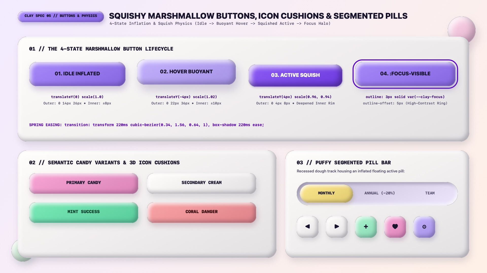

# Claymorphism Design — Squishy Buttons, Icon Cushions & Segmented Pills

Claymorphic buttons behave like **buoyant, compressible marshmallow or soft silicone keycaps**. Unlike Neo-Brutalist buttons (which slide diagonally across a hard `0px`-blur cutout shadow) or Swiss Grid buttons (which invert 1-bit color polarity), a Claymorphic button **inflates and rises on `:hover`** (`translateY(-4px) scale(1.02)`) and **squishes down on `:active`** (`translateY(4px) scale(0.96, 0.94)`), tightening its outer drop shadow while deepening its inner 3D rim shadows.

---

## Button Decision Matrix

| Goal | Tool | Why |
| :--- | :--- | :--- |
| Primary conversion CTA | `.clay-btn--primary` (`background: var(--clay-pink)` or `var(--clay-lilac)`, `border-radius: 26px`, 3-layer clay shadow) | High-buoyancy candy fill + `±8px` inner bevels creates an irresistible tactile button |
| Secondary / neutral action | `.clay-btn--cream` (`background: var(--clay-surface)` Marshmallow White) | Preserves full 3D clay volume while keeping chroma subordinate to the primary CTA |
| Compact toolbar / media icon button | `.clay-btn--icon` (`inline-size: 3.25rem; block-size: 3.25rem; border-radius: 20px`) | Squircle 3D cushion footprint exceeding WCAG `48×48px` touch target guidelines |
| Mutually exclusive view / billing switcher | **Puffy Segmented Pill Bar** (`.clay-segmented`: recessed `.clay-well` outer pill housing an inflated active `.clay-btn` pill) | Contrasts the pressed dough track against the floating 3D active lozenge |
| Keyboard `:focus-visible` indicator | `outline: 3px solid oklch(0.49 0.22 292); outline-offset: 5px;` | Soft inner bevels never count as a WCAG focus indicator; an offset high-contrast ring is mandatory |

---

## Multimodal Visual Reference

Before implementing button states, semantic candy variants, or segmented pill switchers, inspect the buttons specification sheet:

- **Squishy Marshmallow Buttons & Segmented Pills Specification Sheet:** [`./images/claymorphism_buttons.jpg`](./images/claymorphism_buttons.jpg)



### What to Observe in the Reference Sheet
1. **The 4-State Marshmallow Button Lifecycle (`01 // TOP`):**
   - **01. Idle Inflated:** `translateY(0) scale(1.0)` with `0 14px 26px` outer drop shadow and `±8px` inner bevels.
   - **02. Hover Buoyant:** `translateY(-4px) scale(1.02)` with expanded `0 22px 36px` outer drop shadow and `±10px` inner bevels.
   - **03. Active Squish:** `translateY(4px) scale(0.96, 0.94)` with compressed `0 4px 8px` outer shadow and deepened inner rim shade.
   - **04. `:focus-visible`:** High-contrast `3px solid` Electric Iris focus ring at `outline-offset: 5px`.
2. **Semantic Candy Variants (`02 // BOTTOM LEFT`):** Primary Candy (`#F9A8D4`), Secondary Cream (`#FFFDFB`), Mint Success (`#A7F3D0`), and Coral Danger (`#FCA5A5`).
3. **Puffy Segmented Pill Bar & 3D Icon Cushions (`03 // BOTTOM RIGHT`):** A recessed lavender dough track (`inset` shadow) containing an inflated Honey Butter (`#FDE68A`) active pill, plus `52×52px` squircle icon cushions.

---

## Complete Squishy Marshmallow Button CSS

```css
.clay-btn {
  --_bg: var(--clay-lilac);
  --_fg: var(--clay-ink);
  --_drop: oklch(from var(--_bg) calc(l - 0.36) calc(c * 0.95) h / 0.30);
  --_hi: oklch(1 0 0 / 0.86);
  --_lo: oklch(from var(--_bg) calc(l - 0.17) calc(c * 1.2) h / 0.65);

  position: relative;
  display: inline-flex;
  align-items: center;
  justify-content: center;
  gap: 0.6rem;
  min-block-size: 3.375rem; /* 54px generous clay cushion height */
  padding-inline: 1.75rem;
  padding-block: 0.85rem;

  background-color: var(--_bg);
  color: var(--_fg);
  font-family: var(--clay-font-display);
  font-size: 1rem;
  font-weight: 800;
  letter-spacing: 0.03em;
  text-decoration: none;
  white-space: nowrap;

  border-radius: 26px;
  border: 1.5px solid oklch(1 0 0 / 0.55);
  box-shadow:
    0 14px 26px -6px var(--_drop),
    inset 8px 8px 15px 0 var(--_hi),
    inset -8px -8px 15px 0 var(--_lo);

  cursor: pointer;
  user-select: none;
  transition:
    transform var(--clay-duration) var(--clay-ease-spring),
    box-shadow var(--clay-duration) ease,
    background-color 150ms ease;
}

/* 02. HOVER: Buoyant upward float + fuller inflation */
.clay-btn:hover:not(:disabled) {
  transform: translateY(-4px) scale(1.02);
  box-shadow:
    0 22px 36px -8px var(--_drop),
    inset 10px 10px 18px 0 var(--_hi),
    inset -10px -10px 18px 0 var(--_lo);
}

/* 03. ACTIVE: Marshmallow squish compression (wider X or slightly compressed X/Y) */
.clay-btn:active:not(:disabled),
.clay-btn[aria-pressed="true"] {
  transform: translateY(4px) scale(0.96, 0.94);
  box-shadow:
    0 4px 10px -2px var(--_drop),
    inset 6px 6px 12px 0 var(--_hi),
    inset -10px -10px 18px 0 oklch(from var(--_bg) calc(l - 0.22) calc(c * 1.3) h / 0.78);
}

/* 04. FOCUS-VISIBLE: Unmistakable outer halo */
.clay-btn:focus-visible {
  outline: 3px solid oklch(0.49 0.22 292);
  outline-offset: 5px;
}

/* DISABLED: Deflated & muted */
.clay-btn:disabled {
  opacity: 0.55;
  box-shadow:
    inset 4px 4px 8px 0 oklch(1 0 0 / 0.5),
    inset -4px -4px 8px 0 oklch(0 0 0 / 0.12);
  transform: none;
  cursor: not-allowed;
}

/* Candy Variants */
.clay-btn--pink   { --_bg: var(--clay-pink); }
.clay-btn--mint   { --_bg: var(--clay-mint); }
.clay-btn--butter { --_bg: var(--clay-butter); }
.clay-btn--coral  { --_bg: var(--clay-coral); }
.clay-btn--cream  { --_bg: var(--clay-surface); }

/* 3D Squircle Icon Cushion */
.clay-btn--icon {
  inline-size: 3.5rem; /* 56px */
  block-size: 3.5rem;
  padding: 0;
  border-radius: 22px;
  font-size: 1.35rem;
}
```

---

## Puffy Segmented Pill Bar (`.clay-segmented`)

Place segmented options inside a recessed `.clay-well` capsule so the selected option pops out as an inflated 3D clay lozenge:

```html
<div class="clay-segmented" role="group" aria-label="Billing cycle">
  <button type="button" class="clay-segmented__option" aria-pressed="true">MONTHLY</button>
  <button type="button" class="clay-segmented__option" aria-pressed="false">ANNUAL (-20%)</button>
  <button type="button" class="clay-segmented__option" aria-pressed="false">TEAM</button>
</div>
```

```css
.clay-segmented {
  display: inline-flex;
  align-items: center;
  gap: 0.35rem;
  padding: 0.45rem;
  background-color: var(--clay-well-bg);
  border-radius: var(--clay-radius-pill);
  box-shadow:
    inset 6px 6px 12px 0 oklch(from var(--clay-well-bg) calc(l - 0.15) calc(c * 1.1) h / 0.55),
    inset -6px -6px 12px 0 oklch(1 0 0 / 0.85);
}

.clay-segmented__option {
  padding-inline: 1.35rem;
  padding-block: 0.65rem;
  border: none;
  border-radius: var(--clay-radius-pill);
  background: transparent;
  color: var(--clay-ink-muted);
  font-family: var(--clay-font-display);
  font-size: 0.875rem;
  font-weight: 800;
  cursor: pointer;
  transition: transform 200ms var(--clay-ease-spring), box-shadow 200ms ease, background-color 150ms ease;
}

.clay-segmented__option[aria-pressed="true"] {
  --_active-bg: var(--clay-butter);
  background-color: var(--_active-bg);
  color: var(--clay-ink);
  box-shadow:
    0 8px 16px -4px oklch(from var(--_active-bg) calc(l - 0.32) c h / 0.30),
    inset 5px 5px 10px 0 oklch(1 0 0 / 0.88),
    inset -5px -5px 10px 0 oklch(from var(--_active-bg) calc(l - 0.16) calc(c * 1.2) h / 0.62);
}
```

---

## Reduced Motion Safeguard

```css
@media (prefers-reduced-motion: reduce) {
  .clay-btn,
  .clay-btn:hover:not(:disabled),
  .clay-btn:active:not(:disabled) {
    transition: none;
    transform: none;
  }
}
```

---

## Do Not

| BAD | GOOD | Why |
| :--- | :--- | :--- |
| Using linear `transition: all 150ms linear` on clay buttons | Animate explicit properties (`transform`, `box-shadow`) with a bouncy spring curve `cubic-bezier(0.34, 1.56, 0.64, 1)` | Linear transitions make clay buttons feel robotic; a slight spring overshoot creates authentic marshmallow elasticity |
| Scaling a button down to `scale(0.80)` on `:active` | Keep squish subtle: `translateY(4px) scale(0.96, 0.94)` | Extreme scaling shifts text dramatically under the user's pointer and can cause accidental mouseleave jitter |
| Making every button in a toolbar an inflated neon pill right next to each other with `4px` gaps | Wrap grouped buttons in a recessed `.clay-segmented` track OR leave `16px+` gap between standalone buttons | Tightly packed outer drop shadows bleed over neighboring buttons |
