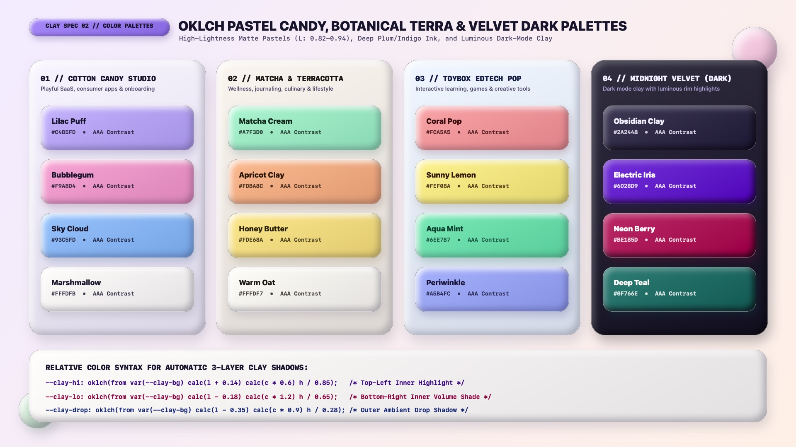

# Claymorphism Design — Color Palettes, OKLCH & Velvet Dark Mode

Claymorphic color systems rely on **high-lightness, medium-chroma matte pastels (`L: 0.80–0.94`, `C: 0.08–0.14`), warm marshmallow creams (`#FFFDFB`), and deep plum-indigo typography (`#1E1B3A`)**. Because 3D clay volume is sculpted by a white top-left inner highlight (`inset 8px 8px 16px`) and a deeper hue-shifted bottom-right inner shade (`inset -8px -8px 16px`), surface lightness must leave headroom at both ends of the luminance spectrum so both the highlight and the underside shade remain clearly visible.

---

## Color & Theming Decision Matrix

| Goal | Tool | Why |
| :--- | :--- | :--- |
| Select optimal lightness `L` for light-mode clay surfaces | `oklch(0.80 to 0.93 C H)` (or `#FFFDFB` Marshmallow Cream with lavender/warm-gray inner shade) | Leaves `7%–20%` luminance headroom for the white top-left inner highlight and deep headroom for the bottom-right inner shade |
| Avoid muddy gray underside shadows on pastel clay | Derive `--_lo` via `oklch(from var(--_bg) calc(l - 0.18) calc(c * 1.2) h / 0.65)` | Boosting chroma (`calc(c * 1.2)`) while lowering lightness produces rich berry, amber, or emerald inner volume instead of dirty gray |
| Guarantee readable text across all pastel clay cards | Deep Plum-Charcoal ink (`#1E1B3A` / `oklch(0.23 0.04 285)`) | Softens the harshness of `#000000` while maintaining `10.5:1` to `16.4:1` WCAG AAA contrast on pastel surfaces |
| Build a playful consumer SaaS or creator app | **Palette 01: Cotton Candy Studio** (Lilac Puff, Bubblegum, Sky Cloud, Marshmallow) | Friendly, buoyant pastel hierarchy with warm lavender canvas harmony |
| Build a wellness, culinary, or lifestyle interface | **Palette 02: Matcha & Terracotta** (Matcha Cream, Apricot Clay, Honey Butter, Warm Oat) | Organic, grounded ceramic and botanical clay tones |
| Implement Dark Mode without losing 3D clay puffiness | **Palette 04: Midnight Velvet Clay** (`#18142C` canvas + `#2A2448` / `#6D28D9` surfaces + translucent white/violet rim highlights) | Pure black (`#000000`) surfaces swallow inner shadows; `L: 0.25–0.48` velvet surfaces let both inner rim light and deep abyssal shade read clearly |

---

## Multimodal Visual Reference

Before choosing surface hues or configuring dark mode, inspect the color palettes specification sheet:

- **Color Palettes & Relative Color Shadow Derivation Sheet:** [`./images/claymorphism_color_palettes.jpg`](./images/claymorphism_color_palettes.jpg)



### What to Observe in the Reference Sheet
1. **Four Curated Archetypes:**
   - **01 Cotton Candy Studio:** Lilac Puff (`#C4B5FD`), Bubblegum (`#F9A8D4`), Sky Cloud (`#93C5FD`), and Marshmallow (`#FFFDFB`).
   - **02 Matcha & Terracotta:** Matcha Cream (`#A7F3D0`), Apricot Clay (`#FDBA8C`), Honey Butter (`#FDE68A`), and Warm Oat (`#FFFDF7`).
   - **03 Toybox EdTech Pop:** Coral Pop (`#FCA5A5`), Sunny Lemon (`#FEF08A`), Aqua Mint (`#6EE7B7`), and Periwinkle (`#A5B4FC`).
   - **04 Midnight Velvet (Dark Mode):** Obsidian Clay (`#2A2448`), Electric Iris (`#6D28D9`), Neon Berry (`#BE185D`), and Deep Teal (`#0F766E`) over a `#18142C` night canvas.
2. **Chromatic Inner Volume:** Notice how Apricot Clay (`#FDBA8C`) uses a warm terracotta inner shade rather than gray, and Bubblegum (`#F9A8D4`) uses a rich rose inner shade.

---

## The 4 Canonical Claymorphic Palettes

### Palette 01: Cotton Candy Studio (Consumer SaaS & Creative Apps)
```css
[data-clay-theme="cotton-candy"] {
  --clay-canvas-bg: linear-gradient(135deg, oklch(0.96 0.025 300), oklch(0.97 0.02 55));
  --clay-surface: oklch(0.99 0.005 85);       /* #FFFDFB Marshmallow White */
  --clay-well-bg: oklch(0.94 0.025 295);      /* #F3EEFF Soft Lavender Well */
  --clay-ink: oklch(0.23 0.04 285);           /* #1E1B3A Deep Plum Ink */

  --clay-accent-1: oklch(0.81 0.11 295);      /* #C4B5FD Lilac Puff */
  --clay-accent-2: oklch(0.82 0.12 345);      /* #F9A8D4 Bubblegum */
  --clay-accent-3: oklch(0.82 0.10 245);      /* #93C5FD Sky Cloud */
}
```

### Palette 02: Matcha & Terracotta (Wellness, Journaling & Lifestyle)
```css
[data-clay-theme="matcha-terracotta"] {
  --clay-canvas-bg: linear-gradient(135deg, oklch(0.96 0.018 80), oklch(0.95 0.022 145));
  --clay-surface: oklch(0.99 0.008 85);       /* #FFFDF7 Warm Oat */
  --clay-well-bg: oklch(0.93 0.02 75);        /* #EFE9DF Ceramic Bisque Well */
  --clay-ink: oklch(0.24 0.025 55);           /* #26211D Espresso Clay Ink */

  --clay-accent-1: oklch(0.88 0.11 162);      /* #A7F3D0 Matcha Cream */
  --clay-accent-2: oklch(0.83 0.11 52);       /* #FDBA8C Apricot Clay */
  --clay-accent-3: oklch(0.91 0.11 92);       /* #FDE68A Honey Butter */
}
```

### Palette 03: Toybox EdTech Pop (Interactive Learning & Games)
```css
[data-clay-theme="toybox-pop"] {
  --clay-canvas-bg: linear-gradient(135deg, oklch(0.96 0.02 240), oklch(0.97 0.02 95));
  --clay-surface: oklch(0.99 0.004 240);      /* #FCFDFF Cloud White */
  --clay-well-bg: oklch(0.93 0.025 245);      /* #E6F0FF Sky Dough Well */
  --clay-ink: oklch(0.24 0.06 260);           /* #172554 Deep Navy Ink */

  --clay-accent-1: oklch(0.79 0.12 22);       /* #FCA5A5 Coral Pop */
  --clay-accent-2: oklch(0.93 0.13 98);       /* #FEF08A Sunny Lemon */
  --clay-accent-3: oklch(0.85 0.13 160);      /* #6EE7B7 Aqua Mint */
  --clay-accent-4: oklch(0.78 0.11 275);      /* #A5B4FC Periwinkle */
}
```

### Palette 04: Midnight Velvet Clay (Dark Mode)
In dark mode, never set clay cards to `#000000`—an inner bottom-right dark shadow cannot darken a surface that is already `L = 0`. Keep dark clay cards at `L: 0.25–0.32` (`#2A2448` Obsidian Clay) or jewel tones (`L: 0.45–0.55`, such as `#6D28D9` Electric Iris), reduce the top-left inner highlight opacity to `0.25–0.35`, and deepen the bottom-right inner shade to `oklch(0.08 0.03 285 / 0.80)`:

```css
[data-clay-theme="midnight-velvet"] {
  color-scheme: dark;
  --clay-canvas-bg: linear-gradient(135deg, oklch(0.17 0.03 285), oklch(0.13 0.025 270));
  --clay-surface: oklch(0.26 0.045 285);      /* #2A2448 Obsidian Velvet Clay */
  --clay-well-bg: oklch(0.19 0.035 285);      /* #1B1632 Recessed Night Well */
  --clay-ink: oklch(0.96 0.015 290);          /* #F5F3FF Crisp Lavender White */

  --clay-accent-1: oklch(0.49 0.22 292);      /* #6D28D9 Electric Iris */
  --clay-accent-2: oklch(0.51 0.20 355);      /* #BE185D Neon Berry */
  --clay-accent-3: oklch(0.52 0.11 192);      /* #0F766E Deep Teal */
}

[data-clay-theme="midnight-velvet"] .clay-surface {
  --_drop: oklch(0.06 0.02 285 / 0.65);
  --_hi: oklch(from var(--_bg) calc(l + 0.22) calc(c * 0.7) h / 0.35);
  --_lo: oklch(0.08 0.03 285 / 0.82);
  border-color: oklch(1 0 0 / 0.14);
}
```

---

## Do Not

| BAD | GOOD | Why |
| :--- | :--- | :--- |
| White text (`#FFFFFF`) on light pastel clay (`#C4B5FD` Lilac, `#A7F3D0` Mint, `#FDE68A` Butter) | Use Deep Plum (`#1E1B3A`) or dark hue-matched ink (`oklch(0.22 0.06 H)`) on all `L > 0.72` pastels | Pastel clay has `L: 0.80–0.93`; white text drops below `1.9:1` contrast and becomes illegible |
| Using `#000000` or `#111111` for dark-mode clay cards | Use `oklch(0.25 0.045 285)` (`#2A2448`) or jewel-toned clay (`#6D28D9`) | `inset -8px -8px 16px` dark volume shadows are completely invisible on a `#000000` surface |
| Using `rgba(255, 255, 255, 0.90)` full-strength white inner highlights in Dark Mode | Lower dark-mode inner highlight opacity to `0.25–0.35` (`oklch(from var(--_bg) calc(l + 0.22) ... / 0.35)`) | Full-opacity white inner shadows on dark purple/slate surfaces create a chalky, milky halo |
| Painting the background canvas the exact same flat hex as the foreground cards | Give the background canvas a soft pastel tint or gentle `135deg` two-tone pastel wash (`#F5F0FF` to `#FFF3EB`) | Contrast between the marshmallow-white/pastel cards and the ambient canvas makes the 3D clay pop |
