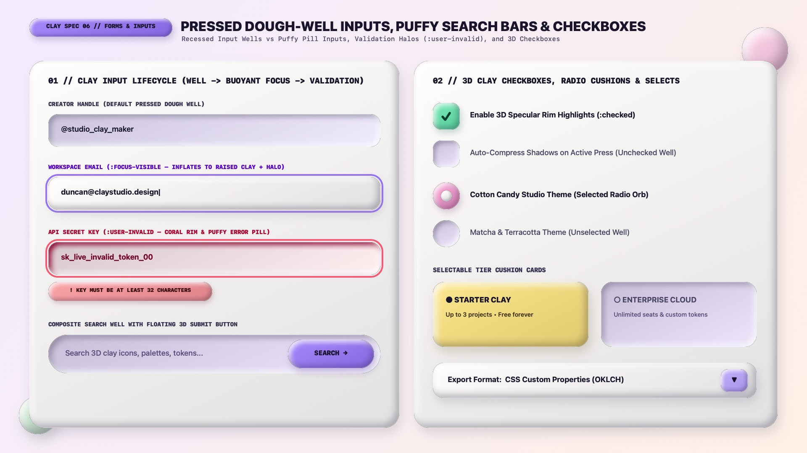

# Claymorphism Design — Forms, Dough-Well Inputs & Selection Controls

Claymorphic forms use **tactile depth inversion** to distinguish where the user types from what the user presses. Text inputs start as **Pressed Dough Wells** (`.clay-input` with top-left dark `inset` shade and bottom-right white `inset` rim) and **inflate into buoyant raised clay surfaces on `:focus-visible`** accompanied by a pastel focus halo. Checkboxes and radio buttons transform from recessed wells when unchecked into puffy 3D candy cushions when `:checked`.

---

## Forms & Inputs Decision Matrix

| Goal | Tool | Why |
| :--- | :--- | :--- |
| Standard text, email, password, or `<textarea>` field | **Pressed Dough Well Input** (`.clay-input` with `inset 6px 6px 14px` top-left shade + `inset -6px -6px 14px` bottom-right rim) | Visually carves a thumb-pressed groove into the card surface, signaling a fillable receptacle |
| Active keyboard focus inside an input | **Focus Inflation Shift:** Flip `box-shadow` from recessed well to raised 3-layer clay + `3px solid var(--clay-lilac)` focus ring | Gives unmistakable physical and chromatic feedback that the field is active |
| Validation error feedback | `:user-invalid` with Coral rim (`#FB7185`), blush well tint (`#FFF1F2`), and a puffy `.clay-error-pill` | Fires only after user interaction (`:user-invalid`) and pairs color with a 3D error lozenge |
| Search bar or newsletter input with submit button | **Composite Search Well** (`.clay-search-well`: recessed capsule well housing an inflated floating `.clay-btn` submit pill) | Nests the raised submit button inside the recessed input track for clear depth polarity |
| Checkboxes & radio controls | `appearance: none` `32px × 32px`controls that flip from **Recessed Well (unchecked)** to **3D Inflated Cushion (`:checked`)** | Reinforces state through both 3D elevation polarity (concave $\rightarrow$ convex) and color |

---

## Multimodal Visual Reference

Before implementing inputs, composite search wells, or custom checkboxes/radios, inspect the forms specification sheet:

- **Forms, Dough-Well Inputs & 3D Checkboxes Specification Sheet:** [`./images/claymorphism_forms_and_inputs.jpg`](./images/claymorphism_forms_and_inputs.jpg)



### What to Observe in the Reference Sheet
1. **Clay Input Lifecycle (`01 // LEFT COLUMN`):**
   - **Default Pressed Dough Well:** Soft lavender-tinted recessed groove (`#F3EEFF`) with top-left inner shade and bottom-right white specular rim.
   - **Focused State (`:focus-visible`):** The field inflates into a Marshmallow White (`#FFFDFB`) raised clay pillow surrounded by a `3px` Lilac focus halo.
   - **Invalid State (`:user-invalid`):** Blush-tinted well (`#FFF1F2`), Coral outline halo (`#FB7185`), and a puffy Coral error pill (`! KEY MUST BE AT LEAST 32 CHARACTERS`).
   - **Composite Search Well:** A deep capsule dough well containing an inflated Lilac `SEARCH →` pill button on the inline-end.
2. **3D Checkboxes, Radio Cushions & Tier Cards (`02 // RIGHT COLUMN`):** Unchecked controls sit recessed as dough wells; `:checked` controls pop outward as 3D Mint/Pink clay cushions with crisp checkmarks or inner 3D pearls.

---

## Dough-Well Input & Focus Inflation CSS

```html
<div class="clay-field">
  <label class="clay-label" for="workspace-email">WORKSPACE EMAIL</label>
  <input
    id="workspace-email"
    class="clay-input"
    type="email"
    placeholder="duncan@claystudio.design"
    required
  />
  <span class="clay-error-pill" role="alert">! PLEASE ENTER A VALID WORKSPACE EMAIL</span>
</div>
```

```css
.clay-field {
  display: flex;
  flex-direction: column;
  gap: 0.55rem;
  margin-block-end: 1.5rem;
}

.clay-label {
  padding-inline-start: 0.5rem;
  font-family: var(--clay-font-display);
  font-size: 0.85rem;
  font-weight: 800;
  letter-spacing: 0.05em;
  text-transform: uppercase;
  color: var(--clay-ink-muted);
}

/* DEFAULT: Pressed Dough Well */
.clay-input,
.clay-textarea {
  --_well: var(--clay-well-bg);
  inline-size: 100%;
  min-block-size: 3.5rem; /* 56px */
  padding-inline: 1.25rem;
  padding-block: 0.85rem;
  background-color: var(--_well);
  color: var(--clay-ink);
  font-family: var(--clay-font-sans);
  font-size: 1.05rem;
  font-weight: 600;
  border-radius: 22px;
  border: 2px solid oklch(1 0 0 / 0.6);
  box-shadow:
    inset 6px 6px 14px 0 oklch(from var(--_well) calc(l - 0.15) calc(c * 1.15) h / 0.58),
    inset -6px -6px 14px 0 oklch(1 0 0 / 0.85);
  transition:
    background-color 180ms ease,
    box-shadow 200ms ease,
    border-color 180ms ease,
    transform 200ms var(--clay-ease-spring);
}

.clay-input::placeholder {
  color: var(--clay-ink-muted);
  opacity: 0.75;
  font-weight: 500;
}

/* FOCUS-VISIBLE: Inflates from recessed well into raised 3D clay + Lilac Halo */
.clay-input:focus-visible,
.clay-textarea:focus-visible {
  outline: 3px solid oklch(0.68 0.16 295);
  outline-offset: 3px;
  background-color: var(--clay-surface);
  transform: translateY(-2px);
  box-shadow:
    0 12px 24px -6px oklch(0.23 0.04 285 / 0.18),
    inset 7px 7px 14px 0 oklch(1 0 0 / 0.90),
    inset -7px -7px 14px 0 oklch(from var(--clay-surface) calc(l - 0.12) 0.04 295 / 0.50);
}

/* VALIDATION (:user-invalid) */
.clay-error-pill {
  display: none;
  align-self: flex-start;
  padding-inline: 1rem;
  padding-block: 0.4rem;
  background-color: var(--clay-coral);
  color: oklch(0.22 0.08 22);
  font-family: var(--clay-font-display);
  font-size: 0.78rem;
  font-weight: 800;
  border-radius: var(--clay-radius-pill);
  box-shadow:
    0 6px 14px -4px oklch(from var(--clay-coral) calc(l - 0.3) c h / 0.35),
    inset 4px 4px 8px 0 oklch(1 0 0 / 0.8),
    inset -4px -4px 8px 0 oklch(from var(--clay-coral) calc(l - 0.18) calc(c * 1.2) h / 0.65);
}

.clay-input:user-invalid {
  --_well: oklch(0.96 0.03 18);
  border-color: oklch(0.70 0.18 20);
}

.clay-input:user-invalid ~ .clay-error-pill {
  display: inline-flex;
}
```

---

## Composite Search Well with Floating 3D Submit Pill

```html
<form class="clay-search-well" role="search">
  <input
    type="search"
    class="clay-search-well__input"
    placeholder="Search 3D clay icons, palettes, tokens..."
    aria-label="Search resources"
  />
  <button type="submit" class="clay-btn clay-search-well__btn">SEARCH →</button>
</form>
```

```css
.clay-search-well {
  display: flex;
  align-items: center;
  gap: 0.5rem;
  padding: 0.45rem 0.45rem 0.45rem 1.35rem;
  background-color: var(--clay-well-bg);
  border-radius: var(--clay-radius-pill);
  box-shadow:
    inset 7px 7px 15px 0 oklch(from var(--clay-well-bg) calc(l - 0.15) calc(c * 1.1) h / 0.60),
    inset -7px -7px 15px 0 oklch(1 0 0 / 0.85);
}

.clay-search-well__input {
  flex: 1;
  min-inline-size: 0;
  border: none;
  background: transparent;
  color: var(--clay-ink);
  font-family: var(--clay-font-sans);
  font-size: 1.05rem;
  font-weight: 600;
}

.clay-search-well__input:focus {
  outline: none;
}

.clay-search-well:focus-within {
  outline: 3px solid oklch(0.68 0.16 295);
  outline-offset: 3px;
}

.clay-search-well__btn {
  min-block-size: 2.85rem;
  padding-inline: 1.35rem;
  padding-block: 0.5rem;
  border-radius: var(--clay-radius-pill);
}
```

---

## 3D Clay Checkboxes & Radio Cushions (`appearance: none`)

Unchecked controls render as recessed dough wells; `:checked` controls inflate into 3D Mint or Pink cushions:

```css
.clay-checkbox,
.clay-radio {
  appearance: none;
  -webkit-appearance: none;
  inline-size: 2rem; /* 32px */
  block-size: 2rem;
  margin: 0;
  display: inline-grid;
  place-content: center;
  background-color: var(--clay-well-bg);
  border-radius: 11px;
  border: 1.5px solid oklch(1 0 0 / 0.6);
  box-shadow:
    inset 4px 4px 8px 0 oklch(from var(--clay-well-bg) calc(l - 0.16) c h / 0.58),
    inset -4px -4px 8px 0 oklch(1 0 0 / 0.85);
  cursor: pointer;
  transition: transform 180ms var(--clay-ease-spring), box-shadow 180ms ease, background-color 150ms ease;
}

.clay-radio {
  border-radius: 50%;
}

/* CHECKED: Flip from recessed well to inflated 3D cushion */
.clay-checkbox:checked {
  --_c: var(--clay-mint);
  background-color: var(--_c);
  transform: scale(1.05);
  box-shadow:
    0 6px 14px -3px oklch(from var(--_c) calc(l - 0.35) c h / 0.35),
    inset 4px 4px 8px 0 oklch(1 0 0 / 0.85),
    inset -4px -4px 8px 0 oklch(from var(--_c) calc(l - 0.18) calc(c * 1.2) h / 0.65);
}

.clay-checkbox::before {
  content: "✓";
  font-family: var(--clay-font-display);
  font-size: 1.1rem;
  font-weight: 900;
  color: oklch(0.22 0.06 160);
  transform: scale(0);
  transition: transform 160ms var(--clay-ease-spring);
}

.clay-checkbox:checked::before {
  transform: scale(1);
}

/* Radio Checked: Pink 3D Cushion + Inner White Pearl */
.clay-radio:checked {
  --_c: var(--clay-pink);
  background-color: var(--_c);
  transform: scale(1.05);
  box-shadow:
    0 6px 14px -3px oklch(from var(--_c) calc(l - 0.35) c h / 0.35),
    inset 4px 4px 8px 0 oklch(1 0 0 / 0.85),
    inset -4px -4px 8px 0 oklch(from var(--_c) calc(l - 0.18) calc(c * 1.2) h / 0.65);
}

.clay-radio::before {
  content: "";
  inline-size: 0.85rem;
  block-size: 0.85rem;
  border-radius: 50%;
  background-color: var(--clay-surface);
  box-shadow:
    0 2px 4px oklch(0 0 0 / 0.2),
    inset 2px 2px 4px oklch(1 0 0 / 0.9),
    inset -2px -2px 4px oklch(0 0 0 / 0.15);
  transform: scale(0);
  transition: transform 160ms var(--clay-ease-spring);
}

.clay-radio:checked::before {
  transform: scale(1);
}
```

---

## Do Not

| BAD | GOOD | Why |
| :--- | :--- | :--- |
| Making text inputs raised 3D clay pillows in their default idle state | Style default text inputs as **Pressed Dough Wells** (`inset` top-left shade + bottom-right rim) | If both inputs and buttons are raised 3D pillows, users cannot tell fillable text boxes apart from clickable buttons |
| Removing `outline` on `:focus-visible` and relying only on an inner shadow tweak | Combine the focus inflation shift with an explicit `outline: 3px solid oklch(0.68 0.16 295)` | Satisfies WCAG 2.2 SC 2.4.11 / 1.4.11 focus visibility requirements |
| Using `:invalid` instead of `:user-invalid` | Always use `:user-invalid` for validation styling | Prevents untouched required fields from glowing red before the user has interacted with the form |
