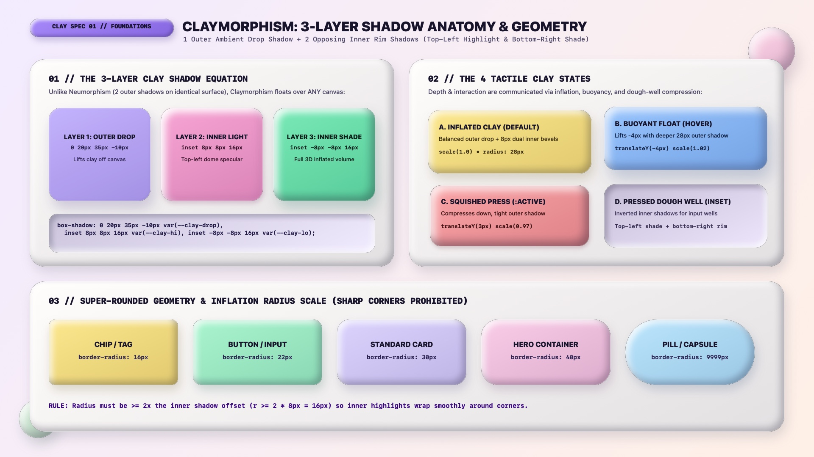

# Claymorphism Design — Foundations, 3-Layer Shadows & Tokens

Claymorphism (coined by Michał Malewicz) creates **tactile, inflated, matte 3D polymer-clay and marshmallow UI surfaces** using pure CSS. While Neumorphism extrudes shapes out of a *monolithic same-color canvas* using two outer shadows, Claymorphism allows **pastel, cream, and candy-colored surfaces to float over any background** by combining **one soft outer ambient drop shadow** with **two opposing inner `inset` rim shadows** (a top-left specular highlight and a thicker bottom-right inner volume shade).

---

## Foundations Decision Matrix

| Goal | Tool | Why |
| :--- | :--- | :--- |
| Inflate a flat container into a 3D clay surface | **3-Layer `box-shadow` Stack** (1 Outer Drop Shadow + Top-Left `inset` Highlight + Bottom-Right `inset` Volume Shade) | The outer shadow lifts the piece off the canvas while the dual opposing `inset` shadows curve the top-left dome toward the light and carve 3D thickness into the bottom-right rim |
| Carve a recessed input well or slider track | **Pressed Dough Well** (Inverted `inset` shadows: top-left dark shade + bottom-right light rim, `0px` outer shadow) | Reverses the $135^\circ$ optical polarity so the surface reads as thumb-pressed into soft clay dough |
| Prevent inner shadows from pinching at corners | Super-rounded `border-radius` (`20px` to `40px`, or `9999px` pills; strictly $r \ge 2 \times \text{inner-offset}$) | Sharp corners (`< 12px`) cause blurred `inset` shadows to form harsh diagonal miters, breaking the inflated balloon/clay illusion |
| Express interactive press feedback | **Squishy Marshmallow Physics** (`transform: translateY(3px) scale(0.97, 0.95)` + tightened outer shadow) | Simulates compressing a soft polymer-clay or marshmallow keycap rather than sliding a rigid plate |
| Derive color-matched inner shadows automatically | CSS Relative Color Syntax `oklch(from var(--clay-bg) ...)` | Tints the bottom-right inner shade with the surface's own hue (`calc(c * 1.2)`) so pastel clay never looks muddy or gray-streaked |

---

## Multimodal Visual Reference

Before writing Claymorphism CSS variables or component classes, inspect the foundational visual specification sheet:

- **Foundations, 3-Layer Shadow Anatomy & Radius Scale:** [`./images/claymorphism_foundations.jpg`](./images/claymorphism_foundations.jpg)



### What to Observe in the Reference Sheet
1. **The 3-Layer Clay Shadow Equation (`01 // TOP LEFT`):**
   - **Layer 1 (Outer Drop):** `0 20px 35px -10px var(--clay-drop)` lifts the clay object above the background canvas.
   - **Layer 2 (Inner Top-Left Light):** `inset 8px 8px 16px 0 var(--clay-hi)` creates the rounded upper-left dome highlight.
   - **Layer 3 (Inner Bottom-Right Shade):** `inset -8px -8px 16px 0 var(--clay-lo)` sculpts the thick lower-right 3D underside.
2. **The 4 Tactile Clay States (`02 // TOP RIGHT`):** Compare **A. Inflated Clay (Default)**, **B. Buoyant Float (Hover)**, **C. Squished Press (`:active`)**, and **D. Pressed Dough Well (`inset` track/input)**.
3. **Super-Rounded Inflation Radius Scale (`03 // BOTTOM`):** From Chips (`16px`) and Buttons (`22px`) to Standard Cards (`30px`), Hero Containers (`40px`), and Pills (`9999px`).

---

## Claymorphism vs. Neumorphism: Crucial Architectural Differences

AI agents frequently confuse Claymorphism with Neumorphism. Keep these 4 structural distinctions strict:

| Dimension | Neumorphism (Soft UI) | Claymorphism (3D Matte Clay) |
| :--- | :--- | :--- |
| **Shadow Stack** | **2 Outer Shadows** (Top-Left Light + Bottom-Right Dark) | **1 Outer Drop Shadow + 2 `inset` Rim Shadows** (Inner Light + Inner Dark) |
| **Background Coupling** | Card background **must equal** parent canvas background (`100%` color lock) | Cards **float freely** over contrasting pastel canvases, gradients, or meshes |
| **Color Chroma** | Low-chroma tinted neutrals (`C: 0.01–0.03`) | Playful matte pastels, creams, and candy hues (`C: 0.06–0.16`) |
| **Corner Radius** | Moderate (`12px`–`24px`) | Generous & inflated (`22px`–`40px`, pills `9999px`) |

---

## Core CSS Custom Properties & Relative Color Token Engine

```css
:root {
  color-scheme: light dark;

  /* 1. Ambient Canvas & Primary Text Ink (Deep Plum-Charcoal, never harsh #000) */
  --clay-canvas-top: light-dark(oklch(0.96 0.025 300), oklch(0.17 0.03 285));
  --clay-canvas-bot: light-dark(oklch(0.97 0.020 55),  oklch(0.14 0.025 270));
  --clay-ink: light-dark(oklch(0.23 0.04 285), oklch(0.96 0.015 290));        /* #1E1B3A / #F5F3FF */
  --clay-ink-muted: light-dark(oklch(0.45 0.04 285), oklch(0.76 0.025 290));  /* #5E5878 */

  /* 2. Default Base Clay Surface (Marshmallow Cream / Obsidian Velvet) */
  --clay-surface: light-dark(oklch(0.99 0.005 85), oklch(0.25 0.04 285));     /* #FFFDFB / #2A2448 */
  --clay-well-bg: light-dark(oklch(0.94 0.025 295), oklch(0.19 0.035 285));   /* #F3EEFF / Recessed Well */

  /* 3. Pastel Candy Surface Palette */
  --clay-lilac: oklch(0.81 0.11 295);      /* #C4B5FD Lilac Puff */
  --clay-pink: oklch(0.82 0.12 345);       /* #F9A8D4 Bubblegum Clay */
  --clay-mint: oklch(0.88 0.11 162);       /* #A7F3D0 Matcha Mint */
  --clay-butter: oklch(0.91 0.11 92);      /* #FDE68A Honey Butter */
  --clay-sky: oklch(0.82 0.10 245);        /* #93C5FD Sky Cloud */
  --clay-coral: oklch(0.79 0.12 22);       /* #FCA5A5 Coral Pop */

  /* 4. Inflated Radius Scale (Always >= 2x inner shadow offset) */
  --clay-radius-sm: 16px;
  --clay-radius-md: 24px;
  --clay-radius-lg: 32px;
  --clay-radius-xl: 40px;
  --clay-radius-pill: 9999px;

  /* 5. Squishy Spring Easing */
  --clay-ease-spring: cubic-bezier(0.34, 1.56, 0.64, 1);
  --clay-duration: 220ms;
}
```

---

## Reusable `.clay-surface` & `.clay-well` Primitives

By binding `--_bg` on any component and deriving `--_drop`, `--_hi`, and `--_lo` via CSS Relative Color Syntax (`oklch(from var(--_bg) ...)`), every pastel card or button automatically computes its own hue-matched 3D inner volume shadows:

```css
.clay-surface {
  --_bg: var(--clay-surface);

  /* Layer 1: Hue-tinted outer ambient drop shadow */
  --_drop: oklch(from var(--_bg) calc(l - 0.36) calc(c * 0.9) h / 0.26);
  /* Layer 2: Top-left specular inner dome highlight */
  --_hi: oklch(from var(--_bg) calc(l + 0.14) calc(c * 0.5) h / 0.85);
  /* Layer 3: Bottom-right chromatic inner volume shade */
  --_lo: oklch(from var(--_bg) calc(l - 0.16) calc(c * 1.2) h / 0.62);

  background-color: var(--_bg);
  color: var(--clay-ink);
  border-radius: var(--clay-radius-lg);
  border: 1.5px solid oklch(1 0 0 / 0.45);
  box-shadow:
    0 20px 35px -10px var(--_drop),
    inset 8px 8px 16px 0 var(--_hi),
    inset -8px -8px 16px 0 var(--_lo);
}

/* Recessed "Pressed Dough Well" for Inputs, Slider Tracks & Callout Wells */
.clay-well {
  --_well: var(--clay-well-bg);
  --_well-shade: oklch(from var(--_well) calc(l - 0.16) calc(c * 1.15) h / 0.58);
  --_well-rim: oklch(1 0 0 / 0.80);

  background-color: var(--_well);
  color: var(--clay-ink);
  border-radius: var(--clay-radius-md);
  border: 1px solid oklch(1 0 0 / 0.55);
  box-shadow:
    inset 6px 6px 14px 0 var(--_well-shade),
    inset -6px -6px 14px 0 var(--_well-rim);
}
```

---

## Do Not

| BAD | GOOD | Why |
| :--- | :--- | :--- |
| Using only an outer `box-shadow` without `inset` highlights and shades | Always combine 1 outer drop shadow with 2 opposing `inset` shadows (`+8px +8px` light, `-8px -8px` dark) | Without the dual inner rim shadows, the element is just a flat Material Design card—not 3D clay |
| Using `rgba(0, 0, 0, 0.4)` pure black for the bottom-right `inset` shadow on pastel pink/yellow/mint clay | Use a darker, slightly higher-chroma shade of the surface's own hue (`oklch(from var(--_bg) calc(l - 0.16) calc(c * 1.2) h / 0.62)`) | Pure black inner shadows turn pastel pink, yellow, and mint surfaces muddy and bruised-looking |
| Setting `border-radius: 4px` or `8px` on clay containers | Use `border-radius: 22px` to `40px` (or `9999px` pills), ensuring `radius >= 2 * inner-offset` | Small corner radii cause `8px`–`12px` inner shadows to pinch into sharp diagonal creases |
| Applying negative spread (`inset -8px -8px 16px -6px`) that chokes the inner bevel | Keep `inset` spread at `0px` (`inset -8px -8px 16px 0px`) and use `-8px` to `-12px` negative spread only on the **outer** drop shadow | Negative spread on the outer shadow keeps the ambient footprint tight; zero spread on inner shadows wraps the 3D rim smoothly |
