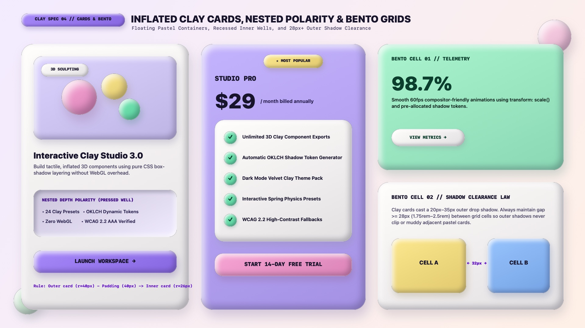

# Claymorphism Design — Layout, Inflated Cards & Bento Grids

Claymorphic layouts arrange **inflated marshmallow and pastel clay containers** across a breathable, soft-tinted canvas. Because every clay card casts an external ambient drop shadow (`0 20px 35px -10px`) AND curves inward along a `10px`–`16px` inner bevel rim, Claymorphic cards require **generous internal padding (`clamp(1.75rem, 3vw, 2.5rem)`)**, **concentric nested radii**, and **alternating depth polarity** when nesting components inside a card.

---

## Layout & Cards Decision Matrix

| Goal | Tool | Why |
| :--- | :--- | :--- |
| Keep text and child elements clear of the curved inner bevel | Minimum card padding `padding: clamp(1.75rem, 3vw, 2.5rem)` (`28px`–`40px`) | The outer `12px`–`16px` perimeter of a clay card is visually curved by the `inset` highlight and shade; text placed too close to the edge sits inside the shadow gradient |
| Nest a secondary container inside an inflated clay card | **Nested Depth Polarity** (Inflated Outer Card $\rightarrow$ Pressed Dough Well `.clay-well` OR contrasting white `.clay-surface` pod) | Stacking multiple same-color inflated cards directly inside each other looks bloated; alternating between raised clay and a recessed dough well creates clear tactile hierarchy |
| Calculate harmonious inner card `border-radius` | **Concentric Radius Formula:** $R_{\text{inner}} = \max(16\text{px}, R_{\text{outer}} - \text{Padding})$ | Prevents awkward uneven pinch points between the outer card's rounded corner and the inner pod's corner |
| Space cards in a Bento or feature grid | Minimum grid gutter `gap: clamp(1.75rem, 3vw, 2.5rem)` (`28px`–`40px`) | Gives the `20px`–`35px` outer drop shadow room to dissipate without bleeding over neighboring pastel cards |

---

## Multimodal Visual Reference

Before building product cards, pricing tiers, or Bento grids, inspect the cards and layout specification sheet:

- **Cards, Nested Polarity & Bento Layout Specification Sheet:** [`./images/claymorphism_cards_and_layout.jpg`](./images/claymorphism_cards_and_layout.jpg)



### What to Observe in the Reference Sheet
1. **Interactive Product Card (`LEFT`):** An outer Marshmallow White card (`border-radius: 40px`, `padding: 40px`) containing:
   - A raised Lilac 3D hero stage (`border-radius: 30px`) populated with floating 3D clay spheres and a mini pill tag.
   - A **Recessed Dough Well** (`inset` top-left shade + bottom-right highlight) for technical bullet specs.
   - A full-width inflated Lilac CTA button at the bottom.
2. **Featured Candy Pricing Card (`CENTER`):** A full-pastel Lilac card (`#C4B5FD`) with a floating Honey Butter badge (`★ MOST POPULAR`), oversized price lockup (`$29`), an elevated Marshmallow White feature checklist container with 3D Mint checkmark orbs (`✓`), and a Bubblegum Pink trial button.
3. **Bento Grid & Shadow Clearance (`RIGHT`):** Demonstrates `32px` (`2rem`) grid gutters so `20px`–`35px` ambient drop shadows never dirty adjacent pastel cells.

---

## Canonical Clay Card Anatomy & Nested Polarity

```html
<article class="clay-card">
  <div class="clay-card__stage">
    <span class="clay-badge clay-badge--cream">3D SCULPTING</span>
    <div class="clay-orb" aria-hidden="true">✦</div>
  </div>

  <h3 class="clay-card__title">Interactive Clay Studio 3.0</h3>
  <p class="clay-card__desc">
    Build tactile, inflated 3D components using pure CSS box-shadow layering without WebGL overhead.
  </p>

  <!-- Recessed Dough Well for secondary metadata -->
  <div class="clay-well clay-card__specs">
    <span>• 24 Clay Presets</span>
    <span>• OKLCH Dynamic Tokens</span>
    <span>• Zero WebGL</span>
    <span>• WCAG 2.2 AAA Verified</span>
  </div>

  <button type="button" class="clay-btn clay-btn--lilac">
    LAUNCH WORKSPACE →
  </button>
</article>
```

```css
.clay-card {
  --_bg: var(--clay-surface);
  --_radius: var(--clay-radius-xl); /* 40px */
  --_pad: clamp(1.75rem, 3vw, 2.5rem);

  display: flex;
  flex-direction: column;
  gap: 1.25rem;
  padding: var(--_pad);
  background-color: var(--_bg);
  color: var(--clay-ink);
  border-radius: var(--_radius);
  border: 1.5px solid oklch(1 0 0 / 0.5);
  box-shadow:
    0 24px 42px -12px oklch(from var(--_bg) calc(l - 0.38) calc(c * 0.9) h / 0.25),
    inset 10px 10px 20px 0 oklch(1 0 0 / 0.88),
    inset -10px -10px 20px 0 oklch(from var(--_bg) calc(l - 0.14) calc(c * 1.15) h / 0.55);
}

/* Inner 3D Hero Stage */
.clay-card__stage {
  --_stage-bg: var(--clay-lilac);
  position: relative;
  min-block-size: 13rem;
  padding: 1.5rem;
  display: grid;
  place-items: center;
  background-color: var(--_stage-bg);
  border-radius: 28px;
  box-shadow:
    0 12px 24px -8px oklch(from var(--_stage-bg) calc(l - 0.32) c h / 0.28),
    inset 8px 8px 16px 0 oklch(1 0 0 / 0.80),
    inset -8px -8px 16px 0 oklch(from var(--_stage-bg) calc(l - 0.16) calc(c * 1.2) h / 0.62);
}

.clay-card__specs {
  display: grid;
  grid-template-columns: repeat(2, minmax(0, 1fr));
  gap: 0.5rem 1rem;
  padding: 1.25rem;
  font-size: 0.925rem;
  font-weight: 600;
}
```

---

## Inflated Bento Grid Layout

```css
.clay-bento {
  display: grid;
  grid-template-columns: repeat(12, minmax(0, 1fr));
  /* Minimum 28px-40px gap prevents outer drop shadows from colliding */
  gap: clamp(1.75rem, 3vw, 2.5rem);
  max-inline-size: 82rem;
  margin-inline: auto;
  padding: clamp(1.5rem, 4vw, 3rem);
}

.clay-bento__cell--span-4 { grid-column: span 4; }
.clay-bento__cell--span-6 { grid-column: span 6; }
.clay-bento__cell--span-8 { grid-column: span 8; }

@media (max-width: 60rem) {
  .clay-bento__cell--span-4,
  .clay-bento__cell--span-6,
  .clay-bento__cell--span-8 {
    grid-column: 1 / -1;
  }
}
```

---

## Do Not

| BAD | GOOD | Why |
| :--- | :--- | :--- |
| Using tight `padding: 12px` inside a clay card with `inset 10px 10px 20px` shadows | Use `padding: clamp(1.75rem, 3vw, 2.5rem)` (`28px`–`40px`) | With only `12px` padding, text and buttons sit right on top of the curved inner bevel shadow |
| Using `overflow: hidden` on a grid wrapper without padding | Add `padding: 2.5rem` to scroll/carousel wrappers or avoid `overflow: hidden` on the outer grid | `overflow: hidden` slices off the `24px`–`42px` outer ambient drop shadow along the edges of the grid |
| Giving an inner child card a larger `border-radius` (`40px`) than its parent card (`28px`) | Follow the concentric radius rule: `R_inner < R_outer` (e.g., outer `40px`, inner `26px`–`30px`) | Mismatched corner curves create awkward pinched gaps in the corners |
| Nesting 4+ levels of inflated raised clay cards inside one another | Limit depth to 2 raised levels (Outer Card $\rightarrow$ Inner Pod or Recessed `.clay-well`) | Excessive stacked clay layers look like a pile of pillows and obscure information hierarchy |
