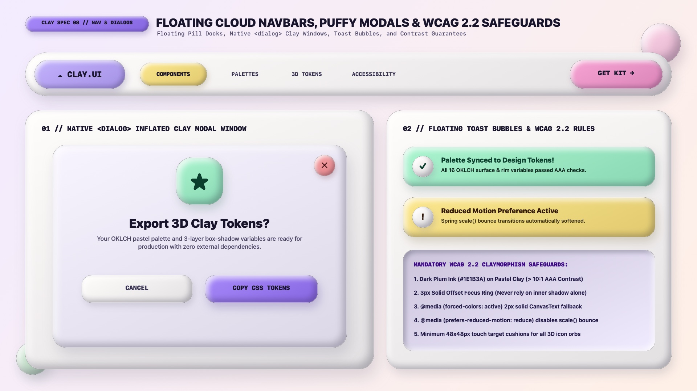

# Claymorphism Design — Floating Cloud Navbars, `<dialog>` Modals & Accessibility

Claymorphic navigation and overlays replace full-bleed edge-to-edge chrome with **buoyant floating cloud docks, puffy pill navbars, native `<dialog>` 3D clay windows, and floating candy toast bubbles**. Because Claymorphism relies on soft pastel hues and rounded inner bevels without hard black borders, **strict adherence to the 5 WCAG 2.2 Claymorphism Safeguards** is required so interfaces remain legible, keyboard-navigable, and resilient in high-contrast assistive modes.

---

## Navigation, Modals & Accessibility Decision Matrix

| Goal | Tool | Why |
| :--- | :--- | :--- |
| Primary site header / navigation bar | **Floating Cloud Pill Navbar** (`.clay-navbar` with `border-radius: 9999px`, `margin: 1.25rem auto`, and inflated active link pills) | Detaches the navbar from viewport edges so it floats like a 3D marshmallow cloud dock |
| Modal confirmation or onboarding dialog | Native `<dialog class="clay-dialog">` (`border-radius: 40px`, 3D icon medallion, frosted pastel `::backdrop`) | Native `.showModal()` traps focus, handles `Esc`, and pairs naturally with a buoyant `@starting-style` entrance |
| Non-blocking status notifications | **Floating Clay Toast Bubble** (`.clay-toast` with 3D spherical icon orb + pastel candy body) | Delivers high-visibility alerts with friendly, non-alarming tactile warmth |
| Guarantee WCAG 2.2 focus & high-contrast compliance | `3px solid` offset `:focus-visible` ring + `@media (forced-colors: active)` `2px solid CanvasText` fallback | Ensures keyboard users and Windows Contrast Theme users never lose structural boundaries when `box-shadow` is stripped |

---

## Multimodal Visual Reference

Before building floating cloud navbars, `<dialog>` modals, or toast stacks, inspect the navigation and dialogs specification sheet:

- **Floating Cloud Navbars, Puffy Modals & WCAG 2.2 Specification Sheet:** [`./images/claymorphism_navigation_and_dialogs.jpg`](./images/claymorphism_navigation_and_dialogs.jpg)



### What to Observe in the Reference Sheet
1. **Floating Cloud Pill Navbar (`TOP`):** A full-width capsule dock (`border-radius: 60px`) in Marshmallow White (`#FFFDFB`) containing an inflated Lilac brand pill (`☁ CLAY.UI`), an inflated Honey Butter active link pill (`COMPONENTS`), and a Bubblegum CTA pill (`GET KIT →`) on the inline-end.
2. **Native `<dialog>` Inflated Clay Modal (`01 // BOTTOM LEFT`):** A `40px`-radius floating clay window featuring a top-right Coral 3D close orb (`✕`), a centered `130×130px` Mint 3D star squircle medallion (`★`), centered heading/body copy, and dual Marshmallow/Lilac action buttons.
3. **Floating Toast Bubbles & WCAG 2.2 Checklist (`02 // BOTTOM RIGHT`):** Mint Success and Honey Butter Warning toast capsules with 3D spherical status orbs (`✓`, `!`), plus the 5 mandatory WCAG 2.2 Claymorphism safeguards.

---

## Floating Cloud Pill Navbar (`.clay-navbar`)

```html
<header class="clay-navbar">
  <a href="/" class="clay-navbar__brand">☁ CLAY.UI</a>

  <nav class="clay-navbar__nav" aria-label="Primary">
    <a href="#components" class="clay-navbar__link" aria-current="page">COMPONENTS</a>
    <a href="#palettes" class="clay-navbar__link">PALETTES</a>
    <a href="#tokens" class="clay-navbar__link">3D TOKENS</a>
    <a href="#a11y" class="clay-navbar__link">ACCESSIBILITY</a>
  </nav>

  <a href="#get-kit" class="clay-btn clay-btn--pink clay-navbar__cta">GET KIT →</a>
</header>
```

```css
.clay-navbar {
  display: flex;
  align-items: center;
  justify-content: space-between;
  gap: 1rem;
  max-inline-size: 80rem;
  margin-inline: auto;
  margin-block: 1.25rem 2.5rem;
  padding: 0.65rem 0.85rem;

  background-color: var(--clay-surface);
  border-radius: var(--clay-radius-pill);
  border: 1.5px solid oklch(1 0 0 / 0.55);
  box-shadow:
    0 20px 38px -10px oklch(0.23 0.04 285 / 0.18),
    inset 8px 8px 16px 0 oklch(1 0 0 / 0.90),
    inset -8px -8px 16px 0 oklch(from var(--clay-surface) calc(l - 0.12) 0.03 295 / 0.50);
}

.clay-navbar__brand {
  padding-inline: 1.5rem;
  padding-block: 0.75rem;
  background-color: var(--clay-lilac);
  color: var(--clay-ink);
  font-family: var(--clay-font-display);
  font-size: 1.15rem;
  font-weight: 800;
  text-decoration: none;
  border-radius: var(--clay-radius-pill);
  box-shadow:
    0 8px 16px -4px oklch(from var(--clay-lilac) calc(l - 0.32) c h / 0.30),
    inset 5px 5px 10px 0 oklch(1 0 0 / 0.85),
    inset -5px -5px 10px 0 oklch(from var(--clay-lilac) calc(l - 0.16) calc(c * 1.2) h / 0.62);
}

.clay-navbar__nav {
  display: flex;
  align-items: center;
  gap: 0.35rem;
  flex-wrap: wrap;
}

.clay-navbar__link {
  padding-inline: 1.15rem;
  padding-block: 0.6rem;
  color: var(--clay-ink-muted);
  font-family: var(--clay-font-display);
  font-size: 0.875rem;
  font-weight: 800;
  text-decoration: none;
  border-radius: var(--clay-radius-pill);
  transition: transform 180ms var(--clay-ease-spring), background-color 150ms ease;
}

.clay-navbar__link[aria-current="page"],
.clay-navbar__link:hover {
  --_nav-bg: var(--clay-butter);
  background-color: var(--_nav-bg);
  color: var(--clay-ink);
  box-shadow:
    0 6px 14px -4px oklch(from var(--_nav-bg) calc(l - 0.32) c h / 0.28),
    inset 4px 4px 8px 0 oklch(1 0 0 / 0.88),
    inset -4px -4px 8px 0 oklch(from var(--_nav-bg) calc(l - 0.16) calc(c * 1.2) h / 0.60);
}

.clay-navbar__cta {
  border-radius: var(--clay-radius-pill);
  min-block-size: 2.85rem;
  padding-inline: 1.5rem;
}
```

---

## Native `<dialog>` Inflated Clay Modal with `@starting-style`

```html
<dialog class="clay-dialog" id="export-modal" aria-labelledby="modal-title">
  <button type="button" class="clay-dialog__close" aria-label="Close modal">✕</button>
  <div class="clay-orb clay-orb--squircle clay-dialog__medallion" aria-hidden="true">★</div>
  <h2 id="modal-title" class="clay-dialog__title">Export 3D Clay Tokens?</h2>
  <p class="clay-dialog__desc">
    Your OKLCH pastel palette and 3-layer box-shadow variables are ready for production with zero external dependencies.
  </p>
  <div class="clay-dialog__actions">
    <button type="button" class="clay-btn clay-btn--cream">CANCEL</button>
    <button type="button" class="clay-btn">COPY CSS TOKENS</button>
  </div>
</dialog>
```

```css
.clay-dialog {
  position: relative;
  inline-size: min(92vw, 34rem);
  padding: clamp(2rem, 4vw, 2.75rem);
  text-align: center;
  background-color: var(--clay-surface);
  color: var(--clay-ink);
  border-radius: var(--clay-radius-xl);
  border: 2px solid oklch(1 0 0 / 0.65);
  box-shadow:
    0 32px 60px -15px oklch(0.18 0.05 285 / 0.38),
    inset 10px 10px 20px 0 oklch(1 0 0 / 0.90),
    inset -10px -10px 20px 0 oklch(from var(--clay-surface) calc(l - 0.14) 0.04 295 / 0.58);

  transition:
    opacity 240ms ease,
    transform 280ms var(--clay-ease-spring),
    overlay 280ms allow-discrete,
    display 280ms allow-discrete;
}

.clay-dialog[open] {
  opacity: 1;
  transform: scale(1) translateY(0);
}

@starting-style {
  .clay-dialog[open] {
    opacity: 0;
    transform: scale(0.88) translateY(16px);
  }
}

.clay-dialog::backdrop {
  background-color: oklch(0.20 0.05 285 / 0.35);
  backdrop-filter: blur(8px);
}

.clay-dialog__close {
  --_c: var(--clay-coral);
  position: absolute;
  inset-block-start: 1.25rem;
  inset-inline-end: 1.25rem;
  inline-size: 2.75rem;
  block-size: 2.75rem;
  border-radius: 50%;
  border: none;
  background-color: var(--_c);
  color: oklch(0.22 0.08 22);
  font-weight: 900;
  cursor: pointer;
  box-shadow:
    0 6px 12px -2px oklch(from var(--_c) calc(l - 0.32) c h / 0.35),
    inset 4px 4px 8px 0 oklch(1 0 0 / 0.82),
    inset -4px -4px 8px 0 oklch(from var(--_c) calc(l - 0.18) calc(c * 1.2) h / 0.65);
}
```

---

## The 5 Mandatory WCAG 2.2 Claymorphism Safeguards

1. **Dark Plum Ink (`#1E1B3A`) on Pastel Clay (`> 10:1` AAA Contrast):** Never place white text (`#FFFFFF`) on pastel Lilac, Pink, Mint, Butter, or Sky clay surfaces (`L > 0.75`). Always use `--clay-ink` (`#1E1B3A`) or a dark hue-matched ink (`oklch(0.22 0.06 H)`).
2. **Explicit Offset `:focus-visible` Halo:** Soft inner bevels never satisfy WCAG 2.2 SC 2.4.11 (Focus Appearance). Always apply `outline: 3px solid oklch(0.49 0.22 292); outline-offset: 4px;` on `:focus-visible`.
3. **Forced-Colors Mode (`@media (forced-colors: active)`) Structural Borders:** Assistive high-contrast modes strip `box-shadow` completely, which would erase all 3-layer clay boundaries. Provide explicit system-color borders in `forced-colors: active`:
   ```css
   @media (forced-colors: active) {
     .clay-surface,
     .clay-card,
     .clay-btn,
     .clay-input,
     .clay-well,
     .clay-dialog {
       border: 2px solid CanvasText;
     }

     .clay-btn[aria-pressed="true"],
     .clay-segmented__option[aria-pressed="true"] {
       forced-color-adjust: none;
       background-color: Highlight;
       color: HighlightText;
     }
   }
   ```
4. **Motion Sensitivity (`@media (prefers-reduced-motion: reduce)`):** Disable bouncy `scale()` and `translateY()` spring transitions for users who request reduced motion.
5. **Generous Touch Targets (`>= 48px × 48px`):** Every 3D icon orb, close button, and switch must maintain a minimum `48px × 48px` (`3rem × 3rem`) interactive hit area.

---

## Do Not

| BAD | GOOD | Why |
| :--- | :--- | :--- |
| Relying purely on `box-shadow` with `border: none` and no `@media (forced-colors: active)` fallback | Include a `1.5px solid oklch(1 0 0 / 0.5)` specular border and upgrade to `2px solid CanvasText` in `forced-colors: active` | When Windows Contrast Themes strip `box-shadow`, borderless clay cards and buttons become completely invisible |
| Using white text on `#F9A8D4` Bubblegum Pink or `#C4B5FD` Lilac buttons | Use `#1E1B3A` Deep Plum text on all light pastel clay fills | White text on light pastels yields `< 2.1:1` contrast, failing WCAG AA (`4.5:1`) |
| Building custom `<div class="modal">` popups without focus management | Use native `<dialog class="clay-dialog">` with `.showModal()` | Native `<dialog>` provides automatic focus trapping, `inert` background locking, and `Esc` key dismissal |
