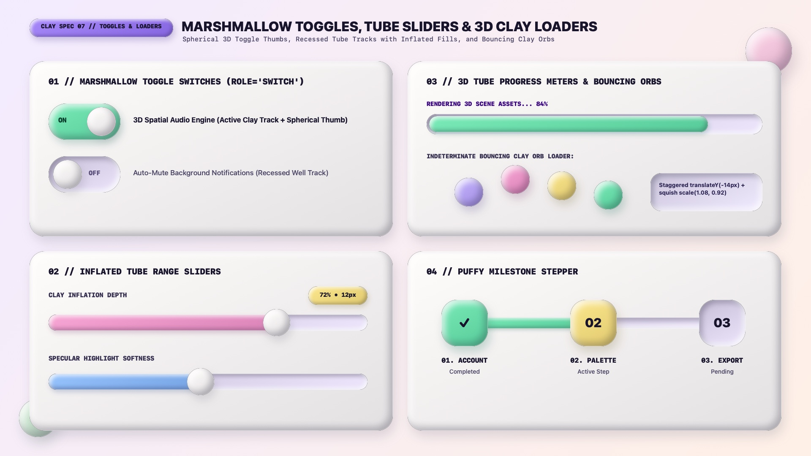

# Claymorphism Design — Marshmallow Toggles, Tube Sliders & 3D Loaders

Claymorphic state controls and progress indicators turn sliders, switches, and loaders into **tactile 3D toys**. Toggle switches pair a recessed or pastel track with a **spherical 3D marshmallow thumb**; range sliders fill a recessed dough tube with an **inflated 3D pastel cylinder**; and indeterminate loaders use **staggered bouncing 3D clay orbs** that squash and stretch on impact.

---

## Toggles, Sliders & Loaders Decision Matrix

| Goal | Tool | Why |
| :--- | :--- | :--- |
| Binary ON/OFF toggle (`role="switch"`) | **Marshmallow Toggle Switch** (`.clay-switch`: recessed well track when OFF $\rightarrow$ inflated Mint clay track when ON + spherical 3D `.clay-orb` thumb) | Reverses track depth polarity between OFF (recessed well) and ON (inflated clay) while sliding a 3D sphere |
| Continuous range adjustment | **Inflated Tube Range Slider** (`<input type="range" class="clay-slider">` with `20px` recessed track and `34px` spherical 3D thumb) | Gives users a plump, easy-to-grab 3D sphere handle with bouncy hover/active physics |
| Determinate file/upload progress | **3D Tube Inside Recessed Well** (`.clay-progress` outer well housing an inflated `.clay-progress__fill` cylinder) | Creates convincing depth contrast between the carved container groove and the rounded pastel liquid/clay bar |
| Indeterminate loading state | **Bouncing & Squishing Clay Orbs** (4 pastel 3D spheres animating `translateY()` + `scale(1.08, 0.92)`) | Celebrates Claymorphism's signature squishy elasticity (`prefers-reduced-motion` safe) |
| Multi-step onboarding / checkout wizard | **Puffy Milestone Stepper** (3D squircle cushions connected by a recessed tube track) | Turns step numbers into collectible 3D tokens |

---

## Multimodal Visual Reference

Before implementing marshmallow toggles, tube sliders, or bouncing orb loaders, inspect the toggles and loaders specification sheet:

- **Marshmallow Toggles, Tube Sliders & 3D Loaders Specification Sheet:** [`./images/claymorphism_toggles_and_loaders.jpg`](./images/claymorphism_toggles_and_loaders.jpg)



### What to Observe in the Reference Sheet
1. **Marshmallow Toggle Switches (`01 // TOP LEFT`):**
   - **ON State:** Track inflates into Mint (`#6EE7B7`) 3D clay; the spherical white marshmallow thumb sits on the inline-end with an explicit `ON` label.
   - **OFF State:** Track recedes into a lavender dough well (`#EFE9FC`); the spherical thumb rests on the inline-start with an `OFF` label.
2. **Inflated Tube Range Sliders (`02 // BOTTOM LEFT`):** Recessed `38px` dough track partially filled by a puffy Bubblegum (`#F9A8D4`) or Sky (`#93C5FD`) 3D tube, capped by a `64px` spherical marshmallow thumb and a floating Butter value pill (`72% • 12px`).
3. **3D Tube Progress & Bouncing Clay Orbs (`03 // TOP RIGHT`):** A recessed outer capsule housing a glossy/matte Mint 3D progress cylinder (`84%`), plus 4 staggered pastel clay spheres (`#C4B5FD`, `#F9A8D4`, `#FDE68A`, `#6EE7B7`).
4. **Puffy Milestone Stepper (`04 // BOTTOM RIGHT`):** Squircle 3D step cushions (`01. ACCOUNT` Mint, `02. PALETTE` Butter, `03. EXPORT` Recessed Well) joined by a recessed pipeline.

---

## Marshmallow Toggle Switch (`role="switch"`)

```html
<label class="clay-switch-wrapper">
  <input type="checkbox" role="switch" class="clay-switch" checked />
  <span class="clay-switch__label">3D Spatial Audio Engine</span>
</label>
```

```css
.clay-switch-wrapper {
  display: inline-flex;
  align-items: center;
  gap: 0.85rem;
  cursor: pointer;
  user-select: none;
}

/* OFF STATE: Recessed Dough Track */
.clay-switch {
  appearance: none;
  -webkit-appearance: none;
  position: relative;
  inline-size: 4.5rem; /* 72px */
  block-size: 2.5rem;  /* 40px */
  margin: 0;
  background-color: var(--clay-well-bg);
  border-radius: var(--clay-radius-pill);
  border: 1.5px solid oklch(1 0 0 / 0.6);
  box-shadow:
    inset 5px 5px 10px 0 oklch(from var(--clay-well-bg) calc(l - 0.16) c h / 0.58),
    inset -5px -5px 10px 0 oklch(1 0 0 / 0.85);
  cursor: pointer;
  transition: background-color 200ms ease, box-shadow 200ms ease;
}

/* Spherical 3D Marshmallow Thumb */
.clay-switch::before {
  content: "";
  position: absolute;
  inset-block-start: 3px;
  inset-inline-start: 4px;
  inline-size: 1.95rem; /* 31px */
  block-size: 1.95rem;
  border-radius: 50%;
  background-color: var(--clay-surface);
  background-image: radial-gradient(circle at 30% 30%, oklch(1 0 0 / 0.8), transparent 60%);
  box-shadow:
    0 6px 12px -2px oklch(0.2 0.04 285 / 0.28),
    inset 4px 4px 8px 0 oklch(1 0 0 / 0.9),
    inset -4px -4px 8px 0 oklch(0.23 0.04 285 / 0.22);
  transition: transform 240ms var(--clay-ease-spring);
}

/* ON STATE: Track inflates into Mint 3D Clay */
.clay-switch:checked {
  --_on: var(--clay-mint);
  background-color: var(--_on);
  box-shadow:
    0 10px 20px -5px oklch(from var(--_on) calc(l - 0.35) c h / 0.32),
    inset 6px 6px 12px 0 oklch(1 0 0 / 0.82),
    inset -6px -6px 12px 0 oklch(from var(--_on) calc(l - 0.18) calc(c * 1.2) h / 0.62);
}

.clay-switch:checked::before {
  transform: translateX(1.95rem);
}

.clay-switch:active::before {
  transform: scale(1.12, 0.92);
}

.clay-switch:checked:active::before {
  transform: translateX(1.95rem) scale(1.12, 0.92);
}

.clay-switch:focus-visible {
  outline: 3px solid oklch(0.49 0.22 292);
  outline-offset: 4px;
}
```

---

## Inflated Tube Range Slider (`<input type="range">`)

```css
.clay-slider {
  appearance: none;
  -webkit-appearance: none;
  inline-size: 100%;
  block-size: 1.35rem; /* 22px recessed dough tube */
  background-color: var(--clay-well-bg);
  border-radius: var(--clay-radius-pill);
  box-shadow:
    inset 5px 5px 10px 0 oklch(from var(--clay-well-bg) calc(l - 0.15) c h / 0.58),
    inset -5px -5px 10px 0 oklch(1 0 0 / 0.85);
  cursor: pointer;
}

/* Spherical 3D Marshmallow Handle (WebKit) */
.clay-slider::-webkit-slider-thumb {
  -webkit-appearance: none;
  appearance: none;
  inline-size: 2.25rem; /* 36px */
  block-size: 2.25rem;
  border-radius: 50%;
  background-color: var(--clay-pink);
  background-image: radial-gradient(circle at 30% 28%, oklch(1 0 0 / 0.65), transparent 55%);
  border: 2px solid oklch(1 0 0 / 0.7);
  box-shadow:
    0 8px 16px -3px oklch(from var(--clay-pink) calc(l - 0.35) c h / 0.38),
    inset 5px 5px 10px 0 oklch(1 0 0 / 0.88),
    inset -5px -5px 10px 0 oklch(from var(--clay-pink) calc(l - 0.18) calc(c * 1.2) h / 0.65);
  cursor: grab;
  transition: transform 180ms var(--clay-ease-spring);
}

.clay-slider::-webkit-slider-thumb:hover {
  transform: scale(1.12);
}

.clay-slider::-webkit-slider-thumb:active {
  cursor: grabbing;
  transform: scale(0.94);
}

/* Firefox Spherical Handle */
.clay-slider::-moz-range-thumb {
  inline-size: 2.25rem;
  block-size: 2.25rem;
  border-radius: 50%;
  background-color: var(--clay-pink);
  border: 2px solid oklch(1 0 0 / 0.7);
  box-shadow:
    0 8px 16px -3px oklch(from var(--clay-pink) calc(l - 0.35) c h / 0.38),
    inset 5px 5px 10px 0 oklch(1 0 0 / 0.88),
    inset -5px -5px 10px 0 oklch(from var(--clay-pink) calc(l - 0.18) calc(c * 1.2) h / 0.65);
  cursor: grab;
}
```

---

## 3D Tube Progress Bar & Bouncing Clay Orbs Loader

### 1. Determinate 3D Tube Progress Bar
```html
<div
  class="clay-progress"
  role="progressbar"
  aria-label="Rendering 3D scene assets"
  aria-valuenow="84"
  aria-valuemin="0"
  aria-valuemax="100"
>
  <div class="clay-progress__fill" style="--progress: 84%"></div>
</div>
```

```css
.clay-progress {
  inline-size: 100%;
  block-size: 2rem; /* 32px */
  padding: 0.3rem;
  background-color: var(--clay-well-bg);
  border-radius: var(--clay-radius-pill);
  box-shadow:
    inset 6px 6px 12px 0 oklch(from var(--clay-well-bg) calc(l - 0.16) c h / 0.58),
    inset -6px -6px 12px 0 oklch(1 0 0 / 0.85);
}

.clay-progress__fill {
  --_fill: var(--clay-mint);
  inline-size: var(--progress, 50%);
  block-size: 100%;
  background-color: var(--_fill);
  border-radius: var(--clay-radius-pill);
  box-shadow:
    0 4px 10px -2px oklch(from var(--_fill) calc(l - 0.32) c h / 0.35),
    inset 4px 4px 8px 0 oklch(1 0 0 / 0.85),
    inset -4px -4px 8px 0 oklch(from var(--_fill) calc(l - 0.18) calc(c * 1.2) h / 0.65);
  transition: inline-size 300ms var(--clay-ease-spring);
}
```

### 2. Bouncing Clay Orbs Indeterminate Loader
```html
<div class="clay-orb-loader" role="status" aria-label="Loading workspace">
  <span class="clay-orb-loader__ball"></span>
  <span class="clay-orb-loader__ball"></span>
  <span class="clay-orb-loader__ball"></span>
  <span class="clay-orb-loader__ball"></span>
</div>
```

```css
.clay-orb-loader {
  display: inline-flex;
  align-items: center;
  gap: 0.85rem;
  padding-block: 1rem;
}

.clay-orb-loader__ball {
  --_c: var(--clay-lilac);
  inline-size: 1.75rem;
  block-size: 1.75rem;
  border-radius: 50%;
  background-color: var(--_c);
  box-shadow:
    0 8px 14px -3px oklch(from var(--_c) calc(l - 0.35) c h / 0.32),
    inset 4px 4px 8px 0 oklch(1 0 0 / 0.88),
    inset -4px -4px 8px 0 oklch(from var(--_c) calc(l - 0.18) calc(c * 1.2) h / 0.65);
  animation: clay-bounce 900ms infinite ease-in-out alternate;
}

.clay-orb-loader__ball:nth-child(2) { --_c: var(--clay-pink);   animation-delay: 150ms; }
.clay-orb-loader__ball:nth-child(3) { --_c: var(--clay-butter); animation-delay: 300ms; }
.clay-orb-loader__ball:nth-child(4) { --_c: var(--clay-mint);   animation-delay: 450ms; }

@keyframes clay-bounce {
  0%   { transform: translateY(4px) scale(1.08, 0.90); }
  100% { transform: translateY(-14px) scale(0.95, 1.05); }
}

@media (prefers-reduced-motion: reduce) {
  .clay-orb-loader__ball {
    animation: none;
  }
}
```

---

## Do Not

| BAD | GOOD | Why |
| :--- | :--- | :--- |
| Animating `box-shadow` blur radius on a 60fps infinite `@keyframes` loop | Pre-define the 3-layer `box-shadow` on `.clay-orb-loader__ball` and animate only compositor-friendly `transform: translateY() scale()` | Animating multi-layered `inset` + outer `box-shadow` on every frame triggers expensive main-thread paint recalculations |
| Making the progress bar fill flush (`padding: 0`) with a sharp `overflow: hidden` parent | Add `padding: 0.3rem` inside `.clay-progress` so the inflated `.clay-progress__fill` capsule sits visibly inside the recessed well | A `0.3rem` lip lets both the recessed well's inner shadow and the inner tube's 3D rounded cap remain visible |
| Using tiny `14px` slider thumbs | Use `32px`–`36px` (`2rem`–`2.25rem`) spherical clay thumbs | Small thumbs cannot display 3-layer clay highlights and fail WCAG 2.2 touch target sizing |
