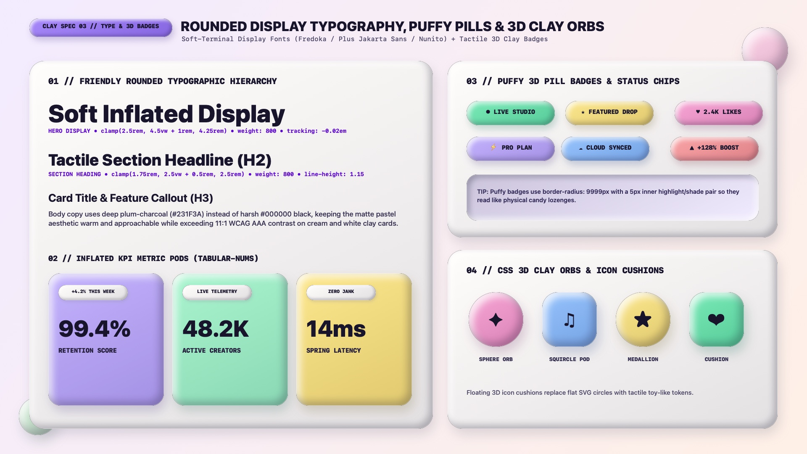

# Claymorphism Design — Typography, Puffy Badges & 3D Clay Accents

Claymorphic typography harmonizes with inflated 3D geometry by pairing **warm, rounded display typefaces (`Plus Jakarta Sans`, `Fredoka`, `Nunito`, `Quicksand`)** with **deep plum-charcoal ink (`#1E1B3A`)**, **puffy lozenge status pills**, and **pure-CSS 3D clay orbs and icon cushions**. Harsh jet-black hairlines and sharp-cornered tags are replaced by soft terminals and tactile candy-like tokens.

---

## Typography & 3D Accents Decision Matrix

| Goal | Tool | Why |
| :--- | :--- | :--- |
| Display headlines & card titles (`h1`–`h3`) | `Fredoka`, `Plus Jakarta Sans`, `Nunito`, or `Outfit` (`font-weight: 700–800`) | Rounded terminals and generous counter spaces mirror the `24px`–`40px` inflated corner radii of clay containers |
| KPI numerals & telemetry counters | `font-variant-numeric: tabular-nums` in heavy rounded display (`clamp(2.5rem, 4vw, 3.5rem)`) | Prevents layout jitter during live counter updates while keeping numbers chunky and toy-like |
| Status tags, category chips & likes | **Puffy 3D Pill Badge** (`.clay-badge` with `border-radius: 9999px` and `±5px` inner bevels) | Turns flat metadata tags into physical candy lozenges |
| Feature icons, avatars & decorative accents | **3D Clay Icon Cushion / Orb** (`.clay-orb` with `50%` circle or `32%` squircle radius) | Replaces flat SVG background circles with touchable 3D polymer-clay medallions |

---

## Multimodal Visual Reference

Before styling headings, KPI metric pods, puffy badges, or 3D icon cushions, inspect the typography and badges specification sheet:

- **Typography, Puffy Pills & 3D Clay Orbs Specification Sheet:** [`./images/claymorphism_typography_and_badges.jpg`](./images/claymorphism_typography_and_badges.jpg)



### What to Observe in the Reference Sheet
1. **Friendly Rounded Typographic Hierarchy (`01 // TOP LEFT`):** Bold, soft-terminal display headings (`clamp(2.5rem, 4.5vw + 1rem, 4.25rem)`) paired with deep plum-charcoal (`#231F3A`) and muted lavender-slate (`#453F63`) body copy.
2. **Inflated KPI Metric Pods (`02 // BOTTOM LEFT`):** Pastel Lilac, Mint, and Butter vertical pods housing a floating mini marshmallow pill badge at the top, oversized `tabular-nums` figures, and uppercase tracking labels.
3. **Puffy 3D Pill Badges (`03 // TOP RIGHT`):** Capsule lozenges (`border-radius: 9999px`) with `inset 5px 5px 10px` top-left highlights and `inset -5px -5px 10px` bottom-right volume shades.
4. **CSS 3D Clay Orbs & Squircle Cushions (`04 // BOTTOM RIGHT`):** Circular spheres (`border-radius: 50%`) and squircle cushions (`border-radius: 34%`) that give icons tangible 3D curvature.

---

## Fluid Type Scale & Font Tokens

```css
:root {
  --clay-font-display: 'Fredoka', 'Plus Jakarta Sans', 'Nunito', system-ui, sans-serif;
  --clay-font-sans: 'Plus Jakarta Sans', 'Nunito', 'Inter', system-ui, sans-serif;
  --clay-font-mono: 'JetBrains Mono', ui-monospace, monospace;

  --clay-text-hero: clamp(2.5rem, 4.5vw + 1rem, 4.25rem);
  --clay-text-h1: clamp(2rem, 3.2vw + 0.75rem, 3.25rem);
  --clay-text-h2: clamp(1.5rem, 2.2vw + 0.5rem, 2.25rem);
  --clay-text-h3: clamp(1.25rem, 1.2vw + 0.5rem, 1.5rem);
  --clay-text-body: 1.0625rem; /* 17px comfortable reading size */
}

.clay-heading-hero {
  font-family: var(--clay-font-display);
  font-size: var(--clay-text-hero);
  font-weight: 800;
  line-height: 1.08;
  letter-spacing: -0.02em;
  color: var(--clay-ink);
  text-wrap: balance;
  margin-block: 0 1rem;
}

.clay-body-copy {
  font-family: var(--clay-font-sans);
  font-size: var(--clay-text-body);
  font-weight: 500;
  line-height: 1.65;
  color: var(--clay-ink-muted);
  max-inline-size: 62ch;
  text-wrap: pretty;
}
```

---

## Puffy 3D Pill Badges (`.clay-badge`)

Because badges are smaller than cards (`block-size: 2.25rem` to `2.75rem`), scale down the outer and inner shadow offsets proportionally (`outer: 0 8px 16px -4px`, `inner: ±5px` offset with `10px` blur) so the highlight and shade don't collide in the center of the pill:

```html
<span class="clay-badge clay-badge--mint">● LIVE STUDIO</span>
<span class="clay-badge clay-badge--butter">★ FEATURED DROP</span>
<span class="clay-badge clay-badge--pink">♥ 2.4K LIKES</span>
```

```css
.clay-badge {
  --_bg: var(--clay-lilac);
  --_drop: oklch(from var(--_bg) calc(l - 0.35) calc(c * 0.9) h / 0.25);
  --_hi: oklch(from var(--_bg) calc(l + 0.15) calc(c * 0.5) h / 0.88);
  --_lo: oklch(from var(--_bg) calc(l - 0.16) calc(c * 1.2) h / 0.62);

  display: inline-flex;
  align-items: center;
  gap: 0.45rem;
  padding-inline: 1rem;
  padding-block: 0.45rem;
  background-color: var(--_bg);
  color: var(--clay-ink);
  font-family: var(--clay-font-display);
  font-size: 0.8125rem;
  font-weight: 800;
  letter-spacing: 0.04em;
  text-transform: uppercase;
  border-radius: var(--clay-radius-pill);
  border: 1px solid oklch(1 0 0 / 0.5);
  box-shadow:
    0 8px 16px -4px var(--_drop),
    inset 5px 5px 10px 0 var(--_hi),
    inset -5px -5px 10px 0 var(--_lo);
  user-select: none;
}

.clay-badge--mint   { --_bg: var(--clay-mint); }
.clay-badge--butter { --_bg: var(--clay-butter); }
.clay-badge--pink   { --_bg: var(--clay-pink); }
.clay-badge--sky    { --_bg: var(--clay-sky); }
```

---

## Pure-CSS 3D Clay Orbs & Squircle Icon Cushions (`.clay-orb`)

Use `.clay-orb` to house feature icons, user avatars, or decorative floating spheres inside hero sections. Adding a subtle radial specular highlight via `background-image` enhances the spherical polymer-clay curvature:

```css
.clay-orb {
  --_bg: var(--clay-pink);
  --_drop: oklch(from var(--_bg) calc(l - 0.36) calc(c * 0.95) h / 0.30);
  --_hi: oklch(1 0 0 / 0.88);
  --_lo: oklch(from var(--_bg) calc(l - 0.18) calc(c * 1.25) h / 0.68);

  inline-size: 4.5rem; /* 72px */
  block-size: 4.5rem;
  display: inline-grid;
  place-content: center;
  border-radius: 50%;
  background-color: var(--_bg);
  background-image: radial-gradient(
    circle at 30% 28%,
    oklch(1 0 0 / 0.55) 0%,
    transparent 55%
  );
  color: var(--clay-ink);
  font-size: 1.75rem;
  box-shadow:
    0 16px 28px -8px var(--_drop),
    inset 8px 8px 16px 0 var(--_hi),
    inset -8px -8px 16px 0 var(--_lo);
}

/* Squircle Cushion Variant */
.clay-orb--squircle {
  border-radius: 34%;
}
```

---

## Do Not

| BAD | GOOD | Why |
| :--- | :--- | :--- |
| Using `inset 12px 12px 24px` card-sized shadows on a tiny `28px`-tall pill badge | Scale badge inner shadows down to `inset 4px 4px 8px` or `inset 5px 5px 10px` | Inner shadow offset must never exceed `25%` of the element's shortest dimension, or the light and dark inner rims will overlap in the middle |
| Using ultra-thin hairline serif fonts (`font-weight: 200`) on puffy clay buttons and badges | Use `font-weight: 700–800` rounded sans-serifs (`Fredoka`, `Plus Jakarta Sans`, `Nunito`) | Delicate hairline strokes visually clash with thick, inflated 3D clay surfaces and lose legibility against inner bevel gradients |
| Applying `text-shadow: 2px 2px 4px rgba(0,0,0,0.4)` to body text on clay cards | Keep typography crisp and flat (`text-shadow: none`) on top of the 3D clay surface | Drop-shadowed text on top of an inner-shadowed clay surface looks blurry and causes double-vision eye strain |
