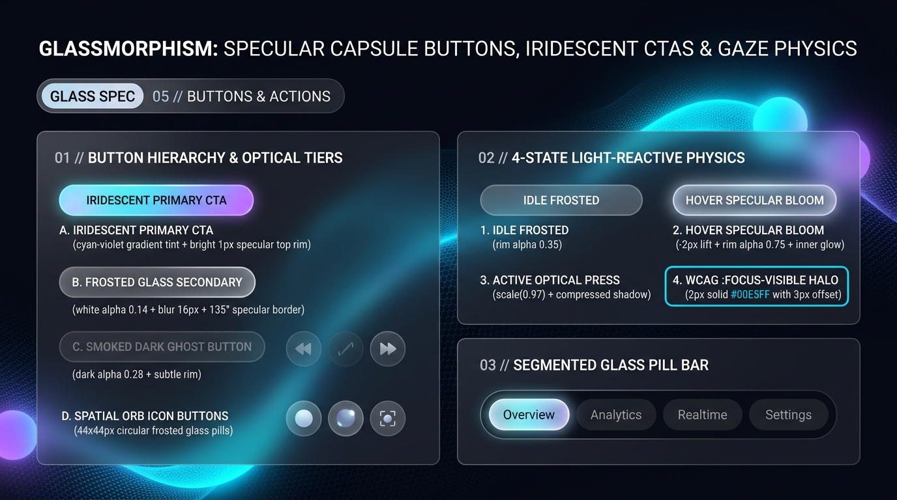

# Glassmorphism Design — Specular Capsule Buttons, Iridescent CTAs & Gaze Physics

In Spatial Glassmorphism (such as Apple **visionOS** and modern translucent interfaces), interactive buttons behave like **precision-cut optical lenses that brighten when approached**. Instead of flat color swaps, Glassmorphic buttons express interactivity through **4-State Light-Reactive Physics**: specular rim brightening (`0.35` $\rightarrow$ `0.75` alpha), internal luminous bloom, subtle Z-axis float (`translateY(-2px)`), and optical compression on press (`scale(0.97)`).

---

## Buttons & Actions Decision Matrix

| Goal | Tool | Why |
| :--- | :--- | :--- |
| Primary high-conversion CTA | **Iridescent Prism Capsule Button** (`linear-gradient(135deg, #00E5FF, #7C3AED)` at `82%` alpha + bright `1px` top specular rim) | Commands immediate visual priority against dark or light frosted panes while retaining refractive translucency. |
| Standard secondary action inside a glass card | **Frosted Specular Capsule Button** (`oklch(1 0 0 / 0.14)` + `backdrop-filter: blur(16px)` + $135^\circ$ specular rim) | Harmonizes with the spatial material hierarchy and blooms brightly on hover/gaze. |
| Low-emphasis cancel or utility trigger | **Smoked Dark Ghost Button** (`oklch(0 0 0 / 0.32)` recessed fill + `1px` subtle rim) | Recedes optically into the pane until hovered, preventing secondary buttons from competing with the Primary CTA. |
| Toolbar or media control triggers | **Circular Spatial Orb Icon Button** (`44px × 44px`, `border-radius: 9999px`) | Matches the ergonomic circular gaze/pointer targets of spatial computing OS toolbars. |
| View or tab switching | **Recessed Smoked Tray + Glowing Frosted Active Pill** | Contrasts a recessed dark channel (`.glass-well`) against an illuminated frosted capsule pill. |

---

## Multimodal Visual Reference

Inspect the 4 button material tiers, the 4-state light-reactive physics, and the segmented glass pill bar before styling interactive triggers:

- **Specular Capsule Buttons, Iridescent CTAs & Gaze Physics:** [`./images/glassmorphism_buttons.jpg`](./images/glassmorphism_buttons.jpg)



### What to Observe in the Reference Sheet
1. **Button Hierarchy & Optical Tiers (`01 // LEFT`):**
   - **A. Iridescent Primary CTA:** Cyan-to-violet gradient tint with a crisp `1px` top specular highlight and ambient cyan outer glow.
   - **B. Frosted Glass Secondary:** White `alpha: 0.14` + `blur(16px)` + $135^\circ$ specular border.
   - **C. Smoked Dark Ghost Button:** Dark `alpha: 0.28` with a muted rim.
   - **D. Spatial Orb Icon Buttons:** `44px × 44px` circular frosted glass keycaps.
2. **4-State Light-Reactive Physics (`02 // TOP RIGHT`):** Compare **1. Idle Frosted (`rim alpha 0.35`)**, **2. Hover Specular Bloom (`-2px` lift + `rim alpha 0.75` + inner glow)**, **3. Active Optical Press (`scale(0.97)`)**, and **4. WCAG `:focus-visible` Halo (`2px solid #00E5FF` with `3px` offset)**.
3. **Segmented Glass Pill Bar (`03 // BOTTOM RIGHT`):** Recessed dark smoked-glass capsule tray holding a glowing frosted active pill (`Overview`).

---

## Production CSS: Specular Capsule & Iridescent Prism Buttons

```css
/* Base Frosted Specular Button (44px Minimum WCAG 2.2 Tap Target) */
.glass-btn {
  position: relative;
  display: inline-flex;
  align-items: center;
  justify-content: center;
  gap: 0.625rem;
  min-block-size: 2.75rem; /* 44px */
  padding-block: 0.6875rem;
  padding-inline: 1.5rem;
  border-radius: var(--glass-radius-pill);
  border: 1px solid transparent;
  background-image:
    linear-gradient(135deg, oklch(1 0 0 / 0.18) 0%, oklch(1 0 0 / 0.07) 100%),
    linear-gradient(135deg, oklch(1 0 0 / 0.45) 0%, oklch(1 0 0 / 0.10) 100%);
  background-origin: border-box;
  background-clip: padding-box, border-box;
  backdrop-filter: blur(16px) saturate(170%);
  -webkit-backdrop-filter: blur(16px) saturate(170%);
  box-shadow:
    0 8px 20px -6px oklch(0 0 0 / 0.38),
    inset 0 1px 0 0 oklch(1 0 0 / 0.40);
  color: var(--glass-ink);
  font-family: var(--glass-font-sans);
  font-size: 0.875rem;
  font-weight: 600;
  letter-spacing: 0.02em;
  text-decoration: none;
  cursor: pointer;
  user-select: none;
  transition:
    transform var(--glass-duration) var(--glass-ease),
    box-shadow var(--glass-duration) var(--glass-ease),
    background-image var(--glass-duration) var(--glass-ease);
}

/* State 2: Hover / Gaze Specular Bloom */
.glass-btn:hover:not(:disabled) {
  transform: translateY(-2px);
  background-image:
    linear-gradient(135deg, oklch(1 0 0 / 0.28) 0%, oklch(1 0 0 / 0.12) 100%),
    linear-gradient(135deg, oklch(1 0 0 / 0.82) 0%, oklch(0.85 0.18 205 / 0.35) 100%);
  box-shadow:
    0 14px 28px -6px oklch(0 0 0 / 0.48),
    0 0 18px oklch(0.85 0.18 205 / 0.22),
    inset 0 1px 0 0 oklch(1 0 0 / 0.65);
}

/* State 3: Active Optical Compression (:active) */
.glass-btn:active:not(:disabled) {
  transform: translateY(0) scale(0.97);
  box-shadow:
    0 4px 10px -2px oklch(0 0 0 / 0.35),
    inset 0 1px 0 0 oklch(1 0 0 / 0.30);
  transition-duration: 100ms;
}

/* State 4: Mandatory WCAG 2.2 Keyboard Focus Halo */
.glass-btn:focus-visible {
  outline: 2px solid var(--glass-accent);
  outline-offset: 3px;
}

/* Variant A: Iridescent Primary CTA */
.glass-btn--primary {
  background-image:
    linear-gradient(135deg, oklch(0.78 0.17 205 / 0.85) 0%, oklch(0.55 0.24 292 / 0.85) 100%),
    linear-gradient(135deg, oklch(1 0 0 / 0.85) 0%, oklch(0.85 0.18 205 / 0.35) 100%);
  color: #FFFFFF;
  text-shadow: 0 1px 4px oklch(0 0 0 / 0.35);
  box-shadow:
    0 10px 25px -4px oklch(0.75 0.18 220 / 0.42),
    inset 0 1px 0 0 oklch(1 0 0 / 0.65);
}

/* Variant C: Smoked Dark Ghost Button */
.glass-btn--smoked {
  background-image:
    linear-gradient(135deg, oklch(0.08 0.02 265 / 0.52), oklch(0.08 0.02 265 / 0.36)),
    linear-gradient(135deg, oklch(1 0 0 / 0.25), oklch(1 0 0 / 0.06));
  backdrop-filter: none; /* Safe inside already-blurred parent windows */
}

/* Variant D: 44x44px Circular Spatial Orb Icon Button */
.glass-orb-btn {
  inline-size: 2.75rem;
  block-size: 2.75rem;
  padding: 0;
  border-radius: var(--glass-radius-pill);
}
```

---

## Segmented Spatial Glass Pill Bar

```css
.glass-segmented {
  display: inline-flex;
  align-items: center;
  gap: 0.25rem;
  padding: 0.3125rem; /* 5px */
  border-radius: var(--glass-radius-pill);
  background-color: var(--glass-tier2-well);
  border: 1px solid oklch(1 0 0 / 0.14);
  box-shadow: inset 0 2px 6px oklch(0 0 0 / 0.45);
}

.glass-segmented__pill {
  appearance: none;
  border: 1px solid transparent;
  background: transparent;
  color: var(--glass-ink-secondary);
  font-family: var(--glass-font-sans);
  font-size: 0.8125rem;
  font-weight: 600;
  padding-block: 0.5rem;
  padding-inline: 1.25rem;
  border-radius: var(--glass-radius-pill);
  cursor: pointer;
  transition:
    color var(--glass-duration) var(--glass-ease),
    background-color var(--glass-duration) var(--glass-ease),
    box-shadow var(--glass-duration) var(--glass-ease);
}

.glass-segmented__pill[aria-selected="true"],
.glass-segmented__pill[aria-pressed="true"] {
  background-color: oklch(1 0 0 / 0.18);
  border-color: oklch(1 0 0 / 0.45);
  color: var(--glass-ink);
  box-shadow:
    0 4px 14px oklch(0 0 0 / 0.35),
    0 0 12px oklch(0.85 0.18 205 / 0.25),
    inset 0 1px 0 oklch(1 0 0 / 0.50);
}
```

---

## Do Not

| BAD | GOOD | Why |
| :--- | :--- | :--- |
| Using `opacity: 0.1` white buttons with white text over bright cyan background orbs | Use `.glass-btn--primary` (`>= 0.80` alpha gradient) or anchor the parent card with a dark smoked-quartz tint floor | Low-alpha white buttons become illegible whenever a bright background orb passes underneath. |
| Making every button on a card an Iridescent Primary CTA | Use **1 `.glass-btn--primary`** paired with `.glass-btn--smoked` or `.glass-btn` secondary actions | Preserves clear optical hierarchy. |
| Using sharp `0px–4px` corners on spatial glass buttons | Use `border-radius: 9999px` capsules or `14px` rounded rectangles | Specular rim highlights wrap most naturally around continuous capsule or squircle curves. |
| Omitting `:focus-visible` outlines on translucent buttons | Always apply `outline: 2px solid var(--glass-accent); outline-offset: 3px;` | Essential for keyboard and assistive switch navigation across translucent layers. |
