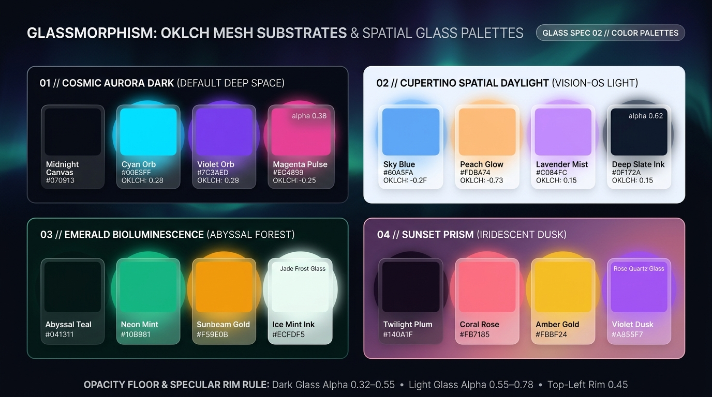

# Glassmorphism Design — OKLCH Mesh Substrates & Spatial Glass Palettes

Glassmorphism is an **environment-dependent material system**: a translucent pane derives 60% of its visual character from the **substrate canvas behind it** and 40% from its **tinted quartz surface fill and specular rim**. This guide defines the **4 canonical OKLCH substrate-and-glass palettes**, the **Minimum Opacity Floor Law** (`alpha >= 0.35` dark / `alpha >= 0.58` light), and dynamic tinting via `oklch(from ...)`.

---

## Color Palettes & Substrate Decision Matrix

| Goal | Tool | Why |
| :--- | :--- | :--- |
| Construct a rich refractive background canvas | **Multi-Radial OKLCH Aurora Mesh** (`radial-gradient` orbs at `at 15% 20%`, `at 85% 75%`, `at 55% 45%`) | Creates smooth, organic color transitions behind glass panes so edges refract shifting hues as the user scrolls. |
| Prevent bright background orbs from washing out white text | **Tinted Quartz Surface Base (`oklch(0.18 0.03 H / 0.38–0.52)`)** instead of pure white `rgba(255,255,255,0.1)` in dark mode | Pure white-alpha glass turns milky gray over dark backgrounds and blindingly bright over cyan/magenta orbs; dark smoked-quartz tint anchors contrast (`>= 4.5:1`). |
| Support airy Apple visionOS / Daylight Spatial UI | **Cupertino Spatial Daylight Palette** (`#EEF2FF` pearl-sky mesh + `oklch(0.99 0.005 250 / 0.62)` silica glass + `#0F172A` ink) | Delivers bright, sunlit frosted silica panels with deep slate ink (`> 10:1` contrast). |
| Tint semantic status panels (Success, Warning, Error) | **Chromatic Smoked Glass** (`oklch(from var(--status-color) 0.24 0.08 h / 0.48)` + glowing rim) | Integrates status alerts into the spatial glass language rather than dropping opaque flat banners onto the canvas. |

---

## Multimodal Visual Reference

Inspect the 4 canonical substrate-and-glass palettes and the Opacity Floor & Specular Rim Rule before selecting theme tokens:

- **OKLCH Mesh Substrates & Spatial Glass Palettes:** [`./images/glassmorphism_color_palettes.jpg`](./images/glassmorphism_color_palettes.jpg)



### What to Observe in the Reference Sheet
1. **`01 // COSMIC AURORA DARK (DEFAULT DEEP SPACE)`:** Midnight Canvas (`#070913`), Cyan Orb (`#00E5FF`), Violet Orb (`#7C3AED`), Magenta Pulse (`#EC4899`), and Smoked Quartz Glass (`alpha: 0.38`).
2. **`02 // CUPERTINO SPATIAL DAYLIGHT (VISION-OS LIGHT)`:** Pearl Sky Canvas (`#EEF2FF`), Sky Blue (`#60A5FA`), Peach Glow (`#FDBA74`), Lavender Mist (`#C084FC`), Deep Slate Ink (`#0F172A`), and Frosted Silica Glass (`alpha: 0.62`).
3. **`03 // EMERALD BIOLUMINESCENCE (ABYSSAL FOREST)`:** Abyssal Teal (`#041311`), Neon Mint (`#10B981`), Sunbeam Gold (`#F59E0B`), Ice Mint Ink (`#ECFDF5`), and Jade Frost Glass.
4. **`04 // SUNSET PRISM (IRIDESCENT DUSK)`:** Twilight Plum (`#140A1F`), Coral Rose (`#FB7185`), Amber Gold (`#FBBF24`), Violet Dusk (`#A855F7`), and Rose Quartz Glass.

---

## The 4 Canonical Glassmorphism Palettes (Production CSS)

```css
/* Palette 1: Cosmic Aurora Dark (Default Deep Space & Cyan/Violet Mesh) */
:root,
[data-theme="cosmic-aurora"] {
  color-scheme: dark;
  --glass-canvas-base: oklch(0.13 0.03 265);     /* #070913 Midnight Base */
  --glass-orb-a: oklch(0.85 0.18 205 / 0.38);    /* #00E5FF Aurora Cyan */
  --glass-orb-b: oklch(0.58 0.25 292 / 0.42);    /* #7C3AED Electric Violet */
  --glass-orb-c: oklch(0.66 0.24 350 / 0.30);    /* #EC4899 Magenta Pulse */

  --glass-surface-tint: oklch(0.20 0.035 265 / 0.44); /* Smoked Quartz Floor */
  --glass-surface-hi: oklch(1 0 0 / 0.14);
  --glass-ink: oklch(0.99 0.005 250);            /* #FFFFFF Pure Crisp White */
  --glass-ink-secondary: oklch(0.86 0.02 255);   /* #CBD5E1 Ice Slate */
  --glass-accent: oklch(0.85 0.18 205);          /* #00E5FF Cyan Glow */
}

/* Palette 2: Cupertino Spatial Daylight (visionOS Light Mode) */
[data-theme="cupertino-daylight"] {
  color-scheme: light;
  --glass-canvas-base: oklch(0.95 0.02 255);     /* #EEF2FF Pearl Daylight */
  --glass-orb-a: oklch(0.72 0.15 248 / 0.45);    /* #60A5FA Sky Blue */
  --glass-orb-b: oklch(0.82 0.13 58 / 0.42);     /* #FDBA74 Peach Glow */
  --glass-orb-c: oklch(0.74 0.17 305 / 0.38);    /* #C084FC Lavender Mist */

  --glass-surface-tint: oklch(0.99 0.005 250 / 0.62); /* Frosted Silica Floor */
  --glass-surface-hi: oklch(1 0 0 / 0.82);
  --glass-ink: oklch(0.18 0.04 260);             /* #0F172A Deep Slate Ink */
  --glass-ink-secondary: oklch(0.36 0.04 260);   /* #334155 Slate Secondary */
  --glass-accent: oklch(0.55 0.22 258);          /* #2563EB Spatial Cobalt */
}

/* Palette 3: Emerald Bioluminescence (Abyssal Teal & Neon Mint) */
[data-theme="emerald-bioluminescence"] {
  color-scheme: dark;
  --glass-canvas-base: oklch(0.15 0.03 180);     /* #041311 Abyssal Teal */
  --glass-orb-a: oklch(0.72 0.18 162 / 0.38);    /* #10B981 Neon Mint */
  --glass-orb-b: oklch(0.78 0.16 78 / 0.28);     /* #F59E0B Sunbeam Gold */
  --glass-orb-c: oklch(0.65 0.14 200 / 0.32);    /* #06B6D4 Lagoon Cyan */

  --glass-surface-tint: oklch(0.20 0.04 172 / 0.46);  /* Jade Frost Floor */
  --glass-surface-hi: oklch(0.95 0.05 165 / 0.14);
  --glass-ink: oklch(0.98 0.015 165);            /* #ECFDF5 Ice Mint Ink */
  --glass-ink-secondary: oklch(0.84 0.035 168);  /* #A7F3D0 Muted Mint */
  --glass-accent: oklch(0.76 0.18 160);          /* #34D399 Bioluminescent Mint */
}

/* Palette 4: Sunset Prism (Twilight Plum & Iridescent Rose Quartz) */
[data-theme="sunset-prism"] {
  color-scheme: dark;
  --glass-canvas-base: oklch(0.15 0.045 315);    /* #140A1F Twilight Plum */
  --glass-orb-a: oklch(0.71 0.19 15 / 0.40);     /* #FB7185 Coral Rose */
  --glass-orb-b: oklch(0.84 0.16 84 / 0.34);     /* #FBBF24 Amber Gold */
  --glass-orb-c: oklch(0.63 0.24 302 / 0.40);    /* #A855F7 Violet Dusk */

  --glass-surface-tint: oklch(0.21 0.045 325 / 0.45); /* Rose Quartz Floor */
  --glass-surface-hi: oklch(1 0 0 / 0.15);
  --glass-ink: oklch(0.98 0.01 340);             /* #FFF1F2 Rose White */
  --glass-ink-secondary: oklch(0.86 0.03 335);   /* #FECDD3 Soft Quartz */
  --glass-accent: oklch(0.71 0.19 15);           /* #FB7185 Coral Prism */
}
```

---

## Multi-Stop Aurora Mesh Substrate Generator

Apply `.glass-mesh-canvas` to the page or section wrapper so translucent cards always have rich chromatic light to refract:

```css
.glass-mesh-canvas {
  background-color: var(--glass-canvas-base);
  background-image:
    radial-gradient(circle at 18% 22%, var(--glass-orb-a) 0%, transparent 48%),
    radial-gradient(circle at 82% 76%, var(--glass-orb-b) 0%, transparent 52%),
    radial-gradient(circle at 52% 48%, var(--glass-orb-c) 0%, transparent 45%);
  background-attachment: fixed;
  min-block-size: 100dvh;
  color: var(--glass-ink);
}
```

---

## Dynamic Chromatic Tinting via Relative Color Syntax

Use `oklch(from ...)` to create semantic or brand-tinted glass cards that automatically pair a smoked translucent base with a matching luminous rim:

```css
.glass-pane--tinted {
  --_tint: var(--glass-accent);

  background-image:
    linear-gradient(
      135deg,
      oklch(from var(--_tint) 0.24 0.08 h / 0.52) 0%,
      oklch(from var(--_tint) 0.16 0.05 h / 0.38) 100%
    ),
    linear-gradient(
      135deg,
      oklch(from var(--_tint) 0.85 0.16 h / 0.65) 0%,
      oklch(from var(--_tint) 0.70 0.12 h / 0.12) 100%
    );
  background-origin: border-box;
  background-clip: padding-box, border-box;
  border: 1px solid transparent;
}
```

---

## Do Not

| BAD | GOOD | Why |
| :--- | :--- | :--- |
| Using `background: rgba(255, 255, 255, 0.08)` with white text over bright cyan/yellow orbs | Use a **Smoked Quartz dark tint** (`oklch(0.20 0.035 265 / 0.44)`) as the base fill in dark mode | Pure white alpha over a bright background orb creates a white-on-white patch (`< 1.5:1` contrast) where text disappears. |
| Letting light-mode glass opacity drop below `0.50` (`rgba(255,255,255,0.2)`) | Enforce a **Minimum Opacity Floor**: `>= 0.38` dark smoked tint in dark mode, `>= 0.58` white silica in light mode | Guarantees WCAG 2.2 AA (`4.5:1`) text contrast regardless of which background orb passes behind the card. |
| Creating sharp, un-blurred hard circles directly behind text without sufficient glass blur | Blur background orbs heavily (`radial-gradient` soft falloff or `filter: blur(80px)`) AND apply `backdrop-filter: blur(20px)` on the pane | High-frequency background edges behind text compete with glyph strokes and cause severe visual fatigue. |
| Using opaque flat hex backgrounds (`#EF4444`) for status alerts inside a glass UI | Use chromatic smoked glass (`oklch(from var(--status) 0.24 0.08 h / 0.48)`) with a glowing specular border | Preserves optical continuity across the spatial interface. |
