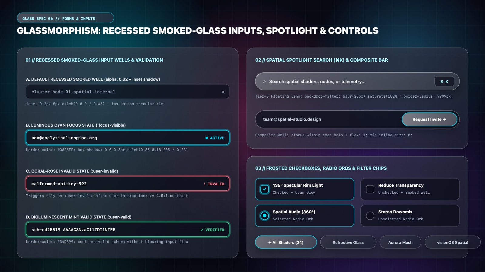

# Glassmorphism Design — Recessed Smoked-Glass Inputs, Spotlight Bars & Controls

In a Glassmorphic interface, **depth polarity distinguishes clickable lenses from fillable receptacles**: while cards and buttons float *above* the pane with top-left specular highlights, text inputs and search wells are **carved *into* the glass pane as Recessed Smoked-Glass Wells** (`oklch(0.06 0.02 265 / 0.58)` with an `inset` top shadow and a subtle bottom rim reflection).

---

## Forms & Inputs Decision Matrix

| Goal | Tool | Why |
| :--- | :--- | :--- |
| Text inputs, textareas & select fields inside a glass card | **Recessed Smoked-Glass Well** (`oklch(0.06 0.02 265 / 0.58)` + `inset 0 2px 5px oklch(0 0 0 / 0.45)` + `1px` bottom specular glint, **no nested blur**) | Contrasts dark recessed glass against the lighter frosted parent card, ensuring `> 7:1` input text legibility and zero GPU blur stacking. |
| Active keyboard focus state | **Luminous Cyan / Cobalt Focus Halo** (`border-color: var(--glass-accent)` + `0 0 0 3px oklch(from var(--glass-accent) l c h / 0.26)`) | Surrounds the recessed well with a bioluminescent optical ring on `:focus-visible`. |
| Form validation states | **`:user-invalid` Coral-Rose (`#FB7185`) & `:user-valid` Mint (`#34D399`) Glows** | Triggers only after user interaction (`:user-invalid`), pairing a luminous border with a high-contrast pill badge. |
| Global command palette or search bar | **Tier-3 Floating Spotlight Lens (`⌘K`)** (`border-radius: 9999px`, `backdrop-filter: blur(28px) saturate(180%)`) | Floats above the workspace as a standalone optical lens with a recessed `⌘K` shortcut keycap. |
| Custom checkboxes & radio buttons | **Frosted `appearance: none` Checkboxes & Radio Orbs** | Transitions from a recessed smoked-glass well when unchecked to a glowing cyan/violet lens when `:checked`. |

---

## Multimodal Visual Reference

Inspect the 4 recessed smoked-glass input states, the floating `⌘K` Spotlight search bar, the composite invite bar, and the frosted checkboxes and radio orbs before building forms:

- **Recessed Smoked-Glass Inputs, Spotlight & Controls:** [`./images/glassmorphism_forms_and_inputs.jpg`](./images/glassmorphism_forms_and_inputs.jpg)



### What to Observe in the Reference Sheet
1. **Recessed Smoked-Glass Input Wells & Validation (`01 // LEFT`):**
   - **A. Default Recessed Smoked Well:** Dark `alpha: 0.62` fill + `inset 0 2px 5px oklch(0 0 0 / 0.45)` + `1px` bottom specular rim.
   - **B. Luminous Cyan Focus State (`:focus-visible`):** `#00E5FF` border + `3px` outer cyan halo (`alpha: 0.28`).
   - **C. Coral-Rose Invalid State (`:user-invalid`):** `#FB7185` border + `! INVALID` rose pill badge.
   - **D. Bioluminescent Mint Valid State (`:user-valid`):** `#34D399` border + `✓ VERIFIED` mint indicator.
2. **Spatial Spotlight Search (`⌘K`) & Composite Bar (`02 // TOP RIGHT`):** Floating capsule Spotlight bar with a recessed `⌘K` badge, plus a composite email well housing an embedded `Request Invite →` iridescent pill button.
3. **Frosted Checkboxes, Radio Orbs & Filter Chips (`03 // BOTTOM RIGHT`):** `26px` rounded-square (`7px` radius) checkboxes and circular radio orbs in unchecked smoked glass and checked glowing cyan states.

---

## Production CSS: Recessed Smoked-Glass Inputs & Validation

```css
.glass-field {
  display: flex;
  flex-direction: column;
  gap: 0.5rem;
  margin-block-end: 1.25rem;
}

.glass-label {
  font-family: var(--glass-font-sans);
  font-size: 0.8125rem;
  font-weight: 600;
  letter-spacing: 0.03em;
  color: var(--glass-ink);
}

/* Recessed Smoked-Glass Input Well (WCAG 3:1 Boundary + Zero Nested Blur) */
.glass-input {
  inline-size: 100%;
  min-block-size: 2.875rem; /* 46px */
  padding-block: 0.625rem;
  padding-inline: 1rem;
  border-radius: var(--glass-radius-sm);
  background-color: light-dark(
    oklch(1 0 0 / 0.72),
    oklch(0.08 0.02 265 / 0.62)
  );
  color: var(--glass-ink);
  border: 1px solid light-dark(
    oklch(0.35 0.04 260 / 0.32),
    oklch(1 0 0 / 0.24)
  );
  box-shadow:
    inset 0 2px 5px oklch(0 0 0 / 0.42),
    0 1px 0 oklch(1 0 0 / 0.10);
  font-family: var(--glass-font-sans);
  font-size: 0.9375rem;
  transition:
    border-color var(--glass-duration) var(--glass-ease),
    box-shadow var(--glass-duration) var(--glass-ease),
    background-color var(--glass-duration) var(--glass-ease);
}

.glass-input::placeholder {
  color: var(--glass-ink-muted);
}

/* State B: Luminous Cyan / Cobalt Focus Halo */
.glass-input:focus-visible {
  outline: none;
  border-color: var(--glass-accent);
  box-shadow:
    0 0 0 3px oklch(from var(--glass-accent) l c h / 0.28),
    inset 0 2px 5px oklch(0 0 0 / 0.35);
}

/* State C: Coral-Rose :user-invalid Validation */
.glass-input:user-invalid {
  border-color: oklch(0.71 0.19 15); /* #FB7185 Coral Rose */
  box-shadow:
    0 0 0 3px oklch(0.71 0.19 15 / 0.22),
    inset 0 2px 5px oklch(0 0 0 / 0.35);
}

/* State D: Bioluminescent Mint :user-valid Validation */
.glass-input:user-valid {
  border-color: oklch(0.76 0.18 160); /* #34D399 Emerald Mint */
}
```

---

## Spatial Spotlight Bar (`⌘K`) & Composite Input Well

```css
/* Composite Recessed Well with Attached Iridescent CTA */
.glass-combo-well {
  display: flex;
  align-items: center;
  padding: 0.3125rem;
  padding-inline-start: 1.25rem;
  border-radius: var(--glass-radius-pill);
  background-color: oklch(0.08 0.02 265 / 0.58);
  border: 1px solid oklch(1 0 0 / 0.24);
  box-shadow: inset 0 2px 6px oklch(0 0 0 / 0.48);
  transition:
    border-color var(--glass-duration) var(--glass-ease),
    box-shadow var(--glass-duration) var(--glass-ease);
}

.glass-combo-well:focus-within {
  border-color: var(--glass-accent);
  box-shadow:
    0 0 0 3px oklch(from var(--glass-accent) l c h / 0.25),
    inset 0 2px 6px oklch(0 0 0 / 0.45);
}

.glass-combo-well__input {
  flex: 1;
  min-inline-size: 0; /* Prevents flex input overflow */
  border: none;
  background: transparent;
  color: var(--glass-ink);
  font-family: var(--glass-font-sans);
  font-size: 0.9375rem;
}

.glass-combo-well__input:focus {
  outline: none;
}

/* Frosted Shortcut Keycap (⌘K) */
.glass-kbd {
  display: inline-flex;
  align-items: center;
  gap: 0.25rem;
  padding-block: 0.25rem;
  padding-inline: 0.625rem;
  border-radius: 8px;
  background-color: oklch(1 0 0 / 0.12);
  border: 1px solid oklch(1 0 0 / 0.28);
  box-shadow: inset 0 1px 0 oklch(1 0 0 / 0.35);
  font-family: var(--glass-font-mono);
  font-size: 0.75rem;
  font-weight: 600;
  color: var(--glass-ink-secondary);
}
```

---

## Frosted Checkboxes & Luminous Radio Orbs

```css
.glass-checkbox,
.glass-radio {
  appearance: none;
  margin: 0;
  inline-size: 1.375rem; /* 22px */
  block-size: 1.375rem;
  background-color: oklch(0.08 0.02 265 / 0.60);
  border: 1.5px solid oklch(1 0 0 / 0.32);
  box-shadow: inset 0 2px 4px oklch(0 0 0 / 0.45);
  display: grid;
  place-content: center;
  cursor: pointer;
  transition:
    background-color 200ms var(--glass-ease),
    border-color 200ms var(--glass-ease),
    box-shadow 200ms var(--glass-ease);
}

.glass-checkbox { border-radius: 6px; }
.glass-radio    { border-radius: var(--glass-radius-pill); }

.glass-checkbox:checked,
.glass-radio:checked {
  background-color: oklch(from var(--glass-accent) l c h / 0.28);
  border-color: var(--glass-accent);
  box-shadow: 0 0 12px oklch(from var(--glass-accent) l c h / 0.45);
}

.glass-checkbox::before {
  content: "";
  inline-size: 0.65rem;
  block-size: 0.38rem;
  border-inline-start: 2px solid #FFFFFF;
  border-block-end: 2px solid #FFFFFF;
  transform: rotate(-45deg) scale(0);
  transition: transform 200ms var(--glass-ease);
}

.glass-radio::before {
  content: "";
  inline-size: 0.625rem;
  block-size: 0.625rem;
  border-radius: var(--glass-radius-pill);
  background-color: var(--glass-accent);
  box-shadow: 0 0 8px var(--glass-accent);
  transform: scale(0);
  transition: transform 200ms var(--glass-ease);
}

.glass-checkbox:checked::before { transform: rotate(-45deg) scale(1); }
.glass-radio:checked::before    { transform: scale(1); }
```

---

## Do Not

| BAD | GOOD | Why |
| :--- | :--- | :--- |
| Styling text inputs with the exact same raised light-frosted fill as buttons | Style inputs as **Recessed Smoked-Glass Wells** (`oklch(0.08 0.02 265 / 0.62)` + `inset` shadow) | Users must be able to tell fillable input fields apart from raised buttons at a glance. |
| Applying `backdrop-filter: blur(20px)` to 15 individual `<input>` fields inside an already-blurred `<form>` card | Omit `backdrop-filter` on child `.glass-input` elements inside a blurred parent `.glass-pane` | The parent card already blurs the background; dark-alpha wells achieve superior contrast at zero extra GPU cost. |
| Using `border: 1px solid rgba(255,255,255,0.08)` on inputs | Keep input border contrast `>= 0.24` white alpha in dark mode (or `>= 3:1` against the surrounding card) | Faint borders vanish over complex mesh backgrounds and fail WCAG 2.2 SC 1.4.11. |
| Triggering error glow rings with `:invalid` on empty untouched forms | Always use `:user-invalid` | Prevents newly loaded forms from glowing red before the user interacts with them. |
