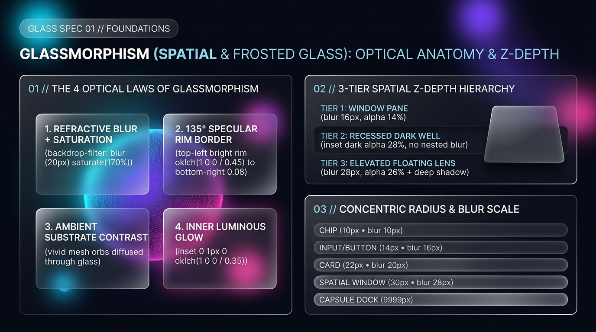

# Glassmorphism Design — Foundations, Optical Anatomy & Spatial Z-Depth

Glassmorphism (popularized across modern spatial computing like Apple **visionOS**, macOS translucent materials, and Fluent Acrylic) constructs **refractive, light-reactive, translucent frosted-glass surfaces** floating in 3D space over vivid multi-stop mesh substrates. True production Glassmorphism is **not** merely `background: rgba(255,255,255,0.1)` with a blur—it requires the coordinated interplay of **chromatic saturation boost (`saturate(160%–180%)`), $135^\circ$ directional specular rim borders, top-edge inner light reflection, and strict Z-axis blur/opacity hierarchy**.

---

## Foundations Decision Matrix

| Goal | Tool | Why |
| :--- | :--- | :--- |
| Diffuse background details while pulling vivid color into the pane | **`backdrop-filter: blur(16px–28px) saturate(160%–180%)`** | `blur()` alone washes underlying colors into dull gray mud; pairing `blur()` with `saturate(170%)` mimics real optical glass refraction. |
| Simulate a $135^\circ$ light source catching cut glass edges | **Directional Specular Rim Border** (`background-clip: padding-box, border-box` with $135^\circ$ white-to-transparent gradient) | A uniform `1px solid rgba(255,255,255,0.2)` border looks like a flat wire box; a $135^\circ$ gradient rim (`0.48` top-left $\rightarrow$ `0.06` bottom-right) creates physical cut-glass bevels. |
| Add top-edge specular thickness | **Inner Top Specular Highlight** (`inset 0 1px 0 0 oklch(1 0 0 / 0.35)`) + deep ambient drop shadow | Simulates overhead light reflecting off the top horizontal thickness of the glass pane. |
| Prevent 60fps GPU frame drops from nested blurs | **3-Tier Z-Depth Law (Max 2 Stacked Blurs)** — use recessed dark alpha wells (`oklch(0 0 0 / 0.35)`) inside parent glass windows | Stacking 3+ nested `backdrop-filter` elements forces multi-pass GPU texture readbacks that cripple scrolling and animation performance. |
| Maintain concentric nested geometry | **Concentric Radius Law ($R_{\text{outer}} = R_{\text{inner}} + \text{padding}$)** | Ensures inner wells and buttons curve in optical parallel with the outer spatial glass window. |

---

## Multimodal Visual Reference

Before defining Glassmorphism tokens or spatial window classes, inspect the foundational visual specification sheet:

- **Optical Anatomy, 3-Tier Spatial Z-Depth & Concentric Radius Scale:** [`./images/glassmorphism_foundations.jpg`](./images/glassmorphism_foundations.jpg)



### What to Observe in the Reference Sheet
1. **The 4 Optical Laws of Glassmorphism (`01 // LEFT`):**
   - **1. Refractive Blur + Saturation:** `backdrop-filter: blur(20px) saturate(170%)`.
   - **2. $135^\circ$ Specular Rim Border:** Bright top-left rim (`oklch(1 0 0 / 0.45)`) fading to `0.08` at bottom-right.
   - **3. Ambient Substrate Contrast:** Vivid aurora mesh orbs (`#00E5FF`, `#7C3AED`, `#EC4899`) diffused through the translucent pane.
   - **4. Inner Luminous Glow:** `inset 0 1px 0 oklch(1 0 0 / 0.35)` top-edge specular highlight.
2. **3-Tier Spatial Z-Depth Hierarchy (`02 // TOP RIGHT`):**
   - **Tier 1 (Window Pane):** `blur(16px)`, `alpha: 0.14` (or `0.38` dark quartz base).
   - **Tier 2 (Recessed Dark Well):** `inset` dark alpha (`0.28–0.45`), **no nested `backdrop-filter`**.
   - **Tier 3 (Elevated Floating Lens):** `blur(28px)`, `alpha: 0.26` + deep ambient drop shadow.
3. **Concentric Radius & Blur Scale (`03 // BOTTOM RIGHT`):** Chips (`10px • blur 10px`), Inputs/Buttons (`14px • blur 16px`), Cards (`22px • blur 20px`), Spatial Windows (`30px • blur 28px`), and Capsule Docks (`9999px`).

---

## Glassmorphism vs. Claymorphism vs. Neumorphism

| Dimension | Glassmorphism (Spatial Glass) | Claymorphism (3D Matte Clay) | Neumorphism (Soft UI) |
| :--- | :--- | :--- | :--- |
| **Optical Transmission** | **Translucent & Refractive** (`backdrop-filter: blur() saturate()`) | **Opaque Matte** (`100%` solid pastel fill) | **Opaque Monolithic** (`100%` locked to canvas color) |
| **Edge Definition** | **$135^\circ$ Specular Rim Border** (`1px` gradient border-box) + `1px` top inner glint | **Thick `8px–16px` `inset` Bevels** (Top-left light + bottom-right shade) | **No border**; defined solely by dual outer shadows |
| **Background Requirement** | Requires **vivid mesh gradients, aurora orbs, or rich media** | Soft pastel/cream gradient or solid canvas | Strictly flat, identical neutral background |
| **GPU Consideration** | High (`backdrop-filter` must be capped at $\le 2$ stacked layers) | Low (standard `box-shadow` compositing) | Low (standard `box-shadow` compositing) |

---

## Core CSS Custom Properties & Spatial Glass Token Engine

```css
:root {
  color-scheme: dark light;

  /* 1. Deep-Space Midnight Canvas & Aurora Mesh Orbs (Cosmic Aurora Default) */
  --glass-canvas: light-dark(oklch(0.95 0.02 255), oklch(0.13 0.03 265)); /* #EEF2FF / #070913 */
  --glass-orb-1: oklch(0.85 0.18 205);  /* #00E5FF Aurora Cyan */
  --glass-orb-2: oklch(0.58 0.25 292);  /* #7C3AED Electric Violet */
  --glass-orb-3: oklch(0.66 0.24 350);  /* #EC4899 Magenta Pulse */

  /* 2. Foreground Optical Ink (High-Contrast White / Deep Slate) */
  --glass-ink: light-dark(oklch(0.18 0.04 260), oklch(0.99 0.005 250));       /* #0F172A / #FFFFFF */
  --glass-ink-secondary: light-dark(oklch(0.35 0.04 260), oklch(0.86 0.02 255)); /* #334155 / #CBD5E1 */
  --glass-ink-muted: light-dark(oklch(0.48 0.03 260), oklch(0.72 0.03 255));  /* #64748B / #94A3B8 */

  /* 3. 3-Tier Spatial Glass Surface Fills (Enforces Minimum Opacity Floor) */
  --glass-tier1-fill: light-dark(
    linear-gradient(135deg, oklch(1 0 0 / 0.68) 0%, oklch(1 0 0 / 0.48) 100%),
    linear-gradient(135deg, oklch(0.22 0.03 265 / 0.52) 0%, oklch(0.16 0.03 265 / 0.36) 100%)
  );
  --glass-tier2-well: light-dark(
    oklch(0.18 0.03 260 / 0.08),
    oklch(0.08 0.02 265 / 0.52)
  );
  --glass-tier3-lens: light-dark(
    linear-gradient(135deg, oklch(1 0 0 / 0.82) 0%, oklch(1 0 0 / 0.62) 100%),
    linear-gradient(135deg, oklch(0.28 0.04 265 / 0.62) 0%, oklch(0.20 0.03 265 / 0.44) 100%)
  );

  /* 4. 135° Specular Rim Gradient & Shadows */
  --glass-specular-rim: light-dark(
    linear-gradient(135deg, oklch(1 0 0 / 0.85) 0%, oklch(1 0 0 / 0.30) 50%, oklch(0.2 0.02 260 / 0.12) 100%),
    linear-gradient(135deg, oklch(1 0 0 / 0.48) 0%, oklch(1 0 0 / 0.14) 50%, oklch(1 0 0 / 0.04) 100%)
  );
  --glass-shadow-ambient:
    0 20px 45px -12px oklch(0 0 0 / 0.45),
    inset 0 1px 0 0 oklch(1 0 0 / 0.32);

  /* 5. Optical Blur & Concentric Radius Scale */
  --glass-blur-sm: blur(12px) saturate(160%);
  --glass-blur-md: blur(20px) saturate(175%);
  --glass-blur-lg: blur(28px) saturate(190%);

  --glass-radius-xs: 10px;
  --glass-radius-sm: 14px;
  --glass-radius-md: 22px;
  --glass-radius-lg: 30px;
  --glass-radius-pill: 9999px;

  /* 6. Spatial Fluid Easing */
  --glass-ease: cubic-bezier(0.22, 1, 0.36, 1);
  --glass-duration: 260ms;
}
```

---

## Reusable `.glass-pane`, `.glass-well`, and `.glass-lens` Primitives

Use dual-background clipping (`background-clip: padding-box, border-box`) so every `.glass-pane` gets a true $135^\circ$ specular rim border around rounded corners without requiring extra DOM wrapper nodes:

```css
/* Tier 1: Primary Spatial Glass Pane / Card */
.glass-pane {
  background-image: var(--glass-tier1-fill), var(--glass-specular-rim);
  background-origin: border-box;
  background-clip: padding-box, border-box;
  border: 1px solid transparent;
  border-radius: var(--glass-radius-md);
  backdrop-filter: var(--glass-blur-md);
  -webkit-backdrop-filter: var(--glass-blur-md);
  box-shadow: var(--glass-shadow-ambient);
  color: var(--glass-ink);
}

/* Tier 2: Recessed Smoked-Glass Inner Well (Zero Nested Blur for 60fps GPU safety) */
.glass-well {
  background-color: var(--glass-tier2-well);
  border-radius: var(--glass-radius-sm);
  border: 1px solid oklch(1 0 0 / 0.12);
  box-shadow:
    inset 0 2px 6px oklch(0 0 0 / 0.42),
    0 1px 0 oklch(1 0 0 / 0.08);
  padding: 1rem 1.25rem;
}

/* Tier 3: Elevated Floating Spatial Lens (Modals, Docks, Popovers) */
.glass-lens {
  background-image: var(--glass-tier3-lens), var(--glass-specular-rim);
  background-origin: border-box;
  background-clip: padding-box, border-box;
  border: 1px solid transparent;
  border-radius: var(--glass-radius-lg);
  backdrop-filter: var(--glass-blur-lg);
  -webkit-backdrop-filter: var(--glass-blur-lg);
  box-shadow:
    0 28px 60px -15px oklch(0 0 0 / 0.60),
    inset 0 1px 0 0 oklch(1 0 0 / 0.48);
}
```

---

## Do Not

| BAD | GOOD | Why |
| :--- | :--- | :--- |
| Using `backdrop-filter: blur(20px)` without `saturate()` | Pair `blur(20px)` with `saturate(160%–180%)` | Un-saturated Gaussian blur muddies underlying hues into lifeless gray fog. |
| Using a flat `border: 1px solid rgba(255,255,255,0.3)` on all 4 sides | Use a $135^\circ$ linear-gradient clipped to `border-box` (`0.48` top-left $\rightarrow$ `0.04` bottom-right) | Real glass reflects directional light primarily along the top-left edge facing the light source. |
| Placing a glass card on a flat, featureless `#111111` or `#F5F5F5` background | Always provide an atmospheric mesh gradient, glowing aurora orbs, or rich media substrate behind glass | Without background color variation or geometry to refract, `backdrop-filter` is completely invisible. |
| Nesting 4 levels of `backdrop-filter: blur()` inside each other | Apply `backdrop-filter` only to the outer Window (Tier 1) and Floating Overlays (Tier 3); use alpha-tinted `.glass-well` for Tier 2 children | Stacked backdrop blurs multiply GPU texture sampling passes and cause severe scroll/animation jank. |
