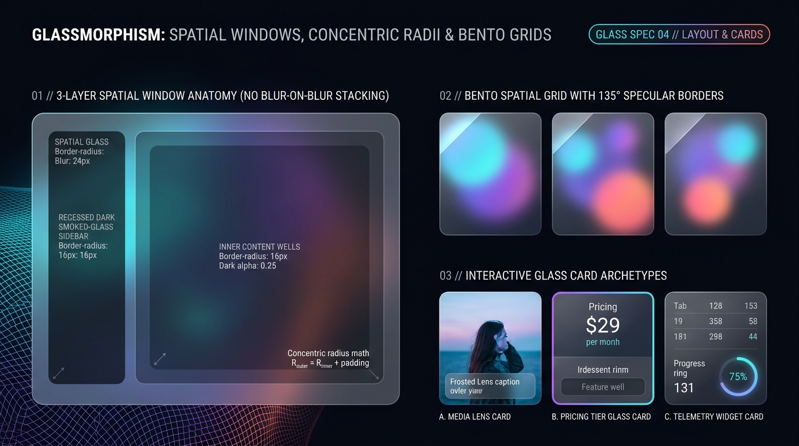

# Glassmorphism Design — Spatial Windows, Concentric Radii & Bento Grids

Spatial Glassmorphism organizes complex applications into **3 distinct optical Z-layers**:
1. **Tier 1 — Primary Spatial Window / Bento Card** (`backdrop-filter: blur(20px–24px) saturate(175%)`, $135^\circ$ specular rim).
2. **Tier 2 — Recessed Smoked-Glass Wells & Sidebars** (`oklch(0.06 0.02 265 / 0.48)` dark alpha with `inset` top shadow and **zero nested `backdrop-filter`**).
3. **Tier 3 — Floating Lens Overlays** (Media caption lenses, tooltips, popovers with `backdrop-filter: blur(28px) saturate(190%)`).

---

## Layout & Cards Decision Matrix

| Goal | Tool | Why |
| :--- | :--- | :--- |
| Group sidebars, code blocks, or feature lists inside a glass window | **Recessed Smoked-Glass Well (`.glass-well`) without nested `backdrop-filter`** | Creates unmistakable recessed depth polarity while avoiding GPU-killing blur-on-blur recursion. |
| Align nested inner cards inside a rounded spatial window | **Concentric Radius Equation ($R_{\text{outer}} = R_{\text{inner}} + \text{padding}$)** | If a window has `border-radius: 28px` and `padding: 12px`, the inner sidebar/well must use `border-radius: 16px` (`28 - 12 = 16`) so curves never pinch. |
| Build multi-widget analytics or feature dashboards | **Spatial Bento Grid** (`gap: clamp(1rem, 2vw, 1.5rem)` over a shared aurora mesh canvas) | Allows underlying aurora orbs to span seamlessly across adjacent glass cards, unifying the dashboard into a single optical field. |
| Overlay readable captions on photographs or video | **Bottom-Anchored Frosted Lens Bar** (`inset-block-end: 0.75rem`, `backdrop-filter: blur(18px) saturate(180%)`) | Ensures `> 7:1` caption contrast over any bright or dark region of the underlying photograph. |

---

## Multimodal Visual Reference

Inspect the 3-layer spatial window anatomy, concentric radius math, Bento spatial grid, and the 3 interactive glass card archetypes before building layouts:

- **Spatial Windows, Concentric Radii & Bento Grids:** [`./images/glassmorphism_layout_and_cards.jpg`](./images/glassmorphism_layout_and_cards.jpg)



### What to Observe in the Reference Sheet
1. **3-Layer Spatial Window Anatomy (`01 // LEFT`):** An outer spatial glass window (`border-radius: 28px`, `blur: 24px`) housing a recessed dark smoked-glass sidebar and inner content well (`border-radius: 16px`, `dark alpha: 0.25–0.45`, no nested blur), demonstrating $R_{\text{outer}} = R_{\text{inner}} + \text{padding}$.
2. **Bento Spatial Grid with $135^\circ$ Specular Borders (`02 // TOP RIGHT`):** Three translucent Bento cards refracting underlying cyan, violet, and coral mesh orbs with crisp top-left diagonal specular rims.
3. **Interactive Glass Card Archetypes (`03 // BOTTOM RIGHT`):**
   - **A. Media Lens Card:** Full-bleed photograph with a floating frosted glass caption bar anchored at the bottom.
   - **B. Pricing Tier Glass Card:** Highlighted with an iridescent cyan-violet rim and recessed feature well.
   - **C. Telemetry Widget Card:** Tabular matrix paired with a glowing circular progress gauge.

---

## Pattern 1: 3-Layer Spatial Application Window (Concentric Geometry)

```css
.glass-spatial-window {
  --_win-radius: 28px;
  --_win-pad: 12px;
  --_inner-radius: calc(var(--_win-radius) - var(--_win-pad)); /* 16px concentric */

  display: grid;
  grid-template-columns: 15rem minmax(0, 1fr);
  gap: var(--_win-pad);
  padding: var(--_win-pad);
  border-radius: var(--_win-radius);
  background-image: var(--glass-tier1-fill), var(--glass-specular-rim);
  background-origin: border-box;
  background-clip: padding-box, border-box;
  border: 1px solid transparent;
  backdrop-filter: var(--glass-blur-md);
  -webkit-backdrop-filter: var(--glass-blur-md);
  box-shadow: var(--glass-shadow-ambient);
}

/* Tier 2 Sidebar & Main Canvas: Recessed dark alpha, NO redundant backdrop-filter */
.glass-spatial-window__sidebar,
.glass-spatial-window__main {
  background-color: var(--glass-tier2-well);
  border-radius: var(--_inner-radius);
  border: 1px solid oklch(1 0 0 / 0.10);
  box-shadow: inset 0 2px 6px oklch(0 0 0 / 0.38);
  padding: 1.5rem;
}

@media (max-width: 48rem) {
  .glass-spatial-window {
    grid-template-columns: 1fr;
  }
}
```

---

## Pattern 2: Spatial Bento Grid with Hover Specular Bloom

```css
.glass-bento-grid {
  display: grid;
  grid-template-columns: repeat(12, minmax(0, 1fr));
  gap: clamp(1rem, 2vw, 1.5rem);
}

.glass-bento-card {
  grid-column: span 4;
  padding: clamp(1.5rem, 3vw, 2.25rem);
  border-radius: var(--glass-radius-md);
  background-image: var(--glass-tier1-fill), var(--glass-specular-rim);
  background-origin: border-box;
  background-clip: padding-box, border-box;
  border: 1px solid transparent;
  backdrop-filter: var(--glass-blur-md);
  -webkit-backdrop-filter: var(--glass-blur-md);
  box-shadow: var(--glass-shadow-ambient);
  transition:
    transform var(--glass-duration) var(--glass-ease),
    box-shadow var(--glass-duration) var(--glass-ease),
    background-image var(--glass-duration) var(--glass-ease);
}

/* Light-Reactive Hover: Rim brightens & card floats -3px toward viewer */
.glass-bento-card:hover {
  transform: translateY(-3px);
  background-image:
    var(--glass-tier3-lens),
    linear-gradient(135deg, oklch(1 0 0 / 0.72) 0%, oklch(0.85 0.18 205 / 0.35) 50%, oklch(1 0 0 / 0.08) 100%);
  box-shadow:
    0 26px 55px -12px oklch(0 0 0 / 0.55),
    inset 0 1px 0 0 oklch(1 0 0 / 0.55);
}

@media (max-width: 60rem) {
  .glass-bento-card { grid-column: span 6; }
}
@media (max-width: 38rem) {
  .glass-bento-card { grid-column: 1 / -1; }
}
```

---

## Pattern 3: Media Lens Card with Floating Frosted Caption Overlay

```css
.glass-media-card {
  position: relative;
  border-radius: var(--glass-radius-md);
  overflow: clip;
  border: 1px solid oklch(1 0 0 / 0.24);
  aspect-ratio: 4 / 5;
}

.glass-media-card__img {
  inline-size: 100%;
  block-size: 100%;
  object-fit: cover;
  display: block;
  transition: transform 500ms var(--glass-ease);
}

.glass-media-card:hover .glass-media-card__img {
  transform: scale(1.04);
}

/* Floating Frosted Caption Lens (Concentric inset: 22px outer - 10px inset = 12px inner) */
.glass-media-card__lens {
  position: absolute;
  inset-inline: 0.625rem;
  inset-block-end: 0.625rem;
  padding-block: 0.875rem;
  padding-inline: 1.125rem;
  border-radius: 12px;
  background-color: oklch(0.15 0.03 265 / 0.58);
  backdrop-filter: blur(20px) saturate(180%);
  -webkit-backdrop-filter: blur(20px) saturate(180%);
  border: 1px solid oklch(1 0 0 / 0.32);
  box-shadow: inset 0 1px 0 oklch(1 0 0 / 0.35);
  color: #FFFFFF;
}
```

---

## Do Not

| BAD | GOOD | Why |
| :--- | :--- | :--- |
| Setting `border-radius: 24px` on both the outer window (`padding: 16px`) and inner child card | Subtract the padding ($R_{\text{inner}} = 24\text{px} - 16\text{px} = 8\text{px}$ or $12\text{px}$) | Identical inner and outer radii create uneven, pinched optical gaps at the corners. |
| Applying `backdrop-filter: blur(24px)` to the outer window, inner sidebar, inner card, and inner table row simultaneously | Apply `backdrop-filter` only to the outer window; use `.glass-well` (`oklch(0 0 0 / 0.4)`) for internal containers | Eliminates redundant GPU blur passes while creating cleaner recessed contrast. |
| Using `overflow: hidden` on a parent container when child cards have `-15px` ambient drop shadows | Leave `overflow: visible` on grid wrappers or provide `>= 24px` padding clearance | Clipping ambient drop shadows makes floating glass cards look abruptly guillotined. |
| Animating `backdrop-filter: blur(0px)` to `blur(24px)` continuously on scroll | Keep the `blur()` radius static and animate `opacity` or `transform: translate3d()` | Animating Gaussian blur radius on every scroll frame triggers expensive per-frame shader recompilation. |
