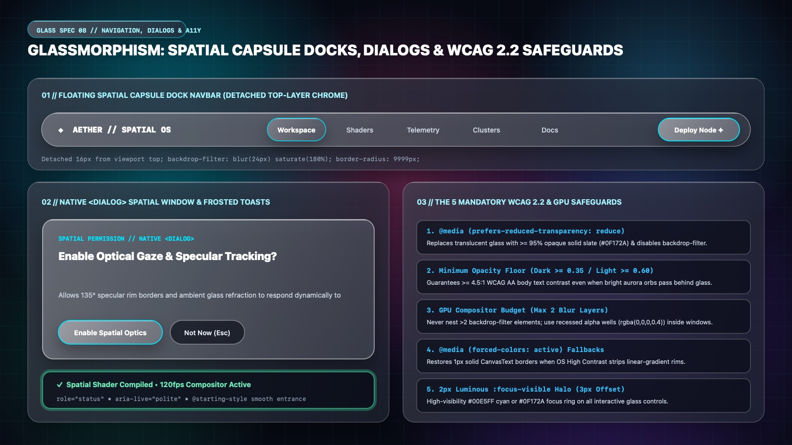

# Glassmorphism Design — Spatial Capsule Docks, Dialogs & WCAG 2.2 Safeguards

In Spatial Glassmorphism, top-level navigation and modal overlays float on **Tier 3 (Elevated Spatial Lenses)**—detached from the viewport edges so underlying aurora mesh gradients and scrolling content refract smoothly around their capsule perimeters. Because translucency introduces unique accessibility and GPU challenges, every Glassmorphic interface must enforce **The 5 Mandatory WCAG 2.2 & GPU Safeguards**.

---

## Navigation, Dialogs & Accessibility Decision Matrix

| Goal | Tool | Why |
| :--- | :--- | :--- |
| Primary top navigation bar | **Detached Spatial Capsule Dock** (`position: sticky; inset-block-start: 1rem; border-radius: 9999px; backdrop-filter: blur(24px) saturate(180%)`) | Floating the navbar `1rem` off the top edge lets the user see the spatial canvas around all 360° of the capsule rim. |
| Active navigation link state | **Illuminated Specular Pill (`aria-current="page"`)** (`oklch(1 0 0 / 0.18)` + `1px` top specular glint) | Highlights the current workspace section as an elevated glass lens inside the dock. |
| Modal confirmations & permission prompts | **Native `<dialog>` Spatial Window + `@starting-style`** (`scale(0.95) -> scale(1)` + smoked dim `::backdrop`) | Provides native top-layer promotion, focus trapping, and `Escape` dismissal with smooth spatial entrance physics. |
| Non-blocking status notifications | **Frosted Toast Capsule (`role="status"`)** with glowing semantic accent border | Surfaces real-time feedback in the top-layer without blocking pointer interaction. |
| Support users with visual/vestibular sensitivities | **`@media (prefers-reduced-transparency: reduce)` & `@media (forced-colors: active)`** | Automatically replaces translucent glass with `96%` opaque high-contrast slate/alabaster when requested by OS accessibility settings. |

---

## Multimodal Visual Reference

Inspect the floating spatial capsule dock navbar, the native `<dialog>` spatial permission modal, the frosted toast alert, and the 5 mandatory WCAG 2.2 & GPU safeguards before building top-layer components:

- **Spatial Capsule Docks, Dialogs & WCAG 2.2 Safeguards:** [`./images/glassmorphism_navigation_and_dialogs.jpg`](./images/glassmorphism_navigation_and_dialogs.jpg)



### What to Observe in the Reference Sheet
1. **Floating Spatial Capsule Dock Navbar (`01 // TOP`):** Detached `16px` from the viewport top with `border-radius: 9999px`, `backdrop-filter: blur(24px) saturate(180%)`, an illuminated `Workspace` active pill, and a right-aligned `Deploy Node ✦` CTA.
2. **Native `<dialog>` Spatial Window & Frosted Toasts (`02 // BOTTOM LEFT`):** Centered `<dialog>` modal with a bright specular border, paired `Enable Spatial Optics` and `Not Now (Esc)` buttons, and a bottom frosted toast (`✓ Spatial Shader Compiled`) with a bioluminescent mint border.
3. **The 5 Mandatory WCAG 2.2 & GPU Safeguards (`03 // BOTTOM RIGHT`):**
   - **1. `@media (prefers-reduced-transparency: reduce)`** solid fallback.
   - **2. Minimum Opacity Floor (`Dark >= 0.35 / Light >= 0.60`)**.
   - **3. GPU Compositor Budget (Max 2 Blur Layers)**.
   - **4. `@media (forced-colors: active)`** system border restoration.
   - **5. `2px` Luminous `:focus-visible` Halo (`3px` offset)**.

---

## Floating Spatial Capsule Dock Navbar

```css
.glass-dock-wrapper {
  position: sticky;
  inset-block-start: 1rem;
  z-index: 50;
  padding-inline: clamp(1rem, 3vw, 2.5rem);
  pointer-events: none; /* Allows clicks in margin around the floating capsule */
}

.glass-dock {
  pointer-events: auto;
  max-inline-size: 76rem;
  margin-inline: auto;
  min-block-size: 4rem; /* 64px */
  padding-block: 0.5rem;
  padding-inline: 1.25rem;
  border-radius: var(--glass-radius-pill);
  display: flex;
  align-items: center;
  justify-content: space-between;
  gap: 1.5rem;
  background-image: var(--glass-tier3-lens), var(--glass-specular-rim);
  background-origin: border-box;
  background-clip: padding-box, border-box;
  border: 1px solid transparent;
  backdrop-filter: var(--glass-blur-lg);
  -webkit-backdrop-filter: var(--glass-blur-lg);
  box-shadow:
    0 20px 45px -12px oklch(0 0 0 / 0.55),
    inset 0 1px 0 0 oklch(1 0 0 / 0.48);
}

.glass-dock__nav {
  display: flex;
  align-items: center;
  gap: 0.375rem;
  list-style: none;
  margin: 0;
  padding: 0;
}

.glass-dock__link {
  display: inline-flex;
  align-items: center;
  min-block-size: 2.5rem;
  padding-inline: 1.125rem;
  border-radius: var(--glass-radius-pill);
  border: 1px solid transparent;
  color: var(--glass-ink-secondary);
  font-size: 0.875rem;
  font-weight: 600;
  text-decoration: none;
  transition:
    color var(--glass-duration) var(--glass-ease),
    background-color var(--glass-duration) var(--glass-ease),
    border-color var(--glass-duration) var(--glass-ease);
}

.glass-dock__link:hover {
  color: var(--glass-ink);
  background-color: oklch(1 0 0 / 0.08);
}

.glass-dock__link[aria-current="page"] {
  color: var(--glass-ink);
  background-color: oklch(1 0 0 / 0.16);
  border-color: oklch(1 0 0 / 0.42);
  box-shadow: inset 0 1px 0 oklch(1 0 0 / 0.45);
}
```

---

## Native `<dialog>` Spatial Window (`@starting-style`)

```css
.glass-dialog {
  inline-size: min(92vw, 32rem);
  padding: clamp(1.75rem, 4vw, 2.5rem);
  border-radius: var(--glass-radius-lg);
  background-image: var(--glass-tier3-lens), var(--glass-specular-rim);
  background-origin: border-box;
  background-clip: padding-box, border-box;
  border: 1px solid transparent;
  backdrop-filter: var(--glass-blur-lg);
  -webkit-backdrop-filter: var(--glass-blur-lg);
  box-shadow:
    0 32px 70px -15px oklch(0 0 0 / 0.68),
    inset 0 1px 0 0 oklch(1 0 0 / 0.55);
  color: var(--glass-ink);
  opacity: 0;
  transform: scale(0.95) translateY(10px);
  transition:
    opacity var(--glass-duration) var(--glass-ease),
    transform var(--glass-duration) var(--glass-ease),
    overlay var(--glass-duration) allow-discrete,
    display var(--glass-duration) allow-discrete;
}

.glass-dialog[open] {
  opacity: 1;
  transform: scale(1) translateY(0);
}

@starting-style {
  .glass-dialog[open] {
    opacity: 0;
    transform: scale(0.95) translateY(10px);
  }
}

.glass-dialog::backdrop {
  background-color: oklch(0.06 0.02 265 / 0);
  transition:
    background-color var(--glass-duration) var(--glass-ease),
    overlay var(--glass-duration) allow-discrete,
    display var(--glass-duration) allow-discrete;
}

.glass-dialog[open]::backdrop {
  /* Dim backdrop WITHOUT full-screen backdrop-filter to preserve GPU budget for the dialog itself */
  background-color: oklch(0.06 0.02 265 / 0.62);
}

@starting-style {
  .glass-dialog[open]::backdrop {
    background-color: oklch(0.06 0.02 265 / 0);
  }
}
```

---

## The 5 Mandatory WCAG 2.2 & GPU Safeguards for Glassmorphism

Include this defensive block in every Glassmorphism stylesheet:

```css
/* 1. Respect User OS "Reduce Transparency" Preference */
@media (prefers-reduced-transparency: reduce) {
  :root {
    --glass-tier1-fill: linear-gradient(135deg, oklch(0.18 0.03 265 / 0.96), oklch(0.15 0.03 265 / 0.96));
    --glass-tier2-well: oklch(0.11 0.02 265 / 0.98);
    --glass-tier3-lens: linear-gradient(135deg, oklch(0.22 0.03 265 / 0.98), oklch(0.18 0.03 265 / 0.98));
  }

  .glass-pane,
  .glass-lens,
  .glass-dock,
  .glass-dialog,
  .glass-btn {
    backdrop-filter: none !important;
    -webkit-backdrop-filter: none !important;
  }
}

/* 2. Progressive Enhancement Fallback for Engines Without backdrop-filter */
@supports not ((backdrop-filter: blur(1px)) or (-webkit-backdrop-filter: blur(1px))) {
  .glass-pane,
  .glass-lens,
  .glass-dock,
  .glass-dialog {
    background-color: oklch(0.16 0.03 265 / 0.94);
  }
}

/* 3. High Contrast / Forced Colors Mode (Windows Contrast Themes) */
@media (forced-colors: active) {
  .glass-pane,
  .glass-well,
  .glass-lens,
  .glass-dock,
  .glass-dialog,
  .glass-btn,
  .glass-input {
    backdrop-filter: none;
    background: Canvas;
    color: CanvasText;
    border: 1px solid CanvasText;
    box-shadow: none;
  }
}

/* 4. Reduced Motion Preference */
@media (prefers-reduced-motion: reduce) {
  *,
  *::before,
  *::after {
    animation-duration: 0.01ms !important;
    transition-duration: 0.01ms !important;
  }
}
```

---

## Do Not

| BAD | GOOD | Why |
| :--- | :--- | :--- |
| Ignoring `@media (prefers-reduced-transparency: reduce)` | Always provide a `>= 95%` opaque fallback surface and disable `backdrop-filter` when reduced transparency is requested | Users with low vision, dyslexia, or astigmatism often enable Reduce Transparency at the OS level to read text cleanly. |
| Applying `backdrop-filter: blur(20px)` to both `.glass-dialog::backdrop` AND `.glass-dialog` simultaneously | Use a dark smoked alpha (`oklch(0.06 0.02 265 / 0.62)`) on `::backdrop` and apply `backdrop-filter: blur(28px)` to `.glass-dialog` | Blurring the entire 4K viewport via `::backdrop` plus blurring the modal doubles full-screen GPU shader cost. |
| Using `div` overlays with `z-index: 9999` for spatial modals | Use native `<dialog class="glass-dialog">` with `.showModal()` | Native `<dialog>` renders in the browser's top layer above all `z-index` stacking contexts and traps focus automatically. |
| Relying on `border-image` for rounded specular borders | Use dual `background-image` layers with `background-clip: padding-box, border-box` and `border: 1px solid transparent` | CSS `border-image` ignores `border-radius` and forces sharp rectangular corners. |
