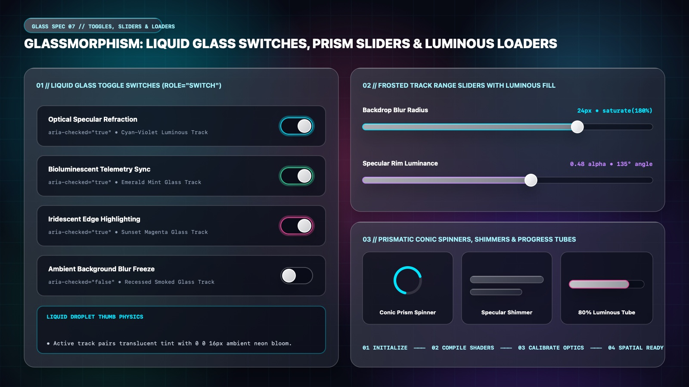

# Glassmorphism Design — Liquid Glass Switches, Prism Sliders & Luminous Loaders

Glassmorphic continuous controls and asynchronous indicators combine **recessed smoked-glass channels** with **bioluminescent gradient fills and specular droplet thumbs**. When a switch is toggled or a range slider is dragged, the active channel emits a soft optical bloom (`box-shadow: 0 0 16px oklch(from var(--glass-accent) l c h / 0.40)`).

---

## Toggles, Sliders & Loaders Decision Matrix

| Goal | Tool | Why |
| :--- | :--- | :--- |
| Binary preference switch | **Liquid Glass `role="switch"`** (`56px × 32px` recessed smoked track $\rightarrow$ luminous cyan/mint active track + `24px` specular droplet thumb) | Pairs a recessed smoked channel when `OFF` with a glowing translucent prism track when `ON`. |
| Continuous range adjustment | **Frosted Track Range Slider + Luminous Prism Fill** (`10px` recessed channel + cyan-violet active bar + `24px` glass orb thumb) | Provides clear visual contrast between the filled luminous portion and the dark unfilled well. |
| Indeterminate loading spinner | **Conic Prism Ring Spinner** (`conic-gradient` masked with `radial-gradient` hollow center + `drop-shadow`) | Creates a smooth, seamless glowing optical arc without jagged border corners. |
| Content placeholder loading | **110° Specular Shimmer Skeleton** (`linear-gradient(110deg, ...)` sweeping across frosted bars) | Simulates a beam of light passing across a frosted glass pane while data loads. |
| Determinate progress indicator | **Luminous Glass Progress Tube** (Recessed dark capsule housing a glowing neon gradient core) | Reads as an illuminated fiber-optic or plasma tube inside the glass surface. |

---

## Multimodal Visual Reference

Inspect the liquid glass toggle switches, frosted track range sliders, conic prism spinner, specular shimmer skeleton, and luminous progress tube before building controls:

- **Liquid Glass Switches, Prism Sliders & Luminous Loaders:** [`./images/glassmorphism_toggles_and_loaders.jpg`](./images/glassmorphism_toggles_and_loaders.jpg)



### What to Observe in the Reference Sheet
1. **Liquid Glass Toggle Switches (`01 // LEFT`):** Compare active tracks in Cyan-Violet (`#00E5FF`), Bioluminescent Mint (`#34D399`), and Sunset Magenta (`#EC4899`) against the recessed smoked-glass `OFF` track, each housing a specular white droplet thumb.
2. **Frosted Track Range Sliders with Luminous Fill (`02 // TOP RIGHT`):** Recessed dark channel with a glowing cyan or lavender fill bar, a `28px` specular glass orb thumb, and `tabular-nums` value readouts (`24px • saturate(180%)`).
3. **Prismatic Conic Spinners, Shimmers & Progress Tubes (`03 // BOTTOM RIGHT`):** Hollow conic-gradient ring spinner, `110deg` specular shimmer skeleton bars, an `80%` luminous progress tube, and a 4-stage spatial stepper.

---

## Liquid Glass Toggle Switch (`role="switch"`)

```html
<button
  type="button"
  role="switch"
  aria-checked="true"
  aria-label="Optical Specular Refraction"
  class="glass-switch"
>
  <span class="glass-switch__thumb" aria-hidden="true"></span>
</button>
```

```css
.glass-switch {
  --_switch-glow: var(--glass-accent);

  position: relative;
  display: inline-flex;
  align-items: center;
  inline-size: 3.5rem;  /* 56px */
  block-size: 2rem;     /* 32px */
  padding: 0.1875rem;   /* 3px */
  border-radius: var(--glass-radius-pill);
  background-color: oklch(0.08 0.02 265 / 0.62);
  border: 1px solid oklch(1 0 0 / 0.24);
  box-shadow: inset 0 2px 5px oklch(0 0 0 / 0.50);
  cursor: pointer;
  transition:
    background-color var(--glass-duration) var(--glass-ease),
    border-color var(--glass-duration) var(--glass-ease),
    box-shadow var(--glass-duration) var(--glass-ease);
}

.glass-switch__thumb {
  inline-size: 1.5rem;  /* 24px specular droplet */
  block-size: 1.5rem;
  border-radius: var(--glass-radius-pill);
  background: linear-gradient(135deg, #FFFFFF 0%, #E2E8F0 100%);
  box-shadow:
    0 2px 8px oklch(0 0 0 / 0.45),
    inset 0 1px 0 #FFFFFF;
  transition: transform var(--glass-duration) var(--glass-ease);
}

.glass-switch[aria-checked="true"] {
  background-color: oklch(from var(--_switch-glow) l c h / 0.42);
  border-color: oklch(from var(--_switch-glow) 0.90 0.16 h / 0.80);
  box-shadow:
    0 0 18px oklch(from var(--_switch-glow) l c h / 0.38),
    inset 0 1px 0 oklch(1 0 0 / 0.45);
}

.glass-switch[aria-checked="true"] .glass-switch__thumb {
  transform: translateX(1.5rem); /* 24px travel */
}

.glass-switch:focus-visible {
  outline: 2px solid var(--glass-accent);
  outline-offset: 3px;
}
```

---

## Frosted Track Range Slider with Luminous Prism Fill

```css
.glass-slider {
  --_fill-pct: 72%;
  appearance: none;
  inline-size: 100%;
  block-size: 0.625rem; /* 10px recessed channel */
  border-radius: var(--glass-radius-pill);
  background:
    linear-gradient(90deg, #00E5FF 0%, #A855F7 var(--_fill-pct), transparent var(--_fill-pct)),
    oklch(0.08 0.02 265 / 0.60);
  border: 1px solid oklch(1 0 0 / 0.18);
  box-shadow: inset 0 2px 4px oklch(0 0 0 / 0.50);
  cursor: pointer;
}

.glass-slider::-webkit-slider-thumb {
  appearance: none;
  inline-size: 1.5rem; /* 24px */
  block-size: 1.5rem;
  border-radius: var(--glass-radius-pill);
  background: oklch(1 0 0 / 0.90);
  border: 2px solid #FFFFFF;
  box-shadow:
    0 0 14px oklch(0.85 0.18 205 / 0.75),
    0 4px 10px oklch(0 0 0 / 0.45);
  transition: transform 200ms var(--glass-ease);
}

.glass-slider::-webkit-slider-thumb:hover {
  transform: scale(1.12);
}
```

---

## Conic Prism Spinner, Specular Shimmer Skeleton & Progress Tube

```css
/* 1. Conic Prism Ring Spinner */
.glass-conic-spinner {
  inline-size: 2.75rem;
  block-size: 2.75rem;
  border-radius: var(--glass-radius-pill);
  background: conic-gradient(from 0deg, transparent 0%, #00E5FF 55%, #EC4899 88%, #FFFFFF 100%);
  -webkit-mask: radial-gradient(farthest-side, transparent calc(100% - 5px), #000 calc(100% - 4px));
  mask: radial-gradient(farthest-side, transparent calc(100% - 5px), #000 calc(100% - 4px));
  filter: drop-shadow(0 0 8px oklch(0.85 0.18 205 / 0.45));
  animation: glass-spin 1.1s linear infinite;
}

@keyframes glass-spin {
  to { transform: rotate(360deg); }
}

/* 2. 110deg Specular Shimmer Skeleton */
.glass-skeleton {
  border-radius: var(--glass-radius-xs);
  background: linear-gradient(
    110deg,
    oklch(1 0 0 / 0.06) 25%,
    oklch(1 0 0 / 0.22) 50%,
    oklch(1 0 0 / 0.06) 75%
  );
  background-size: 200% 100%;
  border: 1px solid oklch(1 0 0 / 0.12);
  animation: glass-shimmer 1.8s ease-in-out infinite;
}

@keyframes glass-shimmer {
  to { background-position-x: -200%; }
}

/* 3. Luminous Progress Tube */
.glass-progress-tube {
  inline-size: 100%;
  block-size: 0.75rem;
  padding: 2px;
  border-radius: var(--glass-radius-pill);
  background-color: oklch(0.08 0.02 265 / 0.65);
  border: 1px solid oklch(1 0 0 / 0.20);
  box-shadow: inset 0 2px 4px oklch(0 0 0 / 0.50);
}

.glass-progress-tube__fill {
  block-size: 100%;
  border-radius: var(--glass-radius-pill);
  background: linear-gradient(90deg, #00E5FF, #A855F7, #EC4899);
  box-shadow: 0 0 12px oklch(0.85 0.18 205 / 0.60);
  transition: inline-size 320ms var(--glass-ease);
}
```

---

## Do Not

| BAD | GOOD | Why |
| :--- | :--- | :--- |
| Making both `OFF` and `ON` switch tracks pale white (`rgba(255,255,255,0.2)`) | Contrast a **dark recessed smoked track (`OFF`)** with a **luminous tinted track (`ON`)** | Users should never rely solely on thumb position to tell whether a switch is enabled. |
| Animating `box-shadow` blur radius on infinite skeleton loaders | Animate `background-position-x` (`transform` or background sweep) | Animating `box-shadow` across dozens of skeleton rows triggers continuous main-thread repaint overhead. |
| Ignoring `prefers-reduced-motion: reduce` on spinning rings and shimmers | Slow or pause continuous shimmer/spin animations under `@media (prefers-reduced-motion: reduce)` | Prevents vestibular discomfort from high-contrast moving light sweeps. |
