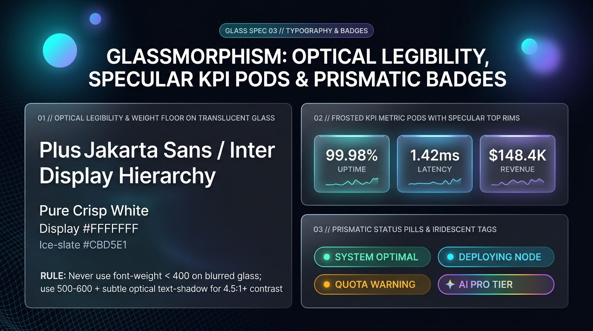

# Glassmorphism Design — Optical Legibility, Specular KPI Pods & Prismatic Badges

Translucent refractive surfaces degrade sub-pixel font antialiasing when bright aurora orbs or photographs pass behind text. Glassmorphism typography compensates with **high-clarity Neo-Grotesque/Geometric sans-serifs** (`Plus Jakarta Sans`, `Inter`, `SF Pro Display`), a **strict font-weight floor (`font-weight >= 400` for body, `600–800` for headings)**, **subtle optical backing shadows**, and **luminous specular KPI metric pods and status pills**.

---

## Typography & Badges Decision Matrix

| Goal | Tool | Why |
| :--- | :--- | :--- |
| Prevent thin strokes from vanishing over blurred mesh gradients | **Font-Weight Floor (`>= 450` body, `600–700` UI labels, `700–800` display)** | Ultra-light `font-weight: 200–300` strokes fragment visually against refractive background noise. |
| Guarantee crisp glyph separation over bright background regions | **Optical Backing Shadow** (`text-shadow: 0 1px 10px oklch(0 0 0 / 0.28)` in dark mode) | Adds an imperceptible micro-halo behind white glyphs that preserves `4.5:1+` contrast over bright cyan/magenta mesh hotspots. |
| Highlight hero metrics & telemetry readouts | **Specular Top-Rim KPI Pod** (`inset 0 1px 0 oklch(1 0 0 / 0.55)` + `tabular-nums`) | Frames high-priority numbers inside dedicated frosted lenses with a bright top specular glint. |
| Display live system or tier status | **Prismatic Capsule Pill + Glowing Status Dot** (`box-shadow: 0 0 8px currentColor`) | Combines a translucent tinted capsule with a bioluminescent indicator dot for instant scannability. |
| Distinguish AI / Pro / Spatial feature badges | **Iridescent Rainbow-Specular Border Pill** (`background-clip: padding-box, border-box`) | Uses a multi-stop cyan-violet-magenta border gradient to signal premium spatial capabilities. |

---

## Multimodal Visual Reference

Inspect the optical legibility hierarchy, frosted KPI metric pods, and prismatic status pills before styling text or badges:

- **Optical Legibility, Specular KPI Pods & Prismatic Badges:** [`./images/glassmorphism_typography_and_badges.jpg`](./images/glassmorphism_typography_and_badges.jpg)



### What to Observe in the Reference Sheet
1. **Optical Legibility & Weight Floor (`01 // LEFT`):** Crisp `Plus Jakarta Sans / Inter` display hierarchy in `#FFFFFF` and `#CBD5E1`, enforcing `font-weight >= 400` (with `500–700` for UI labels and headings) and subtle optical `text-shadow`.
2. **Frosted KPI Metric Pods with Specular Top Rims (`02 // TOP RIGHT`):** Three glowing glass telemetry pods (`99.98% UPTIME`, `1.42ms LATENCY`, `$148.4K REVENUE`) featuring bright top-edge specular glints and `tabular-nums` alignment.
3. **Prismatic Status Pills & Iridescent Tags (`03 // BOTTOM RIGHT`):** Capsule pills with glowing status dots (`● SYSTEM OPTIMAL`, `● DEPLOYING NODE`, `● QUOTA WARNING`) and an iridescent rainbow-rimmed `✦ AI PRO TIER` badge.

---

## Optical Typography Scale & Contrast-Safe Rules

```css
:root {
  --glass-font-sans: 'Plus Jakarta Sans', 'Inter', -apple-system, BlinkMacSystemFont, sans-serif;
  --glass-font-mono: 'JetBrains Mono', 'SF Mono', ui-monospace, monospace;

  --glass-text-display: clamp(2.25rem, 4.5vw + 1rem, 4.25rem);
  --glass-text-h1: clamp(1.75rem, 3vw + 0.75rem, 2.75rem);
  --glass-text-h2: clamp(1.35rem, 2vw + 0.5rem, 1.85rem);
  --glass-text-body: clamp(0.95rem, 0.25vw + 0.9rem, 1.05rem);
}

.glass-display,
.glass-h1,
.glass-h2 {
  font-family: var(--glass-font-sans);
  font-weight: 700;
  letter-spacing: -0.025em;
  line-height: 1.12;
  color: var(--glass-ink);
  text-wrap: balance;
  /* Subtle optical shadow prevents washout over bright mesh orbs in dark mode */
  text-shadow: 0 2px 16px oklch(0 0 0 / 0.28);
}

/* Prismatic Gradient Headline Accent */
.glass-text-prism {
  background: linear-gradient(95deg, #FFFFFF 15%, #67E8F9 55%, #C084FC 95%);
  -webkit-background-clip: text;
  background-clip: text;
  -webkit-text-fill-color: transparent;
  text-shadow: none;
}

/* Optical Body Copy: Never thinner than 400 (450-500 preferred on glass) */
.glass-prose {
  font-family: var(--glass-font-sans);
  font-size: var(--glass-text-body);
  font-weight: 450;
  line-height: 1.65;
  color: var(--glass-ink-secondary);
  max-inline-size: 62ch;
  text-wrap: pretty;
}
```

---

## Frosted KPI Metric Pods with Top Specular Glint

```css
.glass-kpi-pod {
  --_kpi-glow: var(--glass-accent);

  position: relative;
  padding-block: 1.5rem;
  padding-inline: 1.75rem;
  border-radius: var(--glass-radius-md);
  background-image:
    linear-gradient(
      145deg,
      oklch(from var(--_kpi-glow) 0.24 0.06 h / 0.48) 0%,
      oklch(0.14 0.03 265 / 0.42) 100%
    ),
    linear-gradient(
      135deg,
      oklch(from var(--_kpi-glow) 0.88 0.16 h / 0.72) 0%,
      oklch(1 0 0 / 0.10) 60%
    );
  background-origin: border-box;
  background-clip: padding-box, border-box;
  border: 1px solid transparent;
  backdrop-filter: var(--glass-blur-md);
  -webkit-backdrop-filter: var(--glass-blur-md);
  box-shadow:
    0 16px 36px -10px oklch(0 0 0 / 0.50),
    inset 0 1px 0 0 oklch(1 0 0 / 0.55);
}

.glass-kpi-pod__value {
  font-family: var(--glass-font-sans);
  font-size: clamp(1.85rem, 2.8vw, 2.5rem);
  font-weight: 800;
  letter-spacing: -0.03em;
  color: var(--glass-ink);
  font-variant-numeric: tabular-nums;
}

.glass-kpi-pod__label {
  margin-block-start: 0.35rem;
  font-family: var(--glass-font-mono);
  font-size: 0.75rem;
  font-weight: 600;
  letter-spacing: 0.12em;
  text-transform: uppercase;
  color: var(--glass-ink-secondary);
}
```

---

## Prismatic Status Pills & Iridescent Specular Badges

```css
.glass-badge {
  --_badge-color: oklch(0.85 0.18 205); /* Default Cyan */

  display: inline-flex;
  align-items: center;
  gap: 0.5rem;
  padding-block: 0.35rem;
  padding-inline: 0.875rem;
  border-radius: var(--glass-radius-pill);
  background-color: oklch(from var(--_badge-color) 0.24 0.08 h / 0.45);
  border: 1px solid oklch(from var(--_badge-color) 0.82 0.16 h / 0.55);
  box-shadow: inset 0 1px 0 oklch(1 0 0 / 0.28);
  color: oklch(from var(--_badge-color) 0.94 0.08 h);
  font-family: var(--glass-font-sans);
  font-size: 0.75rem;
  font-weight: 600;
  letter-spacing: 0.08em;
  text-transform: uppercase;
}

/* Bioluminescent Glowing Indicator Dot */
.glass-badge__dot {
  inline-size: 0.5rem;
  block-size: 0.5rem;
  border-radius: var(--glass-radius-pill);
  background-color: var(--_badge-color);
  box-shadow: 0 0 8px var(--_badge-color);
}

/* Iridescent Rainbow-Specular Pro Badge */
.glass-badge--iridescent {
  background-image:
    linear-gradient(135deg, oklch(0.18 0.04 275 / 0.72), oklch(0.14 0.03 265 / 0.62)),
    linear-gradient(90deg, #00E5FF 0%, #A855F7 50%, #EC4899 100%);
  background-origin: border-box;
  background-clip: padding-box, border-box;
  border: 1px solid transparent;
  color: #FFFFFF;
}
```

---

## Do Not

| BAD | GOOD | Why |
| :--- | :--- | :--- |
| Using `font-weight: 200` or `300` on translucent glass cards | Use `font-weight >= 450` for body copy and `600–800` for headings and badges | Thin glyph stems dissolve into blurred background noise and fail legibility checks. |
| Applying multi-color rainbow gradients to long body paragraphs | Reserve `.glass-text-prism` for short display hero phrases or badges; keep body copy solid `--glass-ink` | Gradient body text over a translucent background is nearly impossible to read cleanly. |
| Using low-alpha muted gray (`rgba(255,255,255,0.35)`) for secondary labels on glass | Keep secondary copy at `oklch(0.86 0.02 255)` (`#CBD5E1`) or higher in dark mode | Transparent text over a transparent card compounds alpha reduction and drops below `3:1` contrast. |
| Omitting `tabular-nums` on live telemetry KPI pods | Always apply `font-variant-numeric: tabular-nums` to numeric readouts | Prevents horizontal jitter when live metrics update inside glass pods. |
