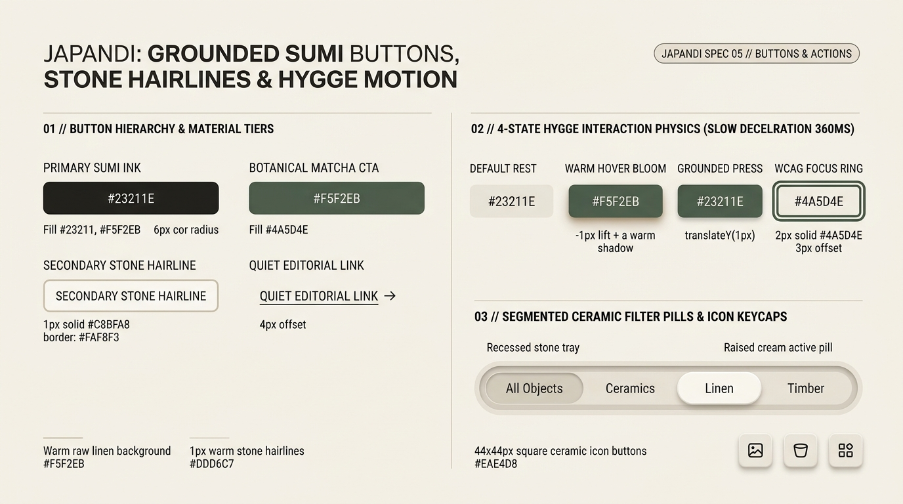

# Japandi Design — Grounded Sumi Buttons, Stone Hairlines & Hygge Motion

Japandi action controls reject flashy neon gradients, glossy plastic bevels, and frantic spring animations. Buttons feel like **honed river stones, matte ceramic tiles, or brushed timber blocks**: grounded in **Sumi Charcoal (`#23211E`)** or **Moss Matcha (`#4A5D4E`)**, framed with **`1px` mineral hairlines**, and animated with **Hygge Slow-Deceleration physics (`cubic-bezier(0.22, 1, 0.36, 1)` over `360ms`)**.

---

## Buttons & Actions Decision Matrix

| Goal | Tool | Why |
| :--- | :--- | :--- |
| Primary conversion or form submission | **Grounded Sumi Ink Button** (`#23211E` fill, `#F5F2EB` linen text, `6px` ceramic radius) | Delivers `> 13:1` WCAG AAA contrast while feeling like brushed cast iron or Sumi calligraphy ink rather than a corporate blue CTA. |
| Secondary / restorative primary action | **Botanical Moss Matcha Button** (`#4A5D4E` fill, `#FAF8F3` text) | Introduces organic nature-inspired warmth for wellness, living, or craft actions without shouting. |
| Secondary / neutral action | **Stone Hairline Button** (`#FAF8F3` travertine fill + `1px solid #C8BFA8` border) | Provides a tactile ceramic boundary (`>= 3:1` edge contrast) that harmonizes quietly with the raw linen canvas. |
| Tertiary editorial navigation or story link | **Quiet Underlined Editorial Link** (`1px` underline with `4px` offset + subtle `→` arrow shift) | Preserves *Ma* whitespace inside cards and article feeds without boxing every link in a button frame. |
| Category or view switching | **Recessed Stone Segmented Tray** (`#EAE4D8` tray + raised `#FAF8F3` active ceramic pill) | Pairs a recessed clay well with a single elevated travertine pill for calm, unmistakable active-state clarity. |

---

## Multimodal Visual Reference

Inspect the 4 button material tiers, the 4-state Hygge interaction lifecycle, and the segmented ceramic filter bar before styling interactive triggers:

- **Grounded Sumi Buttons, Stone Hairlines & Hygge Motion:** [`./images/japandi_buttons.jpg`](./images/japandi_buttons.jpg)



### What to Observe in the Reference Sheet
1. **Button Hierarchy & Material Tiers (`01 // LEFT`):** Compare **Primary Sumi Ink (`#23211E`)**, **Botanical Matcha CTA (`#4A5D4E`)**, **Secondary Stone Hairline (`1px solid #C8BFA8` on `#FAF8F3`)**, and **Quiet Editorial Link (`4px` underline offset + `→`)**.
2. **4-State Hygge Interaction Physics (`02 // TOP RIGHT`):**
   - **Default Rest:** Flat matte surface with whisper-quiet ambient shadow.
   - **Warm Hover Bloom:** `-1px` vertical lift + slight warm darkening (`360ms` slow deceleration).
   - **Grounded Press (`:active`):** `translateY(1px)` tactile settle into the canvas.
   - **WCAG `:focus-visible` Ring:** `2px solid #4A5D4E` (Moss Matcha) with `3px` linen offset gap.
3. **Segmented Ceramic Filter Pills & Icon Keycaps (`03 // BOTTOM RIGHT`):** A recessed stone tray (`#EAE4D8`) holding raised alabaster active pills (`#FAF8F3`), paired with `44px × 44px` tactile ceramic icon keycaps.

---

## Production CSS: Sumi, Matcha, Stone Hairline & Editorial Links

```css
/* Base Ceramic Button Architecture (Enforces 44px WCAG 2.2 Tap Target) */
.japandi-btn {
  --_btn-bg: var(--japandi-ink);
  --_btn-fg: var(--japandi-canvas);
  --_btn-border: transparent;

  display: inline-flex;
  align-items: center;
  justify-content: center;
  gap: 0.625rem;
  min-block-size: 2.75rem; /* 44px minimum touch target */
  padding-block: 0.6875rem;
  padding-inline: 1.5rem;
  border-radius: var(--japandi-radius-sm); /* 6px gentle ceramic curve */
  border: 1px solid var(--_btn-border);
  background-color: var(--_btn-bg);
  color: var(--_btn-fg);
  font-family: var(--japandi-font-sans);
  font-size: 0.875rem;
  font-weight: 500;
  letter-spacing: 0.04em;
  text-decoration: none;
  cursor: pointer;
  user-select: none;
  box-shadow: 0 2px 6px oklch(0.24 0.01 72 / 0.08);
  transition:
    background-color var(--japandi-duration) var(--japandi-ease),
    border-color var(--japandi-duration) var(--japandi-ease),
    transform var(--japandi-duration) var(--japandi-ease),
    box-shadow var(--japandi-duration) var(--japandi-ease);
}

/* State 2: Warm Hover Bloom (Unhurried -1px Lift) */
.japandi-btn:hover:not(:disabled) {
  background-color: oklch(from var(--_btn-bg) calc(l + 0.05) c h);
  transform: translateY(-1px);
  box-shadow: 0 8px 20px -4px oklch(0.24 0.02 72 / 0.14);
}

/* State 3: Grounded Press (:active) */
.japandi-btn:active:not(:disabled) {
  transform: translateY(1px);
  box-shadow: 0 1px 2px oklch(0.24 0.01 72 / 0.06);
  transition-duration: 120ms;
}

/* State 4: Mandatory WCAG 2.2 Keyboard Focus Halo */
.japandi-btn:focus-visible {
  outline: 2px solid var(--japandi-matcha);
  outline-offset: 3px;
}

.japandi-btn:disabled {
  opacity: 0.45;
  cursor: not-allowed;
  box-shadow: none;
}

/* Variant 2: Botanical Moss Matcha CTA */
.japandi-btn--matcha {
  --_btn-bg: var(--japandi-matcha);
  --_btn-fg: oklch(0.978 0.009 84);
}

/* Variant 3: Secondary Stone Hairline Button */
.japandi-btn--stone {
  --_btn-bg: var(--japandi-surface);
  --_btn-fg: var(--japandi-ink);
  --_btn-border: oklch(0.795 0.024 78); /* #C8BFA8 warm stone border */
  box-shadow: 0 1px 2px oklch(0.24 0.01 72 / 0.03);
}

.japandi-btn--stone:hover:not(:disabled) {
  background-color: var(--japandi-well);
  border-color: var(--japandi-border-interactive);
}

/* Variant 4: Quiet Editorial Underline Action */
.japandi-link {
  display: inline-flex;
  align-items: center;
  gap: 0.4rem;
  color: var(--japandi-ink);
  font-family: var(--japandi-font-sans);
  font-size: 0.875rem;
  font-weight: 500;
  letter-spacing: 0.04em;
  text-decoration: underline;
  text-decoration-color: var(--japandi-border-interactive);
  text-decoration-thickness: 1px;
  text-underline-offset: 5px;
  transition:
    text-decoration-color var(--japandi-duration) var(--japandi-ease),
    color var(--japandi-duration) var(--japandi-ease);
}

.japandi-link:hover {
  text-decoration-color: var(--japandi-ink);
}

.japandi-link__arrow {
  display: inline-block;
  transition: transform var(--japandi-duration) var(--japandi-ease);
}

.japandi-link:hover .japandi-link__arrow {
  transform: translateX(4px);
}
```

---

## Segmented Ceramic Filter Pills & Square Icon Keycaps

```css
/* Recessed Stone Filter Tray */
.japandi-segmented {
  display: inline-flex;
  align-items: center;
  gap: 0.25rem;
  padding: 0.25rem;
  background-color: var(--japandi-well);
  border: 1px solid var(--japandi-hairline);
  border-radius: var(--japandi-radius-pill);
}

.japandi-segmented__pill {
  appearance: none;
  border: 1px solid transparent;
  background: transparent;
  color: var(--japandi-ink-secondary);
  font-family: var(--japandi-font-sans);
  font-size: 0.8125rem;
  font-weight: 500;
  padding-block: 0.45rem;
  padding-inline: 1.1rem;
  border-radius: var(--japandi-radius-pill);
  cursor: pointer;
  transition:
    background-color var(--japandi-duration) var(--japandi-ease),
    color var(--japandi-duration) var(--japandi-ease),
    box-shadow var(--japandi-duration) var(--japandi-ease);
}

.japandi-segmented__pill[aria-selected="true"],
.japandi-segmented__pill[aria-pressed="true"] {
  background-color: var(--japandi-surface);
  color: var(--japandi-ink);
  border-color: var(--japandi-hairline);
  box-shadow: 0 2px 8px oklch(0.24 0.01 72 / 0.07);
}

/* 44x44px Tactile Ceramic Icon Keycap */
.japandi-icon-btn {
  inline-size: 2.75rem;
  block-size: 2.75rem;
  display: inline-grid;
  place-items: center;
  border-radius: var(--japandi-radius-sm);
  background-color: var(--japandi-surface);
  color: var(--japandi-ink);
  border: 1px solid var(--japandi-hairline);
  cursor: pointer;
  transition: background-color var(--japandi-duration) var(--japandi-ease);
}

.japandi-icon-btn:hover {
  background-color: var(--japandi-well);
}
```

---

## Do Not

| BAD | GOOD | Why |
| :--- | :--- | :--- |
| Using multiple competing primary Sumi/Matcha fills inside a single card | Use at most **1 Primary fill per view**; demote secondary card actions to `.japandi-btn--stone` or `.japandi-link` | Multiple dark filled buttons create heavy visual clutter that violates Japandi restraint. |
| Animating buttons with fast `100ms` snaps or bouncy `scale(1.08)` pops | Use `360ms cubic-bezier(0.22, 1, 0.36, 1)` with a subtle `-1px` hover lift | Fast snaps feel mechanical; bouncy pops feel cartoonish. Hygge motion is slow, calm, and grounded. |
| Removing `:focus-visible` outlines because "rings ruin the minimalism" | Style `:focus-visible` with a `2px solid var(--japandi-matcha)` ring and `3px` offset | Removing keyboard focus indicators violates WCAG 2.2 Success Criterion 2.4.7. |
| Rendering icon-only buttons without an accessible name (`aria-label`) | Always provide `aria-label="..."` and enforce `2.75rem` (`44px`) minimum dimensions | Guarantees screen-reader clarity and coarse-pointer ergonomics. |
