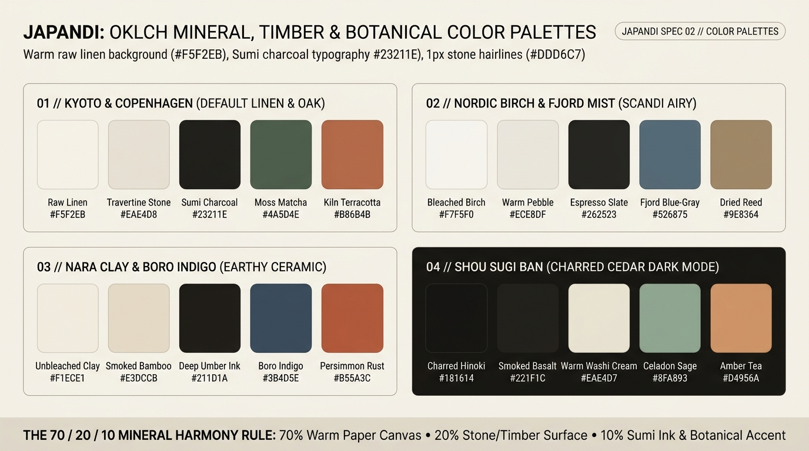

# Japandi Design — Color Palettes, OKLCH Mineral Harmony & Dynamic Theming

Japandi color architecture draws directly from **raw architectural materials**: unbleached linen, blonde Nordic oak, honed travertine limestone, hand-thrown stoneware clay, *Sumi* calligraphy ink, *Shou Sugi Ban* (charred cedar), and muted botanical dyes (moss matcha, kiln terracotta, and *Boro* indigo). Every color is formulated in perceptual `oklch()` space to guarantee warm undertones (`Hue 65°–88°` for neutrals) and strict WCAG 2.2 contrast compliance.

---

## Color & Theming Decision Matrix

| Goal | Tool | Why |
| :--- | :--- | :--- |
| Balance canvas warmth, structure, and accents | **The 70 / 20 / 10 Mineral Harmony Rule** (70% Warm Paper Canvas, 20% Stone/Timber Surface, 10% Sumi Ink & Botanical Accent) | Prevents visual fatigue by anchoring 90% of the viewport in low-chroma warm mineral neutrals (`C: 0.009–0.025`). |
| Derive hover, border, and recessed shades from any surface | CSS Relative Color Syntax `oklch(from var(--japandi-surface) ...)` | Automatically preserves the warm ochre/linen undertone when darkening or lightening surfaces, avoiding cold gray mud. |
| Support restorative Evening / Dark Mode | **Shou Sugi Ban Dark Theme** via `light-dark()` (`#181614` Charred Hinoki + `#221F1C` Smoked Basalt) | Avoids cold blue-black (`#0B0F19`) SaaS dark modes in favor of warm charred timber and candlelit washi cream (`#EAE4D7`). |
| Communicate semantic status (Success, Warning, Error) | **Natural Mineral Pigments** (Moss Matcha, Amber Ochre, Kiln Terracotta) | Neon traffic-light colors (`#00FF00`, `#FF0000`) shatter the calm aesthetic; earthen pigments communicate status clearly while preserving harmony. |
| Grade photography to match the UI canvas | CSS `filter: saturate(0.88) contrast(0.96) sepia(0.06)` + warm linen mattes | Harmonizes disparate user-uploaded or product imagery with the surrounding warm paper and timber palette. |

---

## Multimodal Visual Reference

Inspect the 4 canonical Japandi palettes and the 70/20/10 Mineral Harmony ratio before selecting theme tokens:

- **OKLCH Mineral, Timber & Botanical Color Palettes:** [`./images/japandi_color_palettes.jpg`](./images/japandi_color_palettes.jpg)



### What to Observe in the Reference Sheet
1. **`01 // KYOTO & COPENHAGEN (DEFAULT LINEN & OAK)`:** Raw Linen (`#F5F2EB`), Travertine Stone (`#EAE4D8`), Sumi Charcoal (`#23211E`), Moss Matcha (`#4A5D4E`), and Kiln Terracotta (`#B86B4B`).
2. **`02 // NORDIC BIRCH & FJORD MIST (SCANDI AIRY)`:** Cooler Scandinavian daylight palette with Bleached Birch (`#F7F5F0`), Warm Pebble (`#ECE8DF`), Espresso Slate (`#262523`), Fjord Blue-Gray (`#526875`), and Dried Reed (`#9E8364`).
3. **`03 // NARA CLAY & BORO INDIGO (EARTHY CERAMIC)`:** Grounded pottery studio palette with Unbleached Clay (`#F1ECE1`), Smoked Bamboo (`#E3DCCB`), Deep Umber Ink (`#211D1A`), Boro Indigo (`#3B4D5E`), and Persimmon Rust (`#B55A3C`).
4. **`04 // SHOU SUGI BAN (CHARRED CEDAR DARK MODE)`:** Evening sanctuary palette built on Charred Hinoki (`#181614`), Smoked Basalt (`#221F1C`), Warm Washi Cream (`#EAE4D7`), Celadon Sage (`#8FA893`), and Amber Tea (`#D4956A`).

---

## The 4 Canonical Japandi Palettes (Production CSS)

Switch themes declaratively via `data-theme` on `<html>` or any section container:

```css
/* Palette 1: Kyoto & Copenhagen (Default Linen, Oak & Matcha) */
:root,
[data-theme="kyoto-copenhagen"] {
  --japandi-canvas: oklch(0.958 0.014 82);      /* #F5F2EB Raw Linen */
  --japandi-surface: oklch(0.978 0.009 84);     /* #FAF8F3 Honed Alabaster */
  --japandi-well: oklch(0.918 0.019 80);        /* #EAE4D8 Travertine Stone */
  --japandi-ink: oklch(0.245 0.012 72);         /* #23211E Sumi Charcoal */
  --japandi-ink-muted: oklch(0.510 0.018 75);   /* #6B655C Weathered Ash */
  --japandi-accent-primary: oklch(0.445 0.042 152);   /* #4A5D4E Moss Matcha */
  --japandi-accent-secondary: oklch(0.585 0.105 42);  /* #B86B4B Kiln Terracotta */
  --japandi-hairline: oklch(0.865 0.020 80);    /* #DDD6C7 Stone Seam */
}

/* Palette 2: Nordic Birch & Fjord Mist (Scandi Airy Daylight) */
[data-theme="nordic-birch"] {
  --japandi-canvas: oklch(0.968 0.009 88);      /* #F7F5F0 Bleached Birch */
  --japandi-surface: oklch(0.985 0.005 90);     /* #FCFBF8 Chalk Plaster */
  --japandi-well: oklch(0.930 0.014 85);        /* #ECE8DF Warm Pebble */
  --japandi-ink: oklch(0.260 0.008 75);         /* #262523 Espresso Slate */
  --japandi-ink-muted: oklch(0.520 0.014 235);  /* #636B70 Nordic Mist */
  --japandi-accent-primary: oklch(0.495 0.042 232);   /* #526875 Fjord Blue-Gray */
  --japandi-accent-secondary: oklch(0.625 0.058 72);  /* #9E8364 Dried Reed */
  --japandi-hairline: oklch(0.880 0.014 85);    /* #E0DDD5 Birch Seam */
}

/* Palette 3: Nara Clay & Boro Indigo (Earthy Ceramic Studio) */
[data-theme="nara-clay"] {
  --japandi-canvas: oklch(0.942 0.019 78);      /* #F1ECE1 Unbleached Clay */
  --japandi-surface: oklch(0.965 0.014 80);     /* #F7F3EA Washi Cream */
  --japandi-well: oklch(0.895 0.024 78);        /* #E3DCCB Smoked Bamboo */
  --japandi-ink: oklch(0.230 0.016 62);         /* #211D1A Deep Umber Ink */
  --japandi-ink-muted: oklch(0.490 0.022 65);   /* #685F56 Kiln Ash */
  --japandi-accent-primary: oklch(0.415 0.048 242);   /* #3B4D5E Boro Indigo */
  --japandi-accent-secondary: oklch(0.555 0.118 38);  /* #B55A3C Persimmon Rust */
  --japandi-hairline: oklch(0.840 0.025 76);    /* #D6CEBE Clay Seam */
}

/* Palette 4: Shou Sugi Ban (Charred Cedar Dark Mode) */
[data-theme="shou-sugi-ban"] {
  color-scheme: dark;
  --japandi-canvas: oklch(0.195 0.012 68);      /* #181614 Charred Hinoki */
  --japandi-surface: oklch(0.235 0.014 68);     /* #221F1C Smoked Basalt */
  --japandi-well: oklch(0.165 0.010 68);        /* #13110F Deep Hearth */
  --japandi-ink: oklch(0.922 0.016 82);         /* #EAE4D7 Warm Washi Cream */
  --japandi-ink-muted: oklch(0.710 0.018 78);   /* #A9A092 Warm Ash */
  --japandi-accent-primary: oklch(0.695 0.052 150);   /* #8FA893 Celadon Sage */
  --japandi-accent-secondary: oklch(0.715 0.095 52);  /* #D4956A Amber Tea */
  --japandi-hairline: oklch(0.310 0.016 70);    /* #342F2A Charred Seam */
}
```

---

## Relative Color Syntax & Botanical Semantic States

Never hardcode separate hover hex codes or jarring neon validation colors. Derive interactive states dynamically using `oklch(from ...)` and use grounded botanical/mineral semantic tokens:

```css
:root {
  /* Semantic Status Pigments (WCAG AA compliant against Linen & Basalt) */
  --japandi-status-success-bg: light-dark(oklch(0.93 0.025 152), oklch(0.26 0.03 152));
  --japandi-status-success-ink: light-dark(oklch(0.35 0.05 152), oklch(0.82 0.05 152));

  --japandi-status-warn-bg: light-dark(oklch(0.94 0.035 75), oklch(0.27 0.04 75));
  --japandi-status-warn-ink: light-dark(oklch(0.42 0.08 65), oklch(0.84 0.07 75));

  --japandi-status-error-bg: light-dark(oklch(0.93 0.032 38), oklch(0.27 0.045 35));
  --japandi-status-error-ink: light-dark(oklch(0.42 0.11 35), oklch(0.84 0.08 40));
}

/* Dynamic surface hover derivation */
.japandi-interactive-surface {
  background-color: var(--japandi-surface);
  border: 1px solid var(--japandi-hairline);
}

.japandi-interactive-surface:hover {
  /* Subtle warm deepening (-2% lightness, +0.005 chroma) like sunlight shifting on linen */
  background-color: oklch(from var(--japandi-surface) calc(l - 0.02) calc(c + 0.004) h);
  border-color: oklch(from var(--japandi-hairline) calc(l - 0.08) c h);
}
```

---

## Natural Photography & Media Grading

Harsh, oversaturated commercial stock photos clash with a Japandi canvas. Frame images in warm linen padding and apply a subtle natural light filter:

```css
.japandi-figure {
  background-color: var(--japandi-well);
  padding: clamp(0.75rem, 1.5vw, 1.25rem);
  border: 1px solid var(--japandi-hairline);
  border-radius: var(--japandi-radius-sm);
}

.japandi-figure img {
  display: block;
  inline-size: 100%;
  block-size: auto;
  border-radius: calc(var(--japandi-radius-sm) - 2px);
  /* Gently tempers digital saturation into organic film warmth */
  filter: saturate(0.88) contrast(0.97) sepia(0.04);
  transition: filter 450ms var(--japandi-ease), transform 600ms var(--japandi-ease);
}

.japandi-figure:hover img {
  filter: saturate(0.96) contrast(1) sepia(0.01);
}
```

---

## Do Not

| BAD | GOOD | Why |
| :--- | :--- | :--- |
| Cool blue-gray slate backgrounds (`#F1F5F9` / `#0F172A` Tailwind Slate) | Warm yellow-ochre tinted neutrals (`oklch(... 72°–88°)` like `#F5F2EB` and `#181614`) | Cool blue-grays feel corporate and clinical; Japandi requires organic timber, paper, and stone warmth. |
| Using neon red (`#EF4444`) or lime green (`#22C55E`) for badges and validation | Use Kiln Terracotta (`#A84A32` / `#B86B4B`) and Moss Matcha (`#4A5D4E`) | Saturated neon alerts destroy emotional tranquility and look out of place on raw linen. |
| Flood-filling large sections with bright primary accent colors | Follow the **70/20/10 Mineral Rule**: reserve Matcha, Terracotta, and Indigo for the 10% accent tier | Overusing botanical or terracotta fills turns a minimalist space into a heavy retro theme. |
| Using low-contrast beige text (`#B5AFA4`) on a `#F5F2EB` linen background | Use Sumi Charcoal (`#23211E`) for primary text and Weathered Ash (`#524E48`) for secondary copy | Beige-on-beige text fails WCAG 2.2 AA (`< 2.2:1`) and makes interfaces illegible in daylight. |
