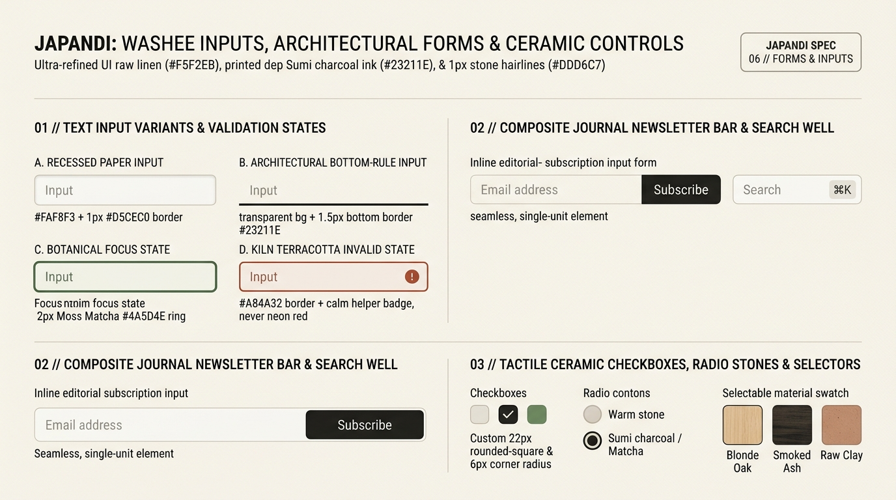

# Japandi Design — Washi Inputs, Architectural Forms & Ceramic Controls

Japandi form architecture turns utilitarian data entry into a **calm, tactile stationery experience**. Inputs are styled either as **Recessed Washi-Paper Wells** (`#FAF8F3` framed by a warm mineral border) or **Architectural Bottom-Rule Lines** (inspired by Japanese ledger books and Nordic monograph order forms). Validation avoids alarming neon `#FF0000` red flashes in favor of **grounded Kiln Terracotta (`#A84A32`)** paired with clear, human-centric guidance.

---

## Forms & Inputs Decision Matrix

| Goal | Tool | Why |
| :--- | :--- | :--- |
| Standard forms, checkout fields & account settings | **Recessed Washi-Paper Input** (`#FAF8F3` fill + `1px solid #C8BFA8` stone border, `6px` radius) | Offers clear boundaries against the `#F5F2EB` raw linen canvas while feeling warm and paper-like. |
| Minimalist editorial inquiry or journal forms | **Architectural Bottom-Rule Input** (`transparent` background + `1.5px solid` bottom stone/ink rule) | Eliminates enclosing boxes altogether, creating an open, breathable ledger layout with generous *Ma* spacing. |
| Communicate active keyboard focus | **Botanical Matcha Focus Ring** (`border-color: var(--japandi-matcha)` + `2px` soft halo) | Guides the user's eye with calm forest-moss pigment rather than harsh default browser blue. |
| Validate invalid user input without inducing anxiety | **`:user-invalid` Kiln Terracotta State** (`#A84A32` border + warm terracotta helper text) | `:user-invalid` waits until after user interaction (never screaming at untouched empty fields) and uses earthen terracotta (`> 5.5:1` contrast). |
| Custom checkboxes, radios & material pickers | **`appearance: none` Ceramic Controls** (`22px` rounded-square `6px` checkbox & pebble radio) | Replaces glossy OS-default controls with matte stone and Sumi charcoal tactile toggles. |

---

## Multimodal Visual Reference

Inspect the 4 input states, the inline journal subscription bar, and the custom ceramic checkboxes, radio pebbles, and material swatches before building forms:

- **Washi Inputs, Architectural Forms & Ceramic Controls:** [`./images/japandi_forms_and_inputs.jpg`](./images/japandi_forms_and_inputs.jpg)



### What to Observe in the Reference Sheet
1. **Text Input Variants & Validation States (`01 // TOP LEFT`):**
   - **A. Recessed Paper Input:** `#FAF8F3` surface with `1px solid #D5CEC0` stone border and `6px` corner radius.
   - **B. Architectural Bottom-Rule Input:** Transparent background with a crisp `1.5px` bottom rule (`#23211E`).
   - **C. Botanical Focus State:** `2px` Moss Matcha (`#4A5D4E`) focus ring.
   - **D. Kiln Terracotta Invalid State:** Grounded `#A84A32` terracotta border and icon indicator—never harsh neon red.
2. **Composite Journal Newsletter Bar & Search Well (`02 // RIGHT & BOTTOM LEFT`):** Seamless single-unit subscription bar joining a warm paper email field with a Sumi Charcoal `Subscribe` button, alongside a minimalist search well with a stone `⌘K` kbd badge.
3. **Tactile Ceramic Checkboxes, Radio Stones & Selectors (`03 // BOTTOM RIGHT`):** Custom `22px` rounded-square (`6px` radius) checkboxes, circular stone radio buttons, and tactile timber/clay swatch pickers (`Blonde Oak`, `Smoked Ash`, `Raw Clay`).

---

## Production CSS: Washi Paper & Architectural Bottom-Rule Inputs

```css
.japandi-field {
  display: flex;
  flex-direction: column;
  gap: 0.5rem;
  margin-block-end: 1.5rem;
}

.japandi-label {
  font-family: var(--japandi-font-sans);
  font-size: 0.8125rem;
  font-weight: 500;
  letter-spacing: 0.04em;
  color: var(--japandi-ink);
}

/* Variant A: Recessed Washi-Paper Input */
.japandi-input {
  inline-size: 100%;
  min-block-size: 2.75rem; /* 44px WCAG tap target */
  padding-block: 0.625rem;
  padding-inline: 0.9375rem;
  background-color: var(--japandi-surface);
  color: var(--japandi-ink);
  border: 1px solid var(--japandi-border-interactive);
  border-radius: var(--japandi-radius-sm);
  font-family: var(--japandi-font-sans);
  font-size: 0.9375rem;
  line-height: 1.5;
  box-shadow: inset 0 1px 2px oklch(0.24 0.01 72 / 0.03);
  transition:
    border-color var(--japandi-duration) var(--japandi-ease),
    box-shadow var(--japandi-duration) var(--japandi-ease),
    background-color var(--japandi-duration) var(--japandi-ease);
}

.japandi-input::placeholder {
  color: var(--japandi-ink-muted);
  opacity: 0.8;
}

/* Variant C: Botanical Moss Matcha Focus State */
.japandi-input:focus-visible {
  outline: none;
  border-color: var(--japandi-matcha);
  box-shadow: 0 0 0 3px oklch(from var(--japandi-matcha) l c h / 0.18);
}

/* Variant D: Kiln Terracotta Validation (:user-invalid only after interaction) */
.japandi-input:user-invalid {
  border-color: oklch(0.48 0.115 36); /* #A84A32 Kiln Terracotta */
  background-color: oklch(from var(--japandi-terracotta) 0.96 0.015 h);
}

.japandi-input:user-valid {
  border-color: var(--japandi-matcha);
}

.japandi-field__error {
  font-size: 0.8125rem;
  color: oklch(0.45 0.115 36); /* WCAG AA compliant terracotta ink */
  display: flex;
  align-items: center;
  gap: 0.375rem;
}

/* Variant B: Architectural Bottom-Rule Input (Editorial / Inquiry Forms) */
.japandi-input--underline {
  background-color: transparent;
  border: none;
  border-block-end: 1.5px solid var(--japandi-border-interactive);
  border-radius: 0;
  padding-inline: 0;
  box-shadow: none;
}

.japandi-input--underline:focus-visible {
  box-shadow: 0 2px 0 0 var(--japandi-matcha);
}
```

---

## Composite Editorial Subscription Bar & Search Well

```css
.japandi-combo-bar {
  display: flex;
  align-items: stretch;
  background-color: var(--japandi-surface);
  border: 1px solid var(--japandi-border-interactive);
  border-radius: var(--japandi-radius-sm);
  padding: 0.25rem;
  transition: border-color var(--japandi-duration) var(--japandi-ease),
              box-shadow var(--japandi-duration) var(--japandi-ease);
}

.japandi-combo-bar:focus-within {
  border-color: var(--japandi-matcha);
  box-shadow: 0 0 0 3px oklch(from var(--japandi-matcha) l c h / 0.16);
}

.japandi-combo-bar__input {
  flex: 1;
  min-inline-size: 0;
  border: none;
  background: transparent;
  padding-inline: 0.875rem;
  color: var(--japandi-ink);
  font-family: var(--japandi-font-sans);
  font-size: 0.9375rem;
}

.japandi-combo-bar__input:focus {
  outline: none;
}
```

---

## Tactile Ceramic Checkboxes & Radio Pebbles

```css
.japandi-choice {
  display: inline-flex;
  align-items: center;
  gap: 0.75rem;
  cursor: pointer;
  font-size: 0.9375rem;
  color: var(--japandi-ink);
  min-block-size: 2.75rem;
}

.japandi-checkbox,
.japandi-radio {
  appearance: none;
  margin: 0;
  inline-size: 1.375rem; /* 22px */
  block-size: 1.375rem;
  background-color: var(--japandi-surface);
  border: 1.5px solid var(--japandi-border-interactive);
  display: grid;
  place-content: center;
  cursor: pointer;
  transition:
    background-color 240ms var(--japandi-ease),
    border-color 240ms var(--japandi-ease);
}

.japandi-checkbox { border-radius: var(--japandi-radius-xs); /* 4px-6px ceramic square */ }
.japandi-radio    { border-radius: var(--japandi-radius-pill); }

.japandi-checkbox::before {
  content: "";
  inline-size: 0.65rem;
  block-size: 0.4rem;
  border-inline-start: 2px solid var(--japandi-canvas);
  border-block-end: 2px solid var(--japandi-canvas);
  transform: rotate(-45deg) scale(0);
  transition: transform 220ms var(--japandi-ease);
}

.japandi-radio::before {
  content: "";
  inline-size: 0.55rem;
  block-size: 0.55rem;
  border-radius: var(--japandi-radius-pill);
  background-color: var(--japandi-canvas);
  transform: scale(0);
  transition: transform 220ms var(--japandi-ease);
}

.japandi-checkbox:checked,
.japandi-radio:checked {
  background-color: var(--japandi-ink);
  border-color: var(--japandi-ink);
}

.japandi-checkbox:checked::before { transform: rotate(-45deg) scale(1); }
.japandi-radio:checked::before    { transform: scale(1); }

.japandi-checkbox:focus-visible,
.japandi-radio:focus-visible {
  outline: 2px solid var(--japandi-matcha);
  outline-offset: 3px;
}
```

---

## Do Not

| BAD | GOOD | Why |
| :--- | :--- | :--- |
| Using `:invalid` which turns required inputs red before the user types a character | Always use `:user-invalid` and `:user-valid` | Premature error borders create visual hostility; `:user-invalid` triggers only after interaction. |
| Using faint `1px solid #EAE4D8` borders on `#F5F2EB` inputs (`1.1:1` contrast) | Use `--japandi-border-interactive` (`#A39B8B` or darker) or pair with a distinct surface fill | WCAG 2.2 SC 1.4.11 requires `>= 3:1` non-text contrast for form control boundaries unless visually distinguished by surface contrast. |
| Replacing `<label>` elements with `placeholder`-only inputs | Always render a persistent visible `<label class="japandi-label">` above the input | Disappearing placeholders harm cognitive recall and fail accessibility standards. |
| Forgetting `min-inline-size: 0` on flex child inputs inside composite bars | Set `flex: 1; min-inline-size: 0;` on `.japandi-combo-bar__input` | Without `min-inline-size: 0`, flex inputs refuse to shrink below their default `size="20"` intrinsic width and overflow mobile screens. |
