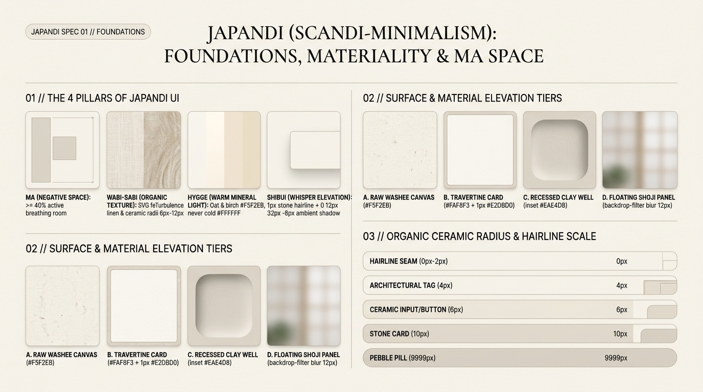

# Japandi Design — Foundations, Materiality & Ma Space Tokens

Japandi (the synthesis of **Japanese *Wabi-Sabi* & *Ma* restraint** with **Scandinavian *Hygge* warmth & functionalism**) replaces loud digital chrome, sterile `#FFFFFF` canvases, and aggressive drop shadows with **architectural calm, warm mineral/linen materiality, and active negative space**. Where Swiss Grid relies on high-contrast starkness and Claymorphism relies on inflated 3D volume, Japandi achieves tactile depth through **raw paper/stone color harmony, exposed `1px` warm mineral hairlines, whisper-quiet ambient shadows, and generous breathing room**.

---

## Foundations Decision Matrix

| Goal | Tool | Why |
| :--- | :--- | :--- |
| Establish architectural calm & cognitive rest | **The Law of *Ma* (間) Active Space** (`>= 40%` open canvas, fluid `clamp()` section padding `4rem`–`9rem`) | In Japandi architecture, empty space is not "leftover"—it is the structural frame that gives typography and craft imagery room to breathe. |
| Replace sterile white (`#FFFFFF`) & pitch black (`#000000`) | **Warm Washi Linen (`#F5F2EB`) + Sumi Charcoal Ink (`#23211E`)** in `oklch()` | Pure `#FFFFFF` emits harsh blue glare; warm yellow-ochre tinted neutrals (`H: 72–85, C: 0.012–0.025`) evoke unbleached linen, birch timber, and lime plaster. |
| Separate cards & sections without heavy drop shadows | **Whisper-Quiet *Shibui* Elevation** (`1px solid` warm stone hairline + ultra-diffused `0 12px 32px -8px` shadow at `6%` opacity) | Mimics overlapping sheets of handmade washi paper and timber shoji joinery rather than floating plastic cards. |
| Infuse organic tactile imperfection (*Wabi-Sabi*) | **Subtle SVG `feTurbulence` Linen Grain + Ceramic Radii (`4px–10px`)** | Softens flat digital pixels into matte stoneware, limewash, and woven textile surfaces without image asset payloads. |
| Govern interactive transitions | **Hygge Slow-Deceleration Curve** (`cubic-bezier(0.22, 1, 0.36, 1)` over `320ms–450ms`) | Rejects bouncy elastic springs (`overshoot > 1`) in favor of grounded, unhurried, physical deceleration. |

---

## Multimodal Visual Reference

Before defining Japandi tokens or layout primitives, inspect the foundational visual specification sheet:

- **Foundations, Materiality & Ma Space:** [`./images/japandi_foundations.jpg`](./images/japandi_foundations.jpg)



### What to Observe in the Reference Sheet
1. **The 4 Pillars of Japandi UI (`01 // TOP LEFT`):**
   - **Ma (Negative Space):** At least `40%` of the viewport remains open raw linen canvas.
   - **Wabi-Sabi (Organic Texture):** Subtle matte paper/stone grain paired with gentle ceramic corner radii (`6px–12px`).
   - **Hygge (Warm Mineral Light):** Warm oat and birch base (`#F5F2EB`), never clinical `#FFFFFF`.
   - **Shibui (Whisper Elevation):** `1px` warm stone hairline (`#DDD6C7`) + `0 12px 32px -8px` low-opacity ambient shadow.
2. **Surface & Material Elevation Tiers (`02 // TOP RIGHT`):** Compare **A. Raw Washi Canvas (`#F5F2EB`)**, **B. Travertine Card (`#FAF8F3` + `1px` `#E2DBD0`)**, **C. Recessed Clay Well (`inset` `#EAE4D8`)**, and **D. Floating Shoji Panel (`backdrop-filter: blur(12px)`)**.
3. **Organic Ceramic Radius & Hairline Scale (`03 // BOTTOM RIGHT`):** From Hairline Seams (`0px–2px`) and Architectural Tags (`4px`) to Ceramic Inputs/Buttons (`6px`), Stone Cards (`10px`), and Pebble Pills (`9999px`).

---

## Japandi vs. Swiss Grid vs. Neumorphism: Structural Distinctions

| Dimension | Swiss Grid | Neumorphism (Soft UI) | Japandi (Scandi-Minimalism) |
| :--- | :--- | :--- | :--- |
| **Primary Mood** | Objective, mathematical, high-contrast rationalism | Monolithic extruded plastic/silicone | Serene, organic, warm architectural sanctuary |
| **Corner Geometry** | Strictly `0px` razor-sharp corners | `12px–24px` uniform soft extrusion | `4px–10px` hand-thrown ceramic softness (`0px` on shoji grid seams) |
| **Border & Shadow** | Exposed `1px–4px` high-contrast ink rules, `0px` shadow | Dual `±offset` outer shadows, no visible borders | `1px` low-contrast warm stone hairline + whisper-quiet ambient shadow |
| **Typography** | Neo-Grotesque sans (`Helvetica`/`Inter`) + Monospace | Geometric rounded sans | **Light Editorial Serif** (`300–400`) + **Warm Humanist Sans** |
| **Accent Philosophy** | High-chroma Signal Red (`#E62E25`) | Soft pastel/electric single accent | Earthy botanical pigments (Moss Matcha, Kiln Terracotta, Boro Indigo) |

---

## Core CSS Custom Properties & Token Engine

```css
:root {
  color-scheme: light dark;

  /* 1. Base Mineral & Timber Surfaces (Kyoto & Copenhagen Default) */
  --japandi-canvas: light-dark(
    oklch(0.958 0.014 82),   /* #F5F2EB Raw Linen / Washi Paper */
    oklch(0.195 0.012 68)    /* #181614 Shou Sugi Ban Charred Cedar */
  );
  --japandi-surface: light-dark(
    oklch(0.978 0.009 84),   /* #FAF8F3 Honed Travertine / Warm Alabaster */
    oklch(0.235 0.014 68)    /* #221F1C Smoked Basalt */
  );
  --japandi-well: light-dark(
    oklch(0.918 0.019 80),   /* #EAE4D8 Recessed Sand / Unbleached Clay */
    oklch(0.165 0.010 68)    /* #13110F Deep Hearth Recessed */
  );
  --japandi-shoji-glass: light-dark(
    oklch(0.968 0.012 82 / 0.82),
    oklch(0.215 0.013 68 / 0.82)
  );

  /* 2. Sumi Ink & Mineral Typography Hierarchy */
  --japandi-ink: light-dark(
    oklch(0.245 0.012 72),   /* #23211E Grounded Sumi Charcoal (>13:1 AAA) */
    oklch(0.922 0.016 82)    /* #EAE4D7 Warm Washi Cream */
  );
  --japandi-ink-secondary: light-dark(
    oklch(0.420 0.016 74),   /* #524E48 Weathered Ash Timber (>7:1 AAA) */
    oklch(0.760 0.018 80)    /* #B8B0A2 Warm Driftwood */
  );
  --japandi-ink-muted: light-dark(
    oklch(0.535 0.018 75),   /* #716B62 Dry Moss Stone (>4.6:1 AA) */
    oklch(0.640 0.016 78)    /* #948C7E Muted Pebble */
  );

  /* 3. Botanical & Earth Pigments */
  --japandi-matcha: light-dark(
    oklch(0.445 0.042 152),  /* #4A5D4E Moss Matcha */
    oklch(0.695 0.052 150)   /* #8FA893 Celadon Sage */
  );
  --japandi-terracotta: light-dark(
    oklch(0.585 0.105 42),   /* #B86B4B Kiln Terracotta */
    oklch(0.715 0.095 52)    /* #D4956A Warm Amber Tea */
  );
  --japandi-indigo: light-dark(
    oklch(0.415 0.048 242),  /* #3B4D5E Boro Indigo */
    oklch(0.680 0.055 240)   /* #869EB2 Misty Fjord */
  );

  /* 4. Stone Hairlines & Whisper-Quiet Elevation */
  --japandi-hairline: light-dark(
    oklch(0.865 0.020 80),   /* #DDD6C7 1px Stone Partition Seam */
    oklch(0.310 0.016 70)    /* #342F2A Dark Timber Seam */
  );
  --japandi-border-interactive: light-dark(
    oklch(0.685 0.024 78),   /* #A39B8B >=3:1 WCAG Control Boundary */
    oklch(0.480 0.020 75)    /* #655E53 Dark Mode Control Boundary */
  );
  --japandi-shadow-whisper:
    0 1px 2px 0 oklch(0.24 0.01 72 / 0.04),
    0 12px 32px -8px oklch(0.24 0.02 72 / 0.06);
  --japandi-shadow-float:
    0 4px 10px -2px oklch(0.24 0.01 72 / 0.05),
    0 24px 48px -12px oklch(0.24 0.02 72 / 0.10);

  /* 5. Organic Ceramic Radii & Ma Fluid Spacing */
  --japandi-radius-none: 0px;
  --japandi-radius-xs: 4px;
  --japandi-radius-sm: 6px;
  --japandi-radius-md: 10px;
  --japandi-radius-lg: 16px;
  --japandi-radius-pill: 9999px;

  --japandi-space-ma-sm: clamp(1.5rem, 3vw, 2.5rem);
  --japandi-space-ma-md: clamp(3rem, 6vw, 5.5rem);
  --japandi-space-ma-lg: clamp(5rem, 10vw, 9rem);

  /* 6. Hygge Slow-Deceleration Motion Physics */
  --japandi-ease: cubic-bezier(0.22, 1, 0.36, 1);
  --japandi-duration: 360ms;
}
```

---

## Reusable Surface & Wabi-Sabi Texture Primitives

```css
/* Base Page Canvas with Ma Breathing Room */
.japandi-canvas {
  background-color: var(--japandi-canvas);
  color: var(--japandi-ink);
  min-block-size: 100dvh;
  padding-block: var(--japandi-space-ma-md);
  padding-inline: var(--japandi-space-ma-sm);
}

/* Tier B: Honed Travertine Surface Card */
.japandi-card {
  background-color: var(--japandi-surface);
  color: var(--japandi-ink);
  border: 1px solid var(--japandi-hairline);
  border-radius: var(--japandi-radius-md);
  box-shadow: var(--japandi-shadow-whisper);
  padding-block: clamp(1.75rem, 3.5vw, 3rem);
  padding-inline: clamp(1.75rem, 3.5vw, 3rem);
  transition:
    transform var(--japandi-duration) var(--japandi-ease),
    box-shadow var(--japandi-duration) var(--japandi-ease),
    border-color var(--japandi-duration) var(--japandi-ease);
}

/* Tier C: Recessed Unbleached Clay Well */
.japandi-well {
  background-color: var(--japandi-well);
  border: 1px solid oklch(from var(--japandi-hairline) calc(l - 0.04) c h);
  border-radius: var(--japandi-radius-sm);
  box-shadow: inset 0 1px 3px oklch(0.24 0.01 72 / 0.05);
  padding-block: 1.25rem;
  padding-inline: 1.5rem;
}

/* Tier D: Translucent Rice-Paper Shoji Surface */
.japandi-shoji {
  background-color: var(--japandi-shoji-glass);
  backdrop-filter: blur(12px) saturate(110%);
  -webkit-backdrop-filter: blur(12px) saturate(110%);
  border: 1px solid var(--japandi-hairline);
}
```

---

## Do Not

| BAD | GOOD | Why |
| :--- | :--- | :--- |
| Using `#FFFFFF` pure white canvas with `#000000` pure black text | Use Warm Washi Linen (`#F5F2EB`) with Sumi Charcoal (`#23211E`) | Sterile `#FFFFFF` destroys the tactile organic warmth of Scandi-Japanese minimalism. |
| Packing cards tightly with `12px` margins and dense multi-widget sidebars | Enforce **Ma (間)**: `clamp(3rem, 6vw, 5.5rem)` section spacing and `>= 40%` open canvas | Cluttered viewports violate the core meditative calm of Japandi architecture. |
| Applying heavy dark drop shadows (`0 10px 25px rgba(0,0,0,0.25)`) | Pair a `1px solid` warm stone hairline (`#DDD6C7`) with a `6%` opacity diffused shadow | Heavy drop shadows look like 2015 Material Design plastic rather than stone and paper. |
| Using bouncy spring overshoots (`cubic-bezier(0.34, 1.56, 0.64, 1)`) | Use grounded slow-deceleration (`cubic-bezier(0.22, 1, 0.36, 1)` over `320ms–450ms`) | Playful cartoon bounce clashes with serene, weighty timber and ceramic materiality. |
| Using physical CSS properties (`width`, `margin-left`, `padding-top`) | Use flow-relative logical properties (`inline-size`, `margin-inline-start`, `padding-block-start`) | Required for seamless horizontal and vertical (`writing-mode: vertical-rl`) layout harmony. |
