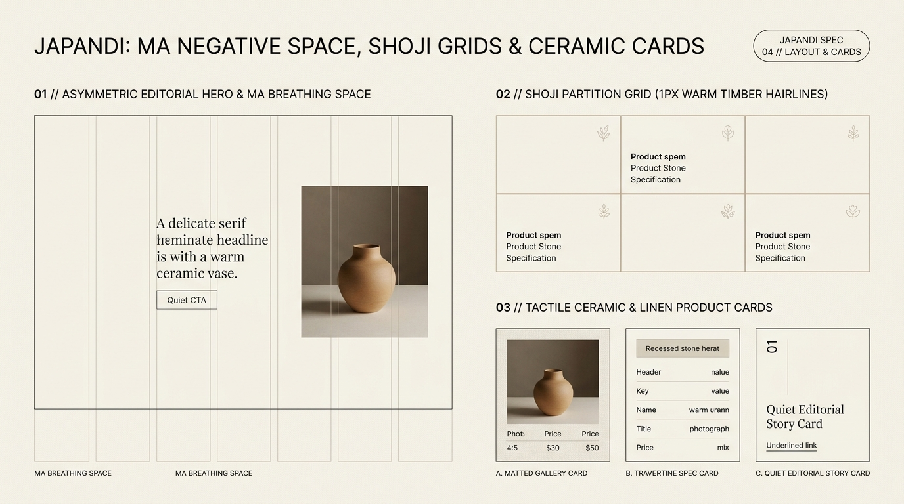

# Japandi Design — Ma Negative Space, Shoji Grids & Ceramic Cards

Japandi layout architecture merges **Scandinavian structural clarity** with the Japanese spatial philosophy of ***Ma* (間 — the active interval between objects)** and ***Shoji* (障子 — translucent timber-framed partitions)**. Instead of cramming the viewport with symmetrical 3-column card walls and heavy shadows, Japandi layouts employ **asymmetric balance, exposed `1px` warm stone/timber hairlines, low-slung horizon weighting, and matted gallery frames**.

---

## Layout & Cards Decision Matrix

| Goal | Tool | Why |
| :--- | :--- | :--- |
| Frame hero narratives with meditative calm | **Asymmetric 7 / 5 Editorial Split + *Ma* Negative Space** | Balances a quiet, lower-weighted text column on one side against a generously matted vertical (`4:5`) photograph on the other. |
| Partition specs, features, or bento cells | **Shoji Hairline Grid** (`gap: 1px` over `--japandi-hairline` background, `0px` shadow) | Evokes sliding cedar *shoji* latticework—clean, weightless structural division without nested card borders. |
| Showcase craft products or editorial stories | **Matted Gallery Card** (`padding: 1rem` warm linen frame around `aspect-ratio: 4 / 5` image) | Mimics museum archival matboard framing rather than generic edge-to-edge e-commerce thumbnails. |
| Align multi-card titles, specs, and prices | **CSS `grid-template-rows: subgrid`** | Guarantees horizontal alignment of hairline dividers and prices across sibling cards regardless of title wrap. |
| Anchor visual weight like low-slung Japandi furniture | **`align-self: end` / Low-Horizon Hero Alignment** | Keeps the upper third of the viewport airy and uncrowded, grounding headlines in the lower two-thirds. |

---

## Multimodal Visual Reference

Inspect the asymmetric hero layout, Shoji `1px` hairline partition grid, and the 3 ceramic/linen card archetypes before building page layouts:

- **Ma Negative Space, Shoji Grids & Ceramic Cards:** [`./images/japandi_layout_and_cards.jpg`](./images/japandi_layout_and_cards.jpg)



### What to Observe in the Reference Sheet
1. **Asymmetric Editorial Hero & *Ma* Breathing Space (`01 // LEFT`):** Notice how the headline and quiet CTA sit anchored in the lower-left quadrant surrounded by open raw linen, balanced by a `4:5` ceramic vessel photograph on the right.
2. **Shoji Partition Grid (`02 // TOP RIGHT`):** A 3-column architectural matrix separated by `1px` warm stone hairlines (`#DDD6C7`), featuring botanical line icons and ample interior cell padding.
3. **Tactile Ceramic & Linen Product Cards (`03 // BOTTOM RIGHT`):**
   - **A. Matted Gallery Card:** `16px` warm linen frame around a `4:5` photograph with tabular-numeral price row beneath.
   - **B. Travertine Spec Card:** Recessed stone header pill + `1px` hairline key-value specification rows.
   - **C. Quiet Editorial Story Card:** Vertical index number (`01`) + light serif headline + underlined text link.

---

## Pattern 1: Asymmetric Editorial Hero with *Ma* Breathing Room

```css
.japandi-hero {
  display: grid;
  grid-template-columns: repeat(12, minmax(0, 1fr));
  gap: clamp(1.5rem, 3vw, 3rem);
  min-block-size: min(82dvh, 52rem);
  padding-block: var(--japandi-space-ma-md);
  padding-inline: var(--japandi-space-ma-sm);
  max-inline-size: 84rem;
  margin-inline: auto;
  border-block-end: 1px solid var(--japandi-hairline);
}

/* Left Column: Low-slung typographic anchor with open upper Ma space */
.japandi-hero__content {
  grid-column: 1 / span 6;
  align-self: end; /* Anchors content toward the lower architectural horizon */
  padding-block-end: clamp(1rem, 3vw, 2.5rem);
  display: flex;
  flex-direction: column;
  gap: 1.5rem;
}

/* Right Column: Matted 4:5 Archival Vessel Plate */
.japandi-hero__plate {
  grid-column: 8 / span 5; /* Column 7 left intentionally empty as Ma interval */
  align-self: center;
  background-color: var(--japandi-well);
  padding: clamp(1rem, 2vw, 1.75rem);
  border: 1px solid var(--japandi-hairline);
  border-radius: var(--japandi-radius-sm);
}

.japandi-hero__plate img {
  inline-size: 100%;
  aspect-ratio: 4 / 5;
  object-fit: cover;
  border-radius: calc(var(--japandi-radius-sm) - 2px);
}

@media (max-width: 56rem) {
  .japandi-hero__content,
  .japandi-hero__plate {
    grid-column: 1 / -1;
  }
}
```

---

## Pattern 2: The Shoji Partition Grid (`1px` Warm Timber Hairlines)

Instead of rendering separate floating cards with competing margins and drop shadows, construct a unified *Shoji* frame where `gap: 1px` exposes the `--japandi-hairline` stone/timber background:

```css
.japandi-shoji-grid {
  display: grid;
  grid-template-columns: repeat(auto-fit, minmax(min(100%, 18rem), 1fr));
  gap: 1px;
  background-color: var(--japandi-hairline); /* Exposed as 1px shoji lattice seams */
  border: 1px solid var(--japandi-hairline);
  border-radius: var(--japandi-radius-md);
  overflow: clip;
}

.japandi-shoji-cell {
  background-color: var(--japandi-surface);
  padding-block: clamp(2rem, 4vw, 3.25rem);
  padding-inline: clamp(1.75rem, 3.5vw, 2.75rem);
  display: flex;
  flex-direction: column;
  justify-content: space-between;
  gap: 2rem;
  transition: background-color var(--japandi-duration) var(--japandi-ease);
}

.japandi-shoji-cell:hover {
  background-color: oklch(from var(--japandi-surface) calc(l - 0.015) c h);
}
```

---

## Pattern 3: Matted Gallery & Travertine Specification Cards (`subgrid`)

```css
.japandi-catalog-grid {
  display: grid;
  grid-template-columns: repeat(auto-fill, minmax(min(100%, 20rem), 1fr));
  gap: clamp(1.75rem, 3.5vw, 2.75rem);
}

/* Card Archetype A: Matted Gallery Product Card with Subgrid Alignment */
.japandi-gallery-card {
  grid-row: span 3;
  display: grid;
  grid-template-rows: subgrid;
  gap: 1.25rem;
  background-color: var(--japandi-surface);
  border: 1px solid var(--japandi-hairline);
  border-radius: var(--japandi-radius-md);
  padding: 1.25rem;
  box-shadow: var(--japandi-shadow-whisper);
  transition:
    transform var(--japandi-duration) var(--japandi-ease),
    box-shadow var(--japandi-duration) var(--japandi-ease);
}

.japandi-gallery-card:hover {
  transform: translateY(-2px);
  box-shadow: var(--japandi-shadow-float);
}

.japandi-gallery-card__matte {
  background-color: var(--japandi-well);
  padding: 0.875rem;
  border-radius: var(--japandi-radius-sm);
  overflow: clip;
}

.japandi-gallery-card__matte img {
  inline-size: 100%;
  aspect-ratio: 4 / 5;
  object-fit: cover;
  display: block;
}

.japandi-gallery-card__meta {
  display: flex;
  justify-content: space-between;
  align-items: baseline;
  padding-block-start: 0.875rem;
  border-block-start: 1px solid var(--japandi-hairline);
  font-variant-numeric: tabular-nums;
}

/* Card Archetype B: Travertine Key-Value Specification List */
.japandi-spec-list {
  display: grid;
  margin-block: 0;
}

.japandi-spec-row {
  display: flex;
  justify-content: space-between;
  align-items: baseline;
  gap: 1rem;
  padding-block: 0.75rem;
  border-block-end: 1px solid var(--japandi-hairline);
  font-size: 0.875rem;
}

.japandi-spec-row dt { color: var(--japandi-ink-muted); }
.japandi-spec-row dd {
  margin-inline-start: 0;
  color: var(--japandi-ink);
  font-variant-numeric: tabular-nums;
}
```

---

## Do Not

| BAD | GOOD | Why |
| :--- | :--- | :--- |
| Filling all 12 columns edge-to-edge in hero sections | Leave 1–2 intermediate grid columns empty (e.g., `1 / span 6` and `8 / span 5`) as active *Ma* space | Intentional spatial intervals create the calm, gallery-like proportion signature to Japandi. |
| Bleeding loud, unframed product photos directly to sharp card edges | Frame imagery inside a `.japandi-gallery-card__matte` (`0.875rem–1.25rem` warm stone padding) | Matted framing harmonizes photography with the surrounding paper/stone architecture. |
| Hovering cards with dramatic `translateY(-10px) scale(1.04)` leaps | Limit card hover lift to a whisper-quiet `translateY(-2px)` over `360ms` | Large hover jumps feel restless and break the grounded weight of stone and timber surfaces. |
| Using `2px–4px` pitch-black borders around grid cells | Use `1px solid var(--japandi-hairline)` (`#DDD6C7` light / `#342F2A` dark) | Thick black borders belong to Neo-Brutalism; Japandi uses delicate timber and limestone hairlines. |
