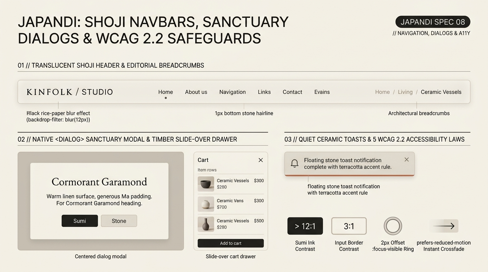

# Japandi Design — Shoji Navbars, Sanctuary Dialogs & WCAG 2.2 Safeguards

Japandi navigation and overlay architecture draws inspiration from **translucent *Shoji* rice-paper screens** and **sliding timber *Fusuma* room dividers**. Top headers float quietly with warm rice-paper translucency (`backdrop-filter: blur(12px)` over `82%` warm linen), native `<dialog>` modals open with unhurried `@starting-style` crossfades, and strict **WCAG 2.2 accessibility safeguards** ensure that warm, muted palettes never sacrifice legibility or keyboard ergonomics.

---

## Navigation, Dialogs & Accessibility Decision Matrix

| Goal | Tool | Why |
| :--- | :--- | :--- |
| Persistent top navigation without heavy chrome | **Translucent *Shoji* Header** (`backdrop-filter: blur(12px)`, `1px` bottom stone hairline, spaced links) | Lets scrolling warm linen and imagery diffuse softly behind the header like light through a *shoji* screen. |
| Indicate current navigation route | **Single `4px` Terracotta / Matcha Pebble Dot** or `1px` underline (`aria-current="page"`) | Avoids heavy pill background boxes in top navbars, keeping the masthead airy. |
| Modal confirmations & sanctuary dialogs | **Native `<dialog>` + `@starting-style` Slow Bloom** + warm dim backdrop (`oklch(0.18 0.01 70 / 0.42)`) | Provides built-in focus trapping, `Escape` dismissal, and top-layer promotion with generous interior *Ma* padding. |
| Cart, filter, or detail inspection panels | **Timber Slide-Over `<dialog>` Drawer** (`margin-inline-start: auto`, `block-size: 100dvh`) | Slides in calmly from the inline-end edge like a Japanese *fusuma* sliding panel. |
| Non-intrusive feedback alerts | **Ceramic Toast Bar** (`role="status"` with `2px` bottom or inline-start Terracotta/Matcha rule) | Delivers status updates without loud full-bleed colored banners. |

---

## Multimodal Visual Reference

Inspect the translucent Shoji navbar, centered `<dialog>` sanctuary modal, slide-over cart drawer, ceramic toast, and the 5 WCAG 2.2 safeguards before building navigation or overlays:

- **Shoji Navbars, Sanctuary Dialogs & WCAG 2.2 Safeguards:** [`./images/japandi_navigation_and_dialogs.jpg`](./images/japandi_navigation_and_dialogs.jpg)



### What to Observe in the Reference Sheet
1. **Translucent Shoji Header & Editorial Breadcrumbs (`01 // TOP`):** Rice-paper blur (`backdrop-filter: blur(12px)`), `1px` bottom stone hairline, editorial serif wordmark (`KINFOLK / STUDIO`), navigation links with a subtle active pebble dot under `Home`, and clean slash breadcrumbs (`Home / Living / Ceramic Vessels`).
2. **Native `<dialog>` Sanctuary Modal & Timber Slide-Over Drawer (`02 // BOTTOM LEFT`):** Centered modal with generous *Ma* padding and light Cormorant Garamond heading, alongside a slide-over cart drawer partitioned by `1px` stone item rows.
3. **Quiet Ceramic Toasts & 5 WCAG 2.2 Accessibility Laws (`03 // BOTTOM RIGHT`):** Floating stone toast with a `2px` terracotta bottom accent rule, plus the 4 visual compliance pillars (`> 12:1` Sumi Ink contrast, `3:1` input border contrast, `2px` offset `:focus-visible` ring, and `prefers-reduced-motion` instant crossfade).

---

## Translucent *Shoji* Navbar & Editorial Breadcrumbs

```css
.japandi-header {
  position: sticky;
  inset-block-start: 0;
  z-index: 40;
  display: flex;
  align-items: center;
  justify-content: space-between;
  gap: 2rem;
  padding-block: 1.125rem;
  padding-inline: var(--japandi-space-ma-sm);
  background-color: var(--japandi-shoji-glass);
  backdrop-filter: blur(12px) saturate(110%);
  -webkit-backdrop-filter: blur(12px) saturate(110%);
  border-block-end: 1px solid var(--japandi-hairline);
}

.japandi-header__brand {
  font-family: var(--japandi-font-serif);
  font-size: 1.25rem;
  font-weight: 400;
  letter-spacing: 0.14em;
  text-transform: uppercase;
  color: var(--japandi-ink);
  text-decoration: none;
}

.japandi-nav {
  display: flex;
  align-items: center;
  gap: clamp(1.25rem, 2.5vw, 2.5rem);
  list-style: none;
  margin: 0;
  padding: 0;
}

.japandi-nav__link {
  position: relative;
  padding-block: 0.5rem;
  font-family: var(--japandi-font-sans);
  font-size: 0.875rem;
  color: var(--japandi-ink-secondary);
  text-decoration: none;
  transition: color var(--japandi-duration) var(--japandi-ease);
}

.japandi-nav__link:hover,
.japandi-nav__link[aria-current="page"] {
  color: var(--japandi-ink);
}

/* Subtle 4px ceramic pebble indicator for active route */
.japandi-nav__link[aria-current="page"]::after {
  content: "";
  position: absolute;
  inset-block-end: 0;
  inset-inline-start: 50%;
  transform: translateX(-50%);
  inline-size: 4px;
  block-size: 4px;
  border-radius: var(--japandi-radius-pill);
  background-color: var(--japandi-terracotta);
}
```

---

## Native `<dialog>` Sanctuary Modal & Slide-Over Drawer (`@starting-style`)

Always use the native `<dialog>` element (`dialog.showModal()`) rather than `<div>` overlays so the browser handles inert background locking and focus trapping natively:

```css
/* Centered Sanctuary Modal */
.japandi-dialog {
  inline-size: min(92vw, 34rem);
  padding-block: clamp(2.25rem, 5vw, 3.5rem);
  padding-inline: clamp(2rem, 4.5vw, 3.25rem);
  background-color: var(--japandi-surface);
  color: var(--japandi-ink);
  border: 1px solid var(--japandi-hairline);
  border-radius: var(--japandi-radius-md);
  box-shadow: var(--japandi-shadow-float);
  opacity: 0;
  transform: translateY(8px);
  transition:
    opacity var(--japandi-duration) var(--japandi-ease),
    transform var(--japandi-duration) var(--japandi-ease),
    overlay var(--japandi-duration) allow-discrete,
    display var(--japandi-duration) allow-discrete;
}

.japandi-dialog[open] {
  opacity: 1;
  transform: translateY(0);
}

@starting-style {
  .japandi-dialog[open] {
    opacity: 0;
    transform: translateY(8px);
  }
}

/* Warm Smoked Linen Backdrop */
.japandi-dialog::backdrop {
  background-color: oklch(0.18 0.012 72 / 0);
  backdrop-filter: blur(0px);
  transition:
    background-color var(--japandi-duration) var(--japandi-ease),
    backdrop-filter var(--japandi-duration) var(--japandi-ease),
    overlay var(--japandi-duration) allow-discrete,
    display var(--japandi-duration) allow-discrete;
}

.japandi-dialog[open]::backdrop {
  background-color: oklch(0.18 0.012 72 / 0.42);
  backdrop-filter: blur(4px);
}

@starting-style {
  .japandi-dialog[open]::backdrop {
    background-color: oklch(0.18 0.012 72 / 0);
    backdrop-filter: blur(0px);
  }
}

/* Slide-Over Timber Cart / Filter Drawer Variant */
.japandi-dialog--drawer {
  margin-block: 0;
  margin-inline-start: auto;
  margin-inline-end: 0;
  inline-size: min(92vw, 26rem);
  block-size: 100dvh;
  max-block-size: 100dvh;
  border-radius: 0;
  border-inline-start: 1px solid var(--japandi-hairline);
  transform: translateX(100%);
}

.japandi-dialog--drawer[open] {
  transform: translateX(0);
}

@starting-style {
  .japandi-dialog--drawer[open] {
    transform: translateX(100%);
  }
}
```

---

## Quiet Ceramic Toast & The 5 Mandatory WCAG 2.2 Japandi Safeguards

Low-chroma earth palettes frequently fail accessibility audits when implemented carelessly. Enforce these **5 non-negotiable WCAG 2.2 safeguards**:

1. **Sumi Ink Text Contrast (`>= 12:1` AAA Primary, `>= 4.5:1` AA Muted):** Never use pale sand or greige for readable copy. `--japandi-ink` (`#23211E`) achieves `> 13:1` against `#F5F2EB`, and `--japandi-ink-muted` (`#716B62`) stays above `4.6:1`.
2. **Interactive Boundary Contrast (`>= 3:1` SC 1.4.11):** While decorative section seams use `--japandi-hairline` (`#DDD6C7`), interactive form inputs, checkboxes, and switches must use `--japandi-border-interactive` (`#A39B8B`) or a contrasting fill.
3. **2px Offset Botanical Focus Ring (SC 2.4.7 & 2.4.11):** Every interactive element must display `outline: 2px solid var(--japandi-matcha); outline-offset: 3px;` on `:focus-visible`.
4. **Coarse-Pointer Tap Targets (`44px × 44px`):** Enforce `min-block-size: 2.75rem` on buttons, inputs, switches, and icon triggers.
5. **Reduced Motion & Forced Colors Resilience:** Collapse slide/lift transforms into instant opacity fades when `prefers-reduced-motion: reduce` is active, and restore system borders under `forced-colors: active`.

```css
/* Quiet Ceramic Toast Notification */
.japandi-toast {
  display: flex;
  align-items: center;
  justify-content: space-between;
  gap: 1rem;
  padding-block: 0.875rem;
  padding-inline: 1.25rem;
  background-color: var(--japandi-surface);
  color: var(--japandi-ink);
  border: 1px solid var(--japandi-hairline);
  border-block-end: 2px solid var(--japandi-terracotta);
  border-radius: var(--japandi-radius-sm);
  box-shadow: var(--japandi-shadow-float);
  font-size: 0.875rem;
}

/* Global Reduced Motion & High Contrast Safeguards */
@media (prefers-reduced-motion: reduce) {
  *,
  *::before,
  *::after {
    animation-duration: 0.01ms !important;
    transition-duration: 0.01ms !important;
    scroll-behavior: auto !important;
  }
}

@media (forced-colors: active) {
  .japandi-card,
  .japandi-btn,
  .japandi-input,
  .japandi-dialog {
    border: 1px solid CanvasText;
  }
}
```

---

## Do Not

| BAD | GOOD | Why |
| :--- | :--- | :--- |
| Using `#B8B0A2` pale stone text on `#F5F2EB` linen background (`1.8:1` contrast) | Use `--japandi-ink` (`#23211E`), `--japandi-ink-secondary` (`#524E48`), or `--japandi-ink-muted` (`#716B62`) | Warm minimalism must never mean illegible low-contrast text. |
| Building custom `<div>` modals without focus trapping or `Escape` key handling | Use native `<dialog class="japandi-dialog">` with `.showModal()` | Native `<dialog>` provides accessible top-layer focus management and `::backdrop` out of the box. |
| Popping modals open with bouncy scale animations (`scale(0.5) -> scale(1.05)`) | Use a subtle `translateY(8px) -> translateY(0)` + opacity bloom via `@starting-style` | Preserves the serene, architectural atmosphere of a Japandi sanctuary. |
| Stacking 5+ persistent floating action buttons, chat widgets, and promo banners over the viewport | Keep viewport chrome minimal; consolidate secondary utilities into a clean slide-over drawer | Floating widget clutter destroys *Ma* negative space. |
