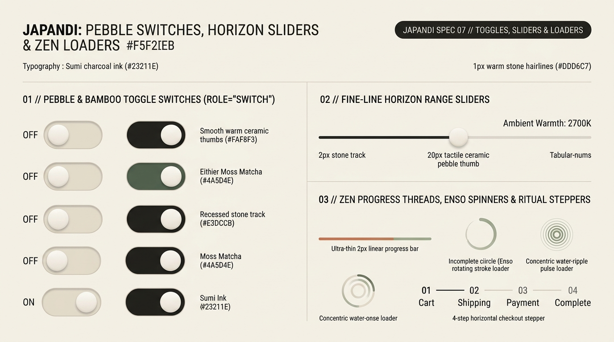

# Japandi Design — Pebble Switches, Horizon Sliders & Zen Loaders

Japandi continuous controls and asynchronous indicators replace frantic spinning wheels and thick neon progress bars with **tactile river-pebble switches, fine-line horizon sliders, incomplete *Enso* (円相) stroke spinners, and concentric water-ripple pulses**. Every control moves at a meditative, unhurried pace (`320ms–450ms`).

---

## Toggles, Sliders & Loaders Decision Matrix

| Goal | Tool | Why |
| :--- | :--- | :--- |
| Binary preference toggle | **Pebble & Bamboo `role="switch"`** (`50px × 28px` recessed stone track + `22px` warm ceramic thumb) | Glides with slow deceleration between Smoked Bamboo (`#E3DCCB`) and Moss Matcha (`#4A5D4E`) or Sumi Ink (`#23211E`). |
| Continuous range adjustment (warmth, volume, price) | **Fine-Line Horizon Slider** (`2px` stone/charcoal track + `20px` ceramic pebble thumb + `tabular-nums` readout) | Echoes a minimalist architectural horizon line weighted by a smooth river stone. |
| Determinate file upload or page progress | **Ultra-Thin `2px` Mineral Thread** (`<progress>` / `role="progressbar"` in Terracotta or Matcha) | Communicates progress with quiet precision rather than a chunky candy-striped bar. |
| Indeterminate loading state | **Zen *Enso* Brush-Stroke Spinner** or **Concentric Water-Ripple Pulse** | Replaces generic fast-spinning OS throbbers with an unhurried `2.4s` organic rotation or ripple. |
| Multi-step checkout or onboarding ritual | **Numbered Hairline Ritual Stepper** (`01 — 02 — 03` connected by `1px` stone threads) | Guides multi-step flows with monospace catalog numerals and calm horizontal rules. |

---

## Multimodal Visual Reference

Inspect the pebble toggle switches, the `2px` horizon range slider, the *Enso* stroke spinner, water-ripple loader, and 4-step ritual stepper before building interactive controls:

- **Pebble Switches, Horizon Sliders & Zen Loaders:** [`./images/japandi_toggles_and_loaders.jpg`](./images/japandi_toggles_and_loaders.jpg)



### What to Observe in the Reference Sheet
1. **Pebble & Bamboo Toggle Switches (`01 // LEFT`):** Recessed stone track (`#E3DCCB`) when `OFF` transitioning to Sumi Ink (`#23211E`) or Moss Matcha (`#4A5D4E`) when `ON`, housing a smooth warm ceramic thumb (`#FAF8F3`).
2. **Fine-Line Horizon Range Sliders (`02 // TOP RIGHT`):** A `2px` stone track with a filled Sumi Charcoal active segment, a `20px` tactile ceramic pebble thumb, and a `tabular-nums` label (`Ambient Warmth: 2700K`).
3. **Zen Progress Threads, *Enso* Spinners & Ritual Steppers (`03 // BOTTOM RIGHT`):** Ultra-thin `2px` terracotta/matcha linear progress bar, incomplete *Enso* circle spinner, concentric water-ripple loader, and `01 Cart — 02 Shipping — 03 Payment — 04 Complete` stepper.

---

## Pebble & Bamboo Toggle Switch (`role="switch"`)

```html
<button
  type="button"
  role="switch"
  aria-checked="true"
  aria-label="Evening Candlelight Mode"
  class="japandi-switch"
>
  <span class="japandi-switch__thumb" aria-hidden="true"></span>
</button>
```

```css
.japandi-switch {
  --_track-off: var(--japandi-well);
  --_track-on: var(--japandi-matcha);

  position: relative;
  display: inline-flex;
  align-items: center;
  inline-size: 3.125rem; /* 50px */
  block-size: 1.75rem;   /* 28px */
  padding: 0.1875rem;    /* 3px */
  border-radius: var(--japandi-radius-pill);
  border: 1px solid var(--japandi-border-interactive);
  background-color: var(--_track-off);
  cursor: pointer;
  transition:
    background-color var(--japandi-duration) var(--japandi-ease),
    border-color var(--japandi-duration) var(--japandi-ease);
}

.japandi-switch__thumb {
  inline-size: 1.25rem;  /* 20px ceramic pebble */
  block-size: 1.25rem;
  border-radius: var(--japandi-radius-pill);
  background-color: var(--japandi-surface);
  box-shadow: 0 1px 3px oklch(0.24 0.01 72 / 0.18);
  transition: transform var(--japandi-duration) var(--japandi-ease);
}

.japandi-switch[aria-checked="true"] {
  background-color: var(--_track-on);
  border-color: var(--_track-on);
}

.japandi-switch[aria-checked="true"] .japandi-switch__thumb {
  transform: translateX(1.375rem); /* 22px travel */
}

.japandi-switch:focus-visible {
  outline: 2px solid var(--japandi-matcha);
  outline-offset: 3px;
}
```

---

## Fine-Line Horizon Range Slider

```css
.japandi-slider-group {
  display: flex;
  flex-direction: column;
  gap: 0.625rem;
}

.japandi-slider-header {
  display: flex;
  justify-content: space-between;
  font-size: 0.8125rem;
  color: var(--japandi-ink-secondary);
  font-variant-numeric: tabular-nums;
}

.japandi-slider {
  --_progress: 60%;
  appearance: none;
  inline-size: 100%;
  block-size: 2px;
  border-radius: var(--japandi-radius-pill);
  background: linear-gradient(
    to right,
    var(--japandi-ink) 0%,
    var(--japandi-ink) var(--_progress),
    var(--japandi-hairline) var(--_progress),
    var(--japandi-hairline) 100%
  );
  cursor: pointer;
  margin-block: 0.75rem;
}

.japandi-slider::-webkit-slider-thumb {
  appearance: none;
  inline-size: 1.25rem; /* 20px ceramic stone */
  block-size: 1.25rem;
  border-radius: var(--japandi-radius-pill);
  background-color: var(--japandi-surface);
  border: 1.5px solid var(--japandi-ink);
  box-shadow: 0 2px 6px oklch(0.24 0.01 72 / 0.12);
  transition: transform 240ms var(--japandi-ease), background-color 240ms var(--japandi-ease);
}

.japandi-slider::-webkit-slider-thumb:hover {
  transform: scale(1.1);
  background-color: var(--japandi-well);
}

.japandi-slider:focus-visible {
  outline: none;
}

.japandi-slider:focus-visible::-webkit-slider-thumb {
  outline: 2px solid var(--japandi-matcha);
  outline-offset: 3px;
}
```

---

## Zen *Enso* Stroke Spinner, Progress Thread & Ritual Stepper

```css
/* 1. Ultra-Thin 2px Mineral Progress Thread */
.japandi-progress-thread {
  inline-size: 100%;
  block-size: 2px;
  background-color: var(--japandi-hairline);
  overflow: clip;
}

.japandi-progress-thread__bar {
  block-size: 100%;
  background-color: var(--japandi-terracotta);
  transition: inline-size 400ms var(--japandi-ease);
}

/* 2. Zen Enso Incomplete Circle Spinner (Unhurried 2.4s Cadence) */
.japandi-enso-loader {
  inline-size: 2rem;
  block-size: 2rem;
  border-radius: var(--japandi-radius-pill);
  border: 2px solid var(--japandi-hairline);
  border-block-start-color: var(--japandi-matcha);
  border-inline-end-color: var(--japandi-matcha);
  animation: japandi-enso-spin 2.4s cubic-bezier(0.45, 0.05, 0.55, 0.95) infinite;
}

@keyframes japandi-enso-spin {
  to { transform: rotate(360deg); }
}

@media (prefers-reduced-motion: reduce) {
  .japandi-enso-loader {
    animation-duration: 8s;
  }
}

/* 3. Numbered Hairline Ritual Stepper */
.japandi-stepper {
  display: flex;
  align-items: center;
  gap: 0.75rem;
  list-style: none;
  padding: 0;
  margin: 0;
  font-family: var(--japandi-font-mono);
  font-size: 0.75rem;
  font-variant-numeric: tabular-nums;
}

.japandi-stepper__item {
  display: inline-flex;
  align-items: center;
  gap: 0.5rem;
  color: var(--japandi-ink-muted);
}

.japandi-stepper__item[aria-current="step"] {
  color: var(--japandi-ink);
  font-weight: 600;
}

.japandi-stepper__line {
  inline-size: clamp(1.5rem, 4vw, 3.5rem);
  block-size: 1px;
  background-color: var(--japandi-hairline);
}
```

---

## Do Not

| BAD | GOOD | Why |
| :--- | :--- | :--- |
| Fast `600ms` spinning loader wheels | Use an unhurried `2.2s–2.6s` *Enso* rotation or breathing opacity pulse | Frantic spinners trigger urgency and stress, counteracting Japandi's low-stress UX mission. |
| Thick `16px` candy-striped or glowing progress bars | Use a `2px` hairline progress thread in Kiln Terracotta or Moss Matcha | Thin architectural threads communicate progress with restraint. |
| Building custom toggle switches with `<div onclick>` instead of `<button role="switch">` | Use `<button type="button" role="switch" aria-checked="...">` | Guarantees native Space/Enter keyboard toggling and assistive technology announcements. |
| Omitting `tabular-nums` on live slider readouts | Always set `font-variant-numeric: tabular-nums` on dynamic value labels | Prevents horizontal layout jitter as digits change during dragging. |
