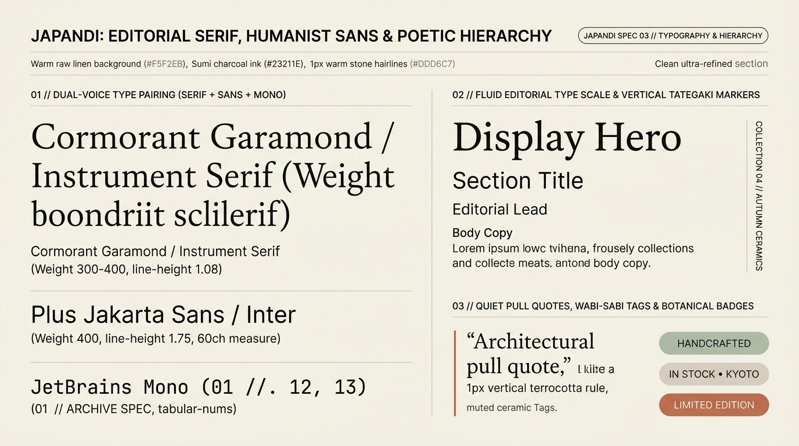

# Japandi Design — Editorial Serif, Humanist Sans & Poetic Hierarchy

In Japandi interfaces, typography carries the emotional weight that other design systems delegate to heavy chrome or 3D shadows. It pairs **delicate, light-to-regular Editorial Serifs** (`Cormorant Garamond`, `Instrument Serif`, `Newsreader` at weights `300–400`) with **warm, open-counter Humanist Sans-Serifs** (`Plus Jakarta Sans`, `DM Sans`, `Inter`) and **understated architectural monospace indices** (`JetBrains Mono` with `tabular-nums`).

---

## Typography Decision Matrix

| Goal | Tool | Why |
| :--- | :--- | :--- |
| Convey serene architectural authority in headings | **Light/Regular Editorial Serif** (`font-weight: 300–400`, `line-height: 1.06–1.15`, `text-wrap: balance`) | Heavy `800–900` display weights shout at the user; light-weight high-contrast serifs evoke fine printmaking, *Kinfolk* monographs, and Japanese exhibition catalogs. |
| Ensure effortless long-form reading comfort | **Humanist Sans Body** (`line-height: 1.72–1.80`, `max-inline-size: 60ch`, `text-wrap: pretty`) | Generous leading (`1.75`) and a disciplined `55ch–65ch` measure create breathable horizontal corridors of *Ma* between lines. |
| Add Japanese/Nordic architectural index markers | **Vertical *Tategaki* Rail Labels** (`writing-mode: vertical-rl`, `letter-spacing: 0.16em`) | Anchors section margins with quiet vertical catalog metadata without cluttering the primary horizontal reading axis. |
| Style pull quotes & philosophical callouts | **`1px–2px` Kiln Terracotta or Stone Inline-Start Rule** + Italic Editorial Serif | Frames quotes with a single architectural brushstroke rather than heavy quotation marks or colored boxes. |
| Display prices, dimensions, and craft specs | **`font-variant-numeric: tabular-nums oldstyle-nums`** | Aligns catalog price columns and millimeter dimensions with watchmaker precision. |

---

## Multimodal Visual Reference

Inspect the dual-voice type pairing, vertical *tategaki* rail labels, and botanical ceramic tags before styling text elements:

- **Editorial Serif, Humanist Sans & Poetic Hierarchy:** [`./images/japandi_typography_and_hierarchy.jpg`](./images/japandi_typography_and_hierarchy.jpg)



### What to Observe in the Reference Sheet
1. **Dual-Voice Type Pairing (`01 // LEFT`):** Notice how the large, light-weight serif (`Cormorant Garamond / Instrument Serif`, weight `300–400`, `line-height: 1.08`) contrasts with the clean humanist sans (`Plus Jakarta Sans / Inter`, `line-height: 1.75`) and monospace spec numbers (`01 // ARCHIVE SPEC`).
2. **Fluid Editorial Type Scale & Vertical *Tategaki* Markers (`02 // TOP RIGHT`):** Observe the vertical side rail label (`COLLECTION 04 // AUTUMN CERAMICS`) running cleanly along the right margin via `writing-mode: vertical-rl`.
3. **Quiet Pull Quotes & Ceramic Tags (`03 // BOTTOM RIGHT`):** A `2px` vertical terracotta rule frames the serif pull quote, accompanied by low-saturation ceramic status pills (`HANDCRAFTED`, `IN STOCK • KYOTO`, `LIMITED EDITION`).

---

## Fluid Editorial Type Scale & Font Stacks

```css
:root {
  /* 1. Three-Voice Font Stack */
  --japandi-font-serif: 'Cormorant Garamond', 'Instrument Serif', 'Newsreader', 'Playfair Display', Georgia, serif;
  --japandi-font-sans: 'Plus Jakarta Sans', 'DM Sans', 'Inter', system-ui, -apple-system, sans-serif;
  --japandi-font-mono: 'JetBrains Mono', 'Geist Mono', ui-monospace, monospace;

  /* 2. Fluid clamp() Scale (Poetic Contrast Without Aggressive Bulk) */
  --japandi-text-display: clamp(2.5rem, 5vw + 1rem, 4.75rem);
  --japandi-text-h1: clamp(2rem, 3.5vw + 0.75rem, 3.25rem);
  --japandi-text-h2: clamp(1.5rem, 2.2vw + 0.6rem, 2.25rem);
  --japandi-text-h3: clamp(1.2rem, 1.4vw + 0.5rem, 1.5rem);
  --japandi-text-lead: clamp(1.125rem, 0.6vw + 0.95rem, 1.35rem);
  --japandi-text-body: clamp(1rem, 0.25vw + 0.92rem, 1.0625rem);
  --japandi-text-caption: 0.8125rem; /* 13px */
}

/* Primary Editorial Headings: Light Weight, High Elegance */
.japandi-display,
.japandi-h1,
.japandi-h2 {
  font-family: var(--japandi-font-serif);
  font-weight: 400; /* Never 700-900 bold on large serifs */
  color: var(--japandi-ink);
  letter-spacing: -0.015em;
  line-height: 1.08;
  text-wrap: balance;
  margin-block: 0;
}

.japandi-display { font-size: var(--japandi-text-display); font-weight: 300; }
.japandi-h1      { font-size: var(--japandi-text-h1); }
.japandi-h2      { font-size: var(--japandi-text-h2); line-height: 1.15; }

/* Body Copy: Breathable 1.75 Leading & 60ch Measure */
.japandi-prose {
  font-family: var(--japandi-font-sans);
  font-size: var(--japandi-text-body);
  font-weight: 400;
  line-height: 1.75;
  color: var(--japandi-ink-secondary);
  max-inline-size: 60ch;
  text-wrap: pretty;
}

/* Architectural Kicker / Catalog Index */
.japandi-kicker {
  font-family: var(--japandi-font-mono);
  font-size: 0.75rem;
  font-weight: 400;
  text-transform: uppercase;
  letter-spacing: 0.16em;
  color: var(--japandi-ink-muted);
  font-variant-numeric: tabular-nums;
}
```

---

## Vertical *Tategaki* Margin Markers & Quiet Pull Quotes

Inspired by Japanese editorial monographs, use flow-relative vertical labels on desktop viewports to frame gallery sections, and delicate `1.5px` terracotta/stone rules for pull quotes:

```css
/* Vertical Side-Rail Catalog Marker */
.japandi-tategaki-label {
  writing-mode: vertical-rl;
  text-orientation: mixed;
  font-family: var(--japandi-font-mono);
  font-size: 0.75rem;
  letter-spacing: 0.18em;
  text-transform: uppercase;
  color: var(--japandi-ink-muted);
  border-inline-start: 1px solid var(--japandi-hairline);
  padding-inline-start: 0.75rem;
  user-select: none;
}

/* Architectural Pull Quote */
.japandi-quote {
  font-family: var(--japandi-font-serif);
  font-style: italic;
  font-weight: 400;
  font-size: clamp(1.35rem, 2vw + 0.5rem, 1.85rem);
  line-height: 1.38;
  color: var(--japandi-ink);
  border-inline-start: 2px solid var(--japandi-terracotta);
  padding-inline-start: clamp(1.25rem, 2.5vw, 2rem);
  margin-block: var(--japandi-space-ma-sm);
  max-inline-size: 48ch;
}

.japandi-quote cite {
  display: block;
  margin-block-start: 0.75rem;
  font-family: var(--japandi-font-sans);
  font-style: normal;
  font-size: 0.8125rem;
  letter-spacing: 0.08em;
  text-transform: uppercase;
  color: var(--japandi-ink-muted);
}
```

---

## Wabi-Sabi Ceramic Tags & Botanical Status Pills

Avoid glossy gradients or saturated notification pills. Style tags like matte ceramic glaze samples:

```css
.japandi-badge {
  display: inline-flex;
  align-items: center;
  gap: 0.4rem;
  padding-block: 0.3rem;
  padding-inline: 0.75rem;
  border-radius: var(--japandi-radius-pill);
  font-family: var(--japandi-font-sans);
  font-size: 0.75rem;
  font-weight: 500;
  letter-spacing: 0.08em;
  text-transform: uppercase;
  background-color: var(--japandi-well);
  color: var(--japandi-ink);
  border: 1px solid var(--japandi-hairline);
}

.japandi-badge--matcha {
  background-color: oklch(from var(--japandi-matcha) 0.92 0.025 h);
  color: var(--japandi-matcha);
  border-color: oklch(from var(--japandi-matcha) 0.82 0.035 h);
}

.japandi-badge--terracotta {
  background-color: oklch(from var(--japandi-terracotta) 0.93 0.030 h);
  color: oklch(from var(--japandi-terracotta) calc(l - 0.14) c h);
  border-color: oklch(from var(--japandi-terracotta) 0.84 0.045 h);
}
```

---

## Do Not

| BAD | GOOD | Why |
| :--- | :--- | :--- |
| Setting `font-weight: 800` or `900` on large serif headings | Use `font-weight: 300` or `400` on editorial serifs (`Cormorant Garamond`, `Instrument Serif`) | Heavy black serifs look loud and Victorian; Japandi serifs rely on delicate hairline strokes and air. |
| Cramped body copy (`line-height: 1.35`) stretching across `100%` of a `1440px` screen | Enforce `line-height: 1.72–1.80` and `max-inline-size: 60ch` | Wide, tightly packed lines destroy *Ma* (breathing space) and cause eye strain. |
| Using `text-align: justify` on web body paragraphs | Use flush-left (`text-align: start`) with `text-wrap: pretty` | Justified web text creates erratic rivers of whitespace that disrupt calm reading flow. |
| All-caps serif headings (`text-transform: uppercase` on `48px` serif) | Use Sentence case or Title Case for serifs; reserve `uppercase` + `0.16em` tracking for `12px` sans/mono kickers | Large all-caps serifs feel like Roman monuments rather than warm Scandi-Japanese minimalism. |
