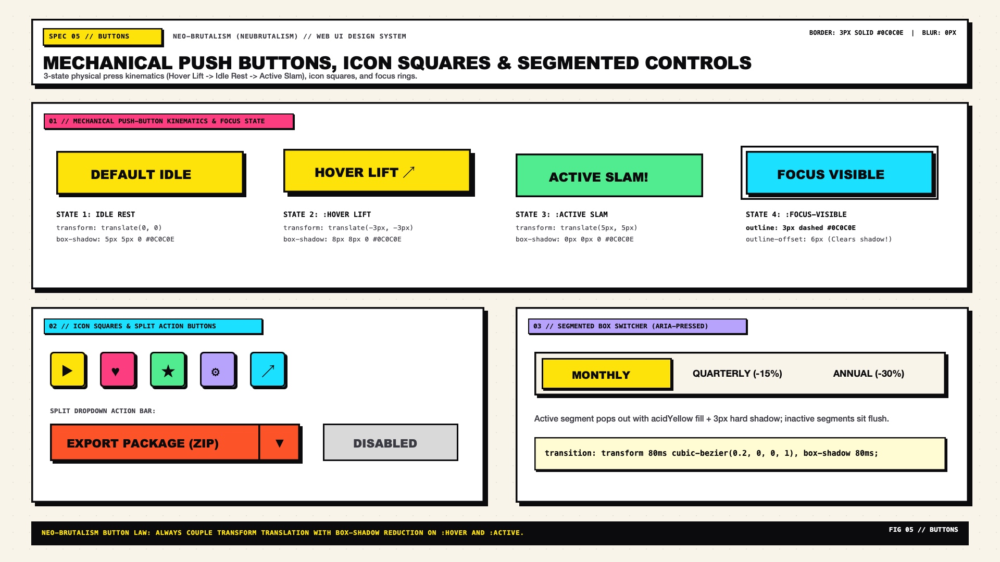

# Neo-Brutalism Design — Buttons & Mechanical Interactive Controls

Buttons are the signature kinetic touchpoint of Neo-Brutalism. Every button behaves like a **physical arcade or mechanical keyboard switch floating above a cutout shadow footprint**. Instead of fading opacity on hover, a Neo-Brutalist button physically lifts toward the user on `:hover` (`transform: translate(-3px, -3px)` with an expanded `8px 8px 0` shadow) and slams flush into the canvas on `:active` (`transform: translate(5px, 5px)` with a collapsed `0px 0px 0` shadow).

---

## Button Decision Matrix

| Goal | Tool | Why |
| :--- | :--- | :--- |
| Primary conversion CTA | `.nb-btn--primary` (`background: var(--nb-yellow)` or `var(--nb-pink)`, `3px solid #0C0C0E`, `5px 5px 0 #0C0C0E`) | High-chroma fill + hard offset shadow commands immediate attention |
| Secondary / neutral action | `.nb-btn--secondary` (`background: var(--nb-bg-surface)`, `3px solid #0C0C0E`, `5px 5px 0 #0C0C0E`) | Preserves full tactile physics while keeping visual weight subordinate to primary CTAs |
| Destructive action | `.nb-btn--danger` (`background: oklch(0.67 0.22 25)`, `#0C0C0E` ink, `5px 5px 0 #0C0C0E`) | High-contrast coral/crimson fill signals irreversible action without breaking the brutalist border language |
| Compact toolbar / social icon button | `.nb-btn--icon` (`inline-size: 3rem; block-size: 3rem`, `4px 4px 0 #0C0C0E`) | Square mechanical keycap footprint with `48px × 48px` WCAG touch target compliance |
| Multi-option view or billing switcher | `.nb-segmented` (`border: 3px solid #0C0C0E` outer frame with shared internal `3px` dividers) | Avoids competing adjacent shadows by housing related buttons inside a single shadowed frame |

---

## Multimodal Visual Reference

Before implementing button states, icon keycaps, or segmented bars, inspect the buttons specification sheet:

- **Buttons & Mechanical Physics Specification Sheet:** [`./images/neo_brutalism_buttons.jpg`](./images/neo_brutalism_buttons.jpg)



### What to Observe in the Reference Sheet
1. **3-State Mechanical Displacement Row (`TOP`):**
   - **01 Default (Idle):** `translate(0, 0)` + `box-shadow: 5px 5px 0 #0C0C0E`.
   - **02 Hover (Lift):** `translate(-3px, -3px)` + `box-shadow: 8px 8px 0 #0C0C0E`. Notice the shadow footprint remains anchored in the exact same spot on the canvas.
   - **03 Active (Pressed Slam):** `translate(5px, 5px)` + `box-shadow: 0px 0px 0 #0C0C0E`. The button face covers its shadow footprint completely.
2. **Semantic Variants & Shapes (`MIDDLE`):** Primary Yellow, Secondary White, Accent Pink, Danger Coral, Pill Tags, and Square Icon Keycaps (`48×48px`).
3. **Composite Controls & Disabled States (`BOTTOM`):** Split Action + Chevron Dropdown button, Connected Segmented Switcher, and Disabled State (flattened `0px` shadow, hatched/muted fill, dashed or muted border).

---

## Complete Mechanical Button CSS Implementation

```css
.nb-btn {
  --_btn-bg: var(--nb-yellow);
  --_btn-fg: var(--nb-ink-on-accent);
  --_btn-shadow-idle: 5px;
  --_btn-lift: 3px;

  position: relative;
  display: inline-flex;
  align-items: center;
  justify-content: center;
  gap: 0.6rem;
  min-block-size: 3rem; /* 48px accessible touch target */
  padding-inline: 1.5rem;
  padding-block: 0.75rem;

  background-color: var(--_btn-bg);
  color: var(--_btn-fg);
  font-family: var(--nb-font-display);
  font-size: 0.95rem;
  font-weight: 800;
  line-height: 1.1;
  text-transform: uppercase;
  letter-spacing: 0.04em;
  text-decoration: none;
  white-space: nowrap;

  border: 3px solid var(--nb-ink);
  border-radius: var(--nb-radius-md);
  box-shadow: var(--_btn-shadow-idle) var(--_btn-shadow-idle) 0px 0px var(--nb-shadow-color);

  cursor: pointer;
  user-select: none;
  transition:
    transform 100ms cubic-bezier(0.2, 0.8, 0.2, 1),
    box-shadow 100ms cubic-bezier(0.2, 0.8, 0.2, 1),
    background-color 100ms ease;
}

/* HOVER: Lift up-left by 3px, expand shadow by 3px (5px + 3px = 8px) */
.nb-btn:hover:not(:disabled) {
  transform: translate(calc(-1 * var(--_btn-lift)), calc(-1 * var(--_btn-lift)));
  box-shadow:
    calc(var(--_btn-shadow-idle) + var(--_btn-lift))
    calc(var(--_btn-shadow-idle) + var(--_btn-lift))
    0px 0px var(--nb-shadow-color);
}

/* ACTIVE: Slam down-right by 5px into the shadow footprint (5px - 5px = 0px) */
.nb-btn:active:not(:disabled),
.nb-btn[aria-pressed="true"] {
  transform: translate(var(--_btn-shadow-idle), var(--_btn-shadow-idle));
  box-shadow: 0px 0px 0px 0px var(--nb-shadow-color);
}

/* KEYBOARD FOCUS: High-visibility dashed brutalist focus ring */
.nb-btn:focus-visible {
  outline: 3px dashed var(--nb-ink);
  outline-offset: 4px;
}

/* DISABLED: Flattened to canvas, no shadow, no displacement */
.nb-btn:disabled {
  background-color: var(--nb-bg-subtle);
  color: var(--nb-ink-muted);
  border-style: dashed;
  box-shadow: none;
  transform: none;
  cursor: not-allowed;
}

/* Semantic Variants */
.nb-btn--secondary { --_btn-bg: var(--nb-bg-surface); --_btn-fg: var(--nb-ink); }
.nb-btn--pink      { --_btn-bg: var(--nb-pink); }
.nb-btn--cyan      { --_btn-bg: var(--nb-cyan); }
.nb-btn--lime      { --_btn-bg: var(--nb-lime); }
.nb-btn--danger    { --_btn-bg: oklch(0.67 0.22 25); }
.nb-btn--pill      { border-radius: var(--nb-radius-pill); }

/* Square Keycap Icon Button */
.nb-btn--icon {
  --_btn-shadow-idle: 4px;
  --_btn-lift: 2px;
  inline-size: 3rem;
  block-size: 3rem;
  padding: 0;
}
```

---

## Connected Segmented Button Group (`.nb-segmented`)

When placing 2–4 mutually exclusive toggle buttons side by side, do **not** give each button its own independent `5px 5px 0` shadow—the shadows will overlap the neighboring buttons. Instead, wrap them in a single bordered container with one shared outer shadow:

```html
<div class="nb-segmented" role="group" aria-label="Billing frequency">
  <button type="button" class="nb-segmented__btn" aria-pressed="true">MONTHLY</button>
  <button type="button" class="nb-segmented__btn" aria-pressed="false">ANNUAL (-20%)</button>
  <button type="button" class="nb-segmented__btn" aria-pressed="false">LIFETIME</button>
</div>
```

```css
.nb-segmented {
  display: inline-flex;
  background-color: var(--nb-bg-surface);
  border: 3px solid var(--nb-ink);
  border-radius: var(--nb-radius-md);
  box-shadow: var(--nb-shadow-md);
  overflow: hidden;
}

.nb-segmented__btn {
  padding-inline: 1.25rem;
  padding-block: 0.65rem;
  background-color: transparent;
  color: var(--nb-ink);
  font-family: var(--nb-font-mono);
  font-size: 0.85rem;
  font-weight: 700;
  border: none;
  border-inline-end: 3px solid var(--nb-ink);
  cursor: pointer;
}

.nb-segmented__btn:last-child {
  border-inline-end: none;
}

.nb-segmented__btn[aria-pressed="true"] {
  background-color: var(--nb-yellow);
  color: var(--nb-ink-on-accent);
  font-weight: 900;
}
```

---

## Reduced Motion Safeguard

For users with vestibular motion sensitivity (`prefers-reduced-motion: reduce`), disable spatial `transform: translate()` while preserving color and border feedback:

```css
@media (prefers-reduced-motion: reduce) {
  .nb-btn,
  .nb-btn:hover:not(:disabled),
  .nb-btn:active:not(:disabled) {
    transition: none;
    transform: none;
  }
}
```

---

## Do Not

| BAD | GOOD | Why |
| :--- | :--- | :--- |
| Using `opacity: 0.8` on `:hover` as the primary interaction cue | Use coupled `transform: translate(-3px, -3px)` and `box-shadow: 8px 8px 0` | Fading opacity makes a Neo-Brutalist button look washed out and loses its signature mechanical keycap feel |
| Translating `:active` by `translate(0, 2px)` while leaving `box-shadow: 5px 5px 0` unchanged | Translate by the full shadow distance `translate(5px, 5px)` and collapse `box-shadow` to `0 0 0 0` | Moving the shadow with the button breaks the illusion of pressing the button down onto the surface |
| Removing `outline` on `:focus-visible` because the button already has a `3px` border | Add `outline: 3px dashed var(--nb-ink); outline-offset: 4px;` on `:focus-visible` | Since every Neo-Brutalist element has a `3px` border by default, a border alone does not distinguish keyboard focus |
| Leaving a hard `5px 5px 0` shadow on a `:disabled` button | Set `box-shadow: none; border-style: dashed;` on `:disabled` | A raised hard shadow invites the user to press the button; flattening it immediately communicates unavailability |
