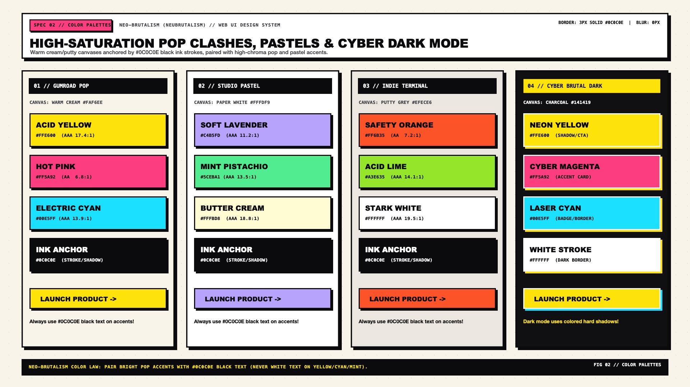

# Neo-Brutalism Design — Color Palettes & Theming

Neo-Brutalist color architecture rejects sterile corporate grayscales and muted gradient meshes in favor of **warm editorial paper canvases, jet-black structural ink, and unapologetic high-chroma accent blocks**. Inspired by Risograph printing, 1990s rave flyers, Gumroad, and Figma's playful workspace palettes, Neo-Brutalism pairs a comfortable low-glare background (`#FAF6EE` Warm Cream or `#EFECE6` Putty) with bold primary/secondary color blocks that never bleed across their `3px solid #0C0C0E` ink borders.

---

## Color & Theming Decision Matrix

| Goal | Tool | Why |
| :--- | :--- | :--- |
| Prevent eye strain across full-viewport pages | Warm Cream (`#FAF6EE`) or Putty (`#EFECE6`) canvas instead of `#FFFFFF` | Pure `#FFFFFF` paired with saturated neon accents causes halation; warm paper grounds the palette and lets white cards pop as elevated surfaces |
| Guarantee readable text on vibrant pop accents | Force `#0C0C0E` (`--nb-ink-on-accent`) on Yellow, Cyan, Lime, Mint, and Lavender | White text on `#FFE600` (Yellow) or `#23F0C7` (Cyan) fails WCAG contrast (`< 1.8:1`); `#0C0C0E` black ink yields `13.5:1` to `18.2:1` AAA contrast |
| Build a bold creator/commerce UI | **Palette 01: Gumroad Pop** (`#FAF6EE` + Bubblegum Pink, Cyber Yellow, Electric Cyan) | High-energy, conversion-focused palette with unmistakable visual hierarchy |
| Build a productivity/SaaS dashboard | **Palette 02: Studio Pastel** (`#F4F1EA` + Lavender, Mint, Butter, Peach) | Softens saturation (`oklch(0.85 0.11 H)`) for long working sessions while keeping crisp black borders and shadows |
| Build a developer tool or technical docs site | **Palette 03: Indie Terminal** (`#EFECE6` + Safety Orange, Cobalt Blue, Acid Lime) | Industrial teenage-engineering / retro-synth hardware aesthetic |
| Support Dark Mode without losing hard shadows | **Palette 04: Cyber Brutal Dark** (`#0E0E12` canvas + `#FFFFFF` borders + colored hard shadows) | Black `box-shadow` is invisible on `#0E0E12` dark canvases; dark mode either uses `#1E1E26` elevated surfaces or neon/white hard offset shadows |

---

## Multimodal Visual Reference

Before selecting colors or implementing dark mode, inspect the multi-palette visual specification sheet:

- **Color Palettes & Contrast Specification Sheet:** [`./images/neo_brutalism_color_palettes.jpg`](./images/neo_brutalism_color_palettes.jpg)



### What to Observe in the Reference Sheet
1. **Four Canonical Archetypes:** Compare how **01 Gumroad Pop** (high-chroma primary accents), **02 Studio Pastel** (desaturated high-lightness editorial fills), **03 Indie Terminal** (industrial putty + safety orange), and **04 Cyber Brutal Dark** (`#0E0E12` carbon canvas with neon/white offset shadows) handle surface contrast.
2. **Surface Allocation Hierarchy (`65% / 20% / 10% / 5%`):** Roughly `65%` of the viewport remains warm paper canvas (`#FAF6EE`), `20%` crisp white card bodies (`#FFFFFF`), `10%` saturated color blocks (headers, feature callouts, active tabs), and `5%` primary CTA accents.
3. **WCAG 2.2 Contrast Verification Bar:** Notice how `#0C0C0E` ink maintains `10.1:1` to `18.2:1` AAA contrast across `#FFE600`, `#FF52A2`, `#23F0C7`, `#A8FF35`, and `#C4B5FD`.

---

## The 4 Canonical Neo-Brutalist Palettes

### Palette 01: Gumroad Pop (High-Chroma Creator & Commerce)
Ideal for digital storefronts, creator platforms, festival sites, and marketing landing pages.

```css
[data-nb-theme="gumroad-pop"] {
  --nb-bg-canvas: oklch(0.97 0.015 85);      /* #FAF6EE Warm Cream */
  --nb-bg-surface: oklch(1.00 0 0);          /* #FFFFFF Crisp White */
  --nb-ink: oklch(0.15 0.01 285);            /* #0C0C0E Jet Black Ink */
  --nb-shadow-color: oklch(0.15 0.01 285);   /* #0C0C0E Solid Black Shadow */

  --nb-accent-primary: oklch(0.68 0.24 355); /* #FF52A2 Bubblegum Pink */
  --nb-accent-secondary: oklch(0.91 0.19 98);/* #FFE600 Cyber Yellow */
  --nb-accent-tertiary: oklch(0.84 0.15 210);/* #23F0C7 Electric Aqua */
  --nb-accent-success: oklch(0.87 0.23 138); /* #A8FF35 Acid Lime */
}
```

### Palette 02: Studio Pastel (Editorial & Long-Session SaaS)
Ideal for collaborative workspaces, note-taking apps, design tools, and interactive education platforms where all-day readability is paramount.

```css
[data-nb-theme="studio-pastel"] {
  --nb-bg-canvas: oklch(0.95 0.012 80);      /* #F4F1EA Soft Alabaster */
  --nb-bg-surface: oklch(1.00 0 0);          /* #FFFFFF Crisp White */
  --nb-ink: oklch(0.15 0.01 285);            /* #0C0C0E Jet Black Ink */
  --nb-shadow-color: oklch(0.15 0.01 285);

  --nb-accent-primary: oklch(0.80 0.11 295); /* #C4B5FD Soft Lilac */
  --nb-accent-secondary: oklch(0.88 0.10 160);/* #86EFAC Pistachio Mint */
  --nb-accent-tertiary: oklch(0.92 0.11 92); /* #FDE68A Warm Butter */
  --nb-accent-warm: oklch(0.84 0.11 35);     /* #FDBA8C Apricot Peach */
}
```

### Palette 03: Indie Terminal (Hardware & Developer Tooling)
Inspired by Teenage Engineering, synth hardware, and retro technical manuals. Pairs a warm industrial putty canvas with safety orange and cobalt blue.

```css
[data-nb-theme="indie-terminal"] {
  --nb-bg-canvas: oklch(0.93 0.01 85);       /* #EFECE6 Putty Gray */
  --nb-bg-surface: oklch(0.98 0.005 85);     /* #FAF8F5 Off-White Card */
  --nb-ink: oklch(0.15 0.01 285);            /* #0C0C0E Jet Black Ink */
  --nb-shadow-color: oklch(0.15 0.01 285);

  --nb-accent-primary: oklch(0.66 0.22 36);  /* #FF5722 Safety Orange */
  --nb-accent-secondary: oklch(0.56 0.22 262);/* #2563EB Cobalt Blue (Use #FFF ink) */
  --nb-accent-tertiary: oklch(0.87 0.23 138);/* #A3E635 Volt Green */
  --nb-accent-neutral: oklch(0.82 0.01 85);  /* #CBC7BE Brushed Aluminum */
}
```

### Palette 04: Cyber Brutal Dark Mode
Standard Neo-Brutalism relies on `#0C0C0E` borders and `#0C0C0E` hard shadows, which vanish against a dark `#0E0E12` background. To preserve authentic Neo-Brutalist geometry in dark mode:
1. Flip structural borders to crisp off-white (`#F4F4F6`) or high-chroma accent ink.
2. Render hard offset shadows in **solid Cyber Yellow (`#FFE600`), Electric Cyan (`#00F5D4`), Hot Pink (`#FF4D9D`), or Crisp White (`#F4F4F6`)**.

```css
[data-nb-theme="cyber-dark"] {
  color-scheme: dark;
  --nb-bg-canvas: oklch(0.16 0.01 285);      /* #0E0E12 Carbon Night */
  --nb-bg-surface: oklch(0.22 0.015 285);    /* #181820 Elevated Obsidian */
  --nb-ink: oklch(0.97 0.005 90);            /* #F4F4F6 Crisp White Ink */
  --nb-ink-on-accent: oklch(0.15 0.01 285);  /* #0C0C0E Black Ink inside Neon Fills */

  /* Colored Hard Shadow makes offset depth pop on dark canvases */
  --nb-shadow-color: oklch(0.91 0.19 98);    /* #FFE600 Hard Yellow Shadow */

  --nb-accent-primary: oklch(0.91 0.19 98);  /* #FFE600 Cyber Yellow */
  --nb-accent-secondary: oklch(0.86 0.16 185);/* #00F5D4 Laser Mint */
  --nb-accent-tertiary: oklch(0.68 0.24 355);/* #FF4D9D Neon Magenta */
}
```

---

## Semantic Status & Validation Colors

Even status alerts (Success, Warning, Danger, Info) use high-chroma fills paired with `#0C0C0E` borders and `#0C0C0E` text:

| Semantic State | Surface Fill (Hex / OKLCH) | Border & Shadow | Foreground Text | Contrast Ratio |
| :--- | :--- | :--- | :--- | :--- |
| **Success** | `#A8FF35` (`oklch(0.87 0.23 138)`) | `3px solid #0C0C0E` | `#0C0C0E` | `15.4 : 1` (AAA) |
| **Warning** | `#FFE600` (`oklch(0.91 0.19 98)`) | `3px solid #0C0C0E` | `#0C0C0E` | `16.8 : 1` (AAA) |
| **Danger / Error** | `#FF5252` (`oklch(0.67 0.22 25)`) | `3px solid #0C0C0E` | `#0C0C0E` | `6.1 : 1` (AA) |
| **Info / Active** | `#23F0C7` (`oklch(0.84 0.15 210)`) | `3px solid #0C0C0E` | `#0C0C0E` | `13.9 : 1` (AAA) |

---

## Decorative Background Patterns (Dot Matrix & Graph Grid)

To give the warm paper canvas (`--nb-bg-canvas`) tactile zine/CAD depth without cluttering foreground cards, apply a subtle CSS radial dot matrix or technical graph grid:

```css
/* Halftone Dot Matrix Canvas */
.nb-canvas-dots {
  background-color: var(--nb-bg-canvas);
  background-image: radial-gradient(var(--nb-ink) 1.25px, transparent 1.25px);
  background-size: 24px 24px;
}

/* Architectural Graph Grid Canvas */
.nb-canvas-grid {
  background-color: var(--nb-bg-canvas);
  background-image:
    linear-gradient(to right, oklch(0.15 0.01 285 / 0.08) 1px, transparent 1px),
    linear-gradient(to bottom, oklch(0.15 0.01 285 / 0.08) 1px, transparent 1px);
  background-size: 32px 32px;
}
```

---

## Do Not

| BAD | GOOD | Why |
| :--- | :--- | :--- |
| White text (`#FFFFFF`) on `#FFE600` Yellow, `#A8FF35` Lime, or `#23F0C7` Cyan | Solid black ink (`#0C0C0E`) on all high-lightness pop and pastel fills | Bright yellow/lime/cyan have `L > 0.80`; white text yields `< 1.6:1` contrast and is unreadable |
| Filling `100%` of the viewport background with neon `#FF52A2` or `#FFE600` | Keep `60%–70%` of the page in Warm Cream (`#FAF6EE`) or Putty (`#EFECE6`) | Unrelieved full-screen neon causes rapid visual fatigue; neutral paper makes accent cards and stickers pop |
| Using `#000000` shadows on a `#0E0E12` dark mode background | Switch `--nb-shadow-color` to `#FFE600`, `#23F0C7`, or `#F4F4F6` in dark mode | Black shadows on a black canvas disappear completely, destroying Neo-Brutalism's signature 3D cutout depth |
| Soft linear gradients (`linear-gradient(135deg, #FF52A2, #A388EE)`) | Flat color-blocked compartments separated by `3px solid var(--nb-ink)` | Smooth color blends dilute the print/poster aesthetic; change colors abruptly across hard ink borders |
