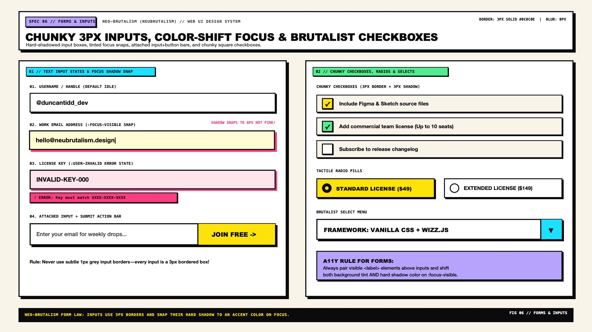

# Neo-Brutalism Design — Forms, Inputs & Validation States

Neo-Brutalist forms turn mundane data entry into a **bold, unmistakable, zero-ambiguity worksheet**. Unlike Neumorphism (which carves concave grooves into the surface) or Minimalist UI (which uses faint `1px` bottom underlines), Neo-Brutalist inputs are framed by **heavy `3px solid #0C0C0E` boxes, crisp white interiors, hard offset shadows, and dramatic focus shifts** that snap the input's background to warm highlighter yellow (`#FFFBD8`) or expand a colored offset shadow (`6px 6px 0 var(--nb-pink)`).

---

## Forms & Inputs Decision Matrix

| Goal | Tool | Why |
| :--- | :--- | :--- |
| Text input, email, password, or `<textarea>` | `.nb-input` (`background: #FFFFFF`, `border: 3px solid #0C0C0E`, `box-shadow: 4px 4px 0 #0C0C0E`) | High-contrast white interior on a warm cream canvas makes fillable fields immediately scannable |
| Signal active keyboard focus inside an input | Warm yellow background shift (`#FFFBD8`) + accent shadow (`6px 6px 0 var(--nb-pink)`) + `translate(-2px, -2px)` | Because every element already has a `3px` black border, focus must change both shadow color/offset and interior tint |
| Newsletter / search bar with attached button | `.nb-input-group` (shared `3px` outer border + `6px 6px 0` shadow, internal `3px` vertical divider) | Unifies input + submit into a single architectural bar without colliding shadows |
| Checkboxes and radio buttons | `appearance: none` custom `28px × 28px` brutalist boxes with `3px` borders and `3px 3px 0` shadows | Native browser checkboxes look tiny and fragile next to `3px` bordered inputs |
| Error / invalid field feedback | `:user-invalid` coral shadow (`5px 5px 0 #FF5252`) + attached `.nb-error-badge` | Delivers clear, accessible validation only after user interaction (`:user-invalid`), with icon + text |

---

## Multimodal Visual Reference

Before building forms, custom checkboxes, or attached search bars, inspect the forms specification sheet:

- **Forms, Inputs & Validation Specification Sheet:** [`./images/neo_brutalism_forms_and_inputs.jpg`](./images/neo_brutalism_forms_and_inputs.jpg)



### What to Observe in the Reference Sheet
1. **Input Lifecycle States (`LEFT COLUMN`):**
   - **Default State:** Crisp white `#FFFFFF` interior, `3px solid #0C0C0E` border, `4px 4px 0 #0C0C0E` hard shadow, and bold uppercase monospace label above.
   - **Focused State (`:focus-visible`):** Interior shifts to soft butter (`#FFFDF0`), slight lift (`translate(-2px, -2px)`), and hard shadow snaps to `6px 6px 0 #FF52A2` (Bubblegum Pink).
   - **Error State (`:user-invalid`):** Coral red border/shadow accent (`#FF5252`), soft blush interior (`#FFF0F0`), and a hard-bordered error sticker badge (`! INVALID EMAIL ADDRESS`).
2. **Composite Search / Command Bar & Select Dropdown (`RIGHT TOP`):** Attached input + high-chroma CTA button sharing a single outer `3px` frame; custom `<select>` with a boxed chevron compartment on the inline-end.
3. **Chunky Checkboxes & Radio Cards (`RIGHT BOTTOM`):** `28px × 28px` square checkboxes with bold ink checkmarks on `#FFE600` yellow fills, and full-row selectable radio cards.

---

## Text Inputs, Labels & Validation CSS

Always pair inputs with a visible `<label>` set in uppercase monospace or bold sans-serif. Never rely on placeholder text alone:

```html
<div class="nb-field">
  <label class="nb-label" for="project-slug">
    PROJECT SLUG <span class="nb-label__req">*REQUIRED</span>
  </label>
  <input
    id="project-slug"
    class="nb-input"
    type="text"
    placeholder="e.g. brutal-synth-v2"
    required
  />
  <p class="nb-error-msg" role="alert">! SLUG MUST BE LOWERCASE ALPHANUMERIC</p>
</div>
```

```css
.nb-field {
  display: flex;
  flex-direction: column;
  gap: 0.5rem;
  margin-block-end: 1.5rem;
}

.nb-label {
  display: flex;
  align-items: center;
  justify-content: space-between;
  font-family: var(--nb-font-mono);
  font-size: 0.85rem;
  font-weight: 800;
  text-transform: uppercase;
  letter-spacing: 0.05em;
  color: var(--nb-ink);
}

.nb-label__req {
  padding-inline: 0.4rem;
  padding-block: 0.1rem;
  background-color: var(--nb-yellow);
  color: var(--nb-ink-on-accent);
  border: 2px solid var(--nb-ink);
  font-size: 0.7rem;
}

.nb-input,
.nb-textarea,
.nb-select {
  inline-size: 100%;
  min-block-size: 3.125rem; /* 50px */
  padding-inline: 1rem;
  padding-block: 0.75rem;
  background-color: var(--nb-bg-surface);
  color: var(--nb-ink);
  font-family: var(--nb-font-sans);
  font-size: 1rem;
  font-weight: 600;
  border: 3px solid var(--nb-ink);
  border-radius: var(--nb-radius-md);
  box-shadow: 4px 4px 0px 0px var(--nb-shadow-color);
  transition:
    transform 100ms cubic-bezier(0.2, 0.8, 0.2, 1),
    box-shadow 100ms cubic-bezier(0.2, 0.8, 0.2, 1),
    background-color 100ms ease;
}

.nb-input::placeholder {
  color: var(--nb-ink-muted);
  font-weight: 400;
}

/* FOCUS: Lift 2px, tint background warm butter, snap shadow to Pink */
.nb-input:focus-visible,
.nb-textarea:focus-visible,
.nb-select:focus-visible {
  outline: none;
  background-color: light-dark(oklch(0.99 0.04 95), oklch(0.26 0.03 285));
  transform: translate(-2px, -2px);
  box-shadow: 6px 6px 0px 0px var(--nb-pink);
}

/* INVALID STATE: Triggered only after user interaction (:user-invalid) */
.nb-error-msg {
  display: none;
  align-self: flex-start;
  margin: 0.25rem 0 0;
  padding-inline: 0.65rem;
  padding-block: 0.25rem;
  background-color: oklch(0.67 0.22 25);
  color: var(--nb-ink-on-accent);
  font-family: var(--nb-font-mono);
  font-size: 0.75rem;
  font-weight: 800;
  border: 2px solid var(--nb-ink);
  box-shadow: 2px 2px 0px 0px var(--nb-ink);
}

.nb-input:user-invalid {
  background-color: light-dark(oklch(0.97 0.03 25), oklch(0.25 0.05 25));
  box-shadow: 5px 5px 0px 0px oklch(0.67 0.22 25);
}

.nb-input:user-invalid ~ .nb-error-msg {
  display: inline-block;
}
```

---

## Attached Input + Submit Action Bar (`.nb-input-group`)

For search bars, command palettes, or newsletter signups, attach the submit button directly to the input inside a unified `3px` frame:

```html
<form class="nb-input-group" role="search">
  <input
    class="nb-input-group__field"
    type="search"
    placeholder="Search 1,400+ brutalist components..."
    aria-label="Search components"
  />
  <button class="nb-input-group__submit" type="submit">SEARCH →</button>
</form>
```

```css
.nb-input-group {
  display: flex;
  align-items: stretch;
  background-color: var(--nb-bg-surface);
  border: 3px solid var(--nb-ink);
  border-radius: var(--nb-radius-md);
  box-shadow: var(--nb-shadow-md);
  overflow: hidden;
  transition: transform 100ms ease, box-shadow 100ms ease;
}

.nb-input-group:focus-within {
  transform: translate(-2px, -2px);
  box-shadow: 7px 7px 0px 0px var(--nb-shadow-color);
}

.nb-input-group__field {
  flex: 1;
  min-inline-size: 0;
  padding-inline: 1rem;
  padding-block: 0.85rem;
  border: none;
  background: transparent;
  color: var(--nb-ink);
  font-family: var(--nb-font-sans);
  font-size: 1rem;
  font-weight: 600;
}

.nb-input-group__field:focus {
  outline: none;
  background-color: light-dark(oklch(0.99 0.04 95), oklch(0.26 0.03 285));
}

.nb-input-group__submit {
  padding-inline: 1.5rem;
  background-color: var(--nb-yellow);
  color: var(--nb-ink-on-accent);
  font-family: var(--nb-font-display);
  font-weight: 900;
  text-transform: uppercase;
  border: none;
  border-inline-start: 3px solid var(--nb-ink);
  cursor: pointer;
}

.nb-input-group__submit:hover {
  background-color: var(--nb-pink);
}
```

---

## Chunky Custom Checkboxes & Radio Controls (`appearance: none`)

```css
.nb-checkbox,
.nb-radio {
  appearance: none;
  -webkit-appearance: none;
  position: relative;
  inline-size: 1.75rem; /* 28px */
  block-size: 1.75rem;  /* 28px */
  margin: 0;
  background-color: var(--nb-bg-surface);
  border: 3px solid var(--nb-ink);
  border-radius: var(--nb-radius-sm);
  box-shadow: 3px 3px 0px 0px var(--nb-shadow-color);
  cursor: pointer;
  display: inline-grid;
  place-content: center;
  transition: transform 90ms ease, box-shadow 90ms ease, background-color 90ms ease;
}

.nb-radio {
  border-radius: 50%;
}

.nb-checkbox:checked,
.nb-radio:checked {
  background-color: var(--nb-yellow);
  transform: translate(1px, 1px);
  box-shadow: 2px 2px 0px 0px var(--nb-shadow-color);
}

/* Crisp Geometrical Checkmark */
.nb-checkbox::before {
  content: "";
  inline-size: 0.75rem;
  block-size: 0.45rem;
  border-inline-start: 3.5px solid var(--nb-ink-on-accent);
  border-block-end: 3.5px solid var(--nb-ink-on-accent);
  transform: translateY(-1px) rotate(-45deg) scale(0);
  transition: transform 90ms cubic-bezier(0.2, 0.8, 0.2, 1);
}

.nb-checkbox:checked::before {
  transform: translateY(-1px) rotate(-45deg) scale(1);
}

/* Solid Ink Center Dot for Radio */
.nb-radio::before {
  content: "";
  inline-size: 0.75rem;
  block-size: 0.75rem;
  border-radius: 50%;
  background-color: var(--nb-ink-on-accent);
  transform: scale(0);
  transition: transform 90ms cubic-bezier(0.2, 0.8, 0.2, 1);
}

.nb-radio:checked::before {
  transform: scale(1);
}

.nb-checkbox:focus-visible,
.nb-radio:focus-visible {
  outline: 3px dashed var(--nb-ink);
  outline-offset: 4px;
}
```

---

## Do Not

| BAD | GOOD | Why |
| :--- | :--- | :--- |
| Using `:invalid` without `:user-invalid` | Style validation errors with `:user-invalid` | `:invalid` fires immediately on page load for empty `required` fields, screaming red error boxes before the user types a single character |
| Relying on `border-color` alone to indicate `:focus-visible` on an input | Shift interior background (`#FFFDF0`) AND change hard shadow offset/color (`6px 6px 0 var(--nb-pink)`) | Every element on a Neo-Brutalist page has a thick black border; a slight border color tweak is nearly invisible |
| Leaving native browser `<input type="checkbox">` unstyled next to `3px` inputs | Use `appearance: none` with a `28px × 28px`, `3px solid` bordered box | Default `16px` OS checkboxes look broken and out of scale inside a Neo-Brutalist layout |
| Omitting `<label>` elements and using `placeholder` as the only field label | Always render a persistent uppercase monospace `<label>` above the field | Placeholders disappear as soon as the user types, failing WCAG 2.2 SC 3.3.2 (Labels or Instructions) |
