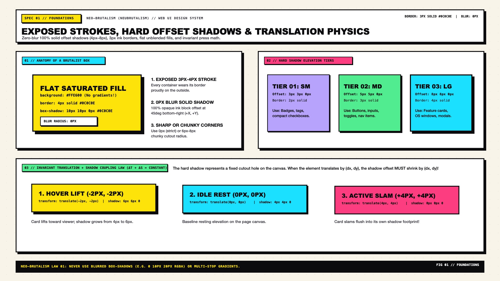

# Neo-Brutalism Design — Foundations & Design Tokens

Neo-Brutalism (also referred to as **Neubrutalism**) fuses raw architectural honesty from mid-20th-century Brutalist concrete structures with vibrant 1990s desktop operating system interfaces (Mac OS 8, Windows 95), punk zine cut-and-paste layouts, and high-chroma pop art. Where Neumorphism hides boundaries inside soft ambient shadows and Swiss Grid strips away decoration in favor of hairline structural rules, Neo-Brutalism celebrates **exposed high-contrast outlines, zero-blur hard offset shadows, unblended clashing color fills, and tactile mechanical displacement**.

---

## Foundations Decision Matrix

| Goal | Tool | Why |
| :--- | :--- | :--- |
| Define structural boundaries | `border: 3px solid var(--nb-ink)` (`2px` to `4px`) | Every surface, card, input, and badge is explicitly outlined in high-contrast ink rather than relying on subtle elevation or background bleed |
| Create depth and elevation | Hard offset `box-shadow: Xpx Ypx 0px 0px var(--nb-shadow)` | Zero blur (`0px`) and zero spread (`0px`) at `100%` opacity create a crisp, cut-paper / comic-book drop shadow |
| Coupled interactive physics | `transform: translate(Δx, Δy)` inversely coupled to `box-shadow` | The hard shadow acts as a stationary cutout footprint on the canvas; when the surface moves toward the viewer, the shadow offset grows by the exact same pixel distance |
| Corner geometry | Sharp (`0px`), blocky (`6px`–`12px`), or full pill (`9999px`) | Avoids corporate "safe" mid-soft rounding without borders; corners are either unapologetically sharp or deliberately chunky cartoon blocks |
| Surface fills | Flat, unblended `oklch()` solid colors (`linear-gradient` prohibited) | Rejects smooth gradients, glassmorphic `backdrop-filter: blur()`, and multi-layered ambient shadows |

---

## Multimodal Visual Reference

Before writing Neo-Brutalism CSS tokens or component wrappers, inspect the foundational visual specification sheet:

- **Foundations & Physics Specification Sheet:** [`./images/neo_brutalism_foundations.jpg`](./images/neo_brutalism_foundations.jpg)



### What to Observe in the Reference Sheet
1. **Exposed Structural Borders (`2px` / `3px` / `4px`):** Every container—from the smallest pill badge (`2px`) to standard cards (`3px`) and primary hero windows (`4px`)—is bounded by an unbroken `#0C0C0E` ink stroke.
2. **Hard Offset Shadow Tiers (`0px` Blur):** Elevation is expressed strictly through diagonal `X/Y` offset distance (`3px 3px 0`, `5px 5px 0`, `8px 8px 0`, `12px 12px 0`) with zero feathering.
3. **Mechanical Translation + Shadow Coupling:** Hovering a control lifts the surface up and left (`translate(-3px, -3px)`) while expanding the shadow (`8px 8px 0`); pressing it slams the surface into the shadow footprint (`translate(5px, 5px)`, `0px 0px 0`).
4. **Corner Geometry Spectrum:** Sharp Brutal (`0px`), Chunky Retro (`8px`), and Pill Badge (`9999px`) all share the same heavy ink border and hard offset shadow.

---

## The 4 Laws of Neo-Brutalism

### 1. Exposed Ink Outlines (`2px`–`4px`)
Never leave a container edge implied by a subtle color shift. Every interactive or structural box carries a solid `var(--nb-ink)` border:
- **Micro badges, inline tags, and compact table cells:** `2px solid var(--nb-ink)`
- **Standard buttons, inputs, cards, and navbars:** `3px solid var(--nb-ink)`
- **Hero containers, modal dialogs, and featured pricing windows:** `4px solid var(--nb-ink)`

### 2. Zero-Blur Hard Offset Shadows (`0px` Blur, `100%` Opacity)
Blurred `box-shadow` values (`0 10px 25px rgba(0,0,0,0.1)`) are strictly forbidden in Neo-Brutalism. Every shadow must have a `0px` blur radius and `0px` spread radius:

```css
/* Standard Neo-Brutalist Elevation Tiers */
--nb-shadow-xs: 2px 2px 0px 0px var(--nb-shadow-color);
--nb-shadow-sm: 3px 3px 0px 0px var(--nb-shadow-color);
--nb-shadow-md: 5px 5px 0px 0px var(--nb-shadow-color);
--nb-shadow-lg: 8px 8px 0px 0px var(--nb-shadow-color);
--nb-shadow-xl: 12px 12px 0px 0px var(--nb-shadow-color);
```

### 3. The Invariant Translation + Shadow Coupling Law
In Neo-Brutalism, the hard shadow represents a fixed physical footprint on the page canvas below the element. Whenever an element translates by $(\Delta x, \Delta y)$, its shadow offset $(S_x, S_y)$ must adjust inversely so the sum remains constant:

$$(S_{x,\text{idle}} - \Delta x) = S_{x,\text{state}}, \quad (S_{y,\text{idle}} - \Delta y) = S_{y,\text{state}}$$

- **Idle State:** `transform: translate(0px, 0px)` + `box-shadow: 5px 5px 0px 0px var(--nb-shadow-color)`
- **Hover (Lift) State:** `transform: translate(-3px, -3px)` + `box-shadow: 8px 8px 0px 0px var(--nb-shadow-color)` ($5 - (-3) = 8$)
- **Active (Slam) State:** `transform: translate(5px, 5px)` + `box-shadow: 0px 0px 0px 0px var(--nb-shadow-color)` ($5 - 5 = 0$)

### 4. Flat Unblended Fills & Exposed Dividers
Surfaces use flat, high-craft `oklch()` solid colors. Internal card sections (headers, bodies, footers, metadata strips) are separated by full-bleed `3px solid var(--nb-ink)` structural borders rather than whitespace alone, allowing each compartment of a single card to carry a distinct background fill.

---

## Core CSS Custom Properties Token Architecture

Copy this zero-dependency token block into `:root`. It defines structural stroke widths, corner radii, elevation shadow tiers, mechanical spring timings, and base surfaces using modern CSS `light-dark()` and `oklch()`:

```css
:root {
  color-scheme: light dark;

  /* 1. Structural Ink & Canvas Surfaces */
  --nb-bg-canvas: light-dark(oklch(0.97 0.015 85), oklch(0.16 0.01 285));   /* Warm Cream #FAF6EE / Carbon #0E0E12 */
  --nb-bg-surface: light-dark(oklch(1.00 0 0), oklch(0.22 0.015 285));      /* Pure White #FFFFFF / Elevated Slate */
  --nb-bg-subtle: light-dark(oklch(0.93 0.02 85), oklch(0.26 0.02 285));    /* Putty Gray #EFECE6 / Muted Charcoal */
  
  --nb-ink: light-dark(oklch(0.15 0.01 285), oklch(0.98 0.005 90));         /* #0C0C0E in Light / Crisp White in Dark */
  --nb-ink-muted: light-dark(oklch(0.38 0.015 285), oklch(0.76 0.01 90));
  --nb-ink-on-accent: oklch(0.15 0.01 285);                                 /* Always #0C0C0E on bright pop accents */

  /* 2. Primary Pop Accents (High-Chroma OKLCH) */
  --nb-yellow: oklch(0.91 0.19 98);    /* #FFE600 Cyber Yellow */
  --nb-pink: oklch(0.68 0.24 355);     /* #FF52A2 Gumroad Bubblegum */
  --nb-cyan: oklch(0.84 0.15 210);     /* #23F0C7 Electric Aqua / Cyan */
  --nb-lime: oklch(0.87 0.23 138);     /* #A8FF35 Acid Lime */
  --nb-violet: oklch(0.70 0.19 295);   /* #A388EE Hyper Lavender */
  --nb-orange: oklch(0.69 0.21 38);    /* #FF5C1A Safety Orange */

  /* 3. Shadow Color (Solid Ink in Light Mode, Neon/Ink in Dark Mode) */
  --nb-shadow-color: light-dark(oklch(0.15 0.01 285), oklch(0.91 0.19 98));

  /* 4. Border Widths */
  --nb-border-sm: 2px;
  --nb-border-md: 3px;
  --nb-border-lg: 4px;
  --nb-border: var(--nb-border-md) solid var(--nb-ink);

  /* 5. Corner Radius Tokens */
  --nb-radius-sharp: 0px;
  --nb-radius-sm: 4px;
  --nb-radius-md: 8px;
  --nb-radius-lg: 14px;
  --nb-radius-pill: 9999px;

  /* 6. Hard Offset Shadow Tiers (0px blur, 0px spread) */
  --nb-shadow-xs: 2px 2px 0px 0px var(--nb-shadow-color);
  --nb-shadow-sm: 3px 3px 0px 0px var(--nb-shadow-color);
  --nb-shadow-md: 5px 5px 0px 0px var(--nb-shadow-color);
  --nb-shadow-lg: 8px 8px 0px 0px var(--nb-shadow-color);
  --nb-shadow-xl: 12px 12px 0px 0px var(--nb-shadow-color);

  /* 7. Mechanical Snappy Easing */
  --nb-ease-snap: cubic-bezier(0.2, 0.8, 0.2, 1);
  --nb-duration-fast: 110ms;
}
```

---

## Base Surface & Utility Classes

```css
*,
*::before,
*::after {
  box-sizing: border-box;
}

body {
  margin: 0;
  background-color: var(--nb-bg-canvas);
  color: var(--nb-ink);
  font-family: 'Space Grotesk', 'Plus Jakarta Sans', system-ui, sans-serif;
  line-height: 1.5;
}

/* Reusable Neo-Brutalist Box Primitive */
.nb-surface {
  background-color: var(--nb-bg-surface);
  color: var(--nb-ink);
  border: var(--nb-border);
  border-radius: var(--nb-radius-md);
  box-shadow: var(--nb-shadow-md);
}

/* Interactive Surface with Invariant Shadow Coupling */
.nb-interactive {
  background-color: var(--nb-yellow);
  color: var(--nb-ink-on-accent);
  border: var(--nb-border);
  border-radius: var(--nb-radius-md);
  box-shadow: var(--nb-shadow-md);
  transition:
    transform var(--nb-duration-fast) var(--nb-ease-snap),
    box-shadow var(--nb-duration-fast) var(--nb-ease-snap),
    background-color var(--nb-duration-fast) ease;
  cursor: pointer;
}

.nb-interactive:hover {
  transform: translate(-3px, -3px);
  box-shadow: var(--nb-shadow-lg);
}

.nb-interactive:active {
  transform: translate(5px, 5px);
  box-shadow: 0px 0px 0px 0px var(--nb-shadow-color);
}
```

---

## Do Not

| BAD | GOOD | Why |
| :--- | :--- | :--- |
| `box-shadow: 0 10px 25px rgba(0, 0, 0, 0.15)` | `box-shadow: 5px 5px 0px 0px var(--nb-ink)` | Blurred, semi-transparent shadows turn Neo-Brutalism into generic Material/SaaS UI; shadows must have `0px` blur and `100%` opacity |
| `border: 1px solid rgba(0, 0, 0, 0.08)` | `border: 3px solid var(--nb-ink)` | Hairline low-contrast borders disappear against vibrant pop fills and break the comic/zine structural frame |
| Translating a button on `:active` without zeroing `box-shadow` | `transform: translate(5px, 5px)` paired with `box-shadow: 0 0 0 0 var(--nb-ink)` | If the shadow moves with the button on press instead of collapsing, the button appears to float sideways rather than pressing into the canvas |
| `backdrop-filter: blur(16px)` and translucent glass cards | Solid `oklch()` opaque surface fills (`#FAF6EE`, `#FFFFFF`, `#FFE600`) | Frosted glass belongs to Glassmorphism; Neo-Brutalism relies on flat, opaque, print-inspired pigment blocks |
| Nesting 4+ levels of `8px 8px 0` shadowed boxes inside each other | Reserve `8px 8px 0` for the outer window; use `3px 3px 0` or flat `border-block-end` dividers inside | Stacking massive hard shadows inside tight containers creates heavy black visual staircases that crowd out content |
