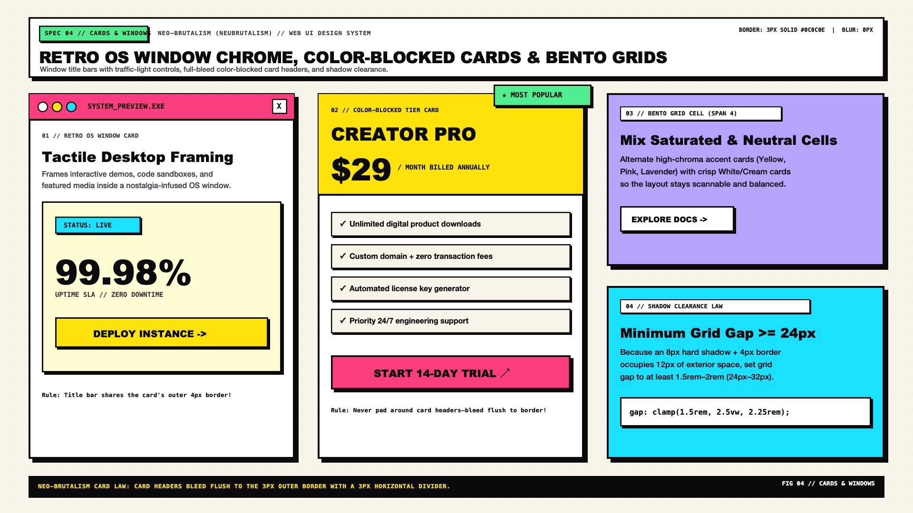

# Neo-Brutalism Design — Layout, Cards & Retro OS Windows

Neo-Brutalist layouts treat the viewport as an **architectural poster board populated by modular Bento blocks, retro desktop OS windows, and color-blocked feature cards**. Unlike Swiss Grid—where elements share a single collapse-bordered table hairline—Neo-Brutalist cards typically stand as distinct physical blocks separated by generous gutters (`gap: clamp(1.5rem, 2.5vw, 2.25rem)`) so their hard offset shadows (`5px 5px 0` to `8px 8px 0`) have room to breathe on the warm canvas.

---

## Layout & Containers Decision Matrix

| Goal | Tool | Why |
| :--- | :--- | :--- |
| Frame primary hero content, code sandboxes, or media players | **Retro OS Window Container** (`.nb-window`) with top title bar and window control dots | Evokes nostalgic 1990s desktop computing (Mac OS 8 / NeXTSTEP) while giving the card a clear structural header |
| Highlight a featured pricing tier or callout | **Color-Blocked Card** with full-bleed bordered header, contrasting body, and corner sticker | Separates metadata, pricing, and actions into distinct high-contrast compartments within a single `3px` outer frame |
| Organize multi-metric dashboards or feature showcases | **Bento Grid** (`display: grid; gap: 1.75rem`) mixing `70%` white/neutral cards with `30%` saturated accent cells | Prevents visual overload while guiding the eye to key metrics |
| Prevent hard shadows from colliding with adjacent cards | Minimum grid gutter `gap: 1.5rem` (`24px`) for `5px` shadows; `gap: 2rem` (`32px`) for `8px` shadows | Hard offset shadows protrude outside the element's border box; tight `8px` gaps cause shadows to overlap neighbor borders |

---

## Multimodal Visual Reference

Before constructing page grids, retro OS windows, or pricing cards, inspect the layout and containers specification sheet:

- **Cards, OS Windows & Bento Layout Specification Sheet:** [`./images/neo_brutalism_cards_and_windows.jpg`](./images/neo_brutalism_cards_and_windows.jpg)



### What to Observe in the Reference Sheet
1. **Retro OS Window Chrome (`SPEC 04 — LEFT`):** A `3px solid #0C0C0E` outer container with an `8px 8px 0 #0C0C0E` shadow, a full-bleed colored title bar (`border-block-end: 3px solid #0C0C0E`), three circular or square window control buttons on the inline-start/end, and a monospace window title (`SYSTEM_MONITOR.EXE`).
2. **Color-Blocked Pricing & Feature Card (`SPEC 04 — CENTER`):** Full-bleed header in Cyber Yellow (`#FFE600`), body in Crisp White (`#FFFFFF`), footer strip in Putty (`#EFECE6`), and an overlapping tilted corner sticker (`MOST POPULAR`).
3. **Bento Grid Balance (`SPEC 04 — RIGHT`):** Notice how saturated cells (Pink, Cyan, Lime) are interspersed with crisp white surfaces so the layout feels structured rather than chaotic.

---

## Retro OS Window Component (`.nb-window`)

Use `.nb-window` for interactive showcases, code previews, media containers, or primary feature callouts:

```html
<article class="nb-window">
  <header class="nb-window__titlebar">
    <div class="nb-window__controls" aria-hidden="true">
      <span class="nb-window__dot nb-window__dot--close"></span>
      <span class="nb-window__dot nb-window__dot--min"></span>
      <span class="nb-window__dot nb-window__dot--max"></span>
    </div>
    <span class="nb-window__title">WORKSPACE_CONFIG // V2.4</span>
    <span class="nb-window__status">ONLINE</span>
  </header>
  <div class="nb-window__body">
    <h3>Zero-Blur Rendering Engine</h3>
    <p>Every surface is bounded by a 3px solid structural stroke and a 100% opaque hard offset shadow.</p>
  </div>
</article>
```

```css
.nb-window {
  background-color: var(--nb-bg-surface);
  color: var(--nb-ink);
  border: 3px solid var(--nb-ink);
  border-radius: var(--nb-radius-md);
  box-shadow: var(--nb-shadow-lg);
  overflow: hidden;
}

.nb-window__titlebar {
  display: flex;
  align-items: center;
  justify-content: space-between;
  gap: 0.75rem;
  padding-inline: 1rem;
  padding-block: 0.65rem;
  background-color: var(--nb-pink);
  color: var(--nb-ink-on-accent);
  border-block-end: 3px solid var(--nb-ink);
}

.nb-window__controls {
  display: flex;
  align-items: center;
  gap: 0.45rem;
}

.nb-window__dot {
  inline-size: 0.85rem;
  block-size: 0.85rem;
  border-radius: 50%;
  border: 2px solid var(--nb-ink);
  background-color: var(--nb-bg-surface);
}

.nb-window__dot--close { background-color: oklch(0.67 0.22 25); }
.nb-window__dot--min   { background-color: var(--nb-yellow); }
.nb-window__dot--max   { background-color: var(--nb-lime); }

.nb-window__title {
  font-family: var(--nb-font-mono);
  font-size: 0.8125rem;
  font-weight: 700;
  letter-spacing: 0.04em;
  text-transform: uppercase;
}

.nb-window__status {
  padding-inline: 0.5rem;
  padding-block: 0.15rem;
  background-color: var(--nb-lime);
  border: 2px solid var(--nb-ink);
  font-family: var(--nb-font-mono);
  font-size: 0.7rem;
  font-weight: 800;
}

.nb-window__body {
  padding: clamp(1.25rem, 2.5vw, 2rem);
}
```

---

## Color-Blocked Feature & Pricing Card

Neo-Brutalist cards divide internal anatomy using **full-bleed horizontal rules (`border-block-end: 3px solid var(--nb-ink)`)** rather than floating padding alone. Note that if you place a corner sticker (`position: absolute; inset-block-start: -14px`), the outer `.nb-card` must **not** have `overflow: hidden`:

```css
.nb-card {
  position: relative;
  display: flex;
  flex-direction: column;
  background-color: var(--nb-bg-surface);
  color: var(--nb-ink);
  border: 3px solid var(--nb-ink);
  border-radius: var(--nb-radius-md);
  box-shadow: var(--nb-shadow-md);
}

.nb-card__header {
  padding-inline: 1.5rem;
  padding-block: 1.25rem;
  background-color: var(--nb-yellow);
  color: var(--nb-ink-on-accent);
  border-block-end: 3px solid var(--nb-ink);
  /* Match top inner radius so background doesn't bleed past rounded corners */
  border-start-start-radius: calc(var(--nb-radius-md) - 3px);
  border-start-end-radius: calc(var(--nb-radius-md) - 3px);
}

.nb-card__body {
  flex: 1;
  padding: 1.5rem;
}

.nb-card__footer {
  padding-inline: 1.5rem;
  padding-block: 1rem;
  background-color: var(--nb-bg-subtle);
  border-block-start: 3px solid var(--nb-ink);
  border-end-start-radius: calc(var(--nb-radius-md) - 3px);
  border-end-end-radius: calc(var(--nb-radius-md) - 3px);
}

/* Corner Sticker Callout */
.nb-card__corner-badge {
  position: absolute;
  inset-block-start: -0.85rem;
  inset-inline-end: -0.75rem;
  z-index: 2;
}
```

---

## Bento Grid Architecture & Shadow Clearance

```css
.nb-bento-grid {
  display: grid;
  grid-template-columns: repeat(12, minmax(0, 1fr));
  /* Generous gap prevents 5px-8px hard shadows from crowding neighbors */
  gap: clamp(1.5rem, 2.5vw, 2.25rem);
  max-inline-size: 80rem;
  margin-inline: auto;
  padding-inline: clamp(1.25rem, 4vw, 3rem);
}

.nb-bento-span-8 { grid-column: span 8; }
.nb-bento-span-4 { grid-column: span 4; }
.nb-bento-span-6 { grid-column: span 6; }

@media (max-width: 56rem) {
  .nb-bento-span-8,
  .nb-bento-span-4,
  .nb-bento-span-6 {
    grid-column: 1 / -1;
  }
}
```

---

## Do Not

| BAD | GOOD | Why |
| :--- | :--- | :--- |
| Setting `overflow: hidden` on a card that has an overlapping `.nb-card__corner-badge` | Use `border-start-start-radius: calc(var(--nb-radius-md) - 3px)` on `.nb-card__header` instead of `overflow: hidden` | `overflow: hidden` clips any sticker or badge that protrudes outside the card border |
| Using tight `gap: 0.5rem` (`8px`) grids with `8px 8px 0` hard shadows | Use `gap: clamp(1.5rem, 2.5vw, 2.25rem)` (`24px`–`36px`) | An `8px` shadow completely fills an `8px` grid gap, causing cards to visually fuse into a muddy black grid |
| Giving every single card in a 9-card Bento grid a different neon background | Keep `60%–70%` of cards on `--nb-bg-surface` (`#FFFFFF`) or `--nb-bg-subtle`, and use color fills on 2–3 focal cells | When everything shouts at maximum saturation, nothing stands out |
| Applying `:hover { transform: translate(-3px, -3px); }` to static non-clickable `<article>` cards | Reserve hover lift physics for genuinely interactive cards (`<a>`, `<button>`, or clickable cards) | Lifting static containers misleads users into clicking non-interactive text blocks |
