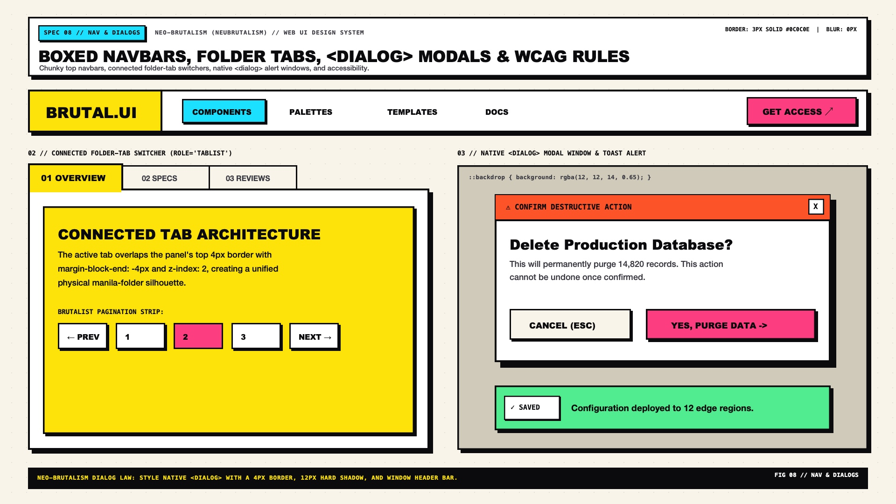

# Neo-Brutalism Design — Navigation, Dialogs & Accessibility

Neo-Brutalist navigation, tab switchers, and modal dialogs turn structural chrome into **high-craft architectural poster frames**. Instead of floating translucent navbars with blurred backdrops, Neo-Brutalism uses **compartmentalized top bars with full-bleed bordered cells, manila-folder connected tab bars where the active tab physically fuses into the content panel below, and native `<dialog>` windows styled after retro desktop operating systems**.

Because Neo-Brutalism already surrounds every element with a `3px solid #0C0C0E` border and high-chroma fills, **WCAG 2.2 accessibility requires special discipline**: keyboard focus rings must never rely on a simple solid border, bright accent fills must always pair with `#0C0C0E` black ink, and mechanical animations must respect `prefers-reduced-motion`.

---

## Navigation, Dialogs & Accessibility Decision Matrix

| Goal | Tool | Why |
| :--- | :--- | :--- |
| Primary site header / top navigation | **Compartmentalized Boxed Navbar** (`.nb-navbar`) with `3px` vertical cell dividers (`border-inline-end: 3px solid var(--nb-ink)`) | Turns brand logo, nav links, and primary CTA into distinct color-blocked architectural compartments |
| In-page view switching | **Connected Manila-Folder Tabs** (`role="tablist"`, active tab uses `margin-block-end: -3px` and `border-block-end-color: var(--nb-bg-surface)`) | Visually fuses the active tab with the panel below while inactive tabs sit recessed in Putty (`#EFECE6`) |
| Modal confirmation or command dialog | Native `<dialog class="nb-dialog">` with OS titlebar, `12px 12px 0` hard shadow, and halftone/dimmed `::backdrop` | Native `<dialog>.showModal()` provides built-in focus trapping, `Esc` dismissal, and `inert` background handling |
| Toast notifications & banners | `.nb-toast` (`border: 3px solid #0C0C0E`, `box-shadow: 6px 6px 0 #0C0C0E`, high-chroma status badge) | Cuts cleanly through dense dashboard layouts without relying on soft drop-shadow elevation |
| Keyboard focus visibility | `outline: 3px dashed var(--nb-ink); outline-offset: 4px;` | Since all components already have a solid `3px` border, a **dashed** offset outline provides an unmistakable secondary perimeter |

---

## Multimodal Visual Reference

Before implementing navigation bars, connected folder tabs, or modal `<dialog>` windows, inspect the navigation and dialogs specification sheet:

- **Navigation, Tabs, Modals & Toasts Specification Sheet:** [`./images/neo_brutalism_navigation_and_dialogs.jpg`](./images/neo_brutalism_navigation_and_dialogs.jpg)



### What to Observe in the Reference Sheet
1. **Compartmentalized Top Navbar (`TOP`):** A full-width `3px solid #0C0C0E` bar with a `6px 6px 0 #0C0C0E` shadow. The brand cell on the inline-start is filled with Cyber Yellow (`#FFE600`), the middle navigation links sit on Crisp White (`#FFFFFF`) with a pill badge on the active link, and the inline-end CTA cell is filled with Bubblegum Pink (`#FF52A2`).
2. **Connected Manila-Folder Tab Switcher (`BOTTOM LEFT`):** Tabs (`[role="tab"]`) sit directly flush atop the tabpanel (`[role="tabpanel"]`). The selected tab (`aria-selected="true"`) shares the panel's `#FFFFFF` background and erases the `3px` bottom border seam beneath it.
3. **Retro OS Modal `<dialog>` & Toast Stack (`BOTTOM RIGHT`):** A `4px solid #0C0C0E` modal window with a `12px 12px 0` hard shadow, a full-bleed Coral/Pink title bar with a square `[X]` close button, and stacked brutalist toast alerts.

---

## Compartmentalized Boxed Top Navbar (`.nb-navbar`)

```html
<header class="nb-navbar">
  <a class="nb-navbar__brand" href="/">BRUTAL_UI // 26</a>
  <nav class="nb-navbar__links" aria-label="Main navigation">
    <a class="nb-navbar__link" href="#foundations" aria-current="page">FOUNDATIONS</a>
    <a class="nb-navbar__link" href="#components">COMPONENTS</a>
    <a class="nb-navbar__link" href="#tokens">TOKENS</a>
  </nav>
  <div class="nb-navbar__cta">
    <a class="nb-navbar__action" href="#get-started">GET ACCESS →</a>
  </div>
</header>
```

```css
.nb-navbar {
  display: flex;
  align-items: stretch;
  justify-content: space-between;
  background-color: var(--nb-bg-surface);
  border: 3px solid var(--nb-ink);
  border-radius: var(--nb-radius-md);
  box-shadow: var(--nb-shadow-md);
  overflow: hidden;
  margin-block-end: 2rem;
}

.nb-navbar__brand {
  display: flex;
  align-items: center;
  padding-inline: 1.5rem;
  padding-block: 1rem;
  background-color: var(--nb-yellow);
  color: var(--nb-ink-on-accent);
  font-family: var(--nb-font-display);
  font-size: 1.15rem;
  font-weight: 900;
  text-decoration: none;
  border-inline-end: 3px solid var(--nb-ink);
}

.nb-navbar__links {
  display: flex;
  align-items: center;
  gap: 0.5rem;
  padding-inline: 1.25rem;
  flex: 1;
}

.nb-navbar__link {
  padding-inline: 0.85rem;
  padding-block: 0.4rem;
  color: var(--nb-ink);
  font-family: var(--nb-font-mono);
  font-size: 0.85rem;
  font-weight: 700;
  text-decoration: none;
  border: 2px solid transparent;
  border-radius: var(--nb-radius-sm);
}

.nb-navbar__link:hover,
.nb-navbar__link[aria-current="page"] {
  background-color: var(--nb-cyan);
  color: var(--nb-ink-on-accent);
  border-color: var(--nb-ink);
  box-shadow: 2px 2px 0px 0px var(--nb-ink);
}

.nb-navbar__cta {
  display: flex;
  border-inline-start: 3px solid var(--nb-ink);
}

.nb-navbar__action {
  display: flex;
  align-items: center;
  padding-inline: 1.5rem;
  background-color: var(--nb-pink);
  color: var(--nb-ink-on-accent);
  font-family: var(--nb-font-display);
  font-weight: 900;
  text-decoration: none;
}

.nb-navbar__action:hover {
  background-color: var(--nb-lime);
}
```

---

## Connected Manila-Folder Tabs (`role="tablist"`)

```html
<div class="nb-tabs">
  <div class="nb-tabs__list" role="tablist" aria-label="Workspace views">
    <button role="tab" aria-selected="true" aria-controls="panel-spec" id="tab-spec" class="nb-tabs__tab">
      01 // ARCHITECTURE
    </button>
    <button role="tab" aria-selected="false" aria-controls="panel-tokens" id="tab-tokens" class="nb-tabs__tab" tabindex="-1">
      02 // CSS TOKENS
    </button>
    <button role="tab" aria-selected="false" aria-controls="panel-a11y" id="tab-a11y" class="nb-tabs__tab" tabindex="-1">
      03 // ACCESSIBILITY
    </button>
  </div>
  <section id="panel-spec" role="tabpanel" aria-labelledby="tab-spec" class="nb-tabs__panel">
    <p>Active folder tab overlaps the panel border by -3px so the tab and panel form a single continuous cutout shape.</p>
  </section>
</div>
```

```css
.nb-tabs__list {
  display: flex;
  flex-wrap: wrap;
  gap: 0.5rem;
  padding-inline-start: 0.75rem;
}

.nb-tabs__tab {
  position: relative;
  padding-inline: 1.25rem;
  padding-block: 0.75rem;
  background-color: var(--nb-bg-subtle);
  color: var(--nb-ink);
  font-family: var(--nb-font-mono);
  font-size: 0.85rem;
  font-weight: 800;
  border: 3px solid var(--nb-ink);
  border-start-start-radius: var(--nb-radius-md);
  border-start-end-radius: var(--nb-radius-md);
  margin-block-end: -3px; /* Overlap panel top border */
  cursor: pointer;
}

.nb-tabs__tab[aria-selected="true"] {
  background-color: var(--nb-bg-surface);
  border-block-end-color: var(--nb-bg-surface); /* Erase seam into panel */
  z-index: 2;
}

.nb-tabs__panel {
  position: relative;
  z-index: 1;
  padding: 1.75rem;
  background-color: var(--nb-bg-surface);
  border: 3px solid var(--nb-ink);
  border-radius: var(--nb-radius-md);
  box-shadow: var(--nb-shadow-md);
}
```

---

## Native `<dialog>` Modal with Retro OS Chrome

Always use the native HTML `<dialog>` element opened via `.showModal()` so background content is automatically made `inert` and keyboard focus is trapped inside the modal:

```css
.nb-dialog {
  inline-size: min(92vw, 34rem);
  padding: 0;
  background-color: var(--nb-bg-surface);
  color: var(--nb-ink);
  border: 4px solid var(--nb-ink);
  border-radius: var(--nb-radius-md);
  box-shadow: var(--nb-shadow-xl); /* 12px 12px 0px 0px */
}

/* Halftone Dimmed Backdrop */
.nb-dialog::backdrop {
  background-color: oklch(0.15 0.01 285 / 0.55);
  background-image: radial-gradient(var(--nb-ink) 1.5px, transparent 1.5px);
  background-size: 16px 16px;
}

.nb-dialog__header {
  display: flex;
  align-items: center;
  justify-content: space-between;
  padding-inline: 1.25rem;
  padding-block: 0.85rem;
  background-color: var(--nb-yellow);
  color: var(--nb-ink-on-accent);
  border-block-end: 4px solid var(--nb-ink);
}

.nb-dialog__close {
  inline-size: 2.25rem;
  block-size: 2.25rem;
  display: grid;
  place-content: center;
  background-color: oklch(0.67 0.22 25);
  color: var(--nb-ink-on-accent);
  font-family: var(--nb-font-mono);
  font-weight: 900;
  border: 3px solid var(--nb-ink);
  box-shadow: 2px 2px 0px 0px var(--nb-ink);
  cursor: pointer;
}
```

---

## WCAG 2.2 & Forced-Colors Accessibility Rules

### 1. High-Contrast Mode (`forced-colors: active`)
In Windows Contrast Themes (`@media (forced-colors: active)`), browser engines strip `box-shadow` completely. Because Neo-Brutalism already pairs every shadow with an explicit `2px–4px solid` border, structural hierarchy survives naturally—provided interactive states (`aria-pressed`, `aria-selected`, `:focus-visible`) also use system keywords (`Highlight`, `CanvasText`):

```css
@media (forced-colors: active) {
  .nb-btn:focus-visible,
  .nb-input:focus-visible {
    outline: 3px dashed Highlight;
    outline-offset: 4px;
  }

  .nb-btn[aria-pressed="true"],
  .nb-tabs__tab[aria-selected="true"] {
    forced-color-adjust: none;
    background-color: Highlight;
    color: HighlightText;
    border-color: CanvasText;
  }
}
```

---

## Do Not

| BAD | GOOD | Why |
| :--- | :--- | :--- |
| Building custom `<div class="modal">` overlays without focus trapping or `inert` | Use native `<dialog class="nb-dialog">` with `.showModal()` | Native `<dialog>` guarantees `Esc` dismissal, top-layer stacking, and accessible screen reader announcements |
| Using `backdrop-filter: blur(12px)` on sticky Neo-Brutalist navbars | Use `100%` opaque `--nb-bg-surface` or `--nb-yellow` with `border-block-end: 3px solid var(--nb-ink)` | Blurred translucent headers belong to Glassmorphism and clash with opaque poster geometry |
| Using a solid `outline: 2px solid black` for `:focus-visible` | Use `outline: 3px dashed var(--nb-ink); outline-offset: 4px;` | A solid black outline merges visually with the element's existing `3px solid black` border; a dashed offset outline stands out immediately |
| Letting active folder tabs float with a `4px` gap above the tab panel | Overlap the panel border using `margin-block-end: -3px` and `border-block-end-color: var(--nb-bg-surface)` | Disconnected tabs lose the physical manila-folder metaphor and create a double `6px` black seam |
