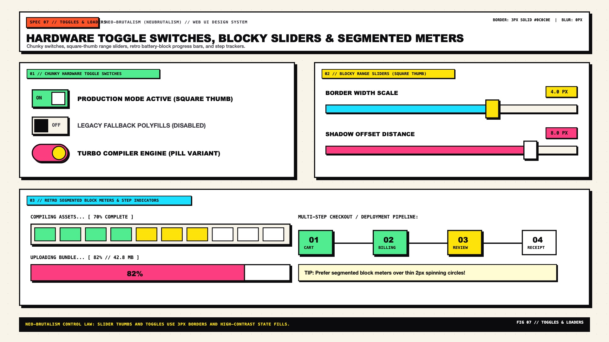

# Neo-Brutalism Design — Toggles, Sliders, Loaders & Steppers

Neo-Brutalist state controls and progress indicators draw inspiration from **industrial synthesizer hardware, retro 1990s OS installer dialogs (Win95 / Mac OS 8), and arcade energy meters**. Soft spinning SVG rings and borderless 2px progress lines are replaced by **chunky mechanical toggle switches, square hard-shadowed range thumbs, and segmented battery-block progress bars**.

---

## Toggles, Sliders & Loaders Decision Matrix

| Goal | Tool | Why |
| :--- | :--- | :--- |
| Binary ON/OFF setting | `.nb-switch` (`role="switch"`, `3px solid #0C0C0E` track + bordered thumb that snaps from `#FFFFFF` to `#A8FF35` Lime on `:checked`) | Provides unmistakable colour + position + label (`ON`/`OFF`) state clarity |
| Continuous value adjustment (volume, price, zoom) | `<input type="range" class="nb-slider">` with `16px` bordered track and `28px × 28px` square hard-shadowed thumb | Gives the user a large, high-contrast physical fader handle with `3px 3px 0` offset depth |
| Determinate file upload / installation progress | **Segmented Block Meter** (`.nb-progress-segmented`) or **Striped Hazard Bar** | Evokes classic OS file-copy dialogs and industrial telemetry meters |
| Indeterminate loading state | **Bouncing Mechanical Blocks** or **Marquee Status Ticker** (`LOADING_ASSETS...`) | Avoids generic Material circular spinners that clash with crisp `3px` brutalist geometry |
| Multi-step checkout or onboarding wizard | **Connected Mechanical Stepper** (`01` $\rightarrow$ `02` $\rightarrow$ `03` nodes joined by a `4px` structural bar) | Turns abstract progress into bold numbered poster milestones |

---

## Multimodal Visual Reference

Before building toggle switches, range faders, or progress meters, inspect the toggles and loaders specification sheet:

- **Toggles, Sliders, Progress & Steppers Specification Sheet:** [`./images/neo_brutalism_toggles_and_loaders.jpg`](./images/neo_brutalism_toggles_and_loaders.jpg)



### What to Observe in the Reference Sheet
1. **Mechanical Toggle Switches (`TOP LEFT`):** Both rectangular rocker switches (`ON` / `OFF` stamped inside the track) and pill switches feature a `3px solid #0C0C0E` track, a `3px 3px 0` hard track shadow, and a bordered thumb that translates smoothly across the track.
2. **Blocky Range Sliders (`BOTTOM LEFT`):** Thick `16px` bordered track with a vibrant filled portion (`#FF52A2` or `#FFE600`), paired with a chunky square thumb (`28px × 28px`, `3px solid #0C0C0E`, `3px 3px 0` shadow) and a hard-shadowed monospace value tooltip (`75%`).
3. **Retro Segmented & Striped Progress Bars (`TOP RIGHT`):**
   - **Segmented Block Meter:** Discrete bordered rectangular cells (`#A8FF35` Lime filled vs `#EFECE6` empty) inside a `3px` outer frame.
   - **Diagonal Hazard Stripe Loader:** High-contrast `45deg` repeating linear-gradient stripes (`#FFE600` and `#0C0C0E`) inside a bordered track.
4. **Mechanical Stepper (`BOTTOM RIGHT`):** Square `48px × 48px` step nodes (`01 DONE` in Lime, `02 ACTIVE` in Yellow with `5px 5px 0` shadow, `03 LOCKED` in Putty) linked by a `4px solid #0C0C0E` connecting rail.

---

## Chunky Hardware Toggle Switch (`role="switch"`)

```html
<label class="nb-switch-label">
  <input class="nb-switch" type="checkbox" role="switch" checked />
  <span class="nb-switch__text">TURBO COMPILER MODE</span>
</label>
```

```css
.nb-switch-label {
  display: inline-flex;
  align-items: center;
  gap: 0.85rem;
  cursor: pointer;
  user-select: none;
}

.nb-switch {
  appearance: none;
  -webkit-appearance: none;
  position: relative;
  inline-size: 4.25rem; /* 68px */
  block-size: 2.25rem;  /* 36px */
  margin: 0;
  background-color: var(--nb-bg-subtle);
  border: 3px solid var(--nb-ink);
  border-radius: var(--nb-radius-sm);
  box-shadow: 3px 3px 0px 0px var(--nb-shadow-color);
  cursor: pointer;
  transition: background-color 120ms ease;
}

/* Inner TrackThumb */
.nb-switch::before {
  content: "";
  position: absolute;
  inset-block-start: 3px;
  inset-inline-start: 3px;
  inline-size: 1.5rem;  /* 24px */
  block-size: 1.5rem;   /* 24px */
  background-color: var(--nb-bg-surface);
  border: 2.5px solid var(--nb-ink);
  border-radius: 2px;
  transition: transform 120ms cubic-bezier(0.2, 0.8, 0.2, 1);
}

.nb-switch:checked {
  background-color: var(--nb-lime);
}

.nb-switch:checked::before {
  transform: translateX(1.95rem);
}

.nb-switch:focus-visible {
  outline: 3px dashed var(--nb-ink);
  outline-offset: 4px;
}

.nb-switch__text {
  font-family: var(--nb-font-mono);
  font-size: 0.9rem;
  font-weight: 800;
  text-transform: uppercase;
}
```

---

## Blocky Hardware Range Slider (`<input type="range">`)

```css
.nb-slider {
  appearance: none;
  -webkit-appearance: none;
  inline-size: 100%;
  block-size: 1rem; /* 16px track */
  background-color: var(--nb-bg-surface);
  border: 3px solid var(--nb-ink);
  border-radius: var(--nb-radius-sm);
  box-shadow: 3px 3px 0px 0px var(--nb-shadow-color);
  cursor: pointer;
}

/* WebKit Square Mechanical Thumb */
.nb-slider::-webkit-slider-thumb {
  -webkit-appearance: none;
  appearance: none;
  inline-size: 1.75rem; /* 28px */
  block-size: 1.75rem;  /* 28px */
  background-color: var(--nb-yellow);
  border: 3px solid var(--nb-ink);
  border-radius: var(--nb-radius-sm);
  box-shadow: 3px 3px 0px 0px var(--nb-shadow-color);
  cursor: grab;
  transition: transform 90ms ease, box-shadow 90ms ease, background-color 90ms ease;
}

.nb-slider::-webkit-slider-thumb:hover {
  background-color: var(--nb-pink);
  transform: translate(-2px, -2px);
  box-shadow: 5px 5px 0px 0px var(--nb-shadow-color);
}

.nb-slider::-webkit-slider-thumb:active {
  cursor: grabbing;
  transform: translate(3px, 3px);
  box-shadow: 0px 0px 0px 0px var(--nb-shadow-color);
}

/* Firefox Square Mechanical Thumb */
.nb-slider::-moz-range-thumb {
  inline-size: 1.75rem;
  block-size: 1.75rem;
  background-color: var(--nb-yellow);
  border: 3px solid var(--nb-ink);
  border-radius: var(--nb-radius-sm);
  box-shadow: 3px 3px 0px 0px var(--nb-shadow-color);
  cursor: grab;
}

.nb-slider:focus-visible {
  outline: 3px dashed var(--nb-ink);
  outline-offset: 6px;
}
```

---

## Retro Segmented & Striped Progress Meters

### 1. Segmented Battery-Block Progress Bar
```html
<div
  class="nb-progress-blocks"
  role="progressbar"
  aria-label="Upload progress"
  aria-valuenow="70"
  aria-valuemin="0"
  aria-valuemax="100"
>
  <span class="nb-progress-blocks__cell is-filled"></span>
  <span class="nb-progress-blocks__cell is-filled"></span>
  <span class="nb-progress-blocks__cell is-filled"></span>
  <span class="nb-progress-blocks__cell is-filled"></span>
  <span class="nb-progress-blocks__cell is-filled"></span>
  <span class="nb-progress-blocks__cell is-filled"></span>
  <span class="nb-progress-blocks__cell is-filled"></span>
  <span class="nb-progress-blocks__cell"></span>
  <span class="nb-progress-blocks__cell"></span>
  <span class="nb-progress-blocks__cell"></span>
</div>
```

```css
.nb-progress-blocks {
  display: grid;
  grid-template-columns: repeat(10, 1fr);
  gap: 0.35rem;
  padding: 0.4rem;
  background-color: var(--nb-bg-surface);
  border: 3px solid var(--nb-ink);
  border-radius: var(--nb-radius-sm);
  box-shadow: var(--nb-shadow-sm);
}

.nb-progress-blocks__cell {
  block-size: 1.5rem;
  background-color: var(--nb-bg-subtle);
  border: 2px solid var(--nb-ink);
}

.nb-progress-blocks__cell.is-filled {
  background-color: var(--nb-lime);
}
```

### 2. Striped Industrial Hazard Bar
```css
.nb-progress-striped {
  inline-size: 100%;
  block-size: 1.75rem;
  background-color: var(--nb-bg-surface);
  border: 3px solid var(--nb-ink);
  border-radius: var(--nb-radius-sm);
  box-shadow: var(--nb-shadow-sm);
  overflow: hidden;
}

.nb-progress-striped__fill {
  block-size: 100%;
  inline-size: var(--progress, 65%);
  border-inline-end: 3px solid var(--nb-ink);
  background-image: repeating-linear-gradient(
    -45deg,
    var(--nb-yellow) 0px,
    var(--nb-yellow) 12px,
    var(--nb-ink) 12px,
    var(--nb-ink) 24px
  );
  background-size: 34px 34px;
  animation: nb-hazard-march 1s linear infinite;
}

@keyframes nb-hazard-march {
  from { background-position: 0 0; }
  to   { background-position: 34px 0; }
}

@media (prefers-reduced-motion: reduce) {
  .nb-progress-striped__fill {
    animation: none;
  }
}
```

---

## Do Not

| BAD | GOOD | Why |
| :--- | :--- | :--- |
| Using thin `2px` borderless circular SVG spinners for loading states | Use segmented block meters, hazard stripe bars, or bordered status tickers | Delicate thin-stroke spinners look foreign inside a heavy `3px`-bordered Neo-Brutalist interface |
| Relying on green vs red track color alone for toggle state | Pair track fill changes with thumb displacement and explicit `ON`/`OFF` labels or icons | Color-blind users must be able to read switch state immediately from geometry and labels |
| Making range slider thumbs smaller than `24px × 24px` | Use a `28px × 28px` (`1.75rem`) square or circular thumb with a `3px` border | Satisfies WCAG 2.2 SC 2.5.8 (Target Size Minimum `24×24px`, AAA `44×44px` hit area) and matches brutalist visual weight |
