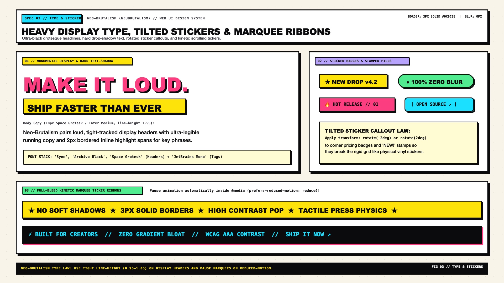

# Neo-Brutalism Design — Typography, Stickers & Marquees

Neo-Brutalist typography pairs **ultra-bold display grotesques** with **raw technical monospaced metadata**, treating type as a physical graphic object on the canvas. Headlines are set tight (`line-height: 0.92` to `1.05`), punctuated by boxed inline highlight spans, rotated vinyl sticker callouts (`transform: rotate(-2deg)`), and full-bleed kinetic marquee ribbons bounded by `3px solid #0C0C0E` structural borders.

---

## Typography & Graphic Elements Decision Matrix

| Goal | Tool | Why |
| :--- | :--- | :--- |
| Hero display headlines (`h1`, `h2`) | `Syne`, `Archivo Black`, `Cabinet Grotesk`, `Space Grotesk`, or `Lexend Mega` (`font-weight: 800–900`) | Wide, assertive geometric/grotesque letterforms hold their own against `3px–4px` ink strokes and saturated fills |
| Labels, pricing specs, timestamps, tags | `JetBrains Mono`, `Space Mono`, or `IBM Plex Mono` (`font-variant-numeric: tabular-nums`) | Reinforces the raw, exposed "source-code / industrial spec sheet" honesty of Brutalism |
| Emphasize key words inside a headline | `.nb-highlight-box` (`background: var(--nb-yellow); border: 2px solid var(--nb-ink); box-shadow: 3px 3px 0 var(--nb-ink)`) | Turns inline emphasis into a physical cut-out label rather than relying on subtle italics |
| Draw attention to promos, "NEW!" tags, or prices | Tilted sticker badge (`transform: rotate(-3deg)` + hard shadow) | Breaks strict horizontal/vertical grid rigidity with playful zine/skateboard sticker energy |
| Create kinetic horizontal separation | Full-bleed bordered marquee strip with `@media (prefers-reduced-motion: reduce)` pause | Anchors section transitions with rhythmic poster typography |

---

## Multimodal Visual Reference

Before styling type scales, stickers, or marquee banners, inspect the typography specification sheet:

- **Typography, Stickers & Marquees Specification Sheet:** [`./images/neo_brutalism_typography_and_stickers.jpg`](./images/neo_brutalism_typography_and_stickers.jpg)



### What to Observe in the Reference Sheet
1. **Display Type Treatments:** Notice how solid black display type, hard-shadowed display type (`text-shadow: 4px 4px 0 #0C0C0E` with `-webkit-text-stroke: 2px #0C0C0E`), and boxed inline highlight spans interact within a single headline lockup.
2. **Font Pairing Triad:** Heavy Display Grotesque (`Syne` / `Archivo Black`) for headlines, Neo-Grotesque (`Space Grotesk` / `Plus Jakarta Sans`) for readable body copy, and Technical Monospace (`JetBrains Mono`) for index numbers and metadata badges.
3. **Vinyl Sticker Badges:** Circular starbursts, tilted rectangular price tags (`rotate(-3deg)`), and pill callouts overlap card corners to break sterile symmetry.
4. **Full-Bleed Marquee Ribbon:** Framed top and bottom by `3px solid #0C0C0E` with alternating separator glyphs (`★`, `//`, `✦`).

---

## Fluid Type Scale & Font Stack Tokens

```css
:root {
  /* Font Families */
  --nb-font-display: 'Syne', 'Archivo Black', 'Space Grotesk', system-ui, sans-serif;
  --nb-font-sans: 'Space Grotesk', 'Plus Jakarta Sans', 'Inter', system-ui, sans-serif;
  --nb-font-mono: 'JetBrains Mono', 'Space Mono', ui-monospace, monospace;

  /* Fluid Type Scale */
  --nb-text-hero: clamp(2.75rem, 5.5vw + 1rem, 5.25rem);
  --nb-text-h1: clamp(2.125rem, 3.8vw + 0.75rem, 3.75rem);
  --nb-text-h2: clamp(1.625rem, 2.5vw + 0.5rem, 2.5rem);
  --nb-text-h3: clamp(1.25rem, 1.5vw + 0.5rem, 1.625rem);
  --nb-text-body-lg: clamp(1.125rem, 0.5vw + 0.95rem, 1.25rem);
  --nb-text-body: 1rem;
  --nb-text-mono-sm: 0.8125rem;
}

.nb-heading-hero {
  font-family: var(--nb-font-display);
  font-size: var(--nb-text-hero);
  font-weight: 900;
  line-height: 0.95;
  letter-spacing: -0.03em;
  text-transform: uppercase;
  color: var(--nb-ink);
  margin-block: 0 1.25rem;
}
```

---

## Signature Typographic Treatments

### 1. Outlined & Hard-Shadowed Display Text
For hero words or oversized numerals, apply a crisp ink stroke (`-webkit-text-stroke`) combined with a zero-blur `text-shadow`:

```css
.nb-text-pop-shadow {
  color: var(--nb-yellow);
  -webkit-text-stroke: 2.5px var(--nb-ink);
  paint-order: stroke fill;
  text-shadow: 4px 4px 0px var(--nb-ink);
}
```

> **Tip:** `paint-order: stroke fill` ensures the `2.5px` stroke is drawn *behind* the character fill rather than eating into the inner counter spaces of letters.

### 2. Boxed Inline Highlight Spans
Instead of `<em>` or colored text alone, wrap key phrases in a physical bordered box:

```css
.nb-highlight-box {
  display: inline-block;
  padding-inline: 0.45em;
  padding-block: 0.05em;
  background-color: var(--nb-yellow);
  color: var(--nb-ink-on-accent);
  border: 2.5px solid var(--nb-ink);
  border-radius: var(--nb-radius-sm);
  box-shadow: 3px 3px 0px 0px var(--nb-ink);
  transform: rotate(-1deg);
  line-height: 1.15;
}
```

---

## Vinyl Sticker Badges & Corner Callouts

Stickers provide personality and visual hierarchy. Use slight rotations (`-3deg` to `3deg`) and position them Either inline or overlapping card corners (`position: absolute; inset-block-start: -14px; inset-inline-end: -14px`).

```css
.nb-sticker {
  display: inline-flex;
  align-items: center;
  gap: 0.4rem;
  padding-inline: 0.85rem;
  padding-block: 0.35rem;
  background-color: var(--nb-pink);
  color: var(--nb-ink-on-accent);
  font-family: var(--nb-font-mono);
  font-size: var(--nb-text-mono-sm);
  font-weight: 800;
  text-transform: uppercase;
  letter-spacing: 0.06em;
  border: 2.5px solid var(--nb-ink);
  border-radius: var(--nb-radius-pill);
  box-shadow: var(--nb-shadow-sm);
  transform: rotate(-2.5deg);
  user-select: none;
}

.nb-sticker--square {
  border-radius: var(--nb-radius-sm);
  background-color: var(--nb-lime);
  transform: rotate(2deg);
}

/* Circular Price / Promo Seal */
.nb-sticker--seal {
  inline-size: 4.5rem;
  block-size: 4.5rem;
  justify-content: center;
  text-align: center;
  border-radius: 50%;
  background-color: var(--nb-yellow);
  font-family: var(--nb-font-display);
  font-size: 0.95rem;
  line-height: 1.05;
  transform: rotate(6deg);
}
```

---

## Full-Bleed Bordered Marquee Strip

Marquee ribbons work as high-energy section dividers. Always duplicate the track content with `aria-hidden="true"` for seamless looping and pause the animation under `prefers-reduced-motion: reduce`:

```html
<div class="nb-marquee" role="region" aria-label="Announcements">
  <div class="nb-marquee__track">
    <span>SHIP FASTER WITH ZERO BLUR</span>
    <span aria-hidden="true">★</span>
    <span>100% HARD OFFSET SHADOWS</span>
    <span aria-hidden="true">★</span>
    <span>RAW ARCHITECTURAL HONESTY</span>
    <span aria-hidden="true">★</span>
  </div>
  <div class="nb-marquee__track" aria-hidden="true">
    <span>SHIP FASTER WITH ZERO BLUR</span>
    <span>★</span>
    <span>100% HARD OFFSET SHADOWS</span>
    <span>★</span>
    <span>RAW ARCHITECTURAL HONESTY</span>
    <span>★</span>
  </div>
</div>
```

```css
.nb-marquee {
  display: flex;
  overflow: hidden;
  inline-size: 100%;
  background-color: var(--nb-yellow);
  color: var(--nb-ink-on-accent);
  border-block: 3px solid var(--nb-ink);
  padding-block: 0.75rem;
  user-select: none;
}

.nb-marquee__track {
  display: flex;
  flex-shrink: 0;
  align-items: center;
  justify-content: space-around;
  min-inline-size: 100%;
  gap: 2rem;
  padding-inline-end: 2rem;
  font-family: var(--nb-font-display);
  font-size: 1.125rem;
  font-weight: 900;
  text-transform: uppercase;
  letter-spacing: 0.05em;
  animation: nb-marquee-scroll 22s linear infinite;
}

.nb-marquee:hover .nb-marquee__track {
  animation-play-state: paused;
}

@keyframes nb-marquee-scroll {
  from { transform: translateX(0); }
  to { transform: translateX(-100%); }
}

@media (prefers-reduced-motion: reduce) {
  .nb-marquee__track {
    animation: none;
  }
}
```

---

## Do Not

| BAD | GOOD | Why |
| :--- | :--- | :--- |
| Setting long-form body paragraphs in `Archivo Black` or `UPPERCASE` monospace | Use `Space Grotesk`, `Plus Jakarta Sans`, or `Inter` (`font-weight: 400–500`, `60ch–70ch`) for body copy | Heavy display fonts and all-caps monospace are for headlines and badges; body text still requires effortless scannability |
| Using `-webkit-text-stroke: 2px` without `paint-order: stroke fill` | Always pair `-webkit-text-stroke` with `paint-order: stroke fill` | Without `paint-order: stroke fill`, half of the stroke renders inside the glyph and chokes letter counters |
| Rotating body text containers or multi-line cards (`rotate(-4deg)`) | Restrict rotation (`-3deg` to `3deg`) to short 1–3 word sticker badges | Tilted paragraphs cause vestibular discomfort and terrible text aliasing |
| Running unpausable `<marquee>` tags or animations that ignore `prefers-reduced-motion` | Pause CSS marquees on `:hover` and disable animation in `@media (prefers-reduced-motion: reduce)` | Required by WCAG 2.2 SC 2.2.2 (Pause, Stop, Hide) |
