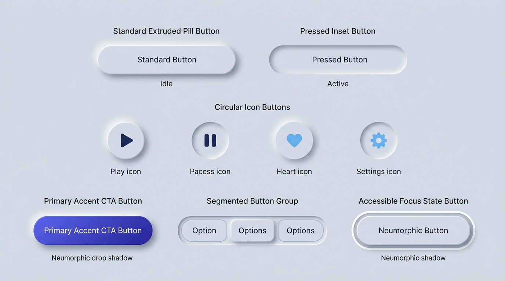

# Neumorphism Design — Tactile Buttons & Action Controls

## Buttons Decision Matrix

| Goal | Tool | Why |
| :--- | :--- | :--- |
| Standard secondary / surface button | Extruded pill or rounded rectangle (`--neu-raised-md` + `1px` specular border) | Feels physically raised from the surface ready to be pressed downward. |
| Tactile click / press feedback (`:active`) | Swap outer shadows to `--neu-inset-sm` + `translateY(1px)` | Simulates a physical spring-loaded button being pushed below the surface plane. |
| Persistent toggle button (`aria-pressed="true"`) | Deep inset shadow (`--neu-inset-md`) + accent text/icon color | Clearly communicates that the button is latched in the depressed (engaged) position. |
| High-conversion Primary CTA button | High-chroma OKLCH gradient fill (`--neu-accent`) + colored drop shadow | Pure monochromatic Neumorphic buttons lack urgency for primary form submissions; an accent fill guarantees instant visual priority. |
| Grouped mutually-exclusive view switcher | Recessed stadium track (`--neu-inset-sm`) containing raised active button (`--neu-raised-sm`) | Prevents adjacent button shadows from clashing while framing the options as a unified physical instrument. |
| Accessible keyboard focus | `outline: 3px solid var(--neu-accent)` with `outline-offset: 4px` | Places the focus ring outside the soft shadow halo so it is never swallowed or blurred. |

---

## Visual Reference: Neumorphic Button Variants & States



> **Multimodal Agent Instruction:** View [`./images/neumorphism_buttons.jpg`](./images/neumorphism_buttons.jpg) to inspect the exact visual relationship between Idle (extruded), Active/Pressed (inset), Circular Icon buttons, Primary Accent CTAs, Segmented Button Groups, and Accessible Focus rings.

---

## Tactile Button State Physics (Idle $\rightarrow$ Hover $\rightarrow$ Active $\rightarrow$ Focus)

A Neumorphic button must never abruptly snap from outer shadows to inner shadows without intermediate state clarity. Follow this four-state progression:

1. **Idle (`default`):** Raised surface (`--neu-raised-md`) with a subtle `1px` specular border (`--neu-border-raised`).
2. **Hover (`:hover:not(:disabled)`):** Tightens elevation slightly (`4px 4px 8px`) or subtly brightens surface luminance (`+0.015 L`) and shifts label toward `--neu-accent`.
3. **Active / Pressed (`:active`, `[aria-pressed="true"]`):** Inverts shadow geometry to recessed (`--neu-inset-sm`), shifts border to `--neu-border-inset`, and scales content slightly (`scale(0.98)`).
4. **Keyboard Focus (`:focus-visible`):** Renders a high-contrast solid outline offset by `4px`–`6px` outside the perimeter so it clears the ambient shadow.

```css
.neu-btn {
  position: relative;
  display: inline-flex;
  align-items: center;
  justify-content: center;
  gap: 0.625rem;
  min-block-size: 2.75rem; /* 44px minimum WCAG tap target */
  padding-block: 0.75rem;
  padding-inline: 1.5rem;
  border-radius: var(--neu-radius-pill);
  border: 1px solid var(--neu-border-raised);
  background-color: var(--neu-surface);
  color: var(--neu-text-primary);
  font-family: inherit;
  font-size: 0.95rem;
  font-weight: 600;
  line-height: 1.2;
  cursor: pointer;
  user-select: none;
  box-shadow: var(--neu-raised-md);
  transition:
    box-shadow 180ms cubic-bezier(0.2, 0, 0, 1),
    transform 150ms cubic-bezier(0.2, 0, 0, 1),
    color 150ms ease,
    border-color 150ms ease;
}

.neu-btn:hover:not(:disabled) {
  color: var(--neu-accent);
  box-shadow:
    4px 4px 9px var(--neu-shadow),
    -4px -4px 9px var(--neu-highlight);
}

.neu-btn:active:not(:disabled),
.neu-btn[aria-pressed="true"] {
  border-color: var(--neu-border-inset);
  box-shadow: var(--neu-inset-sm);
  transform: scale(0.985);
  color: var(--neu-accent);
}

/* Mandatory Keyboard Focus Ring outside shadow halo */
.neu-btn:focus-visible {
  outline: 3px solid var(--neu-accent);
  outline-offset: 4px;
}

/* Disabled State: Flatten elevation to signal non-interactivity */
.neu-btn:disabled {
  opacity: 0.55;
  cursor: not-allowed;
  box-shadow: none;
  border-color: var(--neu-border-inset);
}
```

---

## Circular & Square Icon Action Buttons

Icon-only buttons (media controls, toolbar actions, utility triggers) require equal inline and block dimensions (`aspect-ratio: 1`) and an explicit `aria-label`:

```html
<button type="button" class="neu-btn-icon" aria-label="Play audio track">
  <svg aria-hidden="true" width="20" height="20" viewBox="0 0 24 24" fill="currentColor">
    <path d="M8 5v14l11-7z"/>
  </svg>
</button>
```

```css
.neu-btn-icon {
  display: inline-grid;
  place-content: center;
  inline-size: 3rem;   /* 48px tactile target */
  block-size: 3rem;
  aspect-ratio: 1;
  padding: 0;
  border-radius: 50%;  /* Or var(--neu-radius-sm) for rounded square */
  border: 1px solid var(--neu-border-raised);
  background-color: var(--neu-surface);
  color: var(--neu-text-primary);
  box-shadow: var(--neu-raised-md);
  cursor: pointer;
  transition: box-shadow 180ms ease, transform 150ms ease, color 150ms ease;
}

.neu-btn-icon:hover:not(:disabled) {
  color: var(--neu-accent);
}

.neu-btn-icon:active:not(:disabled),
.neu-btn-icon[aria-pressed="true"] {
  border-color: var(--neu-border-inset);
  box-shadow: var(--neu-inset-sm);
  color: var(--neu-accent);
}

.neu-btn-icon:focus-visible {
  outline: 3px solid var(--neu-accent);
  outline-offset: 4px;
}
```

---

## Primary Accent CTA Button

Every screen with a primary conversion or submit action should pair standard monochromatic Soft UI buttons with **at most one Primary Accent CTA button**. It retains the Neumorphic outer shadow and tactile press physics while using a high-contrast accent surface:

```css
.neu-btn-primary {
  background-image: linear-gradient(
    135deg,
    oklch(from var(--neu-accent) calc(l + 0.06) c h),
    oklch(from var(--neu-accent) calc(l - 0.04) c h)
  );
  color: var(--neu-accent-contrast);
  border: 1px solid oklch(from var(--neu-accent) calc(l + 0.14) c h / 0.5);
  box-shadow:
    6px 6px 14px color-mix(in oklch, var(--neu-shadow) 65%, var(--neu-accent)),
    -6px -6px 14px var(--neu-highlight);
}

.neu-btn-primary:hover:not(:disabled) {
  color: var(--neu-accent-contrast);
  filter: brightness(1.06);
}

.neu-btn-primary:active:not(:disabled) {
  box-shadow:
    inset 3px 3px 7px oklch(from var(--neu-accent) calc(l - 0.18) c h),
    inset -3px -3px 7px oklch(from var(--neu-accent) calc(l + 0.08) c h);
  transform: scale(0.985);
}
```

---

## Segmented Button Group (Recessed Track + Raised Active Option)

When placing multiple related buttons side-by-side, house them inside a **recessed stadium track** so their individual shadows do not collide:

```html
<div class="neu-segmented-group" role="group" aria-label="Billing frequency">
  <button type="button" class="neu-segment" aria-pressed="true">Monthly</button>
  <button type="button" class="neu-segment" aria-pressed="false">Quarterly</button>
  <button type="button" class="neu-segment" aria-pressed="false">Annual</button>
</div>
```

```css
.neu-segmented-group {
  display: inline-grid;
  grid-auto-flow: column;
  grid-auto-columns: 1fr;
  gap: 0.375rem;
  padding: 0.375rem;
  border-radius: var(--neu-radius-pill);
  background-color: var(--neu-surface);
  border: 1px solid var(--neu-border-inset);
  box-shadow: var(--neu-inset-sm);
}

.neu-segment {
  padding-block: 0.55rem;
  padding-inline: 1.25rem;
  border-radius: var(--neu-radius-pill);
  border: 1px solid transparent;
  background: transparent;
  color: var(--neu-text-secondary);
  font-weight: 600;
  cursor: pointer;
  transition: all 180ms ease;
}

/* Only the active segment is extruded inside the recessed groove */
.neu-segment[aria-pressed="true"] {
  background-color: var(--neu-surface);
  color: var(--neu-text-primary);
  border-color: var(--neu-border-raised);
  box-shadow: var(--neu-raised-sm);
}
```

---

## Do Not

| BAD | GOOD | Why |
| :--- | :--- | :--- |
| Using monochromatic Soft UI for every button including primary checkout/submit CTAs | Use `.neu-btn-primary` (accent fill + tactile shadow) for the primary CTA and `.neu-btn` for secondary actions | When primary and secondary buttons share the exact same gray background color, users struggle to identify the primary action path. |
| Keeping outer drop shadows AND adding `inset` shadows simultaneously on `:active` | Replace outer shadows cleanly with `var(--neu-inset-sm)` on `:active` | Combining full-strength outer and inner shadows on a small button creates a thick, muddy ring around the border. |
| Replacing `:focus-visible` outline with a slightly deeper Neumorphic shadow | Use an explicit `outline: 3px solid var(--neu-accent); outline-offset: 4px;` | Subtle shadow changes fail WCAG 2.4.7 / 2.4.11 Focus Visible criteria and are invisible to keyboard users. |
| Giving `:disabled` buttons full 3D extrusion shadows | Flatten `:disabled` buttons (`box-shadow: none; border: 1px solid var(--neu-border-inset)`) | An extruded button signals physical pressability; disabled elements must sit flush with the canvas so they do not invite clicks. |
