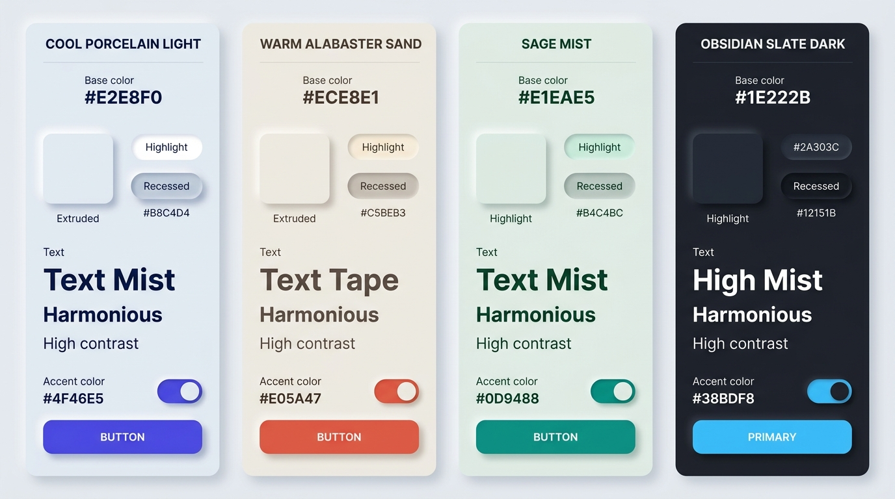

# Neumorphism Design — Color Palettes, OKLCH & Dynamic Theming

## Color Palettes Decision Matrix

| Goal | Tool | Why |
| :--- | :--- | :--- |
| Construct harmonious Soft UI base surfaces | Low-chroma OKLCH (`oklch(0.91 0.015 <hue>)`) | Guarantees perceptual lightness headroom for both brighter highlights (`+0.08 L`) and deeper shadows (`-0.14 L`) without muddy hue shifts. |
| Compute shadow pairs automatically from any surface | CSS Relative Color Syntax (`oklch(from var(--neu-surface) ...)`) | Eliminates manual hex picking; changing a single base token automatically recalculates mathematically accurate highlights and low-lights. |
| Support seamless Light and Dark Soft UI | `light-dark()` with asymmetric lightness deltas | Prevents the classic "glowing white chalk" dark-mode mistake by clamping dark-mode top-left highlights to subtle slate (`+0.06 L`). |
| Draw attention to primary actions & active states | High-chroma OKLCH accent tokens (`C: 0.16–0.22`) with soft colored glow | Cuts through monochromatic softness to establish unmistakable visual hierarchy and WCAG-compliant contrast. |
| Ensure readable typography on tinted surfaces | Same-hue high-contrast text tokens (`L: 0.20` on light, `L: 0.94` on dark) | Harmonizes text with the surface tint while exceeding the 7:1 AAA contrast threshold for body copy. |

---

## Visual Reference: Curated Neumorphic Color Palettes



> **Multimodal Agent Instruction:** View [`./images/neumorphism_color_palettes.jpg`](./images/neumorphism_color_palettes.jpg) before selecting theme colors to inspect how the four canonical Neumorphic palettes (Cool Porcelain, Warm Alabaster Sand, Sage Mist, and Obsidian Slate Dark) balance surface luminance, shadow depth, and high-contrast accents.

---

## Why OKLCH is Mandatory for Neumorphism

Neumorphism lives or dies by subtle luminance steps around a mid-tone surface. In legacy `hsl()` or `rgb()`, shifting lightness by $\pm 12\%$ across different hues produces wildly uneven perceived contrast and muddy gray bands.

In **OKLCH**:
- **Light Mode Surface (`L`):** Must sit between **`0.88` and `0.93`** (`88%–93%`). This leaves `7%–12%` upward headroom for the top-left specular highlight (`L ≈ 0.99–1.0`) and `13%–16%` downward headroom for the bottom-right shadow (`L ≈ 0.75–0.79`).
- **Dark Mode Surface (`L`):** Must sit between **`0.20` and `0.25`** (`20%–25%`). Upward highlight shifts by only **`+0.05` to `+0.07`** (`L ≈ 0.26–0.31`), while downward shadow drops by **`-0.10` to `-0.12`** (`L ≈ 0.10–0.13`).
- **Surface Chroma (`C`):** Keep between **`0.008` and `0.025`**. Pure achromatic gray (`C = 0`) looks sterile and lifeless; overly saturated surfaces (`C > 0.05`) create visual fatigue and clash with semantic status colors.

---

## The 4 Canonical Neumorphic Theme Palettes

Use these production-tested palette presets via data attributes or root tokens:

```css
/* ==========================================================================
   1. COOL PORCELAIN LIGHT (Default — Crisp Technical & SaaS UIs)
   Hex equivalents: Base #E2E8F0 | Highlight #FFFFFF | Shadow #B8C4D4 | Accent #4F46E5
   ========================================================================== */
:root,
[data-neu-theme="porcelain"] {
  --neu-surface: oklch(0.92 0.014 250);
  --neu-highlight: oklch(0.995 0.005 250);
  --neu-shadow: oklch(0.78 0.024 250);
  --neu-text-primary: oklch(0.22 0.03 250);    /* > 11:1 contrast */
  --neu-text-secondary: oklch(0.44 0.025 250); /* > 5.2:1 contrast */
  --neu-accent: oklch(0.55 0.22 268);          /* Electric Indigo */
  --neu-accent-contrast: oklch(0.99 0.005 268);
}

/* ==========================================================================
   2. WARM ALABASTER SAND (Editorial, Smart Home, Audio & Lifestyle UIs)
   Hex equivalents: Base #ECE8E1 | Highlight #FAF8F5 | Shadow #C5BEB3 | Accent #E05A47
   ========================================================================== */
[data-neu-theme="alabaster"] {
  --neu-surface: oklch(0.93 0.012 75);
  --neu-highlight: oklch(0.99 0.006 75);
  --neu-shadow: oklch(0.79 0.022 72);
  --neu-text-primary: oklch(0.24 0.025 65);
  --neu-text-secondary: oklch(0.45 0.022 65);
  --neu-accent: oklch(0.62 0.19 32);           /* Terracotta Coral */
  --neu-accent-contrast: oklch(0.99 0.005 32);
}

/* ==========================================================================
   3. SAGE MIST (Wellness, Fintech, Sustainability & Calm Dashboards)
   Hex equivalents: Base #E1EAE5 | Highlight #F6FBF8 | Shadow #B4C4BC | Accent #0D9488
   ========================================================================== */
[data-neu-theme="sage"] {
  --neu-surface: oklch(0.92 0.016 160);
  --neu-highlight: oklch(0.99 0.007 160);
  --neu-shadow: oklch(0.78 0.026 160);
  --neu-text-primary: oklch(0.22 0.035 165);
  --neu-text-secondary: oklch(0.43 0.028 165);
  --neu-accent: oklch(0.60 0.14 180);          /* Deep Emerald Teal */
  --neu-accent-contrast: oklch(0.99 0.005 180);
}

/* ==========================================================================
   4. OBSIDIAN SLATE DARK (Pro Audio, Developer Tools, Automotive & Night UI)
   Hex equivalents: Base #1E222B | Highlight #2A303C | Shadow #12151B | Accent #38BDF8
   ========================================================================== */
[data-neu-theme="obsidian"] {
  color-scheme: dark;
  --neu-surface: oklch(0.24 0.018 255);
  --neu-highlight: oklch(0.30 0.020 255);      /* Subtle slate rim, NEVER white! */
  --neu-shadow: oklch(0.13 0.015 255);
  --neu-text-primary: oklch(0.94 0.010 255);
  --neu-text-secondary: oklch(0.72 0.018 255);
  --neu-accent: oklch(0.74 0.15 230);          /* Luminous Sky Cyan */
  --neu-accent-contrast: oklch(0.16 0.02 255);
}
```

---

## Automatic Light/Dark Theme Engine with `light-dark()`

To support automatic OS-level `prefers-color-scheme` switching without duplicating media queries, combine `light-dark()` with CSS Relative Color Syntax:

```css
:root {
  color-scheme: light dark;

  --neu-hue: 250;
  --neu-surface: light-dark(
    oklch(0.92 0.014 var(--neu-hue)),
    oklch(0.24 0.018 var(--neu-hue))
  );

  /* Highlight delta is +0.075 in light mode, but only +0.06 in dark mode */
  --neu-highlight: light-dark(
    oklch(from var(--neu-surface) clamp(0, calc(l + 0.075), 1) calc(c * 0.4) h),
    oklch(from var(--neu-surface) calc(l + 0.06) c h)
  );

  /* Shadow delta is -0.14 in light mode, -0.11 in dark mode */
  --neu-shadow: light-dark(
    oklch(from var(--neu-surface) calc(l - 0.14) calc(c * 1.6) h),
    oklch(from var(--neu-surface) calc(l - 0.11) c h)
  );

  /* Semantic Status Colors (Harmonized for Soft UI) */
  --neu-success: light-dark(oklch(0.55 0.16 150), oklch(0.72 0.16 150));
  --neu-warning: light-dark(oklch(0.62 0.17 75),  oklch(0.78 0.16 75));
  --neu-danger:  light-dark(oklch(0.56 0.21 25),  oklch(0.70 0.19 25));
}
```

---

## Accent Glow & Colored Extrusion Shadows

When an interactive element is filled with `--neu-accent` (such as a Primary CTA button or an active toggle indicator), its outer drop shadow can blend `25%` of the accent hue into `--neu-shadow` using `color-mix(in oklch, ...)` to simulate subsurface color bounce:

```css
.neu-accent-surface {
  background-image: linear-gradient(
    135deg,
    oklch(from var(--neu-accent) calc(l + 0.05) c h),
    oklch(from var(--neu-accent) calc(l - 0.04) c h)
  );
  color: var(--neu-accent-contrast);
  box-shadow:
    6px 6px 14px color-mix(in oklch, var(--neu-shadow) 70%, var(--neu-accent)),
    -6px -6px 14px var(--neu-highlight);
}
```

---

## Do Not

| BAD | GOOD | Why |
| :--- | :--- | :--- |
| Using white (`rgba(255, 255, 255, 0.5)`) as the top-left highlight in Dark Mode | Using a slightly lighter surface tone (`oklch(from var(--neu-surface) calc(l + 0.06) c h)`) | Semitransparent white on a dark surface creates a chalky, glowing neon halo instead of a realistic dim-room surface reflection. |
| High-saturation background canvas (`oklch(0.85 0.18 250)`) | Low-chroma tinted neutral canvas (`oklch(0.92 0.014 250)`) | High background saturation overpowers subtle shadow gradients and causes severe chromatic aberration along edges. |
| Using pure black (`rgba(0, 0, 0, 0.25)`) for light-mode shadows | Using hue-matched OKLCH shadow (`oklch(0.78 0.024 var(--neu-hue))`) | Pure black alpha shadows desaturate the tinted surface into a dirty, muddy smudge; slightly increasing chroma in the shadow preserves warmth/coolness. |
| Low-contrast muted gray body text (`#8892b0` on `#e2e8f0`) | High-contrast tinted text (`--neu-text-primary` $\ge 7:1$, `--neu-text-secondary` $\ge 4.5:1$) | Soft UI already lowers structural border contrast; combining soft shadows with low-contrast typography makes the interface unreadable. |
