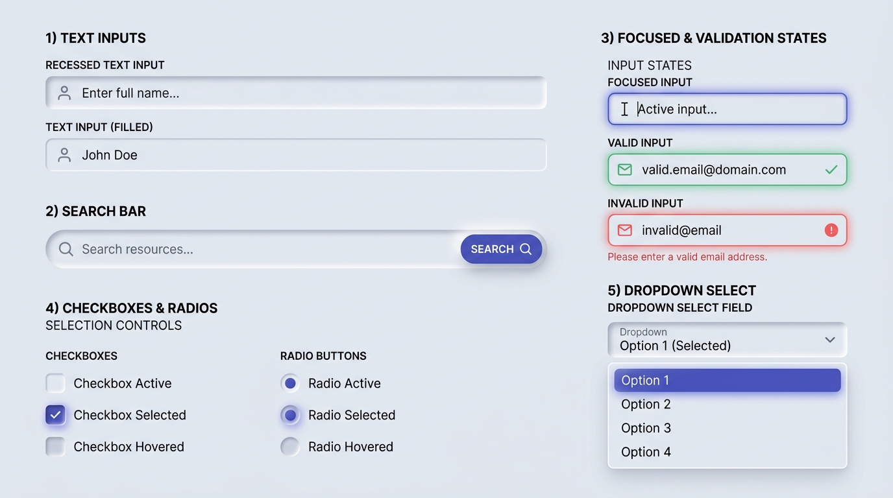

# Neumorphism Design — Forms, Text Inputs & Selection Controls

## Forms & Inputs Decision Matrix

| Goal | Tool | Why |
| :--- | :--- | :--- |
| Text inputs, textareas, and number fields | Recessed concave well (`--neu-inset-md`) + `1px` inner border | Physically distinguishes editable fields (carved into the surface to receive content) from buttons (extruded above the surface to be pressed). |
| Search bar with inline submit button | Recessed outer pill container (`:focus-within`) + raised inner submit button | Combines an inset typing trough with a tactile raised trigger in a single cohesive instrument. |
| Custom checkboxes and radio buttons | `appearance: none` + inset well (`--neu-inset-sm`) + raised/glowing checked indicator | Replaces flat browser-default widgets with tactile sockets that fill or extrude upon selection. |
| Form validation states (`:user-valid` / `:user-invalid`) | Semantic border color + subtle colored outer halo (`0 0 0 3px oklch(... / 0.2)`) | Preserves the inner carved shadow while adding an unmistakable semantic ring after user interaction. |
| Auto-growing multi-line textarea | `field-sizing: content` inside a `.neu-input` recessed box | Expands the carved well smoothly as the user types without JavaScript height calculation. |

---

## Visual Reference: Neumorphic Form Controls & Validation States



> **Multimodal Agent Instruction:** View [`./images/neumorphism_forms_and_inputs.jpg`](./images/neumorphism_forms_and_inputs.jpg) to inspect the visual distinction between recessed text inputs, composite search bars, focus/valid/invalid semantic rings, tactile checkboxes/radios, and dropdown select popovers.

---

## Rule 1: Inputs Are Always Recessed (Never Extruded)

In Neumorphism, **extrusion means "push me"** (buttons), while **recession means "fill me"** (text inputs, search troughs, checkbox wells). Never style a text `<input>` or `<textarea>` with outer raised shadows, or users will mistake it for a button.

```html
<div class="neu-field">
  <label for="full-name" class="neu-label">Full Name</label>
  <div class="neu-input-wrapper">
    <input
      id="full-name"
      name="fullName"
      type="text"
      class="neu-input"
      placeholder="Enter full name..."
      required
    />
  </div>
</div>
```

```css
.neu-field {
  display: flex;
  flex-direction: column;
  gap: 0.5rem;
}

.neu-label {
  font-size: 0.875rem;
  font-weight: 600;
  color: var(--neu-text-primary);
  padding-inline-start: 0.375rem;
}

.neu-input {
  inline-size: 100%;
  min-block-size: 2.875rem;
  padding-block: 0.75rem;
  padding-inline: 1.125rem;
  border-radius: var(--neu-radius-md);
  border: 1px solid var(--neu-border-inset);
  background-color: var(--neu-surface);
  color: var(--neu-text-primary);
  font-family: inherit;
  font-size: 1rem;
  box-shadow: var(--neu-inset-md);
  transition:
    box-shadow 180ms ease,
    border-color 180ms ease,
    outline-color 180ms ease;
}

/* Auto-growing textarea support */
textarea.neu-input {
  field-sizing: content;
  min-block-size: 6rem;
  resize: vertical;
}

.neu-input::placeholder {
  /* Guarantee >= 4.5:1 or clear secondary distinction */
  color: var(--neu-text-secondary);
  opacity: 0.85;
}

/* Focus State: Keep the inset groove and add a crisp outer accent ring */
.neu-input:focus-visible {
  outline: none;
  border-color: var(--neu-accent);
  box-shadow:
    var(--neu-inset-md),
    0 0 0 3px oklch(from var(--neu-accent) l c h / 0.25);
}
```

---

## Rule 2: User-Aware Validation States (`:user-valid` & `:user-invalid`)

Never replace the inner recessed shadow on invalid inputs—doing so makes the input suddenly pop flat. Instead, layer a semantic border and outer glow onto the existing `--neu-inset-md` shadow using `:user-valid` and `:user-invalid`:

```css
.neu-input:user-valid {
  border-color: var(--neu-success);
  box-shadow:
    var(--neu-inset-md),
    0 0 0 3px oklch(from var(--neu-success) l c h / 0.22);
}

.neu-input:user-invalid {
  border-color: var(--neu-danger);
  box-shadow:
    var(--neu-inset-md),
    0 0 0 3px oklch(from var(--neu-danger) l c h / 0.25);
}

.neu-error-message {
  font-size: 0.8125rem;
  font-weight: 500;
  color: var(--neu-danger);
  padding-inline-start: 0.375rem;
}
```

---

## Composite Search Bar (Inset Trough + Raised Action Button)

A classic Neumorphic pattern houses a transparent `<input type="search">` and an extruded submit `<button>` inside a single recessed stadium container that reacts via `:focus-within`:

```html
<form class="neu-search-bar" role="search">
  <input
    type="search"
    class="neu-search-input"
    placeholder="Search resources..."
    aria-label="Search resources"
  />
  <button type="submit" class="neu-search-submit">Search</button>
</form>
```

```css
.neu-search-bar {
  display: flex;
  align-items: center;
  gap: 0.5rem;
  padding-block: 0.375rem;
  padding-inline-start: 1.25rem;
  padding-inline-end: 0.375rem;
  border-radius: var(--neu-radius-pill);
  border: 1px solid var(--neu-border-inset);
  background-color: var(--neu-surface);
  box-shadow: var(--neu-inset-md);
  transition: border-color 180ms ease, box-shadow 180ms ease;
}

.neu-search-bar:focus-within {
  border-color: var(--neu-accent);
  box-shadow:
    var(--neu-inset-md),
    0 0 0 3px oklch(from var(--neu-accent) l c h / 0.22);
}

.neu-search-input {
  flex: 1;
  min-inline-size: 0;
  border: none;
  background: transparent;
  color: var(--neu-text-primary);
  font-size: 0.95rem;
  padding-block: 0.5rem;
  outline: none;
}

.neu-search-submit {
  padding-block: 0.6rem;
  padding-inline: 1.25rem;
  border-radius: var(--neu-radius-pill);
  border: 1px solid oklch(from var(--neu-accent) calc(l + 0.12) c h / 0.4);
  background-color: var(--neu-accent);
  color: var(--neu-accent-contrast);
  font-weight: 600;
  box-shadow: var(--neu-raised-sm);
  cursor: pointer;
}
```

---

## Tactile Checkboxes & Radio Controls

Style native `<input type="checkbox">` and `<input type="radio">` directly using `appearance: none` so keyboard navigation, label association, and form submission work natively without wrapper `<span>` hacks:

```css
:where(.neu-checkbox, .neu-radio) {
  appearance: none;
  display: inline-grid;
  place-content: center;
  inline-size: 1.5rem;
  block-size: 1.5rem;
  margin: 0;
  background-color: var(--neu-surface);
  border: 1px solid var(--neu-border-inset);
  box-shadow: var(--neu-inset-sm);
  cursor: pointer;
  transition: all 160ms ease;
}

.neu-checkbox {
  border-radius: 0.45rem;
}

.neu-radio {
  border-radius: 50%;
}

/* Inner indicator rendered via ::before */
.neu-checkbox::before {
  content: "";
  inline-size: 0.75rem;
  block-size: 0.75rem;
  border-radius: 0.2rem;
  background-color: var(--neu-accent);
  box-shadow: 0 0 8px oklch(from var(--neu-accent) l c h / 0.55);
  transform: scale(0);
  transition: transform 160ms cubic-bezier(0.34, 1.56, 0.64, 1);
}

.neu-radio::before {
  content: "";
  inline-size: 0.75rem;
  block-size: 0.75rem;
  border-radius: 50%;
  background-color: var(--neu-accent);
  box-shadow: 2px 2px 4px var(--neu-shadow), -1px -1px 3px var(--neu-highlight);
  transform: scale(0);
  transition: transform 160ms cubic-bezier(0.34, 1.56, 0.64, 1);
}

:where(.neu-checkbox, .neu-radio):checked::before {
  transform: scale(1);
}

:where(.neu-checkbox, .neu-radio):focus-visible {
  outline: 3px solid var(--neu-accent);
  outline-offset: 3px;
}
```

---

## Do Not

| BAD | GOOD | Why |
| :--- | :--- | :--- |
| Styling `<input type="text">` with outer extruded shadows (`--neu-raised-md`) | Always style text inputs with recessed inner shadows (`--neu-inset-md`) | Extruded rectangles look identical to buttons; recessed grooves universally signal an empty receptacle for user input. |
| Relying solely on deeper inset shadows to indicate `:focus` on an input | Combine `--neu-inset-md` with `border-color: var(--neu-accent)` and a `3px` outer glow ring | A slightly darker inner shadow is imperceptible to keyboard users scanning a form with multiple fields. |
| Hiding `<input type="checkbox">` with `display: none` and styling a fake `<div>` | Use `appearance: none` directly on the native `<input>` element | `display: none` removes the control from the tab order and breaks assistive technology accessibility. |
| Using `:invalid` to show red borders before the user has interacted with the field | Use `:user-invalid` and `:user-valid` | `:invalid` triggers immediately on page load for empty `required` fields, littering the Soft UI form with premature error rings. |
