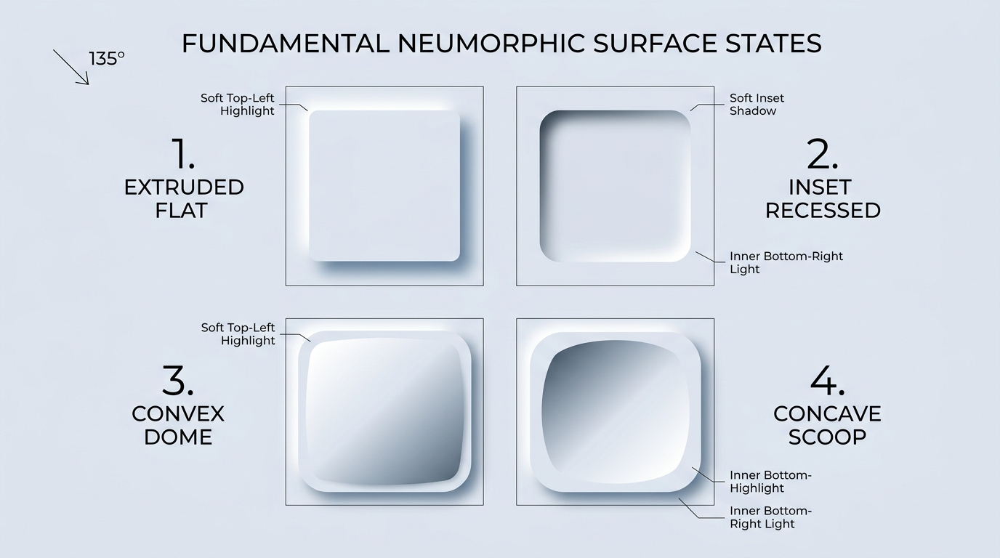

# Neumorphism Design — Foundations, Light Physics & Design Tokens

## Foundations Decision Matrix

| Goal | Tool | Why |
| :--- | :--- | :--- |
| Simulate tactile extruded surfaces | Dual opposing `box-shadow` (top-left highlight + bottom-right shadow) | Creates the illusion that the element is molded directly out of the continuous background material under a fixed $135^\circ$ light source. |
| Simulate recessed / carved wells | Dual `inset` `box-shadow` (top-left dark shadow + bottom-right light catch) | Reverses the shadow polarity inside the element perimeter so it appears pressed or milled into the surface plane. |
| Simulate subtle curved dome / scoop | `linear-gradient(135deg, ...)` paired with outer dual shadows | Shifts surface luminance across the face of the component to create a convex (dome) or concave (scoop) curvature. |
| Maintain consistent elevation hierarchy | Standardized CSS custom property elevation scale (`--neu-raised-sm`, `--neu-raised-md`, `--neu-raised-lg`) | Prevents arbitrary shadow distances that break the unified single-light-source illusion across a viewport. |
| Guarantee boundary visibility for low-vision users | `1px solid` specular perimeter border (`--neu-border-specular`) | Ensures WCAG boundary recognition even when soft shadows blend into the canvas on low-contrast displays. |

---

## Visual Reference: The 4 Fundamental Surface States



> **Multimodal Agent Instruction:** View [`./images/neumorphism_surface_states.jpg`](./images/neumorphism_surface_states.jpg) using your image inspection tool before styling custom Neumorphic geometry to verify light-source angle ($135^\circ$), highlight sharpness, and concave/convex gradient polarity.

---

## The Single Light-Source Law ($135^\circ$ Top-Left Illumination)

Neumorphism (Soft UI) models a continuous, monolithic surface illuminated by a single directional light source positioned at the **top-left ($135^\circ$)**. Every component on the page must obey this vector without exception:

1. **Extruded (Raised) Elements:**
   - **Top & Left edges** catch the light source $\rightarrow$ negative offset shadow (`-X -Y blur var(--neu-highlight)`).
   - **Bottom & Right edges** cast a shadow away from the light $\rightarrow$ positive offset shadow (`+X +Y blur var(--neu-shadow)`).
2. **Recessed (Inset) Elements:**
   - **Top & Left inner walls** are occluded from the light by the rim $\rightarrow$ positive inset shadow (`inset +X +Y blur var(--neu-shadow)`).
   - **Bottom & Right inner walls** reflect the light source directly $\rightarrow$ negative inset shadow (`inset -X -Y blur var(--neu-highlight)`).
3. **The Golden Blur Ratio ($1 : 2$):**
   - For any shadow offset distance $d$, the blur radius must be approximately $2d$ (e.g., `6px 6px 12px` or `10px 10px 20px`). If blur $< 1.5d$, the shadow looks hard and detached; if blur $> 3d$, the tactile edge dissolves into muddy fog.

---

## Core Design Token Architecture

Define all Neumorphic geometry, elevation steps, and surface physics on `:root` so components never hardcode raw pixel offsets or shadow colors:

```css
:root {
  color-scheme: light dark;

  /* 1. Base Monolithic Surface (OKLCH Cool Porcelain / Obsidian Dark) */
  --neu-hue: 250;
  --neu-chroma: 0.015;
  --neu-surface: light-dark(
    oklch(0.92 var(--neu-chroma) var(--neu-hue)),
    oklch(0.22 var(--neu-chroma) var(--neu-hue))
  );

  /* 2. Opposing Light & Shadow Sources via Relative Color Syntax */
  --neu-highlight: light-dark(
    oklch(from var(--neu-surface) calc(l + 0.08) calc(c * 0.5) h),
    oklch(from var(--neu-surface) calc(l + 0.06) c h)
  );
  --neu-shadow: light-dark(
    oklch(from var(--neu-surface) calc(l - 0.14) calc(c * 1.3) h),
    oklch(from var(--neu-surface) calc(l - 0.11) c h)
  );

  /* 3. Specular Perimeter Edge (WCAG Boundary Safeguard) */
  --neu-border-raised: light-dark(
    oklch(1 0 0 / 0.55),
    oklch(1 0 0 / 0.07)
  );
  --neu-border-inset: light-dark(
    oklch(0 0 0 / 0.06),
    oklch(0 0 0 / 0.35)
  );

  /* 4. Elevation Scale Tokens (Offset : Blur = 1 : 2) */
  --neu-raised-sm:
    3px 3px 6px var(--neu-shadow),
    -3px -3px 6px var(--neu-highlight);

  --neu-raised-md:
    6px 6px 12px var(--neu-shadow),
    -6px -6px 12px var(--neu-highlight);

  --neu-raised-lg:
    12px 12px 24px var(--neu-shadow),
    -12px -12px 24px var(--neu-highlight);

  /* 5. Recessed (Inset) Scale Tokens */
  --neu-inset-sm:
    inset 2px 2px 5px var(--neu-shadow),
    inset -2px -2px 5px var(--neu-highlight);

  --neu-inset-md:
    inset 5px 5px 10px var(--neu-shadow),
    inset -5px -5px 10px var(--neu-highlight);

  --neu-inset-lg:
    inset 8px 8px 16px var(--neu-shadow),
    inset -8px -8px 16px var(--neu-highlight);

  /* 6. Curvature Radii Tokens */
  --neu-radius-sm: 0.75rem;   /* 12px - Compact controls, checkboxes */
  --neu-radius-md: 1.25rem;   /* 20px - Standard buttons, inputs */
  --neu-radius-lg: 1.75rem;   /* 28px - Cards, panels, dialogs */
  --neu-radius-pill: 9999px;  /* Pill buttons, sliders, toggles */
}
```

---

## Implementing the 4 Fundamental Surface Geometries

Every visual surface in a Neumorphic interface belongs to one of four physical profiles:

```css
/* Shared base for all Neumorphic surfaces */
:where(.neu-flat, .neu-inset, .neu-convex, .neu-concave) {
  background-color: var(--neu-surface);
  border-radius: var(--neu-radius-md);
  border: 1px solid var(--neu-border-raised);
}

/* 1. Extruded Flat: Flat top face raised above the canvas */
.neu-flat {
  box-shadow: var(--neu-raised-md);
}

/* 2. Inset Recessed: Carved well pressed into the canvas */
.neu-inset {
  border-color: var(--neu-border-inset);
  box-shadow: var(--neu-inset-md);
}

/* 3. Convex Dome: Outer extrusion + light-to-dark diagonal surface curve */
.neu-convex {
  background-image: linear-gradient(
    135deg,
    oklch(from var(--neu-surface) calc(l + 0.04) c h),
    oklch(from var(--neu-surface) calc(l - 0.04) c h)
  );
  box-shadow: var(--neu-raised-md);
}

/* 4. Concave Scoop: Outer extrusion + dark-to-light scooped surface curve */
.neu-concave {
  background-image: linear-gradient(
    135deg,
    oklch(from var(--neu-surface) calc(l - 0.05) c h),
    oklch(from var(--neu-surface) calc(l + 0.04) c h)
  );
  box-shadow: var(--neu-raised-md);
}
```

---

## Corner Radius & Shadow Proportion Law

Sharp corners (`border-radius: 0` or `2px`) break the physical illusion of molded soft plastic/ceramic and create harsh diagonal shadow artifacts. Always match the corner radius to the elevation tier:

| Elevation Tier | Shadow Offset / Blur | Minimum `border-radius` | Typical Component |
| :--- | :--- | :--- | :--- |
| **Small (`sm`)** | `3px` / `6px` | `0.5rem` – `0.75rem` (`8px`–`12px`) | Checkboxes, small badges, pagination tiles |
| **Medium (`md`)** | `6px` / `12px` | `1rem` – `1.25rem` (`16px`–`20px`) or `9999px` | Buttons, text inputs, toggle tracks |
| **Large (`lg`)** | `12px` / `24px` | `1.5rem` – `2rem` (`24px`–`32px`) | Dashboard cards, containers, modals |

---

## Do Not

| BAD | GOOD | Why |
| :--- | :--- | :--- |
| `background: #ffffff` on canvas or cards | `background-color: var(--neu-surface)` (`L: 88%–93%` in light mode) | Pure white (`L = 100%`) leaves zero headroom for a lighter top-left highlight shadow, completely destroying the 3D extrusion effect. |
| `background: #000000` in dark mode | `background-color: oklch(0.22 0.015 250)` (`L: 18%–24%`) | Pure black (`L = 0%`) leaves zero room for a darker bottom-right drop shadow. |
| Single drop shadow (`box-shadow: 0 10px 20px rgba(0,0,0,0.15)`) | Opposing dual shadows (`6px 6px 12px var(--neu-shadow), -6px -6px 12px var(--neu-highlight)`) | A single shadow creates a floating flat card (Material/Flat design), not an extruded Neumorphic surface. |
| Mixing light angles (e.g., `-6px 6px` on one card, `6px -6px` on another) | Strict $135^\circ$ top-left highlight (`-X -Y`) and bottom-right shadow (`+X +Y`) across all elements | Inconsistent shadow directions fracture the optical illusion and cause immediate visual dissonance. |
| Different background color on raised card vs parent canvas | Identical `--neu-surface` token on both parent canvas and extruded child | Neumorphism relies on the child appearing extruded from the *same* continuous sheet of material as its parent container. |
| Zero border (`border: none`) with ultra-low shadow contrast | `border: 1px solid var(--neu-border-raised)` | Without a subtle specular edge, low-vision users and uncalibrated monitors cannot perceive where interactive components begin or end. |
