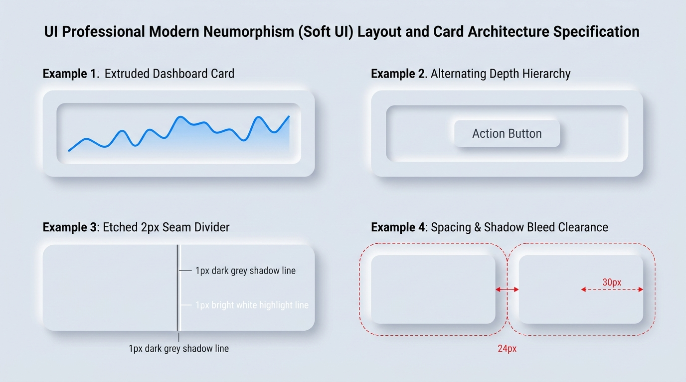

# Neumorphism Design — Layout Architecture, Cards & Depth Hierarchy

## Layout & Cards Decision Matrix

| Goal | Tool | Why |
| :--- | :--- | :--- |
| Prevent adjacent soft shadows from colliding | Minimum grid/flex `gap` $\ge 2 \times \text{blur radius}$ (`1.5rem`–`2.5rem`) | Because a `12px 12px 24px` shadow bleeds up to `36px` outside the element box, tight spacing causes neighboring highlights and dark shadows to muddy together. |
| Group data or controls inside an extruded card | Alternating Depth Polarity (Raised Card $\rightarrow$ Inset Well $\rightarrow$ Raised Control) | Stacking multiple raised layers on top of each other creates visual "wedding cake" clutter; alternating extrusion and recession keeps elevation crisp. |
| Separate sections inside a card without flat hairlines | 2px Etched Seam Divider (`1px` dark shadow + `1px` bright highlight) | Simulates a physical micro-groove carved into the surface rather than a flat painted line. |
| Build responsive dashboard grids | CSS Grid RAM (`repeat(auto-fit, minmax(min(100%, 280px), 1fr))`) with generous padding | Adapts cleanly across viewports while preserving outer padding so peripheral card shadows are never clipped by `overflow: hidden`. |
| Present modal dialogs over a Soft UI canvas | Native `<dialog>` with frosted `backdrop-filter: blur(8px)` + `--neu-raised-lg` | Separates the top-layer modal from the underlying monolithic plane while keeping the dialog surface tactile. |

---

## Visual Reference: Layout, Nested Depth & Shadow Clearance



> **Multimodal Agent Instruction:** View [`./images/neumorphism_cards_and_layout.jpg`](./images/neumorphism_cards_and_layout.jpg) to inspect the 4 core layout rules: (1) Extruded Card with recessed chart well, (2) Alternating Depth Hierarchy (Raised $\rightarrow$ Inset $\rightarrow$ Raised), (3) Etched 2px Seam Divider, and (4) Shadow Bleed Clearance spacing.

---

## Rule 1: The Shadow Bleed Clearance Formula

A Neumorphic element's visual footprint extends far beyond its CSS border box. Given shadow offset $d$ and blur radius $b$, the shadow extends approximately $d + b$ pixels outward in every direction.

- For `--neu-raised-md` (`6px 6px 12px`), shadow bleed is **$18\text{px}$** per side.
- For `--neu-raised-lg` (`12px 12px 24px`), shadow bleed is **$36\text{px}$** per side.

Therefore:
1. **Grid / Flex Gaps:** Never set `gap` smaller than **`1.5rem` (`24px`)** between medium raised elements, or **`2.25rem` (`36px`)** between large raised cards.
2. **Scroll Container Padding:** Any scrollable or `overflow: hidden` parent containing raised Neumorphic children **must** include at least `padding: 2rem` so outer shadows are never sliced off at the container boundary.

```css
.neu-bento-grid {
  display: grid;
  grid-template-columns: repeat(auto-fit, minmax(min(100%, 300px), 1fr));
  /* Generous gap prevents adjacent top-left highlights and bottom-right shadows from colliding */
  gap: clamp(1.75rem, 3vw, 2.5rem);
  /* Outer clearance prevents viewport or container clipping of peripheral shadows */
  padding-block: clamp(1.5rem, 3vw, 2.5rem);
  padding-inline: clamp(1.5rem, 3vw, 2.5rem);
}
```

---

## Rule 2: Alternating Depth Polarity (No "Wedding Cakes")

Never stack more than **two** extruded layers directly on top of one another (`Canvas -> Raised Card -> Raised Sub-card -> Raised Button`). Instead, alternate the Z-axis polarity:

1. **Level 0 (Canvas):** Base flat surface (`--neu-surface`)
2. **Level +1 (Outer Card):** Extruded container (`--neu-raised-lg`)
3. **Level -1 (Inner Data Well / Control Track):** Recessed groove (`--neu-inset-md`)
4. **Level +1 (Interactive Thumb / Action Pill):** Extruded control (`--neu-raised-sm`)

```html
<article class="neu-card">
  <header class="neu-card-header">
    <h2 class="neu-card-title">System Telemetry</h2>
    <span class="neu-badge-inset">Live</span>
  </header>

  <!-- Recessed well inside the raised card -->
  <div class="neu-data-well">
    <p class="neu-metric-value">99.98%</p>
    <button type="button" class="neu-well-action">Inspect Logs</button>
  </div>
</article>
```

```css
.neu-card {
  background-color: var(--neu-surface);
  border-radius: var(--neu-radius-lg);
  border: 1px solid var(--neu-border-raised);
  box-shadow: var(--neu-raised-lg);
  padding-block: 1.75rem;
  padding-inline: 1.75rem;
  display: flex;
  flex-direction: column;
  gap: 1.5rem;
}

/* Carved inner well creates dramatic depth contrast without raising higher */
.neu-data-well {
  background-color: var(--neu-surface);
  border-radius: var(--neu-radius-md);
  border: 1px solid var(--neu-border-inset);
  box-shadow: var(--neu-inset-md);
  padding-block: 1.25rem;
  padding-inline: 1.25rem;
  display: flex;
  align-items: center;
  justify-content: space-between;
  gap: 1rem;
}

/* Raised control sitting inside the recessed well */
.neu-well-action {
  background-color: var(--neu-surface);
  border-radius: var(--neu-radius-sm);
  border: 1px solid var(--neu-border-raised);
  box-shadow: var(--neu-raised-sm);
  padding-block: 0.6rem;
  padding-inline: 1.1rem;
  font-weight: 600;
  color: var(--neu-text-primary);
  cursor: pointer;
}
```

---

## Rule 3: Etched Seam Dividers (Horizontal & Vertical)

Flat `1px solid #ccc` borders look foreign inside a Soft UI card. Replace them with a **2px etched groove** composed of a `1px` dark line paired immediately with a `1px` highlight line:

```css
/* Horizontal etched groove (<hr class="neu-divider">) */
.neu-divider {
  border: none;
  block-size: 2px;
  inline-size: 100%;
  margin-block: 1.25rem;
  background-color: var(--neu-shadow);
  box-shadow: 0 1px 0 var(--neu-highlight);
}

/* Vertical etched groove between side-by-side columns */
.neu-divider-vertical {
  inline-size: 2px;
   align-self: stretch;
  margin-inline: 1.25rem;
  background-color: var(--neu-shadow);
  box-shadow: 1px 0 0 var(--neu-highlight);
}
```

---

## Rule 4: The 30% Soft-UI Density Cap

In complex web applications, making **every** table cell, list row, tag, and paragraph an extruded Neumorphic block causes severe visual exhaustion.
- **Extrude or Recess:** Outer section cards, primary interactive controls (buttons, inputs, sliders, toggles, segmented tabs), and key KPI wells.
- **Keep Flat:** Standard text paragraphs, table rows, inline metadata badges, and secondary links inside a card. Use typography weight, spacing, and etched seam dividers for internal organization.

---

## Do Not

| BAD | GOOD | Why |
| :--- | :--- | :--- |
| `gap: 8px` between raised Neumorphic cards | `gap: clamp(1.5rem, 3vw, 2.5rem)` (`24px`–`40px`) | Tight gaps cause the bottom-right dark shadow of Card A to overlap the top-left highlight of Card B, creating dirty gray banding. |
| `overflow: hidden` directly on a tight wrapper around raised cards | Add `padding: 2rem` inside any scroll/overflow container, or avoid `overflow: hidden` | `overflow: hidden` slices `box-shadow` straight along the bounding box edge, producing ugly flat-cut shadow seams. |
| Stacking 3+ extruded containers (`Card -> Sub-card -> Pill -> Button`) | Alternate depth polarity (`Raised Card -> Inset Well -> Raised Button`) | Multiple stacked extrusions of the same color lose all visual separation and look like a blurry staircase. |
| Making every list item and table row an extruded Neumorphic card | Group list items inside a single raised card or inset well separated by `.neu-divider` seams | Overusing 3D shadows on dense repeatable content destroys scannability and slows down page rendering. |
