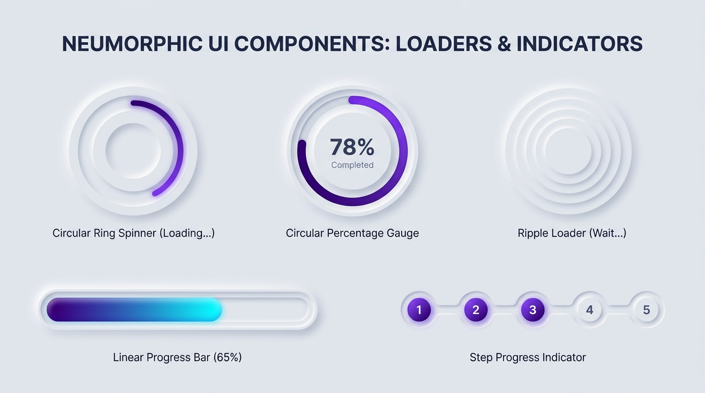

# Neumorphism Design — Loaders, Spinners & Progress Indicators

## Loaders & Progress Decision Matrix

| Goal | Tool | Why |
| :--- | :--- | :--- |
| Indeterminate circular loading spinner | Stationary recessed donut track (`--neu-inset-md` + raised inner island) with a rotating `::after` conic-gradient arc | Rotating a `box-shadow` directly makes the light source spin around the screen; keeping the Neumorphic track fixed while rotating only the colored arc preserves $135^\circ$ light physics. |
| Determinate percentage ring gauge | Fixed Neumorphic donut well + SVG `stroke-dasharray` / `conic-gradient` + extruded center readout | Frames the percentage readout on a raised central pedestal surrounded by a carved progress moat. |
| Determinate linear progress bar | Deep recessed stadium trough (`--neu-inset-sm`) containing a glowing accent bar | Looks like a milled liquid/LED channel filling smoothly from 0% to 100%. |
| Ambient waiting / audio / AI listening state | Concentric tactile ripple rings animating `transform: scale()` and `opacity` | Uses GPU-composited transforms while respecting `@media (prefers-reduced-motion)`. |
| Multi-step wizard / checkout tracker | Recessed connector trough linking raised step nodes (`--neu-raised-sm`) | Clearly differentiates completed (accent filled), current (extruded + focus ring), and upcoming (recessed) milestones. |

---

## Visual Reference: Neumorphic Loaders, Gauges & Progress Bars



> **Multimodal Agent Instruction:** View [`./images/neumorphism_loaders_and_progress.jpg`](./images/neumorphism_loaders_and_progress.jpg) to inspect the 5 canonical loading and progress patterns: (1) Circular Ring Spinner, (2) Circular Percentage Gauge, (3) Concentric Ripple Loader, (4) Carved Linear Progress Bar, and (5) Step Progress Indicator.

---

## Critical Physics Rule: Never Rotate a Neumorphic `box-shadow`

If you apply `@keyframes spin { to { transform: rotate(360deg); } }` directly to an element that has `box-shadow: 6px 6px 12px var(--neu-shadow), -6px -6px 12px var(--neu-highlight)`, **the shadows will orbit around the element**, making the room's light source appear to spin wildly in circles.

**The Solution:**
1. Keep the Neumorphic container (`box-shadow`) **100% stationary**.
2. Rotate only an inner child or `::after` pseudo-element carrying a `conic-gradient` or `border-top-color` inside the carved track.

---

## 1. Circular Ring Spinner (Stationary Carved Donut + Rotating Arc)

```html
<div class="neu-spinner" role="status" aria-label="Loading content">
  <span class="sr-only">Loading...</span>
</div>
```

```css
.neu-spinner {
  position: relative;
  display: inline-grid;
  place-items: center;
  inline-size: 4.5rem;
  block-size: 4.5rem;
  border-radius: 50%;
  background-color: var(--neu-surface);
  /* Stationary recessed outer track */
  box-shadow: var(--neu-inset-md);
}

/* Stationary raised inner island creating the donut channel */
.neu-spinner::before {
  content: "";
  inline-size: 2.75rem;
  block-size: 2.75rem;
  border-radius: 50%;
  background-color: var(--neu-surface);
  border: 1px solid var(--neu-border-raised);
  box-shadow: var(--neu-raised-sm);
  z-index: 2;
}

/* Rotating luminous arc inside the carved channel */
.neu-spinner::after {
  content: "";
  position: absolute;
  inset: 0.35rem;
  border-radius: 50%;
  background: conic-gradient(
    from 0deg,
    transparent 0%,
    transparent 35%,
    var(--neu-accent) 100%
  );
  animation: neu-spin 1.1s linear infinite;
  z-index: 1;
}

@keyframes neu-spin {
  to {
    transform: rotate(360deg);
  }
}
```

---

## 2. Determinate Circular Percentage Gauge

Pair a carved circular well with a `--progress` custom property (`0` to `100`) and a raised central pedestal displaying the numeric percentage:

```html
<div
  class="neu-gauge"
  role="progressbar"
  aria-valuenow="78"
  aria-valuemin="0"
  aria-valuemax="100"
  style="--progress: 78"
>
  <div class="neu-gauge-center">
    <span class="neu-gauge-value">78%</span>
    <span class="neu-gauge-label">Completed</span>
  </div>
</div>
```

```css
.neu-gauge {
  --progress: 0;
  position: relative;
  display: inline-grid;
  place-items: center;
  inline-size: 8.5rem;
  block-size: 8.5rem;
  border-radius: 50%;
  background-color: var(--neu-surface);
  background-image: conic-gradient(
    var(--neu-accent) calc(var(--progress) * 1%),
    transparent 0
  );
  box-shadow: var(--neu-inset-lg);
}

.neu-gauge-center {
  display: flex;
  flex-direction: column;
  align-items: center;
  justify-content: center;
  inline-size: 6.25rem;
  block-size: 6.25rem;
  border-radius: 50%;
  background-color: var(--neu-surface);
  border: 1px solid var(--neu-border-raised);
  box-shadow: var(--neu-raised-md);
}

.neu-gauge-value {
  font-size: 1.5rem;
  font-weight: 700;
  color: var(--neu-text-primary);
  font-variant-numeric: tabular-nums;
}

.neu-gauge-label {
  font-size: 0.75rem;
  color: var(--neu-text-secondary);
}
```

---

## 3. Carved Linear Progress Bar

```html
<div
  class="neu-progress-track"
  role="progressbar"
  aria-valuenow="65"
  aria-valuemin="0"
  aria-valuemax="100"
>
  <div class="neu-progress-fill" style="inline-size: 65%"></div>
</div>
```

```css
.neu-progress-track {
  inline-size: 100%;
  block-size: 1.125rem;
  padding: 0.2rem;
  border-radius: var(--neu-radius-pill);
  border: 1px solid var(--neu-border-inset);
  background-color: var(--neu-surface);
  box-shadow: var(--neu-inset-sm);
  overflow: hidden;
}

.neu-progress-fill {
  block-size: 100%;
  border-radius: var(--neu-radius-pill);
  background-image: linear-gradient(
    90deg,
    var(--neu-accent),
    oklch(from var(--neu-accent) calc(l + 0.12) c calc(h - 25))
  );
  box-shadow: 0 0 10px oklch(from var(--neu-accent) l c h / 0.5);
  transition: inline-size 300ms cubic-bezier(0.2, 0, 0, 1);
}
```

---

## 4. Concentric Tactile Ripple Loader & Reduced Motion Fallback

For ambient waiting states, expand concentric rings using `transform: scale()` and `opacity` (GPU-composited), and always provide a calm static fallback for `@media (prefers-reduced-motion: reduce)`:

```css
.neu-ripple {
  position: relative;
  inline-size: 5rem;
  block-size: 5rem;
  display: inline-grid;
  place-items: center;
}

.neu-ripple::before,
.neu-ripple::after {
  content: "";
  position: absolute;
  inset: 0;
  border-radius: 50%;
  border: 1px solid var(--neu-border-raised);
  box-shadow: var(--neu-raised-sm);
  animation: neu-ripple-wave 2.2s cubic-bezier(0.16, 1, 0.3, 1) infinite;
}

.neu-ripple::after {
  animation-delay: -1.1s;
}

@keyframes neu-ripple-wave {
  0% {
    transform: scale(0.2);
    opacity: 1;
  }
  100% {
    transform: scale(1);
    opacity: 0;
  }
}

/* Mandatory Accessibility Motion Safeguard */
@media (prefers-reduced-motion: reduce) {
  .neu-spinner::after,
  .neu-ripple::before,
  .neu-ripple::after {
    animation-duration: 0.01ms !important;
    animation-iteration-count: 1 !important;
  }
}
```

---

## Do Not

| BAD | GOOD | Why |
| :--- | :--- | :--- |
| Animating `transform: rotate(360deg)` on an element that has Neumorphic `box-shadow` | Keep the shadowed track stationary and rotate an inner `conic-gradient` pseudo-element | Rotating `box-shadow` makes the top-left highlight and bottom-right shadow spin around in circles, breaking the fixed $135^\circ$ light source. |
| Animating `box-shadow` blur or spread in an infinite `@keyframes` loop | Animate `transform: scale()` and `opacity` on pseudo-elements | Continuous `box-shadow` repaints run on the main CPU paint thread and drain mobile battery/frame rates. |
| Omitting `role="status"` or `role="progressbar"` on custom div loaders | Include `role="status"` + `.sr-only` text for indeterminate spinners, and `role="progressbar"` + `aria-valuenow` for determinate bars | Screen readers completely ignore empty decorative `<div>` spinners unless semantic ARIA roles are attached. |
| Ignoring `@media (prefers-reduced-motion: reduce)` on pulsing ripples | Disable or slow infinite keyframe loops inside `prefers-reduced-motion: reduce` | Continuous expanding concentric rings can trigger vestibular discomfort for motion-sensitive users. |
