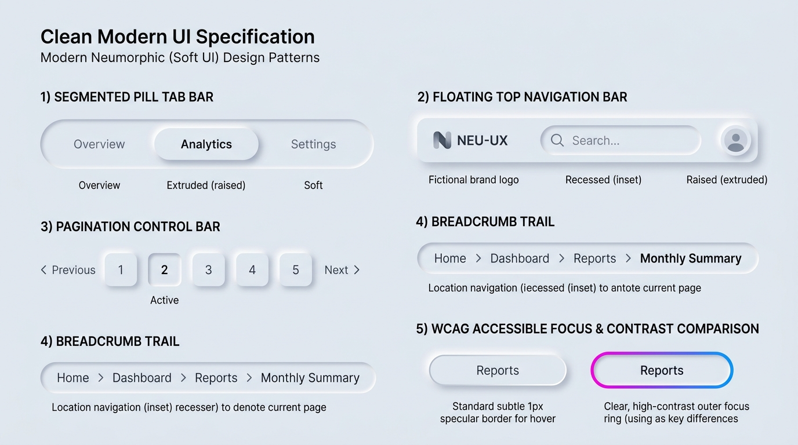

# Neumorphism Design — Navigation, Tabs & WCAG Accessibility Rules

## Navigation & Accessibility Decision Matrix

| Goal | Tool | Why |
| :--- | :--- | :--- |
| Mutually exclusive tab switcher (`role="tablist"`) | Recessed stadium trough (`--neu-inset-sm`) + extruded active tab pill (`--neu-raised-sm`) | Groups tabs into a single visual instrument and uses physical elevation to denote the active view. |
| Top / bottom floating app bar | Extruded pill/rounded bar (`--neu-raised-lg`) with `1px` specular border | Anchors global navigation above the content plane without requiring a jarring background color change. |
| Pagination control strip | Extruded page tiles (`--neu-raised-sm`) + recessed active page well (`aria-current="page"`) | Pressing a page tile "latches" it into the recessed active socket, making the current page unmistakable. |
| Breadcrumb location trail | Subtle recessed pill container (`--neu-inset-sm`) housing inline links | Frames hierarchical location metadata cleanly without competing with raised action buttons. |
| WCAG 2.2 Non-Text Contrast & Focus compliance | `1px` perimeter border + `outline-offset: 4px` focus ring + `@media (prefers-contrast: more)` fallback | Solves historical Neumorphism accessibility failures across low-vision, keyboard-only, and high-contrast OS modes. |

---

## Visual Reference: Navigation Bars, Tabs & WCAG Accessibility Patterns



> **Multimodal Agent Instruction:** View [`./images/neumorphism_navigation.jpg`](./images/neumorphism_navigation.jpg) to inspect the 5 core navigation and accessibility patterns: (1) Segmented Pill Tab Bar, (2) Floating Top Navigation Bar, (3) Pagination Control Bar, (4) Recessed Breadcrumb Trail, and (5) WCAG Accessible Focus & Contrast comparison.

---

## 1. Segmented Pill Tab Bar (`role="tablist"`)

Place the tab list inside a **recessed outer track** (`--neu-inset-sm`). Inactive tabs sit flush and transparent inside the groove, while the selected tab (`[aria-selected="true"]`) extrudes upward (`--neu-raised-sm`):

```html
<div class="neu-tablist" role="tablist" aria-label="Dashboard sections">
  <button role="tab" aria-selected="false" class="neu-tab">Overview</button>
  <button role="tab" aria-selected="true" class="neu-tab">Analytics</button>
  <button role="tab" aria-selected="false" class="neu-tab">Settings</button>
</div>
```

```css
.neu-tablist {
  display: inline-grid;
  grid-auto-flow: column;
  grid-auto-columns: 1fr;
  gap: 0.375rem;
  padding: 0.375rem;
  border-radius: var(--neu-radius-pill);
  border: 1px solid var(--neu-border-inset);
  background-color: var(--neu-surface);
  box-shadow: var(--neu-inset-sm);
}

.neu-tab {
  min-block-size: 2.5rem;
  padding-block: 0.5rem;
  padding-inline: 1.5rem;
  border-radius: var(--neu-radius-pill);
  border: 1px solid transparent;
  background: transparent;
  color: var(--neu-text-secondary);
  font-weight: 600;
  font-size: 0.9375rem;
  cursor: pointer;
  transition: all 180ms cubic-bezier(0.2, 0, 0, 1);
}

.neu-tab:hover:not([aria-selected="true"]) {
  color: var(--neu-text-primary);
}

/* Active tab extrudes out of the recessed groove */
.neu-tab[aria-selected="true"] {
  background-color: var(--neu-surface);
  color: var(--neu-text-primary);
  border-color: var(--neu-border-raised);
  box-shadow: var(--neu-raised-sm);
}

.neu-tab:focus-visible {
  outline: 3px solid var(--neu-accent);
  outline-offset: 3px;
}
```

---

## 2. Pagination Control Strip (Raised Tiles + Recessed Current Page)

In pagination, available page numbers are **raised buttons** (`--neu-raised-sm`) inviting a click, whereas the current page (`[aria-current="page"]`) is **latched inward** (`--neu-inset-sm`) with `--neu-accent` typography:

```html
<nav aria-label="Pagination" class="neu-pagination">
  <a href="?page=1" class="neu-page-tile">1</a>
  <a href="?page=2" class="neu-page-tile" aria-current="page">2</a>
  <a href="?page=3" class="neu-page-tile">3</a>
  <a href="?page=4" class="neu-page-tile">4</a>
</nav>
```

```css
.neu-pagination {
  display: inline-flex;
  align-items: center;
  gap: 0.875rem;
}

.neu-page-tile {
  display: inline-grid;
  place-content: center;
  inline-size: 2.625rem;
  block-size: 2.625rem;
  border-radius: var(--neu-radius-sm);
  border: 1px solid var(--neu-border-raised);
  background-color: var(--neu-surface);
  color: var(--neu-text-primary);
  font-weight: 600;
  text-decoration: none;
  box-shadow: var(--neu-raised-sm);
  transition: all 160ms ease;
}

.neu-page-tile[aria-current="page"] {
  border-color: var(--neu-border-inset);
  box-shadow: var(--neu-inset-sm);
  color: var(--neu-accent);
  font-weight: 700;
}
```

---

## 3. The 5 Mandatory WCAG 2.2 Accessibility Rules for Neumorphism

Early 2020-era Neumorphism failed accessibility audits because designers relied exclusively on diffuse shadows to define interactive boundaries. Modern production Neumorphism **must** enforce these five structural safeguards:

### Safeguard A: 1px Specular/Inset Perimeter Borders
Never rely on `box-shadow` alone to define a component's hit area. Every raised component must include `border: 1px solid var(--neu-border-raised)` and every recessed input must include `border: 1px solid var(--neu-border-inset)`.

### Safeguard B: Focus Rings Outside Shadow Geometry
Because soft shadows blur outward by `12px`–`24px`, a `0px` offset outline gets visually muddied by the shadow gradient. Always offset `:focus-visible` outlines by **`4px` to `6px`**:

```css
:where(button, a, input, select, textarea, [tabindex]):focus-visible {
  outline: 3px solid var(--neu-accent);
  outline-offset: 4px;
}
```

### Safeguard C: Typography & Icon Contrast ($\ge 4.5:1$ / $\ge 3:1$)
- Primary text (`--neu-text-primary`) must maintain at least **$7:1$ (AAA)** contrast against `--neu-surface`.
- Secondary/placeholder text (`--neu-text-secondary`) must maintain at least **$4.5:1$ (AA)** contrast against `--neu-surface`.
- Interactive icons must maintain at least **$3:1$** contrast against `--neu-surface`. Never use "embossed" same-color text or icons that rely only on `text-shadow` to be read!

### Safeguard D: High-Contrast User Preference (`prefers-contrast: more`)
When a user enables OS High Contrast (`@media (prefers-contrast: more)`), soft shadows lose utility and create visual noise. Strip complex `box-shadow` blurs and upgrade component borders to crisp `2px` high-contrast edges:

```css
@media (prefers-contrast: more) {
  :root {
    --neu-border-raised: currentColor;
    --neu-border-inset: currentColor;
  }

  :where(.neu-card, .neu-btn, .neu-input, .neu-tab, .neu-switch, .neu-page-tile) {
    box-shadow: none !important;
    border-width: 2px !important;
  }

  :where(.neu-btn[aria-pressed="true"], .neu-tab[aria-selected="true"], .neu-page-tile[aria-current="page"]) {
    background-color: var(--neu-accent) !important;
    color: var(--neu-accent-contrast) !important;
  }
}
```

### Safeguard E: Windows Forced Colors Mode (`forced-colors: active`)
Because Windows High Contrast mode strips all `box-shadow` and `background-image` gradients automatically, ensure interactive states remain distinguishable via system color keywords (`ButtonBorder`, `Highlight`, `HighlightText`):

```css
@media (forced-colors: active) {
  :where(.neu-card, .neu-btn, .neu-input, .neu-switch) {
    border: 1px solid ButtonBorder;
  }

  :where(.neu-btn[aria-pressed="true"], .neu-tab[aria-selected="true"], .neu-page-tile[aria-current="page"]) {
    forced-color-adjust: none;
    background-color: Highlight;
    color: HighlightText;
    border-color: Highlight;
  }
}
```

---

## Do Not

| BAD | GOOD | Why |
| :--- | :--- | :--- |
| Using "embossed" same-color text (`color: var(--neu-surface); text-shadow: 1px 1px 2px ...`) | Always use high-contrast solid text (`color: var(--neu-text-primary)`, $\ge 7:1$ contrast) | Embossed same-color text has a $1:1$ luminance contrast ratio, failing WCAG 1.4.3 catastrophically and rendering text unreadable. |
| Indicating the active navigation tab only with a slightly deeper drop shadow | House tabs in an inset track (`--neu-inset-sm`) and extrude only `[aria-selected="true"]` (`--neu-raised-sm`) with high-contrast text | Subtle shadow-size differences between sibling tabs cannot be distinguished by users with low contrast sensitivity. |
| Ignoring `@media (prefers-contrast: more)` and `forced-colors: active` | Provide explicit `2px` border and `Highlight` system-color fallbacks | When `box-shadow` is stripped by assistive OS modes, borderless Neumorphic components become completely invisible. |
| Setting `outline: none` on `.neu-btn:focus` or `.neu-tab:focus` | Use `:focus-visible` with `outline: 3px solid var(--neu-accent); outline-offset: 4px;` | Removing focus outlines locks out keyboard and switch-control users. |
