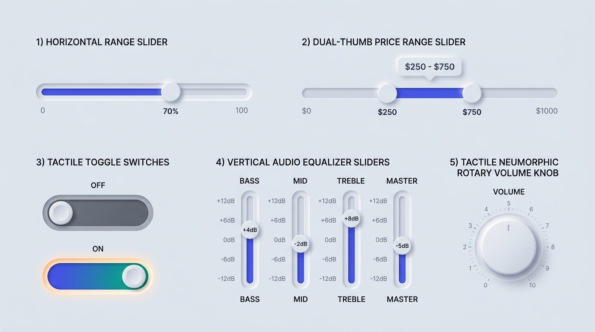

# Neumorphism Design — Sliders, Toggle Switches & Tactile Dials

## Sliders & Toggles Decision Matrix

| Goal | Tool | Why |
| :--- | :--- | :--- |
| Continuous value selection (`<input type="range">`) | Recessed stadium groove (`--neu-inset-sm`) + raised spherical thumb (`--neu-raised-md`) | Mimics a physical mixing-board fader where a raised cap glides inside a milled slot. |
| Visual progress fill inside a range slider | CSS custom property `--slider-pct` driving a `linear-gradient` inside the recessed track | Combines tactile depth with instant high-contrast visual feedback of the current percentage. |
| Binary ON/OFF switch | `<input type="checkbox" role="switch">` with recessed stadium track + sliding extruded thumb | Provides unambiguous state polarity: recessed neutral track when OFF, luminous accent track + translated thumb when ON. |
| Vertical equalizer / multi-band faders | `writing-mode: vertical-lr; direction: rtl` on native `<input type="range">` | Achieves native vertical keyboard and pointer dragging without fragile JavaScript coordinate math. |
| Rotary volume / parameter knob | Extruded circular dial (`--neu-convex`) + recessed outer bezel + conic tick marks | Delivers authentic studio hardware tactility for audio, media, and smart-home interfaces. |

---

## Visual Reference: Sliders, Switches, Equalizers & Rotary Knobs



> **Multimodal Agent Instruction:** View [`./images/neumorphism_sliders_and_toggles.jpg`](./images/neumorphism_sliders_and_toggles.jpg) to inspect the physical depth relationship between recessed slider channels, glowing accent fills, extruded circular thumbs, ON/OFF toggle switches, and rotary dials.

---

## Tactile Range Slider (Recessed Groove + Filled Channel + Raised Thumb)

A production Neumorphic range slider pairs a **recessed track** (`--neu-inset-sm`) with an **extruded thumb** (`--neu-raised-md`). By binding a `--val` percentage token (`0%` to `100%`), the left side of the groove illuminates with `--neu-accent` while preserving the inner carved shadow:

```html
<div class="neu-slider-group">
  <div class="neu-slider-header">
    <label for="volume-slider" class="neu-label">Master Output</label>
    <output for="volume-slider" class="neu-slider-value">70%</output>
  </div>
  <input
    id="volume-slider"
    type="range"
    min="0"
    max="100"
    value="70"
    style="--val: 70%"
    class="neu-range"
    oninput="this.style.setProperty('--val', this.value + '%'); this.previousElementSibling.lastElementChild.value = this.value + '%'"
  />
</div>
```

```css
.neu-range {
  --val: 50%;
  appearance: none;
  inline-size: 100%;
  block-size: 0.75rem; /* 12px carved channel height */
  border-radius: var(--neu-radius-pill);
  border: 1px solid var(--neu-border-inset);
  /* Accent fill up to --val, base surface beyond --val */
  background-image: linear-gradient(
    to right,
    var(--neu-accent) 0%,
    oklch(from var(--neu-accent) calc(l + 0.08) c h) var(--val),
    var(--neu-surface) var(--val),
    var(--neu-surface) 100%
  );
  box-shadow: var(--neu-inset-sm);
  cursor: pointer;
}

/* WebKit / Blink Extruded Spherical Thumb */
.neu-range::-webkit-slider-thumb {
  appearance: none;
  inline-size: 1.625rem; /* 26px tactile thumb */
  block-size: 1.625rem;
  border-radius: 50%;
  border: 1px solid var(--neu-border-raised);
  background-color: var(--neu-surface);
  box-shadow: var(--neu-raised-md);
  cursor: grab;
  transition: transform 150ms ease, box-shadow 150ms ease;
}

/* Firefox Extruded Spherical Thumb */
.neu-range::-moz-range-thumb {
  inline-size: 1.625rem;
  block-size: 1.625rem;
  border-radius: 50%;
  border: 1px solid var(--neu-border-raised);
  background-color: var(--neu-surface);
  box-shadow: var(--neu-raised-md);
  cursor: grab;
  transition: transform 150ms ease, box-shadow 150ms ease;
}

.neu-range:active::-webkit-slider-thumb {
  cursor: grabbing;
  transform: scale(1.08);
}

.neu-range:focus-visible {
  outline: 3px solid var(--neu-accent);
  outline-offset: 6px;
}
```

---

## Neumorphic Binary Toggle Switch (`role="switch"`)

A toggle switch consists of a **recessed stadium well** and a **raised circular thumb** that translates across the inline axis when `:checked`.

> **Accessibility Rule:** Never rely on thumb position alone to distinguish ON from OFF. In the `:checked` state, flood the recessed track with `--neu-accent` (or an emerald/cyan gradient) so state polarity is unmistakable from across the room.

```html
<label class="neu-switch-label">
  <input type="checkbox" role="switch" class="neu-switch" checked />
  <span>Spatial Audio Processing</span>
</label>
```

```css
.neu-switch-label {
  display: inline-flex;
  align-items: center;
  gap: 0.875rem;
  cursor: pointer;
  user-select: none;
  color: var(--neu-text-primary);
  font-weight: 500;
}

.neu-switch {
  appearance: none;
  position: relative;
  inline-size: 3.75rem; /* 60px stadium width */
  block-size: 2rem;     /* 32px stadium height */
  margin: 0;
  border-radius: var(--neu-radius-pill);
  border: 1px solid var(--neu-border-inset);
  background-color: var(--neu-surface);
  box-shadow: var(--neu-inset-md);
  cursor: pointer;
  transition: background-color 220ms ease, box-shadow 220ms ease, border-color 220ms ease;
}

/* Extruded sliding thumb */
.neu-switch::before {
  content: "";
  position: absolute;
  inset-block-start: 3px;
  inset-inline-start: 3px;
  inline-size: calc(2rem - 8px); /* 24px thumb diameter */
  block-size: calc(2rem - 8px);
  border-radius: 50%;
  border: 1px solid var(--neu-border-raised);
  background-color: var(--neu-surface);
  box-shadow: var(--neu-raised-sm);
  transition: transform 220ms cubic-bezier(0.34, 1.56, 0.64, 1);
}

/* Checked (ON) State: Luminous recessed track + translated thumb */
.neu-switch:checked {
  background-color: var(--neu-accent);
  border-color: oklch(from var(--neu-accent) calc(l - 0.1) c h);
  box-shadow:
    inset 3px 3px 6px oklch(from var(--neu-accent) calc(l - 0.22) c h),
    inset -3px -3px 6px oklch(from var(--neu-accent) calc(l + 0.1) c h),
    0 0 12px oklch(from var(--neu-accent) l c h / 0.35);
}

.neu-switch:checked::before {
  transform: translateX(1.75rem); /* Slides cleanly to the right end */
}

.neu-switch:focus-visible {
  outline: 3px solid var(--neu-accent);
  outline-offset: 4px;
}
```

---

## Vertical Faders & Rotary Dial Geometry

### 1. Native Vertical Fader
Use modern standard CSS writing modes on `<input type="range">` rather than `transform: rotate(-90deg)` (which breaks bounding-box layout flow):

```css
.neu-range-vertical {
  writing-mode: vertical-lr;
  direction: rtl;
  inline-size: 0.75rem;
  block-size: 10rem;
}
```

### 2. Tactile Rotary Knob Surface
For rotary controls, nest a **convex circular cap** inside a **recessed circular housing**, with a high-contrast indicator notch rotated via a `--angle` custom property:

```css
.neu-knob-well {
  display: grid;
  place-items: center;
  inline-size: 5.5rem;
  block-size: 5.5rem;
  border-radius: 50%;
  background-color: var(--neu-surface);
  box-shadow: var(--neu-inset-md);
}

.neu-knob-dial {
  --angle: -45deg; /* Map -135deg (min) to +135deg (max) */
  position: relative;
  inline-size: 4rem;
  block-size: 4rem;
  border-radius: 50%;
  border: 1px solid var(--neu-border-raised);
  background-image: linear-gradient(
    135deg,
    oklch(from var(--neu-surface) calc(l + 0.05) c h),
    oklch(from var(--neu-surface) calc(l - 0.05) c h)
  );
  box-shadow: var(--neu-raised-md);
  transform: rotate(var(--angle));
}

/* Indicator notch on the dial perimeter */
.neu-knob-dial::after {
  content: "";
  position: absolute;
  inset-block-start: 0.4rem;
  inset-inline-start: calc(50% - 2px);
  inline-size: 4px;
  block-size: 0.65rem;
  border-radius: var(--neu-radius-pill);
  background-color: var(--neu-accent);
  box-shadow: 0 0 6px var(--neu-accent);
}
```

---

## Do Not

| BAD | GOOD | Why |
| :--- | :--- | :--- |
| Making both the slider track AND the slider thumb extruded (`--neu-raised-md`) | Recess the slider track (`--neu-inset-sm`) and extrude the slider thumb (`--neu-raised-md`) | A raised thumb sliding over a raised bar lacks a physical channel and creates clashing double drop shadows. |
| Leaving a toggle switch track the exact same gray in both OFF and ON states | Fill the recessed track with `--neu-accent` (or illuminate an indicator) when `:checked` | Users with low vision or cognitive load cannot tell whether a monochromatic gray toggle is ON or OFF by position alone. |
| Rotating a horizontal slider with `transform: rotate(-90deg)` for vertical faders | Use `writing-mode: vertical-lr; direction: rtl` on `<input type="range">` | CSS `transform: rotate()` leaves the original horizontal layout box intact, causing massive overlapping whitespace in flex/grid containers. |
|Rotating the entire `.neu-knob-dial` shadow when turning a rotary knob | Keep the outer `135deg` shadow stationary on a wrapper or counter-rotate only the indicator notch | If `transform: rotate()` spins the element carrying `box-shadow`, the light source rotates with the knob, violating the Single Light-Source Law! |
