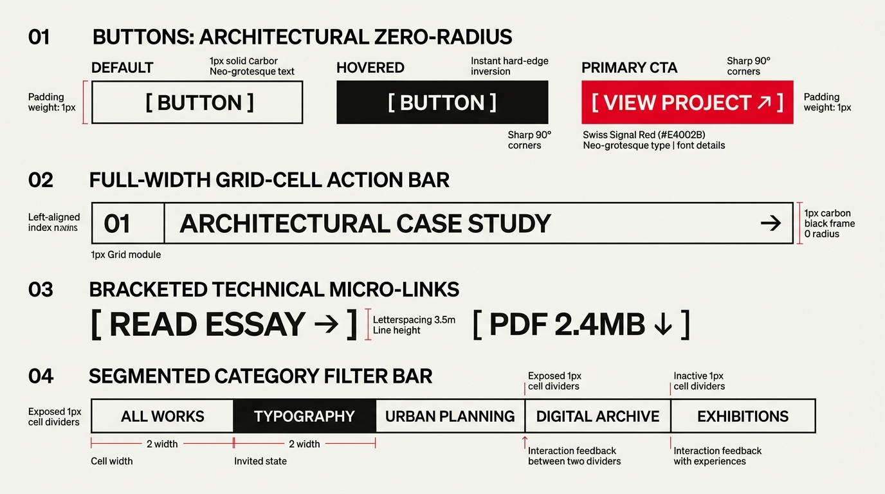

# Swiss Grid Design — Zero-Radius Buttons, Cell Triggers & Action Bars

## Buttons & Actions Decision Matrix

| Goal | Tool | Why |
| :--- | :--- | :--- |
| Standard secondary / architectural button | Zero-radius rectangle (`border: 1px solid var(--swiss-ink)`) with hard-edge hover inversion | Rejects pill/rounded shapes so buttons lock flush against grid hairlines and column margins. |
| High-priority Primary CTA | Solid Signal Red (`--swiss-accent`) fill with white uppercase label + directional glyph (`↗` or `→`) | Commands immediate focal priority against the monochrome paper-and-ink canvas. |
| Section-wide call to action | Full-Width Grid-Cell Action Bar (`[01] [TITLE] [→]`) spanning an entire bordered module | Turns the grid cell itself into an oversized, impossible-to-miss interactive surface. |
| Inline editorial / download micro-action | Bracketed Technical Link (`[ READ ESSAY → ]`, `[ PDF 2.4MB ↓ ]`) in `--swiss-font-mono` | Provides self-contained typographic framing without adding nested box borders inside prose. |
| Category or archive view switcher | Contiguous `1px` hairline Segmented Filter Bar with inverted active cell (`[aria-pressed="true"]`) | Partitions filter tabs cleanly along a horizontal strip with zero gap between options. |

---

## Visual Reference: Swiss Grid Buttons & Action Controls



> **Multimodal Agent Instruction:** View [`./images/swiss_grid_buttons.jpg`](./images/swiss_grid_buttons.jpg) to inspect the 4 canonical Swiss action patterns: (01) Zero-Radius Architectural Buttons (Default, Hovered Inversion, Primary Signal Red CTA), (02) Full-Width Grid-Cell Action Bar, (03) Bracketed Technical Micro-Links, and (04) Segmented Category Filter Bar.

---

## 1. Zero-Radius Architectural Buttons (Hard-Edge Polarity Inversion)

Swiss buttons never use `border-radius`, drop shadows, or subtle hover tints. Hovering flips the button's color polarity instantaneously (`100ms–140ms`) from `--swiss-paper` to solid `--swiss-ink` (or `--swiss-accent`):

```html
<button type="button" class="swiss-btn">
  <span>[ VIEW ARCHIVE ]</span>
</button>

<button type="button" class="swiss-btn swiss-btn-primary">
  <span>VIEW PROJECT</span>
  <span class="swiss-btn-arrow" aria-hidden="true">↗</span>
</button>
```

```css
.swiss-btn {
  display: inline-flex;
  align-items: center;
  justify-content: center;
  gap: 0.75rem;
  min-block-size: 3rem; /* 48px accessible tap target */
  padding-block: 0.75rem;
  padding-inline: 1.5rem;
  border-radius: 0;
  border: 1px solid var(--swiss-ink);
  background-color: var(--swiss-paper);
  color: var(--swiss-ink);
  font-family: var(--swiss-font-sans);
  font-size: 0.875rem;
  font-weight: 700;
  letter-spacing: 0.06em;
  text-transform: uppercase;
  text-decoration: none;
  cursor: pointer;
  transition:
    background-color 120ms cubic-bezier(0.2, 0, 0, 1),
    color 120ms cubic-bezier(0.2, 0, 0, 1),
    border-color 120ms cubic-bezier(0.2, 0, 0, 1);
}

/* Instant Hard-Edge Inversion on Hover */
.swiss-btn:hover:not(:disabled) {
  background-color: var(--swiss-ink);
  color: var(--swiss-paper);
}

.swiss-btn:active:not(:disabled) {
  background-color: var(--swiss-accent);
  border-color: var(--swiss-accent);
  color: var(--swiss-accent-contrast);
}

/* Primary Signal Red CTA Variant */
.swiss-btn-primary {
  background-color: var(--swiss-accent);
  border-color: var(--swiss-accent);
  color: var(--swiss-accent-contrast);
}

.swiss-btn-primary:hover:not(:disabled) {
  background-color: var(--swiss-ink);
  border-color: var(--swiss-ink);
  color: var(--swiss-paper);
}

.swiss-btn-arrow {
  display: inline-block;
  transition: transform 140ms ease;
}

.swiss-btn:hover .swiss-btn-arrow {
  transform: translate(2px, -2px);
}

/* Zero-Radius High-Contrast Focus Ring */
.swiss-btn:focus-visible {
  outline: 3px solid var(--swiss-accent);
  outline-offset: 4px;
}
```

---

## 2. Full-Width Grid-Cell Action Bar

In magazine and portfolio layouts, replace small isolated buttons at the bottom of a section with a **Full-Width Grid-Cell Action Bar** partitioned into an index number cell, a bold title cell, and a directional arrow cell:

```html
<a href="/case-studies/01" class="swiss-action-bar">
  <span class="swiss-action-index">01</span>
  <span class="swiss-action-label">ARCHITECTURAL CASE STUDY</span>
  <span class="swiss-action-glyph" aria-hidden="true">→</span>
</a>
```

```css
.swiss-action-bar {
  display: grid;
  grid-template-columns: 4.5rem 1fr 4.5rem;
  align-items: stretch;
  border: 2px solid var(--swiss-ink);
  background-color: var(--swiss-paper);
  color: var(--swiss-ink);
  text-decoration: none;
  transition: background-color 120ms ease, color 120ms ease;
}

.swiss-action-index,
.swiss-action-label,
.swiss-action-glyph {
  display: flex;
  align-items: center;
  padding-block: 1.125rem;
}

.swiss-action-index {
  justify-content: center;
  border-inline-end: 1px solid var(--swiss-ink);
  font-family: var(--swiss-font-mono);
  font-size: 1.125rem;
  font-weight: 700;
  font-variant-numeric: tabular-nums;
}

.swiss-action-label {
  padding-inline: 1.5rem;
  font-family: var(--swiss-font-sans);
  font-size: clamp(1.125rem, 1.8vw, 1.5rem);
  font-weight: 700;
  letter-spacing: -0.01em;
  text-transform: uppercase;
}

.swiss-action-glyph {
  justify-content: center;
  border-inline-start: 1px solid var(--swiss-ink);
  font-size: 1.5rem;
}

.swiss-action-bar:hover {
  background-color: var(--swiss-ink);
  color: var(--swiss-paper);
}

.swiss-action-bar:hover .swiss-action-index,
.swiss-action-bar:hover .swiss-action-glyph {
  border-color: oklch(from var(--swiss-paper) l c h / 0.25);
  color: var(--swiss-accent);
}
```

---

## 3. Bracketed Technical Micro-Links (`[ LABEL → ]`)

For inline article links, footnote triggers, or file downloads, use square typographic brackets (`[` and `]`) in uppercase monospace or bold sans-serif:

```css
.swiss-bracket-link {
  display: inline-flex;
  align-items: center;
  gap: 0.35rem;
  font-family: var(--swiss-font-mono);
  font-size: 0.8125rem;
  font-weight: 700;
  letter-spacing: 0.06em;
  text-transform: uppercase;
  text-decoration: none;
  color: var(--swiss-ink);
  padding-block: 0.15rem;
}

.swiss-bracket-link::before {
  content: "[";
  color: var(--swiss-accent);
}

.swiss-bracket-link::after {
  content: "]";
  color: var(--swiss-accent);
}

.swiss-bracket-link:hover {
  background-color: var(--swiss-ink);
  color: var(--swiss-paper);
}
```

---

## 4. Segmented Category Filter Strip

```html
<div class="swiss-filter-bar" role="group" aria-label="Filter archive by category">
  <button type="button" class="swiss-filter-btn" aria-pressed="false">ALL WORKS</button>
  <button type="button" class="swiss-filter-btn" aria-pressed="true">TYPOGRAPHY</button>
  <button type="button" class="swiss-filter-btn" aria-pressed="false">URBAN PLANNING</button>
  <button type="button" class="swiss-filter-btn" aria-pressed="false">EXHIBITIONS</button>
</div>
```

```css
.swiss-filter-bar {
  display: grid;
  grid-auto-flow: column;
  grid-auto-columns: 1fr;
  gap: 1px;
  background-color: var(--swiss-ink);
  border: 2px solid var(--swiss-ink);
}

.swiss-filter-btn {
  padding-block: 0.875rem;
  padding-inline: 1.25rem;
  border: none;
  border-radius: 0;
  background-color: var(--swiss-paper);
  color: var(--swiss-ink);
  font-family: var(--swiss-font-sans);
  font-size: 0.8125rem;
  font-weight: 700;
  letter-spacing: 0.06em;
  text-transform: uppercase;
  cursor: pointer;
}

.swiss-filter-btn[aria-pressed="true"],
.swiss-filter-btn:hover {
  background-color: var(--swiss-ink);
  color: var(--swiss-paper);
}
```

---

## Do Not

| BAD | GOOD | Why |
| :--- | :--- | :--- |
| Pill-shaped buttons (`border-radius: 9999px`) | Strict $90^\circ$ corners (`border-radius: 0`) | Rounded pill buttons clash visually with rectangular grid cells and exposed hairline intersections. |
| Soft drop-shadow hover lift (`transform: translateY(-2px); box-shadow: ...`) | Instant hard-edge color inversion (`background-color: var(--swiss-ink); color: var(--swiss-paper)`) | Elevation shadows violate the flat, two-dimensional print-poster physics of the Swiss style. |
| Center-aligned floating buttons detached from grid lines | Align buttons flush-left to a column track or span the full grid cell width | Unanchored buttons float aimlessly instead of reinforcing the column architecture. |
