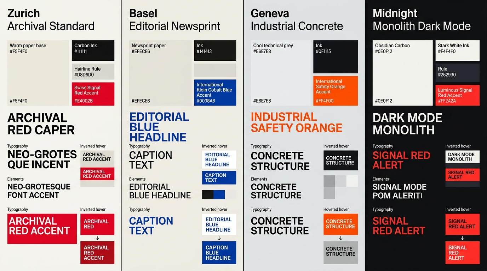

# Swiss Grid Design — Color Palettes, Signal Accents & Hard-Edge Inversion

## Color Palettes Decision Matrix

| Goal | Tool | Why |
| :--- | :--- | :--- |
| Prevent harsh eye strain on text-heavy magazine pages | Warm Archival Paper (`#F5F4F0` / `oklch(0.965 0.006 85)`) + Carbon Ink (`#111111` / `oklch(0.18 0.005 85)`) | Pure `#FFFFFF` paired with `#000000` creates halation (dazzle) during long-form reading; warm archival paper achieves $> 16:1$ AAA contrast with zero glare. |
| Establish unmistakable focal hierarchy | The Single Signal Accent Rule (`1` high-chroma OKLCH accent per view, e.g. Swiss Red `#E4002B`) | When $90\%$ of the interface is strictly paper-and-ink monochrome, a single surgical hit of Signal Red or Cobalt Blue commands immediate visual authority. |
| Communicate hover, selection, or featured cell status | Hard-edge polarity inversion (swap cell background to `--swiss-ink` or `--swiss-accent` and text to `--swiss-paper`) | Replaces soft opacity fades and drop shadows with bold, flat print-poster color blocking. |
| Support seamless Dark Mode editorial reading | `light-dark()` with Obsidian Carbon (`#0E0F12`) base and exposed `#262930` structural hairlines | Preserves the architectural grid skeleton in dark environments without blinding white border lines. |

---

## Visual Reference: The 4 Canonical Swiss Grid Color Palettes



> **Multimodal Agent Instruction:** View [`./images/swiss_grid_color_palettes.jpg`](./images/swiss_grid_color_palettes.jpg) before defining theme tokens to inspect the 4 canonical Swiss Grid palettes (*Zurich Archival Standard*, *Basel Editorial Newsprint*, *Geneva Industrial Concrete*, and *Midnight Monolith Dark Mode*) and their hard-edge hover inversions.

---

## The 90 / 10 Monochromatic + Single Signal Accent Law

In the International Typographic Style, color is **structural information**, never ornament:
- **90%+ of the viewport** must consist of the base **Paper** surface (`--swiss-paper`), secondary **Cell Tint** (`--swiss-paper-alt`), **Carbon Ink** typography/rules (`--swiss-ink`), and **Technical Grey** metadata (`--swiss-muted`).
- **$\le 10\%$ of the viewport** uses the **Signal Accent** (`--swiss-accent`): reserved strictly for primary CTAs, active navigation indicators, index numbers (`01`, `02`), hover-inverted rows, or critical status badges.
- **Never mix multiple decorative accent hues** (e.g., purple, teal, pink, and yellow cards on the same page). Pick **one** high-chroma signal color for the entire publication or view.

---

## The 4 Canonical Swiss Grid Palettes (OKLCH + Hex Equivalents)

```css
/* ==========================================================================
   1. ZURICH ARCHIVAL STANDARD (Default — Art Catalogs, Magazines & Design Systems)
   Paper: #F5F4F0 | Ink: #111111 | Rule: #D8D6D0 | Signal Accent: Swiss Red #E4002B
   ========================================================================== */
:root,
[data-swiss-theme="zurich"] {
  --swiss-paper: oklch(0.965 0.006 85);
  --swiss-paper-alt: oklch(0.93 0.008 85);
  --swiss-ink: oklch(0.18 0.005 85);
  --swiss-muted: oklch(0.46 0.008 85);
  --swiss-rule-subtle: oklch(0.86 0.008 85);
  --swiss-accent: oklch(0.56 0.24 27);          /* Swiss International Red */
  --swiss-accent-contrast: oklch(0.99 0 0);
}

/* ==========================================================================
   2. BASEL EDITORIAL NEWSPRINT (Essays, Literary Journals, Research Archives)
   Paper: #EFECE6 | Ink: #141413 | Rule: #CFCBC2 | Signal Accent: Klein Cobalt #0038A8
   ========================================================================== */
[data-swiss-theme="basel"] {
  --swiss-paper: oklch(0.945 0.010 82);
  --swiss-paper-alt: oklch(0.905 0.012 82);
  --swiss-ink: oklch(0.19 0.006 80);
  --swiss-muted: oklch(0.45 0.010 80);
  --swiss-rule-subtle: oklch(0.83 0.010 82);
  --swiss-accent: oklch(0.42 0.20 262);         /* International Klein Cobalt Blue */
  --swiss-accent-contrast: oklch(0.99 0 0);
}

/* ==========================================================================
   3. GENEVA INDUSTRIAL CONCRETE (Architecture, Engineering, Technical Docs)
   Paper: #E6E7E8 | Ink: #0F1115 | Rule: #C4C7CC | Signal Accent: Safety Orange #FF4F00
   ========================================================================== */
[data-swiss-theme="geneva"] {
  --swiss-paper: oklch(0.925 0.003 250);
  --swiss-paper-alt: oklch(0.885 0.005 250);
  --swiss-ink: oklch(0.17 0.008 255);
  --swiss-muted: oklch(0.44 0.010 255);
  --swiss-rule-subtle: oklch(0.81 0.006 250);
  --swiss-accent: oklch(0.64 0.23 38);          /* International Safety Orange */
  --swiss-accent-contrast: oklch(0.99 0 0);
}

/* ==========================================================================
   4. MIDNIGHT MONOLITH DARK MODE (Film, Photography, Developer & Night Editions)
   Paper: #0E0F12 | Ink: #F4F4F0 | Rule: #262930 | Signal Accent: Signal Red #FF2A2A
   ========================================================================== */
[data-swiss-theme="monolith"] {
  color-scheme: dark;
  --swiss-paper: oklch(0.16 0.008 260);
  --swiss-paper-alt: oklch(0.21 0.010 260);
  --swiss-ink: oklch(0.96 0.005 85);
  --swiss-muted: oklch(0.70 0.008 260);
  --swiss-rule-subtle: oklch(0.28 0.010 260);
  --swiss-accent: oklch(0.63 0.24 27);          /* Luminous Signal Red */
  --swiss-accent-contrast: oklch(0.99 0 0);
}
```

---

## Hard-Edge Polarity Inversion (Cell & Row States)

In Swiss Grid interfaces, interactive cards, archive rows, and buttons do **not** lift up with a drop shadow or fade to `opacity: 0.8` on hover. Instead, they execute a **hard-edge color polarity inversion**—flipping the entire grid cell to solid `--swiss-ink` or `--swiss-accent`:

```css
.swiss-interactive-cell {
  background-color: var(--swiss-paper);
  color: var(--swiss-ink);
  transition: background-color 120ms cubic-bezier(0.2, 0, 0, 1),
              color 120ms cubic-bezier(0.2, 0, 0, 1);
}

/* Monochrome Polarity Flip (Paper -> Carbon Ink) */
.swiss-interactive-cell:hover,
.swiss-interactive-cell:focus-visible {
  background-color: var(--swiss-ink);
  color: var(--swiss-paper);
}

/* Child metadata & index markers invert cleanly inside the hovered cell */
.swiss-interactive-cell:hover .swiss-meta {
  color: var(--swiss-paper);
}

.swiss-interactive-cell:hover .swiss-action-arrow {
  color: var(--swiss-accent);
  transform: translate(3px, -3px);
}
```

---

## Do Not

| BAD | GOOD | Why |
| :--- | :--- | :--- |
| Multi-color pastel gradients or blurred mesh backgrounds | Solid flat `--swiss-paper` (`#F5F4F0`) and `--swiss-ink` (`#111111`) color blocks | Gradients blur the geometric boundaries of the grid and violate the objective flatness of Swiss print architecture. |
| Assigning a different rainbow color to every category tag or card | Use `--swiss-ink` and `--swiss-paper` for $90\%$ of tags, reserving `--swiss-accent` for the single active/featured item | Multiple competing hues destroy the visual punch of the single Signal Accent. |
| Using pure `#FFFFFF` background with `#222` hairlines in Dark Mode | Use `--swiss-paper: oklch(0.16 0.008 260)` and `--swiss-rule-subtle: oklch(0.28 0.010 260)` in Dark Mode | High-contrast white grid lines across a dark screen create a distracting "spreadsheet cage" effect that overwhelms the typography. |
| Soft hover opacity fades (`opacity: 0.7`) on interactive cards | Full-cell hard-edge color inversion (`background-color: var(--swiss-ink); color: var(--swiss-paper)`) | Opacity fades make typography look washed out and disabled rather than decisively engaged. |
