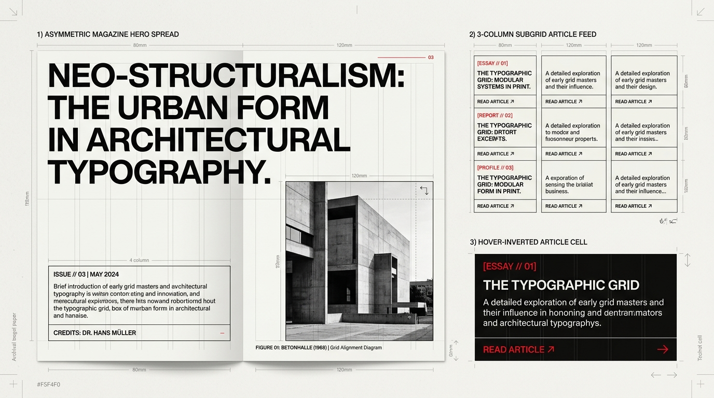

# Swiss Grid Design — Magazine Layouts, Asymmetric Spreads & Subgrid Cards

## Editorial Layout Decision Matrix

| Goal | Tool | Why |
| :--- | :--- | :--- |
| Asymmetric magazine hero spread | 12-column CSS Grid with `8-col` monumental headline + `4-col` metadata/whitespace counterweight | Rejects static centered hero banners in favor of dynamic architectural tension across the viewport. |
| Align internal card elements across adjacent columns | `grid-template-rows: subgrid` on `.swiss-article-card` spanning 4 row tracks | Guarantees that index tags, titles, excerpts, and bottom action rules align horizontally across sibling cards regardless of title length. |
| Frame editorial photography inside the grid | Zero-radius `<figure>` locked to grid tracks with `aspect-ratio`, `object-fit: cover`, and `1px` caption rule | Treats photography as an objective structural module locked into the same mathematical rhythm as the text. |
| Responsive broadsheet-to-mobile adaptation | Collapse 12-column tracks at breakpoints while preserving `1px` horizontal structural rules | Maintains the unmistakable Swiss editorial identity on narrow screens without squishing multi-column text. |

---

## Visual Reference: Magazine Hero Spreads & Subgrid Article Feeds



> **Multimodal Agent Instruction:** View [`./images/swiss_grid_editorial_layout.jpg`](./images/swiss_grid_editorial_layout.jpg) to inspect the 3 core editorial layout patterns: (1) Asymmetric Magazine Hero Spread (8-column display headline + 4-column issue brief + framed monochrome architecture photograph), (2) 3-Column Subgrid Article Feed with horizontally locked rules, and (3) Hover-Inverted Article Cell.

---

## Pattern 1: Asymmetric Magazine Hero Spread

Never center a headline over a full-bleed darkened background image. In a Swiss Grid hero spread, typography and photography occupy **distinct, non-overlapping mathematical zones** separated by exposed `1px` hairlines and `4px` structural rules:

```html
<section class="swiss-hero-spread">
  <!-- Monumental 8-Column Display Zone -->
  <div class="swiss-hero-headline-cell">
    <span class="swiss-index-marker">[ ISSUE 03 // LEAD MONOGRAPH ]</span>
    <h1 class="swiss-display">Neo-Structuralism: The Urban Form in Typography.</h1>
  </div>

  <!-- 4-Column Counterweight / Issue Brief Cell -->
  <aside class="swiss-hero-brief-cell">
    <div class="swiss-meta">VOL. 14 — ZÜRICH / BASEL</div>
    <p class="swiss-lead">
      An objective investigation into modular proportions, architectural concrete, and multi-column broadsheet rhythm.
    </p>
    <div class="swiss-meta">CREDITS: DR. HANS MÜLLER</div>
  </aside>

  <!-- Asymmetric 4-Column Empty / Caption Counterweight + 8-Column Framed Plate -->
  <div class="swiss-hero-caption-cell">
    <span class="swiss-meta">FIG. 01 // BETONHALLE (1968)</span>
    <p>Orthogonal elevation photographed under diffuse northern light.</p>
  </div>

  <figure class="swiss-hero-plate-cell">
    
  </figure>
</section>
```

```css
.swiss-hero-spread {
  display: grid;
  grid-template-columns: repeat(12, minmax(0, 1fr));
  gap: 1px;
  background-color: var(--swiss-ink);
  border: 1px solid var(--swiss-ink);
  border-block-start: var(--swiss-border-monolith);
  max-inline-size: var(--swiss-max-inline);
  margin-inline: auto;
}

.swiss-hero-headline-cell {
  grid-column: 1 / span 8;
  background-color: var(--swiss-paper);
  padding: var(--swiss-cell-pad);
  display: flex;
  flex-direction: column;
  gap: 1.5rem;
}

.swiss-hero-brief-cell {
  grid-column: 9 / span 4;
  background-color: var(--swiss-paper);
  padding: var(--swiss-cell-pad);
  display: flex;
  flex-direction: column;
  justify-content: space-between;
}

.swiss-hero-caption-cell {
  grid-column: 1 / span 4;
  background-color: var(--swiss-paper);
  padding: var(--swiss-cell-pad);
  display: flex;
  flex-direction: column;
  justify-content: flex-end;
  font-size: 0.875rem;
  color: var(--swiss-muted);
}

.swiss-hero-plate-cell {
  grid-column: 5 / span 8;
  margin: 0;
  background-color: var(--swiss-ink);
  aspect-ratio: 16 / 9;
  overflow: hidden;
}

.swiss-hero-plate-cell img {
  inline-size: 100%;
  block-size: 100%;
  object-fit: cover;
  display: block;
  filter: grayscale(100%) contrast(1.08);
}
```

---

## Pattern 2: Cross-Aligned Editorial Feed with CSS `subgrid`

In a multi-column magazine feed, if Card 1 has a two-line title and Card 2 has a four-line title, standard flexbox cards let the body text and footer rules drift out of horizontal alignment.

Use **`grid-template-rows: subgrid`** so every card's index badge, headline, excerpt, and bottom action bar lock to the exact same horizontal row tracks across the entire row:

```html
<section class="swiss-article-feed">
  <article class="swiss-article-card">
    <div class="swiss-card-meta">[ ESSAY // 01 ]</div>
    <h2 class="swiss-card-title">The Typographic Grid: Modular Systems in Print</h2>
    <p class="swiss-card-excerpt">A detailed exploration of early grid masters and their lasting influence on digital layout engines.</p>
    <a href="/essays/01" class="swiss-card-Link">
      <span>READ ARTICLE</span>
      <span aria-hidden="true">↗</span>
    </a>
  </article>
  <!-- Repeat sibling .swiss-article-card items -->
</section>
```

```css
.swiss-article-feed {
  display: grid;
  grid-template-columns: repeat(auto-fit, minmax(min(100%, 320px), 1fr));
  /* 4 explicit row tracks per card row: Meta, Title, Excerpt, Action Footer */
  grid-auto-rows: auto auto 1fr auto;
  gap: 1px;
  background-color: var(--swiss-ink);
  border: 1px solid var(--swiss-ink);
}

.swiss-article-card {
  grid-row: span 4;
  display: grid;
  grid-template-rows: subgrid;
  gap: 0;
  background-color: var(--swiss-paper);
  color: var(--swiss-ink);
  transition: background-color 120ms ease, color 120ms ease;
}

.swiss-card-meta {
  padding-block-start: 1.5rem;
  padding-inline: 1.5rem;
  font-family: var(--swiss-font-mono);
  font-size: 0.75rem;
  font-weight: 700;
  color: var(--swiss-accent);
}

.swiss-card-title {
  padding-block-start: 0.75rem;
  padding-inline: 1.5rem;
  font-size: 1.35rem;
  font-weight: 700;
  line-height: 1.12;
  letter-spacing: -0.02em;
  margin: 0;
}

.swiss-card-excerpt {
  padding-block: 1rem 1.5rem;
  padding-inline: 1.5rem;
  font-size: 0.95rem;
  line-height: 1.55;
  color: var(--swiss-muted);
  margin: 0;
}

/* Exposed 1px top border locks the action bar across all sibling cards */
.swiss-card-link {
  display: flex;
  align-items: center;
  justify-content: space-between;
  padding-block: 0.875rem;
  padding-inline: 1.5rem;
  border-block-start: 1px solid var(--swiss-ink);
  font-family: var(--swiss-font-mono);
  font-size: 0.75rem;
  font-weight: 700;
  letter-spacing: 0.08em;
  text-decoration: none;
  color: inherit;
}

/* Full-Cell Hard-Edge Inversion on Hover */
.swiss-article-card:hover {
  background-color: var(--swiss-ink);
  color: var(--swiss-paper);
}

.swiss-article-card:hover .swiss-card-excerpt {
  color: oklch(from var(--swiss-paper) l c h / 0.8);
}

.swiss-article-card:hover .swiss-card-link {
  border-block-start-color: oklch(from var(--swiss-paper) l c h / 0.25);
  color: var(--swiss-accent);
}
```

---

## Do Not

| BAD | GOOD | Why |
| :--- | :--- | :--- |
| Floating cards with `margin: 16px`, `border-radius: 12px`, and `box-shadow` | Contiguous `gap: 1px` hairline cells sharing structural borders | Floating rounded cards belong to Material/SaaS dashboard design; Swiss editorial layouts partition the canvas itself into contiguous modules. |
| Placing white text directly over busy, unframed background photos | Place headlines in a dedicated `--swiss-paper` grid cell adjacent to the framed `<figure>` | Overlaying text on photography compromises legibility and hides the underlying grid structure. |
| Allowing card footers and horizontal rules to stagger at different vertical heights | Use `grid-row: span 4; grid-template-rows: subgrid;` | Misaligned horizontal rules across adjacent columns break the cross-column continuity of a Swiss grid. |
