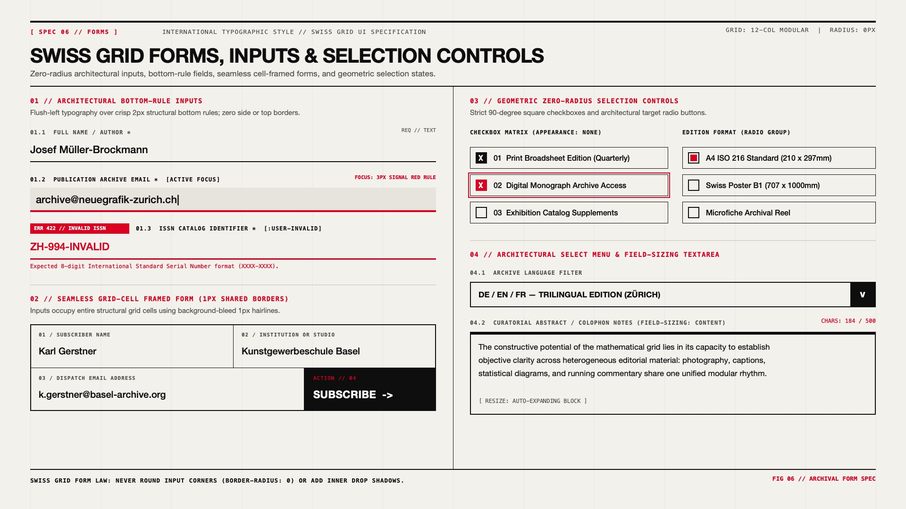

# Swiss Grid Design — Architectural Forms, Inputs & Selection Controls

## Forms & Inputs Decision Matrix

| Goal | Tool | Why |
| :--- | :--- | :--- |
| Editorial form fields & search inputs | Architectural Bottom-Rule Input (`border: none; border-block-end: 2px solid var(--swiss-ink)`) | Echoes physical archival index cards and ledger forms where text sits cleanly atop a ruled baseline. |
| Compact multi-field subscription / checkout grids | Seamless Grid-Cell Framed Inputs (`gap: 1px; background-color: var(--swiss-ink)`) | Integrates inputs and submit buttons directly into the exposed structural grid without external margin gaps. |
| Unambiguous field labeling | Numbered Uppercase Monospace Label (`01 // FULL NAME *`) above the input | Replaces floating-label animations with permanent, high-contrast catalog numbering. |
| Form validation (`:user-invalid`) | `3px` solid `--swiss-accent` bottom rule + inverted red error code badge (`[ERR 422 // INVALID]`) | Communicates validation errors through structural rule thickness and typographic badges rather than blurry red glows. |
| Checkboxes and radio buttons | `appearance: none` zero-radius square (`24px x 24px`) with stark `X` or solid square inner mark | Maintains strict $90^\circ$ orthogonality across all selection controls. |

---

## Visual Reference: Swiss Grid Forms, Inputs & Selection Controls



> **Multimodal Agent Instruction:** View [`./images/swiss_grid_forms_and_inputs.jpg`](./images/swiss_grid_forms_and_inputs.jpg) to inspect the 4 canonical Swiss form patterns: (01) Architectural Bottom-Rule Inputs (Default, Active Focus, `:user-invalid`), (02) Seamless Grid-Cell Framed Form, (03) Geometric Zero-Radius Checkboxes & Radios, and (04) Architectural Select & `field-sizing: content` Textarea.

---

## Pattern 1: Architectural Bottom-Rule Inputs

Strip the default browser 4-sided box and replace it with a **heavy `2px` bottom structural rule** paired with a numbered monospace catalog label:

```html
<div class="swiss-field">
  <div class="swiss-field-header">
    <label for="author-name" class="swiss-label">01.1 // FULL NAME / AUTHOR *</label>
    <span class="swiss-field-spec">REQ // TEXT</span>
  </div>
  <input
    id="author-name"
    type="text"
    class="swiss-input-ruled"
    placeholder="Enter full name..."
    required
  />
</div>
```

```css
.swiss-field {
  display: flex;
  flex-direction: column;
  gap: 0.375rem;
}

.swiss-field-header {
  display: flex;
  align-items: baseline;
  justify-content: space-between;
  gap: 1rem;
}

.swiss-label {
  font-family: var(--swiss-font-mono);
  font-size: 0.75rem;
  font-weight: 700;
  letter-spacing: 0.08em;
  text-transform: uppercase;
  color: var(--swiss-muted);
}

.swiss-field-spec {
  font-family: var(--swiss-font-mono);
  font-size: 0.6875rem;
  color: var(--swiss-muted);
}

.swiss-input-ruled {
  inline-size: 100%;
  padding-block: 0.625rem;
  padding-inline: 0;
  border: none;
  border-block-end: 2px solid var(--swiss-ink);
  border-radius: 0;
  background-color: transparent;
  color: var(--swiss-ink);
  font-family: var(--swiss-font-sans);
  font-size: 1.25rem;
  font-weight: 500;
  transition: border-color 120ms ease, background-color 120ms ease, padding-inline 120ms ease;
}

/* Focus State: Subtle paper tint + 4px Signal Red bottom rule */
.swiss-input-ruled:focus-visible {
  outline: none;
  background-color: var(--swiss-paper-alt);
  padding-inline: 0.75rem;
  border-block-end: 4px solid var(--swiss-accent);
}

/* User-Invalid State: High-contrast Signal Red rule + text */
.swiss-input-ruled:user-invalid {
  border-block-end: 3px solid var(--swiss-accent);
  color: var(--swiss-accent);
}
```

---

## Pattern 2: Seamless Grid-Cell Framed Form

For newsletter dispatches, archive filters, or contact modules, house each `<label>` + `<input>` inside its own exposed `1px` grid cell, with the submit `<button>` occupying the final cell in solid `--swiss-ink`:

```html
<form class="swiss-cell-form">
  <label class="swiss-form-cell">
    <span class="swiss-label">01 / SUBSCRIBER NAME</span>
    <input type="text" class="swiss-cell-input" placeholder="Karl Gerstner" required />
  </label>

  <label class="swiss-form-cell">
    <span class="swiss-label">02 / INSTITUTION OR STUDIO</span>
    <input type="text" class="swiss-cell-input" placeholder="Kunstgewerbeschule Basel" />
  </label>

  <label class="swiss-form-cell swiss-form-cell-wide">
    <span class="swiss-label">03 / DISPATCH EMAIL ADDRESS</span>
    <input type="email" class="swiss-cell-input" placeholder="k.gerstner@basel-archive.org" required />
  </label>

  <button type="submit" class="swiss-form-submit-cell">
    <span class="swiss-meta">ACTION // 04</span>
    <span class="swiss-submit-text">SUBSCRIBE →</span>
  </button>
</form>
```

```css
.swiss-cell-form {
  display: grid;
  grid-template-columns: repeat(12, minmax(0, 1fr));
  gap: 1px;
  background-color: var(--swiss-ink);
  border: 2px solid var(--swiss-ink);
}

.swiss-form-cell {
  grid-column: span 6;
  background-color: var(--swiss-paper);
  padding-block: 1rem;
  padding-inline: 1.25rem;
  display: flex;
  flex-direction: column;
  gap: 0.5rem;
  cursor: text;
}

.swiss-form-cell-wide {
  grid-column: span 8;
}

.swiss-form-cell:focus-within {
  background-color: var(--swiss-paper-alt);
  box-shadow: inset 0 -4px 0 var(--swiss-accent);
}

.swiss-cell-input {
  border: none;
  background: transparent;
  color: var(--swiss-ink);
  font-family: var(--swiss-font-sans);
  font-size: 1.125rem;
  font-weight: 500;
  padding: 0;
  outline: none;
}

.swiss-form-submit-cell {
  grid-column: span 4;
  border: none;
  border-radius: 0;
  background-color: var(--swiss-ink);
  color: var(--swiss-paper);
  padding-block: 1rem;
  padding-inline: 1.5rem;
  display: flex;
  flex-direction: column;
  align-items: flex-start;
  justify-content: space-between;
  cursor: pointer;
  transition: background-color 120ms ease;
}

.swiss-form-submit-cell:hover {
  background-color: var(--swiss-accent);
}
```

---

## Pattern 3: Zero-Radius Geometric Checkboxes & Radios

Even radio buttons in strict Swiss editorial matrices often adopt a **nested concentric square** (or sharp target), while checkboxes use a `2px` square frame that fills with `--swiss-ink` and a stark typographic `✕` when checked:

```css
:where(.swiss-checkbox, .swiss-radio) {
  appearance: none;
  display: inline-grid;
  place-content: center;
  inline-size: 1.5rem;
  block-size: 1.5rem;
  margin: 0;
  border: 2px solid var(--swiss-ink);
  border-radius: 0; /* Strict 90-degree square */
  background-color: var(--swiss-paper);
  cursor: pointer;
}

.swiss-checkbox:checked {
  background-color: var(--swiss-ink);
}

.swiss-checkbox:checked::before {
  content: "✕";
  font-family: var(--swiss-font-mono);
  font-size: 0.875rem;
  font-weight: 700;
  color: var(--swiss-paper);
  line-height: 1;
}

.swiss-radio::before {
  content: "";
  inline-size: 0.75rem;
  block-size: 0.75rem;
  background-color: var(--swiss-accent);
  transform: scale(0);
  transition: transform 100ms ease;
}

.swiss-radio:checked::before {
  transform: scale(1);
}

:where(.swiss-checkbox, .swiss-radio):focus-visible {
  outline: 3px solid var(--swiss-accent);
  outline-offset: 3px;
}
```

---

## Do Not

| BAD | GOOD | Why |
| :--- | :--- | :--- |
| Rounded input boxes (`border-radius: 8px; border: 1px solid #ccc`) with floating material labels | Use permanent numbered monospace labels (`01 // EMAIL`) above a `2px` bottom rule or `1px` grid cell | Floating labels obscure the structural grid rhythm and belong to Material Design, not Swiss editorial style. |
| Blurred glowing red box-shadows (`box-shadow: 0 0 8px red`) on invalid inputs | Use a `3px solid var(--swiss-accent)` bottom rule and an inverted `[ERR // INVALID]` monospace badge | Blurry glows violate the razor-sharp ink-on-paper physics of Swiss typography. |
| Fixed-height `<textarea>` with internal scrollbars | Use `field-sizing: content` with a `6px` top structural bar | Allows editorial comment and abstract boxes to expand in clean vertical increments with the user's text. |
