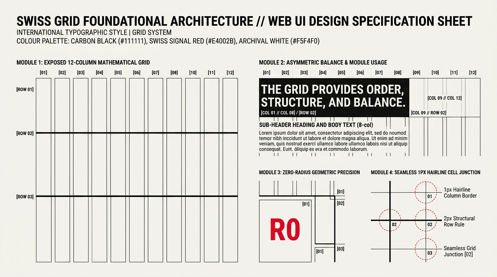

# Swiss Grid Design — Foundations, Exposed Architecture & Tokens

## Foundations Decision Matrix

| Goal | Tool | Why |
| :--- | :--- | :--- |
| Establish mathematical macro-structure | 12-column CSS Grid (`repeat(12, minmax(0, 1fr))`) with strict modular baseline | Grounds asymmetric editorial compositions in an objective, proportional coordinate system pioneered by Josef Müller-Brockmann and Karl Gerstner. |
| Render seamless exposed `1px` grid hairlines | Parent `background-color: var(--swiss-rule)` + `gap: 1px` with child `background-color: var(--swiss-paper)` | Eliminates the classic "double 2px border" bug where adjacent CSS `border: 1px solid` cells touch. |
| Anchor major horizontal editorial sections | Heavy structural rules (`border-block-start: 2px solid` or `4px solid var(--swiss-ink)`) | Creates unambiguous visual hierarchy between mastheads, lead essays, and archive feeds without drop shadows. |
| Enforce geometric precision | Global zero-radius token (`--swiss-radius: 0px`) | Rounded corners soften architectural tension; strict $90^\circ$ intersections lock typography and photography to the grid wireframe. |
| Create dynamic asymmetric balance | Deliberate empty structural cells (`25%–35%` open canvas allocation) + coordinate markers | Contrasts dense multi-column text blocks against open archival paper so text-heavy pages never feel cramped. |

---

## Visual Reference: Swiss Grid Foundational Architecture



> **Multimodal Agent Instruction:** View [`./images/swiss_grid_foundations.jpg`](./images/swiss_grid_foundations.jpg) before constructing a Swiss Grid layout to inspect the 12-column mathematical skeleton, asymmetric 8-col/4-col module weighting, zero-radius $90^\circ$ cell intersections, and `1px` hairline vs `2px–4px` structural row rules.

---

## Core Philosophy: Structure as the Ornament

The **International Typographic Style (Swiss Grid)** rejects decorative gradients, drop shadows, blurred glass, and skeuomorphic embellishments. Visual drama is generated entirely through four objective mechanisms:
1. **Exposed Mathematical Grid Lines:** The structural wireframe (`1px` cell hairlines and `2px–4px` section rules) remains visible as the primary graphic device.
2. **Asymmetric Equilibrium:** Rather than centering elements symmetrically down the middle of the viewport, weight is distributed asymmetrically across column tracks (e.g., an 8-column headline balanced against a 4-column empty or metadata cell).
3. **Extreme Scale & Weight Contrast:** Monumental Neo-Grotesque display typography (`clamp(3rem, 7vw, 6.5rem)`) sits directly adjacent to crisp `0.75rem` uppercase monospace coordinate labels (`[COL 01 // ROW 02]`).
4. **Zero-Radius Orthogonality:** Every container, image frame, button, input, and focus ring uses `border-radius: 0`.

---

## Core Design Token Architecture

Define all structural rules, typographic stacks, and modular spacing tokens on `:root`:

```css
:root {
  color-scheme: light dark;

  /* 1. Archival Paper & Carbon Ink Foundation (OKLCH) */
  --swiss-paper: light-dark(oklch(0.965 0.006 85), oklch(0.16 0.008 260));
  --swiss-paper-alt: light-dark(oklch(0.93 0.008 85), oklch(0.21 0.010 260));
  --swiss-ink: light-dark(oklch(0.18 0.005 85), oklch(0.96 0.005 85));
  --swiss-muted: light-dark(oklch(0.46 0.008 85), oklch(0.70 0.008 260));

  /* 2. Exposed Structural Rule Tokens */
  --swiss-rule-subtle: light-dark(oklch(0.84 0.008 85), oklch(0.28 0.010 260));
  --swiss-rule-strong: var(--swiss-ink);

  /* 3. Primary Signal Accent (Swiss International Red) */
  --swiss-accent: light-dark(oklch(0.56 0.24 27), oklch(0.64 0.23 27));
  --swiss-accent-contrast: oklch(0.99 0 0);

  /* 4. Typography Stacks */
  --swiss-font-sans: "Inter", "Helvetica Neue", "Neue Haas Grotesk", "Arial", system-ui, sans-serif;
  --swiss-font-mono: "JetBrains Mono", "IBM Plex Mono", "SFMono-Regular", ui-monospace, monospace;

  /* 5. Mathematical Grid & Rule Thickness Tokens */
  --swiss-columns: 12;
  --swiss-max-inline: 90rem; /* 1440px broadsheet max width */
  --swiss-gutter: clamp(1rem, 2vw, 1.5rem);
  --swiss-cell-pad: clamp(1.25rem, 2.5vw, 2rem);
  --swiss-border-hairline: 1px solid var(--swiss-rule-strong);
  --swiss-border-heavy: 2px solid var(--swiss-rule-strong);
  --swiss-border-monolith: 4px solid var(--swiss-rule-strong);
  --swiss-radius: 0px; /* Strict orthogonality */
}
```

---

## The Seamless `1px` Exposed Hairline Grid Technique

When building an exposed Swiss grid where every cell is framed by a `1px` border, applying `border: 1px solid var(--swiss-ink)` to every child creates **doubled `2px` internal seams** where adjacent cells meet.

Solve this natively using the **Background-Bleed Hairline Pattern**:
1. Set the grid container's `background-color` to `--swiss-ink` (or `--swiss-rule-subtle`).
2. Set `gap: 1px` on the grid container and `border: 1px solid var(--swiss-ink)` on the outer perimeter.
3. Give every direct child cell `background-color: var(--swiss-paper)`. Every vertical and horizontal junction is now guaranteed to be a razor-sharp `1px` seam:

```css
.swiss-hairline-grid {
  display: grid;
  grid-template-columns: repeat(var(--swiss-columns), minmax(0, 1fr));
  /* 1px gap reveals the container's ink background as seamless cell hairlines */
  gap: 1px;
  background-color: var(--swiss-ink);
  border: 1px solid var(--swiss-ink);
  max-inline-size: var(--swiss-max-inline);
  margin-inline: auto;
}

.swiss-cell {
  background-color: var(--swiss-paper);
  padding-block: var(--swiss-cell-pad);
  padding-inline: var(--swiss-cell-pad);
  min-inline-size: 0;
  display: flex;
  flex-direction: column;
  justify-content: space-between;
}
```

---

## Structural Coordinate & Index Markers

Authentic Swiss editorial interfaces label grid modules with technical index markers (e.g., `[01 // ESSAY]`, `[FIG. 04]`, `COL 01—08`). Style these with `--swiss-font-mono`, uppercase lettering, and `tabular-nums`:

```css
.swiss-index-marker {
  font-family: var(--swiss-font-mono);
  font-size: 0.75rem;
  font-weight: 700;
  letter-spacing: 0.08em;
  text-transform: uppercase;
  font-variant-numeric: tabular-nums;
  color: var(--swiss-accent);
  display: inline-flex;
  align-items: center;
  gap: 0.5rem;
}
```

---

## Do Not

| BAD | GOOD | Why |
| :--- | :--- | :--- |
| Adding `border-radius: 8px` or `12px` to cards, buttons, or images | Enforce `border-radius: 0` (`--swiss-radius: 0px`) across all elements | Rounded corners destroy the orthogonal architectural tension where cell borders intersect at $90^\circ$. |
| Adding `box-shadow: 0 10px 25px rgba(0,0,0,0.1)` to elevate cards | Use exposed `1px` perimeter hairlines, `2px–4px` top rules, or solid color inversion | Swiss design is strictly 2D and anti-skeuomorphic; depth is communicated through scale and proportion, never artificial lighting shadows. |
| Applying `border: 1px solid #111` to adjacent sibling grid items | Use `gap: 1px; background-color: var(--swiss-ink)` on the parent grid and `background-color: var(--swiss-paper)` on children | Adjacent `1px` borders collide to form uneven `2px` interior lines while leaving `1px` outer edges. |
| Filling 100% of grid cells with dense content | Reserve `25%–35%` of grid cells as deliberate open archival paper whitespace | In Swiss design, empty grid cells are active structural counterweights that give monumental typography room to breathe. |
