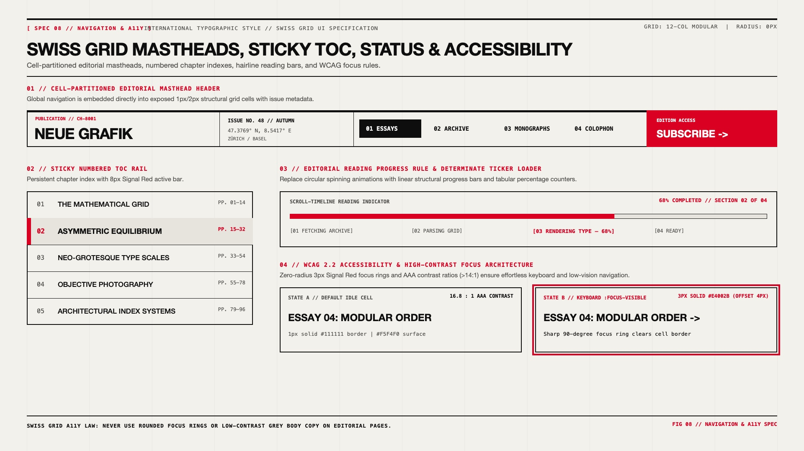

# Swiss Grid Design — Mastheads, Sticky TOCs, Status Tickers & Accessibility

## Navigation & Status Decision Matrix

| Goal | Tool | Why |
| :--- | :--- | :--- |
| Global publication / site header | Cell-Partitioned Editorial Masthead (`border-block-start: 4px solid var(--swiss-ink)`) | Integrates brand identity, issue metadata/coordinates, navigation links, and primary CTA into a single unified architectural grid bar. |
| Long-form essay / documentation navigation | Sticky Left-Rail Table of Contents (`position: sticky`) with `8px` Signal Red active bar | Keeps the reader oriented within the document's structural hierarchy without floating overlays. |
| Article reading progress / determinate loading | Linear Structural Rule Progress Bar (`scroll()` timeline or determinate `%` bar) + tabular counter | Replaces circular spinning loaders (which clash with orthogonal grids) with a horizontal hairline fill and exact percentage readout. |
| WCAG 2.2 keyboard & low-vision compliance | Zero-radius `3px solid var(--swiss-accent)` focus ring (`outline-offset: 4px`) + $> 14:1$ AAA contrast | Preserves strict $90^\circ$ geometric harmony while exceeding every WCAG 2.2 focus visibility and contrast threshold. |

---

## Visual Reference: Mastheads, Sticky TOCs, Progress Rules & WCAG Focus



> **Multimodal Agent Instruction:** View [`./images/swiss_grid_navigation_and_status.jpg`](./images/swiss_grid_navigation_and_status.jpg) to inspect the 4 canonical navigation and status patterns: (01) Cell-Partitioned Editorial Masthead Header, (02) Sticky Numbered TOC Rail, (03) Scroll-Timeline Reading Progress Rule & Step Ticker, and (04) WCAG 2.2 Zero-Radius Focus Architecture.

---

## 1. Cell-Partitioned Editorial Masthead Header

A Swiss Grid header is never a floating transparent navbar. It is a **structural masthead** partitioned into bordered cells housing the publication wordmark, issue/location metadata (`VOL. 48 // ZÜRICH`), numbered navigation links (`01 ESSAYS`, `02 ARCHIVE`), and a full-bleed Signal Red subscription cell:

```html
<header class="swiss-masthead">
  <div class="swiss-masthead-brand">
    <span class="swiss-index-marker">PUBLICATION // CH-8001</span>
    <a href="/" class="swiss-wordmark">NEUE GRAFIK</a>
  </div>

  <div class="swiss-masthead-meta">
    <strong>ISSUE NO. 48 // AUTUMN</strong>
    <span>47.3769° N, 8.5417° E — ZÜRICH</span>
  </div>

  <nav class="swiss-masthead-nav" aria-label="Primary">
    <a href="/essays" aria-current="page">01 ESSAYS</a>
    <a href="/archive">02 ARCHIVE</a>
    <a href="/monographs">03 MONOGRAPHS</a>
    <a href="/colophon">04 COLOPHON</a>
  </nav>

  <a href="/subscribe" class="swiss-masthead-cta">
    <span class="swiss-meta">EDITION ACCESS</span>
    <strong>SUBSCRIBE →</strong>
  </a>
</header>
```

```css
.swiss-masthead {
  display: grid;
  grid-template-columns: minmax(220px, 2fr) minmax(180px, 1.5fr) 4fr minmax(180px, 1.5fr);
  gap: 1px;
  background-color: var(--swiss-ink);
  border: 2px solid var(--swiss-ink);
  border-block-start: 5px solid var(--swiss-ink);
}

.swiss-masthead > * {
  background-color: var(--swiss-paper);
  padding-block: 1rem;
  padding-inline: 1.25rem;
}

.swiss-wordmark {
  display: block;
  font-family: var(--swiss-font-sans);
  font-size: 1.75rem;
  font-weight: 800;
  letter-spacing: -0.03em;
  text-decoration: none;
  color: var(--swiss-ink);
}

.swiss-masthead-meta {
  display: flex;
  flex-direction: column;
  justify-content: center;
  gap: 0.25rem;
  font-family: var(--swiss-font-mono);
  font-size: 0.75rem;
  color: var(--swiss-muted);
}

.swiss-masthead-meta strong {
  color: var(--swiss-ink);
}

.swiss-masthead-nav {
  display: flex;
  align-items: center;
  flex-wrap: wrap;
  gap: 0.5rem;
}

.swiss-masthead-nav a {
  padding-block: 0.5rem;
  padding-inline: 0.875rem;
  font-family: var(--swiss-font-mono);
  font-size: 0.8125rem;
  font-weight: 700;
  text-decoration: none;
  color: var(--swiss-ink);
}

.swiss-masthead-nav a[aria-current="page"],
.swiss-masthead-nav a:hover {
  background-color: var(--swiss-ink);
  color: var(--swiss-paper);
}

.swiss-masthead-cta {
  background-color: var(--swiss-accent);
  color: var(--swiss-accent-contrast);
  text-decoration: none;
  display: flex;
  flex-direction: column;
  justify-content: center;
}

.swiss-masthead-cta .swiss-meta {
  color: var(--swiss-accent-contrast);
}
```

---

## 2. Sticky Numbered Table of Contents (TOC) Rail

For long-form magazine articles and documentation, house the chapter list inside a `2px` bordered stack where the active chapter (`[aria-current="location"]`) displays an `8px` solid Signal Red inline-start bar:

```css
.swiss-toc {
  position: sticky;
  inset-block-start: 2rem;
  border: 2px solid var(--swiss-ink);
  background-color: var(--swiss-ink);
  display: flex;
  flex-direction: column;
  gap: 1px;
}

.swiss-toc-link {
  display: grid;
  grid-template-columns: 2.5rem 1fr auto;
  align-items: center;
  padding-block: 1rem;
  padding-inline: 1.125rem;
  background-color: var(--swiss-paper);
  color: var(--swiss-ink);
  text-decoration: none;
  font-weight: 600;
  font-size: 0.9375rem;
}

.swiss-toc-link[aria-current="location"] {
  background-color: var(--swiss-paper-alt);
  box-shadow: inset 8px 0 0 var(--swiss-accent);
  font-weight: 700;
}
```

---

## 3. Scroll-Driven Reading Progress Rule & Technical Step Ticker

Spinning circular loaders look out of place in an orthogonal Swiss Grid. Use a **linear structural progress rule** (driven either by `animation-timeline: scroll()` for reading progress or a `--progress` percentage for async tasks) paired with a monospace step ticker:

```css
/* Native CSS Scroll-Driven Reading Progress Bar */
.swiss-reading-bar {
  position: fixed;
  inset-block-start: 0;
  inset-inline: 0;
  block-size: 4px;
  background-color: var(--swiss-accent);
  transform-origin: 0 50%;
  animation: swiss-scroll-progress linear;
  animation-timeline: scroll(root block);
  z-index: 100;
}

@keyframes swiss-scroll-progress {
  from {
    transform: scaleX(0);
  }
  to {
    transform: scaleX(1);
  }
}
```

---

## 4. WCAG 2.2 Accessibility Rules for Swiss Grid UIs

Because Swiss Grid relies on high-contrast ink-on-paper monochromes and explicit `1px–2px` borders, it is naturally one of the most accessible design systems when these three rules are upheld:

1. **Zero-Radius Offset Focus Rings:** Never use browser-default rounded focus rings. Apply a sharp `3px solid var(--swiss-accent)` outline with `outline-offset: 4px` so keyboard focus frames the grid cell cleanly:
   ```css
   :where(a, button, input, select, textarea, [tabindex]):focus-visible {
     outline: 3px solid var(--swiss-accent);
     outline-offset: 4px;
     border-radius: 0;
   }
   ```
2. **Preserve Semantic Heading Hierarchy Despite Visual Scale:** In Swiss editorial layouts, a small `12px` monospace label (`[ISSUE 03 // LEAD ESSAY]`) often sits visually above a `96px` headline. Never make the `12px` label an `<h1>` and the `96px` headline an `<h2>`—wrap them in `<header>` or keep the `96px` title as the semantic `<h1>`.
3. **Honor `prefers-reduced-motion` on Hard-Edge Sweeps:** If using sliding background wipes (`transform: scaleX()`) on row hovers, disable the slide transition inside `@media (prefers-reduced-motion: reduce)` so color inversions happen instantaneously.

---

## Do Not

| BAD | GOOD | Why |
| :--- | :--- | :--- |
| Using spinning circular SVG/border loaders (`border-radius: 50%`) | Use a linear structural progress bar and a tabular monospace percentage counter (`[ 68% LOADED ]`) | Circular spinners break the strict $90^\circ$ orthogonal geometry of a Swiss grid. |
| Floating blurred glass (`backdrop-filter: blur(12px)`) sticky headers | Use a solid `--swiss-paper` masthead framed by a `2px solid var(--swiss-ink)` bottom rule | Frosted glass blurs the underlying typography and grid hairlines into unreadable smudges. |
| Using `<h1>`, `<h2>`, `<h3>` tags purely for visual font sizing | Decouple semantic heading levels (`<h1>`–`<h6>`) from visual scale classes (`.swiss-display`, `.swiss-meta`) | Screen reader users rely on a logical document outline to navigate long-form magazine articles. |
