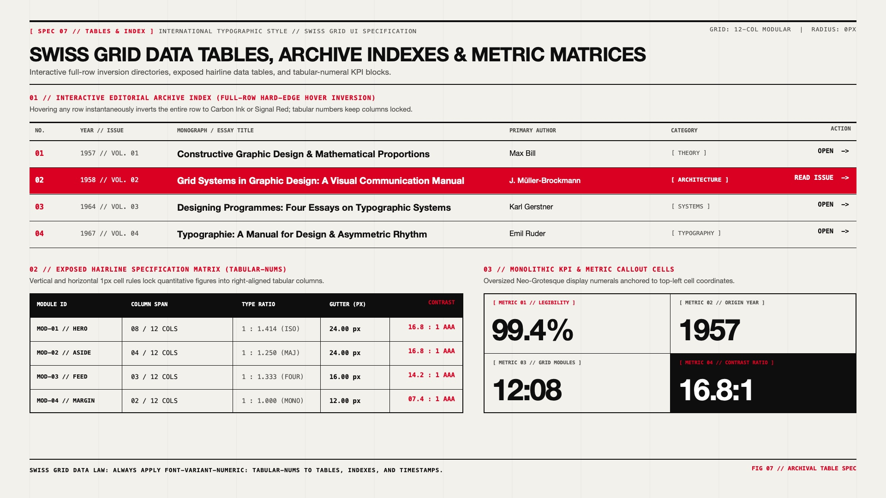

# Swiss Grid Design — Data Tables, Archive Indexes & KPI Matrices

## Tables & Indexes Decision Matrix

| Goal | Tool | Why |
| :--- | :--- | :--- |
| Magazine issue / article archive directory | Interactive Row-Inversion Index (`border-block-end: 1px solid`) that flips to `--swiss-accent` on `:hover` | Turns a text-heavy table of contents into a bold, scannable, poster-like interactive directory. |
| Quantitative data & technical specifications | Exposed `1px` vertical & horizontal cell rules + `font-variant-numeric: tabular-nums` | Locks decimal points, units, and serial codes into strict vertical alignment across hundreds of rows. |
| Key performance metrics / historical dates | Monolithic KPI Callout Cells (`clamp(2.5rem, 5vw, 4.5rem)` bold figures + top-left `[METRIC 01]` coordinate) | Uses extreme typographic scale contrast inside bordered grid cells instead of decorative circular gauges or sparkline clutter. |
| Responsive wide tables on narrow screens | Horizontal scroll container with sticky first index column (`position: sticky; inset-inline-start: 0`) | Preserves the tabular grid geometry on mobile without breaking row alignment. |

---

## Visual Reference: Archive Indexes, Specification Matrices & KPI Cells



> **Multimodal Agent Instruction:** View [`./images/swiss_grid_tables_and_index.jpg`](./images/swiss_grid_tables_and_index.jpg) to inspect the 3 core tabular data patterns: (01) Interactive Editorial Archive Index with full-row Signal Red hover inversion, (02) Exposed Hairline Specification Matrix with `tabular-nums`, and (03) Monolithic KPI Callout Cells.

---

## Pattern 1: Interactive Editorial Archive Index (Full-Row Inversion)

A signature hallmark of modern Swiss editorial websites (museum catalogs, architecture portfolios, journal archives) is the **Full-Row Hover Inversion Index**. Each row is divided into aligned columns (`NO.`, `YEAR // ISSUE`, `TITLE`, `AUTHOR`, `CATEGORY`, `ACTION`) separated by `1px` horizontal rules. Hovering anywhere on the row instantaneously flips the row background to `--swiss-accent` (or `--swiss-ink`) and text to `--swiss-paper`:

```html
<div class="swiss-archive-index" role="region" aria-label="Publication Archive">
  <div class="swiss-archive-header" aria-hidden="true">
    <span>NO.</span>
    <span>YEAR // VOL</span>
    <span>MONOGRAPH / ESSAY TITLE</span>
    <span>PRIMARY AUTHOR</span>
    <span>CATEGORY</span>
    <span class="swiss-align-end">ACTION</span>
  </div>

  <a href="/archive/vol-02" class="swiss-archive-row">
    <span class="swiss-row-num">02</span>
    <span class="swiss-row-meta">1958 // VOL. 02</span>
    <strong class="swiss-row-title">Grid Systems in Graphic Design: A Visual Communication Manual</strong>
    <span class="swiss-row-author">J. Müller-Brockmann</span>
    <span class="swiss-row-tag">[ ARCHITECTURE ]</span>
    <span class="swiss-row-action swiss-align-end">READ ISSUE →</span>
  </a>
</div>
```

```css
.swiss-archive-index {
  border-block-start: 3px solid var(--swiss-ink);
  font-variant-numeric: tabular-nums;
}

.swiss-archive-header,
.swiss-archive-row {
  display: grid;
  grid-template-columns: 3.5rem 9rem 1fr 13rem 10rem 8rem;
  align-items: center;
  gap: 1rem;
  padding-inline: 0.75rem;
}

.swiss-archive-header {
  padding-block: 0.75rem;
  border-block-end: 2px solid var(--swiss-ink);
  font-family: var(--swiss-font-mono);
  font-size: 0.75rem;
  font-weight: 700;
  letter-spacing: 0.06em;
  color: var(--swiss-muted);
}

.swiss-archive-row {
  padding-block: 1.125rem;
  border-block-end: 1px solid var(--swiss-ink);
  background-color: var(--swiss-paper);
  color: var(--swiss-ink);
  text-decoration: none;
  transition: background-color 100ms ease, color 100ms ease;
}

.swiss-row-num {
  font-family: var(--swiss-font-mono);
  font-weight: 700;
  color: var(--swiss-accent);
}

.swiss-row-meta,
.swiss-row-tag {
  font-family: var(--swiss-font-mono);
  font-size: 0.8125rem;
  color: var(--swiss-muted);
}

.swiss-row-title {
  font-size: 1.1875rem;
  font-weight: 700;
  letter-spacing: -0.015em;
}

.swiss-row-action {
  font-family: var(--swiss-font-mono);
  font-size: 0.8125rem;
  font-weight: 700;
}

.swiss-align-end {
  text-align: end;
}

/* Full-Row Hard-Edge Signal Red Inversion */
.swiss-archive-row:hover,
.swiss-archive-row:focus-visible {
  background-color: var(--swiss-accent);
  color: var(--swiss-accent-contrast);
  outline: none;
}

.swiss-archive-row:hover :where(.swiss-row-num, .swiss-row-meta, .swiss-row-tag) {
  color: var(--swiss-accent-contrast);
}
```

---

## Pattern 2: Exposed Hairline Specification Table (`tabular-nums`)

When presenting structured technical or financial data, expose **both vertical and horizontal `1px` cell borders** (`border-collapse: collapse`) and top the table with a solid `--swiss-ink` header bar:

```css
.swiss-spec-table {
  inline-size: 100%;
  border-collapse: collapse;
  border: 2px solid var(--swiss-ink);
  font-variant-numeric: tabular-nums;
}

.swiss-spec-table thead th {
  background-color: var(--swiss-ink);
  color: var(--swiss-paper);
  font-family: var(--swiss-font-mono);
  font-size: 0.75rem;
  font-weight: 700;
  letter-spacing: 0.08em;
  text-transform: uppercase;
  text-align: start;
  padding-block: 0.875rem;
  padding-inline: 1rem;
  border-inline-end: 1px solid oklch(from var(--swiss-paper) l c h / 0.25);
}

.swiss-spec-table tbody td {
  padding-block: 0.875rem;
  padding-inline: 1rem;
  border: 1px solid var(--swiss-ink);
  font-size: 0.9375rem;
  color: var(--swiss-ink);
}

/* Right-align quantitative numeric columns */
.swiss-spec-table :where(th, td)[data-numeric="true"] {
  text-align: end;
  font-family: var(--swiss-font-mono);
  font-weight: 600;
}
```

---

## Pattern 3: Monolithic KPI / Metric Callout Matrix

Instead of decorative donut charts, display key figures inside a `2x2` or `4x1` hairline grid where each cell pairs a top-left `[METRIC 01]` monospace coordinate with a massive `clamp(2.75rem, 5vw, 4.25rem)` Neo-Grotesque figure:

```css
.swiss-kpi-matrix {
  display: grid;
  grid-template-columns: repeat(auto-fit, minmax(200px, 1fr));
  gap: 1px;
  background-color: var(--swiss-ink);
  border: 2px solid var(--swiss-ink);
}

.swiss-kpi-cell {
  background-color: var(--swiss-paper);
  padding: 1.25rem 1.5rem;
  display: flex;
  flex-direction: column;
  justify-content: space-between;
  gap: 0.75rem;
}

.swiss-kpi-cell[data-inverted="true"] {
  background-color: var(--swiss-ink);
  color: var(--swiss-paper);
}

.swiss-kpi-value {
  font-family: var(--swiss-font-sans);
  font-size: clamp(2.75rem, 4.5vw, 4.25rem);
  font-weight: 800;
  line-height: 0.95;
  letter-spacing: -0.04em;
  font-variant-numeric: tabular-nums;
}
```

---

## Do Not

| BAD | GOOD | Why |
| :--- | :--- | :--- |
| Zebra-striped table rows (`tr:nth-child(even) { background: #f9f9f9 }`) with hidden vertical borders | Expose `1px solid var(--swiss-ink)` cell hairlines and use full-row hover inversion | Soft zebra striping is a spreadsheet convention; exposed architectural grid lines give tables crisp Swiss editorial authority. |
| Omitting `font-variant-numeric: tabular-nums` on index numbers, years, or metrics | Enforce `font-variant-numeric: tabular-nums` on all tables and index lists | Proportional digits jitter horizontally from row to row, breaking vertical column alignment. |
| Center-aligning text columns inside a table | Left-align text columns (`text-align: start`) and right-align numeric columns (`text-align: end`) | Centered table cells create ragged edges on both sides, making vertical scanning impossible. |
