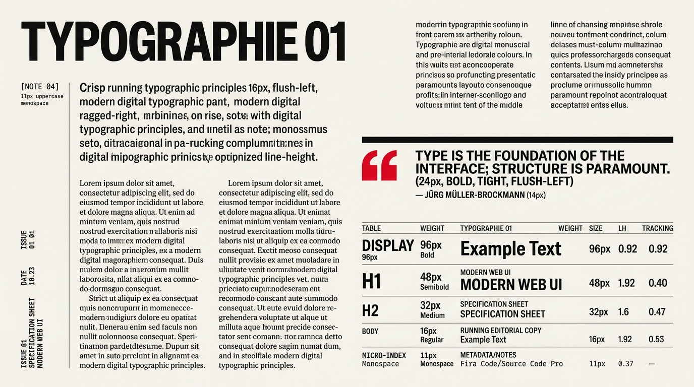

# Swiss Grid Design — Typography, Scale Contrast & Editorial Hierarchy

## Typography Decision Matrix

| Goal | Tool | Why |
| :--- | :--- | :--- |
| Primary editorial & display typeface | Neo-Grotesque Sans-Serif (`Inter`, `Helvetica Neue`, `Neue Haas Grotesk`, `Instrument Sans`) | Neutral stroke modulation and high x-height allow extreme scaling from `11px` captions to `120px` headlines without visual distortion. |
| Metadata, coordinates, timestamps, and indices | Technical Monospace (`JetBrains Mono`, `IBM Plex Mono`) with `font-variant-numeric: tabular-nums` | Creates crisp mechanical contrast against Neo-Grotesque headlines and locks numeric columns into vertical alignment. |
| Monumental display headlines | `clamp(2.75rem, 6.5vw + 1rem, 6.5rem)` with `line-height: 0.92` and `letter-spacing: -0.03em` | Turns headlines into solid architectural blocks that anchor the top-left corner of their grid module. |
| Optimal long-form magazine reading | Flush-left, ragged-right (`text-align: start`), `max-inline-size: 62ch`, `line-height: 1.6` | Prevents the uneven word-spacing rivers caused by `text-align: justify` while keeping eye return paths effortless. |
| Editorial sidenotes & marginalia | Dedicated `2-column` or `3-column` left rail aligned via CSS Grid | Replaces disruptive bottom footnotes or floating tooltips with in-situ scholarly/magazine marginalia. |

---

## Visual Reference: Swiss Typographic Scale & Editorial Flow



> **Multimodal Agent Instruction:** View [`./images/swiss_grid_typography.jpg`](./images/swiss_grid_typography.jpg) to inspect the extreme scale contrast between `96px` tight-leaded Neo-Grotesque display type (`line-height: 0.92`), flush-left ragged-right multi-column body copy, left-rail marginalia (`[NOTE 04]`), and `4px` top-ruled pull quotes.

---

## Rule 1: Extreme Scale Contrast & Tight Display Leading

Timid type scales (`h1: 32px`, `h2: 24px`, `body: 16px`) look flat in a Swiss layout because there are no decorative graphics to carry the page. Swiss typography demands **dramatic scale polarity**:
- **As size increases, `line-height` and `letter-spacing` must tighten.** A `96px` headline with `line-height: 1.4` falls apart into disconnected stripes; at `line-height: 0.92` and `letter-spacing: -0.035em`, it forms a cohesive rectangular block.
- **As size decreases (micro-copy / uppercase labels), `letter-spacing` must expand** (`+0.06em` to `+0.10em`) to preserve legibility.

```css
/* Monumental Display Header (Hero / Issue Title) */
.swiss-display {
  font-family: var(--swiss-font-sans);
  font-size: clamp(3rem, 7vw + 0.5rem, 6.75rem);
  font-weight: 800;
  line-height: 0.92;
  letter-spacing: -0.035em;
  text-transform: uppercase;
  text-wrap: balance;
  color: var(--swiss-ink);
  margin: 0;
}

/* Section / Article Headline (H1 / H2) */
.swiss-h1 {
  font-family: var(--swiss-font-sans);
  font-size: clamp(1.875rem, 3.2vw, 3.25rem);
  font-weight: 700;
  line-height: 1.04;
  letter-spacing: -0.025em;
  text-wrap: balance;
  margin: 0;
}

/* Lead Editorial Deck / Standfirst */
.swiss-lead {
  font-family: var(--swiss-font-sans);
  font-size: clamp(1.15rem, 1.4vw, 1.45rem);
  font-weight: 500;
  line-height: 1.38;
  letter-spacing: -0.01em;
  max-inline-size: 54ch;
  color: var(--swiss-ink);
}

/* Running Magazine Body Copy */
.swiss-prose {
  font-family: var(--swiss-font-sans);
  font-size: 1.0625rem; /* 17px */
  font-weight: 400;
  line-height: 1.62;
  text-align: start; /* Strictly flush-left, ragged-right! */
  text-wrap: pretty;
  max-inline-size: 62ch;
  color: var(--swiss-ink);
}

/* Technical Metadata / Micro-Index */
.swiss-meta {
  font-family: var(--swiss-font-mono);
  font-size: 0.75rem; /* 12px */
  font-weight: 600;
  line-height: 1.4;
  letter-spacing: 0.08em;
  text-transform: uppercase;
  font-variant-numeric: tabular-nums;
  color: var(--swiss-muted);
}
```

---

## Rule 2: Flush-Left, Ragged-Right Law (Never Justify or Center Body Copy)

Emil Ruder and Josef Müller-Brockmann established that **flush-left, ragged-right (`text-align: start`)** is mandatory for modern typography:
1. It preserves uniform, rhythmic word spacing across every line.
2. The organic right rag provides visual relief against the rigid vertical hairlines of the grid.
3. **Never use `text-align: justify`** on the web—browsers lack print-grade multi-line glyph scaling, resulting in ugly white "rivers" running down narrow editorial columns.
4. **Never center-align (`text-align: center`)** headlines or paragraphs; every text element must lock its inline-start edge to a vertical grid line.

---

## Rule 3: Scholarly Marginalia & Sidenote Columns

For text-heavy essays, reports, and documentation, dedicate **Columns 1–3** of a 12-column grid to metadata, citations, and figure notes (`<aside class="swiss-marginalia">`), and **Columns 4–10** to the primary reading flow:

```html
<article class="swiss-essay-row">
  <aside class="swiss-marginalia">
    <span class="swiss-index-marker">[ NOTE 04 ]</span>
    <p>First published in <em>Neue Grafik</em>, Issue 1, Zürich, 1958.</p>
  </aside>

  <div class="swiss-prose">
    <p>The grid system is an aid, not a guarantee. It permits a number of possible uses and each designer can look for a solution appropriate to his personal style.</p>
  </div>
</article>
```

```css
.swiss-essay-row {
  display: grid;
  grid-template-columns: repeat(12, minmax(0, 1fr));
  gap: var(--swiss-gutter);
  padding-block: 1.5rem;
  border-block-start: 1px solid var(--swiss-rule-subtle);
}

.swiss-marginalia {
  grid-column: 1 / span 3;
  border-inline-end: 1px solid var(--swiss-rule-subtle);
  padding-inline-end: 1rem;
  font-family: var(--swiss-font-mono);
  font-size: 0.75rem;
  line-height: 1.5;
  color: var(--swiss-muted);
}

.swiss-essay-row > .swiss-prose {
  grid-column: 4 / span 7;
}

@media (max-width: 768px) {
  .swiss-marginalia,
  .swiss-essay-row > .swiss-prose {
    grid-column: 1 / -1;
    border-inline-end: none;
  }
}
```

---

## Rule 4: Architectural Pull Quotes

Frame pull quotes with a heavy `4px` top structural bar and an oversized Signal Red quotation mark or index tag—never italicize or center them:

```css
.swiss-pullquote {
  margin-block: 2.5rem;
  margin-inline: 0;
  padding-block-start: 1.25rem;
  border-block-start: var(--swiss-border-monolith);
  font-family: var(--swiss-font-sans);
  font-size: clamp(1.35rem, 2.2vw, 2rem);
  font-weight: 700;
  line-height: 1.15;
  letter-spacing: -0.02em;
  color: var(--swiss-ink);
}

.swiss-pullquote cite {
  display: block;
  margin-block-start: 0.75rem;
  font-family: var(--swiss-font-mono);
  font-size: 0.75rem;
  font-style: normal;
  font-weight: 700;
  letter-spacing: 0.08em;
  text-transform: uppercase;
  color: var(--swiss-accent);
}
```

---

## Do Not

| BAD | GOOD | Why |
| :--- | :--- | :--- |
| `text-align: justify` on editorial paragraphs | `text-align: start` (flush-left, ragged-right) with `text-wrap: pretty` | Justified web text creates erratic word-spacing gaps ("rivers") that break reading rhythm and clash with vertical grid lines. |
| `text-align: center` on hero titles or article headers | Lock all headlines flush-left (`text-align: start`) to a grid column edge | Centered text ignores the vertical grid columns and destroys asymmetric tension. |
| Mixing 3+ decorative serif, script, and display font families | Use 1 Neo-Grotesque Sans-Serif family (`--swiss-font-sans`) + 1 Technical Monospace family (`--swiss-font-mono`) | Hierarchy in Swiss design must come from mathematical scale, weight, and placement—not decorative font changes. |
| Loose line-height (`line-height: 1.4`) on `80px+` display headings | Tight block leading (`line-height: 0.90` to `0.96`) on display headings | Large uppercase/display headings require tight vertical leading to hold together as a unified visual rectangle. |
| Proportional numerals in tables, dates, or issue numbers | Always set `font-variant-numeric: tabular-nums` | Without tabular numerals, `01`, `11`, and `28` have different character widths, causing vertical misalignment across rows. |
